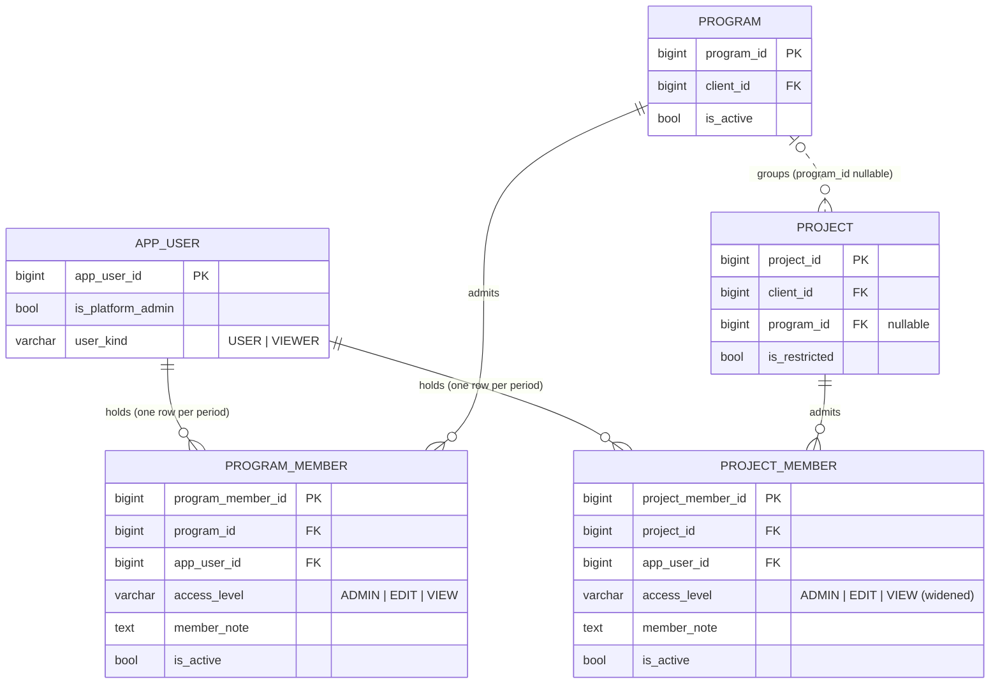

# Project admin and program membership — logical and physical model

> Data model by `apple`, 2026-10-16, for [access_v2_decision.md](access_v2_decision.md). Draft, not built. Where the paper's §8 differs (KIND_CAP / KIND_BASE, one who-can-open function, lock order), the paper wins.

I didn't write any files. I read `services/access.py`, `services/project.py`, `services/program.py`, `models/identity.py`, `models/tenancy.py` and `routers/projects.py`, plus VB_design §4.7, §5.3 (PROJECT_MEMBER, APP_USER), §7.10/7.10a and the constraint grid rows 3521–3525.

### Headline
- **One new table, `program_member`**, built the same way as `project_member`: one row per membership period, a partial unique index on live rows, and a FK guard that keeps a live member pinned to a live program.
- **`project_member.access_level` widens to take ADMIN.** It is `varchar(4)` today, and 'ADMIN' is 5 characters, so the column type has to change too.
- **Effective access is still computed per request.** Nothing is stored per user per project.
- **The biggest risk is not the schema.** Today the `ADMIN` level is shared by every platform-only project route. If memberships can carry ADMIN, those routes open to project admins unless they are moved behind a separate guard first (see section 4).

### 1. ER diagram (changed part only)


### 2. Entities and grain
- **PROGRAM_MEMBER (new).** One row per membership period of one user on one program. Through `project.program_id` it gives that user its level on every live project of the program, restricted ones included.
  - PK: `program_member_id` (surrogate). The natural key is (program, user, period), and a period has no stable natural key, so a surrogate is the right call here.
  - Live UK: `(program_id, app_user_id) WHERE is_active`.
  - FKs: `program_id`, `app_user_id`.
  - Attributes: `access_level`, `member_note`, plus the full audit set.
  - Re-adding someone inserts a new row and never restores the old one. A level change is an in-place UPDATE and is audited. This copies `project_member` exactly.
- **PROJECT_MEMBER (changed).** The grain does not change. The CHECK constraint allows ADMIN. Its meaning also changes: today a membership "matters only while the project is restricted". Under this proposal an **ADMIN membership also matters on an unrestricted project**, because open staff only get EDIT. VB_design §5.3 needs that sentence rewritten.
- **Why not one polymorphic table** (`project_id` XOR `program_id`, the shape of the retired `user_access_grant`)? Two tables give each scope its own declarative FK and its own live-scope guard, with no nullable FKs and no XOR CHECK. **Do not revive `user_access_grant`.** It is SELECT-only history and holds a single grant per user.
- **Values that are derived, never stored:** effective level, "why" (the source of access) and the user's kind cap. Under VB law 6 none of these may come in a request body.

### 3. How effective access is computed (`access.access_to`, still the only owner)
```
platform admin                      -> PLATFORM (above ADMIN; see section 4)
project missing or retired          -> None (404)
sources = []
  project unrestricted              -> KIND_BASE[kind]   USER: EDIT, VIEWER: VIEW   (via STAFF)
  live project_member               -> pm.access_level                              (via MEMBER)
  live program_member on p.program_id
      (program live)                -> gm.access_level                              (via PROGRAM)
no sources                          -> None (404)
level = min(KIND_CAP[kind], max(sources))   KIND_CAP: USER: ADMIN, VIEWER: VIEW
```
- **The answer to "max of direct and program, capped by kind?" is yes**, but with one change: today's single `KIND_CAP` splits in two.
  - `KIND_BASE` is what open staff get.
  - `KIND_CAP` is the ceiling any membership can lift a user to.
  - Without the split, USER caps at EDIT and nobody can ever reach ADMIN.
- **A VIEWER at ADMIN should be refused when it is written** (422). Restricting ADMIN to FTC staff of kind USER cannot be enforced declaratively, because `user_kind` lives on another table. The service refuses it, and the read-time cap is the fail-closed backstop: a USER later demoted to VIEWER drops to VIEW on their next request.
- **When a future CLIENT_VIEWER is added (D-43)**, it gets cap VIEW and is refused any membership above VIEW.
- **`EffectiveAccess.via` should carry the winning source** (STAFF, MEMBER or PROGRAM). The Access screen needs it to show "via program X".
- **`visible_project_ids`** becomes: open projects, plus restricted projects with a live direct membership, plus restricted projects whose live program has a live `program_member` for the user. It stays one function. `test_no_get_route_leaks_a_restricted_project` needs program-member variants: a member of program A must not see a restricted project in program B.
- **`require_program` / `visible_program_ids`** also include programs where the user has a live `program_member`. Otherwise a program admin cannot open an empty program. Program level comes **only** from platform admin or a live `program_member` (capped by kind) — never from staff base (design-auditor H2; the paper wins). Roll-ups keep calling `require_project` per project (R2-S2), which is unchanged.

### 4. The guard split: settle this before the schema
`routers/projects.py` puts all of these on `_proj_admin = project_ctx("ADMIN")`:
- components
- data-model depth
- FTE basis
- DFD rule (preview and set)
- restriction
- the access list
- members, plus `_member_admin`

Today that is safe only because "only a platform admin reaches ADMIN".

**Proposal:** add a fourth rank, `PLATFORM` (rank 4). It is never a membership value and is only ever held by a platform admin. Then:
- Components, depth, FTE basis, DFD rule and restriction move to `project_ctx("PLATFORM")`.
- Members, the access list and the project's own lists stay on `ADMIN`.

This must land **in the same change** as the CHECK widening, or the first ADMIN row silently grants all of the above. The rest of the platform-only work is already gated in services (`components.py:396`, `effort.py:73`, `br_lines.py:133` check `is_platform_admin` directly), but the routes above are not. "Its own lists" depends on the Wave 1g code-list spec (Q-32..Q-36), which decides which guard project list overrides use.

### 5. Project moves and program retirement
- **A project move now changes access.** `move_project_program` hard-codes `gains: [], loses: []` (R2-S3, "a move changes roll-ups, not access"). That stops being true.
  - The preview must compute who loses or gains access, and who changes level, from the old and new program's live members. It has to put them inside the hash.
  - The confirm step should lock both program rows (in id order) as well as the project.
  - Program member writes should take `FOR SHARE` on the program row, the same as `_share_lock` does on the project today.
  - Moving stays **platform admin only** (Q10). If a program admin could move a project into their own program, they would grant themselves access to a restricted project. That is the escalation path to close.
- **Creating a project inside a program now grants access at once.** A restricted project created in a program is immediately visible to that program's members, so "a restricted project starts with no members" (D-62) no longer means "nobody sees it". The create preview or audit should name the program members it admits.
- **Program retire:** follow VB law 1 (nothing cascades) and treat it like project retire. A live `program_member` **blocks** the retire, with a 409 naming the members. This works through the generated `program_is_active` column plus a FK to `program(program_id, is_active)`; `uq_program_live` already exists as the target. Removing the members first is a deliberate, audited step. A retired program is already blocked from having live projects (`fk_project_program_live`), so derived access cannot outlive the program.
- **Set restriction:** its preview "keeps" must include program-derived members, or the hash misses them. `effective_access` must list program members with their source.

### 6. Physical (PostgreSQL), two migrations, one per commit
**A — widen project_member** (`project_member` is not shadowed, so the no-ALTER-on-shadow-type rule does not apply):
```sql
ALTER TABLE project_member ALTER COLUMN access_level TYPE varchar(5);   -- length increase: catalog-only, no rewrite
ALTER TABLE project_member DROP CONSTRAINT ck_pm_level;
ALTER TABLE project_member ADD CONSTRAINT ck_pm_level CHECK (access_level IN ('ADMIN','EDIT','VIEW'));
```
Down: **refuse (raise) if any row, live or retired, has 'ADMIN'**. Narrowing it back would mean rewriting or deleting membership history, which is destructive and pauses for Ben.

**B — create program_member:**
```sql
CREATE TABLE program_member (
    program_member_id  bigint GENERATED ALWAYS AS IDENTITY PRIMARY KEY,
    program_id         bigint NOT NULL REFERENCES program(program_id),
    program_is_active  boolean GENERATED ALWAYS AS (CASE WHEN is_active THEN TRUE END) STORED,
    app_user_id        bigint NOT NULL REFERENCES app_user(app_user_id),
    access_level       varchar(5) NOT NULL CONSTRAINT ck_prgm_level CHECK (access_level IN ('ADMIN','EDIT','VIEW')),
    member_note        text CONSTRAINT ck_prgm_note_not_blank CHECK (member_note IS NULL OR btrim(member_note) <> ''),
    -- + vb_ops.audit_columns(): is_active, created_at/by, updated_at/by, deleted_at/by, row_version
    CONSTRAINT fk_prgm_live_program FOREIGN KEY (program_id, program_is_active)
        REFERENCES program(program_id, is_active) ON UPDATE NO ACTION
);
CREATE UNIQUE INDEX uq_prgm_live ON program_member (program_id, app_user_id) WHERE is_active;
CREATE INDEX ix_prgm_user_live ON program_member (app_user_id) WHERE is_active;
-- fn_set_updated_at() trigger; GRANT SELECT, INSERT, UPDATE ON program_member TO vb_app (no DELETE)
```
- **Down for B:** dropping the table destroys membership history once it has rows. The down step should refuse when rows exist; forcing it is destructive and pauses for Ben.
- **Housekeeping:**
  - Add `ProgramMember` to `models/__init__.py` with `owning_project_id() -> None`, so `object_guard` falls to admin-only. Better: add a program-scoped object guard, so program ADMIN can PATCH or DELETE `/program-members/{id}`.
  - Keep it off the freeze set, the shadows, the restore allow-list (memberships are excluded under R2-S5) and the `step_retire` lists, since it points at neither a step nor a BR.
  - `access_level` stays CHECK-listed rather than in `code_master`, following the `ck_pm_level` precedent: it is a closed set that the code ranks in `LEVEL_RANK`.
- **No data migration.** No existing row changes meaning, and both migrations are additive. This must go on `main` in order.

### 7. Normalization and integrity risks
1. **3NF holds.** The kind cap stays on `app_user`; the effective level and the program-to-project link are derived through `project.program_id`, not copied. The derivation is deliberately transitive, so a move re-derives access with no rows to fix. The price is that a move is now a permissions event (section 5).
2. **There is no declarative guard that ADMIN is held only by kind USER.** It crosses tables. The service refuses it and the read-time cap backstops it. A trigger is possible but I don't recommend it.
3. **Two overlapping sources of access.** Removing someone's direct project membership does not revoke access they hold through the program. The Access screen and the remove preview must show "still has access via program X", or project admins will believe they revoked it.
4. **Level changes are not rows.** History within a period lives only in `audit_event`. That table has `project_id` but no `program_id`, so program events can only be filtered through `detail` JSONB. Optionally add a nullable `program_id` to `audit_event`; that is additive.
5. **Platform admins still get no membership rows.** Keep the 422 on both tables.
6. **Risk grade 1 (permissions).** Mutation proof is justified for `access_to`, `visible_project_ids`, the guard split and the move preview.

### 8. Questions for Ben, highest value first
1. Can a project admin grant ADMIN to someone else, or only EDIT and VIEW? Same question for a program admin.
2. Can a project admin restrict or unrestrict the project? I modelled it as platform-only (section 4).
3. A VIEWER given ADMIN: refuse it (my recommendation), or silently cap it to VIEW?
4. Program retire with live members: block it with a 409 (my recommendation, per law 1), or have the retire service remove them in one audited step?

### Spec impact (for the history-then-spec commit)
This reverses part of D-40 ("programs grant nothing") and the claim that only platform admins reach ADMIN. It touches §4.7, §4.14, §5.3 (PROJECT_MEMBER, APP_USER levels), §5.4.11, §7.10/7.10a (`move_project_program`, `effective_access`, `add_member`), constraint grid rows 3522–3524, the API table rows for `/programs` and `/projects`, and criteria 140, 150 and 153, which were retired along with program grants.