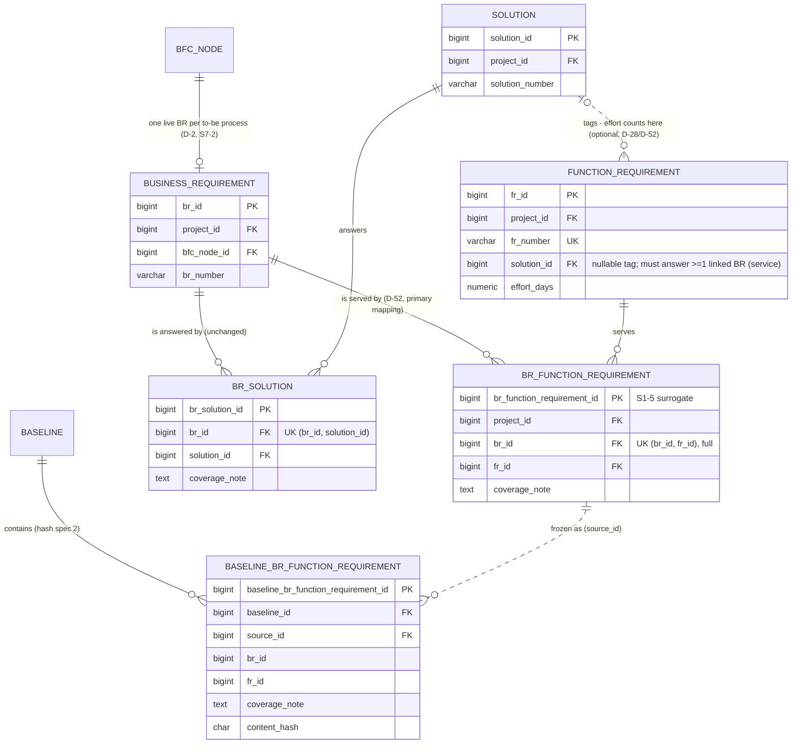

# Slice 10b — BR ↔ FR direct link (D-52): physical schema spec

Author: `apple` · 2026-10-12 · source of truth: `docs/VB_design.md`, with the §1a rows winning over older text.
In particular, **D-52 (2026-10-12) overrides D-7's "FR hangs off a Solution; `FR_BR` deleted; BR→FR derived"**
and the §5.4.3 D-7 override box, and reinstates `apple`'s original §5.4.3 M:N recommendation. D-28
(`solution_id` nullable) stands. This spec **does not redesign** beyond D-52. Where D-52 is silent once it is
made physical, the spec shows a **proposed** choice marked **[Q-n]**, and §10 lists each one for Ben. Do not
build a [Q-n] until Ben has answered it.

Scope: the new junction `br_function_requirement`, its shadow, the backfill from today's derived paths, the
fate of D-34 `suggested_br_id`, and every read that changes. Sources: D-7, D-28, D-34, D-37, D-52; §4.3, §4.4,
§5.3 FUNCTION_REQUIREMENT / BR_SOLUTION, §5.4.3, §5.4.15; S1-5, S1-7, S3-SR, S5-1, S5-3, S5-5, S6a-1, S6a-5,
S6b-3, S8-1; `docs/slice5_schema.md`, `docs/slice6a_schema.md`, `docs/slice8_schema.md`.
Dialect: **PostgreSQL 16**, with the house conventions of Slices 1–8:
- a surrogate identity PK;
- `(id, project_id)` composite FKs onto a `uq_<t>_project` UK;
- `AuditMixin` / `vb_ops.audit_columns()`, plus `updated_at_trigger()`;
- every FK is `NO ACTION`, and partial or expression indexes go in raw `op.execute`.

**Facts checked against the code (2026-10-12, head `0048`):**
- **`function_requirement.suggested_br_id` was never built.** S6a-1 deferred it to the FR import, and the FR
  import is not built either (`services/bulk.py` has no FR target). The column, its FK, `EXCLUDED_FKS` and
  the clearing hook do not exist. Only `baseline_shadow.SHADOW_EXCLUDED`, a tripwire test and the
  `# D-34 hook` comment in `services/solution.link` mention it. So D-34 can be retired **without dropping
  anything** (§3.3).
- `v_br_function_requirement` (0024) is `br_solution ⋈ solution ⋈ function_requirement`, all live.
  `v_interface_list` (0030) reads it for `br_numbers`.
- `br_coverage_report`, `fr_traceability_matrix`, `fr_unlinked`, `analyse_cr_impact` and `solution_matrix`
  are **not built yet**. §6 gives the source they must read when they are.
- **Latent defect found while specifying the shadow (§5.3):** `freeze_set.digest()` builds its string from
  **every** entity in `FREEZE_SET`. So adding any entity changes the recomputed digest of every existing
  baseline, and `baseline.verify()` then reports all of them as failing their integrity check. Slice 8 §4's
  rule "a new entity joins the set without a spec bump" cannot work as built. This slice fixes it [Q-14].

---

## 1. `br_function_requirement` — one row per (BR × FR) pairing in one project (D-52)

**Grain:** one row per pairing of one business requirement with one function requirement it is served by,
within one project. M:N: one FORM serves several BRs, and one BR needs a FORM plus a BATCH plus an INTERFACE
(§5.4.3). **The solution is not in the grain.** D-52 stores the solution once, on the FR (`solution_id`), so
an FR's effort counts to exactly one solution, however many BRs it serves.

The name follows the BR-junction family (`br_data_entity`, `br_org_role`, `br_solution`) and the view name
already in use. The abbreviation is `brfr` [Q-1].

| Column | Type | Null | Default | FK | Description |
|---|---|---|---|---|---|
| `br_function_requirement_id` | bigint identity | NO | identity | — | PK (S1-5 surrogate) |
| `project_id` | bigint | NO | — | → `project`, and in both composites | copied from the BR by the service, never from the body |
| `br_id` | bigint | NO | — | composite | |
| `fr_id` | bigint | NO | — | composite | |
| `coverage_note` | text | YES | — | — | "this FR covers only the validation half of BR-0042" (§5.4.3). Edited in place, S5-3 pattern [Q-1] |
| + `AuditMixin` | | | | | `created_*`, `updated_*`, `is_active`, `deleted_*`, `row_version` (law 3); `updated_at` from `fn_set_updated_at()` |

**Keys and FKs** (all `NO ACTION`)
- PK `br_function_requirement_id`.
- UK `uq_brfr_grain (br_id, fr_id)`, **full, not partial** [Q-2]. This is the design's §5.4.3 key `(fr_id, br_id)`,
  kept as a `UNIQUE NOT NULL` key beside the surrogate (S1-5, S5-5).
- `fk_brfr_br (br_id, project_id) → business_requirement (br_id, project_id)` uses `uq_br_project` (0011).
- `fk_brfr_fr (fr_id, project_id) → function_requirement (fr_id, project_id)` uses `uq_fr_project` (0023).
- `project_id → project (project_id)`, unnamed, as on every table.
- Together, the two composites make a cross-project pairing **impossible in the database** (§6.2, "all
  junctions").

**Why the full UK, and restore-before-insert, rather than a partial live-only unique.** This is exactly
`br_solution`'s shape (slice5 §2):
- **The shadow needs a single key.** `baseline_shadow.shadow_table()` records the live PK as `source_id`.
- **Relinking restores the old row.** `lifecycle.unlink` soft-deletes the pair. Linking the same pair again
  finds the dead row through the full UK and calls `lifecycle.relink` (S1-7), so the pair keeps **one id**
  across unlink and relink, and a baseline diff sees the same `source_id` (an unlink then relink between two
  freezes is no change, not REMOVED + ADDED).
- **A partial UK would let dead duplicates pile up** and break that identity. Partial live-only uniques are
  the house rule for *user-typed names* (S1-6), not for link grains.

**CHECKs:** none row-local. The BR carries the D-23 process guard and the S7-2 to-be guard, so a link can
only reach a to-be process's BR by construction. The FR needs no guard.

**Indexes**
- `uq_brfr_grain` (leading `br_id`) serves `fk_brfr_br`, "FRs serving this BR" (the BR panel), and the
  step-retire owned-set scan.
- `ix_brfr_fr (fr_id, project_id)` serves the reverse FK, "BRs this FR serves", the FK_LIVENESS scan when an
  FR retires, the untraced-FR anti-join (§6) and `v_interface_list.br_numbers`.
- `ix_brfr_project (project_id)` follows the sibling junctions. It serves the coverage reports, the freeze
  `live_select` and `purge_project`.

**Model:** `BrFunctionRequirement(AuditMixin, Base)` in `models/function_requirement.py`, exported from
`models/__init__.py` (law 10). It has view-only `br_row` / `fr_row` relationships for the two-ended label,
and `owning_project_id()`. `lifecycle.LABELS` gains
`"br_function_requirement": ("Requirement ↔ function requirement", "BR-0042 ↔ FR-0007")`, so a 409 on
either end names the other (DR1-P1).

### 1.1 What stays on `function_requirement`

Nothing is added, altered or dropped there. **`solution_id` (nullable, D-28) is the solution tag** D-52
describes: stored once per FR and FK-verified in-project by `fk_fr_solution`. Its meaning narrows from "the
FR's only path to a BR" to "the one solution this FR's effort counts toward". Its shadow column and its place
in the FR `content_hash` are unchanged, so no shadow type is touched (DR8-D1).

### 1.2 Service contract (for the spec)

Every route is on the BR screen, under `/business-requirements/{id}/function-requirements`. The guard on each
is `object_guard(BusinessRequirement, …)` with the component in §4.1.

| Route | What it does |
|---|---|
| `GET …` | the BR's live links, one row per link: link id, `row_version`, `coverage_note`; FR number, name, type; FR `row_version`; the FR's tag (`solution_id/number/name`, may be NULL); **`tag_answers_this_br`** (the tag is a live `BR_SOLUTION` of this BR) |
| `POST …` `{fr_id, coverage_note}` | link. **Lock order (SR-5 extended):** step FOR SHARE → BR FOR SHARE → FR FOR SHARE, then the liveness checks, then the link row by the full UK FOR UPDATE. If there is no row: insert. If the row is live: 409 "already linked". If the row is dead: relink and set the note. The FR is fetched scoped to the BR's project first (404, DR1-S1 pattern) |
| `PATCH …/{link_id}` `{row_version, coverage_note}` | the note, in place. The previous note goes to the audit detail (S5-3) |
| `DELETE …/{link_id}?row_version=` | `lifecycle.unlink` |
| `PUT …/{link_id}/solution` `{solution_id \| null, fr_row_version}` | **sets the FR's tag from this BR's row** (§2). It writes `function_requirement` with the FR's `row_version` (409 if stale). The `RECORD_UPDATED` audit carries `previous_solution_number`, as `update_fr` does today |
| `POST /projects/{id}/function-requirements` `{…, br_id}` | create an FR and link it in one transaction [Q-20] |

---

## 2. Integrity between the FR's solution tag and its BR links

### 2.1 The rule recommended [Q-3]

> **An FR's solution tag must answer at least one of the BRs the FR serves.** If the FR has one or more live
> BR links, `solution_id` is NULL or is the solution of a live `BR_SOLUTION` of **at least one** of those BRs.
> An FR with **no** BR link may carry any live solution of its project (D-28 discovery case), with a `no_br`
> warning.

On the BR screen the rule is stricter, because the user is acting on one BR:
- **The picker on a BR's FR row offers only that BR's live solutions, plus "none".**
- `PUT …/{link_id}/solution` refuses with **422** any solution that is not a live `BR_SOLUTION` of *this* BR:
  "SOL-0003 does not answer BR-0042. Add it to this requirement's solutions first."
- The UI places that action ("Add SOL-0003 to this requirement") beside the message, on the same screen.
  **The server never creates a `BR_SOLUTION` as a side effect** [Q-5]. A BR_SOLUTION is a scope statement
  with its own coverage note, and it must be made on purpose.
- `PATCH /function-requirements/{id}` with `solution_id` (the FR register) applies the "at least one" form.

**Why "at least one", not "every".** BR-A may be answered by SOL-3 while BR-B is mapped straight to the FR
with no solution at all, which is the D-52 "skip solutions" case. Under "every", one FR serving those two
BRs could never carry a tag. **Why not "none" (tag independent of the links).** Effort would then count
toward a solution that answers none of the requirements the FR serves, and the BR → Solution → FR
traceability the client reads would disagree with the effort roll-up.

### 2.2 Drift: warn, never block, never cascade [Q-4]

Five later actions can leave a tag outside its FR's BRs:
1. unlinking the `BR_SOLUTION`;
2. unlinking the BR–FR link that was the tag's last answering BR;
3. linking an already-tagged FR, that had no links, to a BR the tag does not answer;
4. retiring the BR's step, which takes that BR's `BR_SOLUTION` and links with it;
5. restoring an FR (its tag comes back as it was).

**None of them is refused, and none clears the tag.**
- **Refusing them would bring back the friction S3-SR removed.** In particular, a step retire would block on
  another object's column.
- **Clearing the tag silently would be a hidden write** to a hashed scope column on a different object, and
  it would move effort between solutions without anyone deciding to.

Instead:
- **The response names the FRs it affected:** `warnings: [{"code": "fr_solution_outside_its_brs",
  "frs": ["FR-0007"]}]`. The UI offers "Clear FR-0007's solution" or "Add SOL-0003 to BR-0042", each an
  explicit call.
- For case 3, the POST response carries the same warning. The link is made and the tag stays [Q-6].
- **Proof line** `consistency_check.fr_solution_outside_its_brs`: live FRs with at least one live link whose
  tag is not a live `BR_SOLUTION` of any of them. It is a **warning**: shown on the control panel and in the
  freeze preview's warnings, **not freeze-blocking**. That matches D-28's "flag, don't refuse" for
  traceability gaps.

### 2.3 DB-enforced vs service-enforced

| Rule | Where | How |
|---|---|---|
| Link and tag stay in one project | **DB** | `fk_brfr_br`, `fk_brfr_fr`, `fk_fr_solution` composites |
| One row per pair, forever (relink restores) | **DB** | `uq_brfr_grain` (full) |
| A to-be process BR only | **DB** | the BR's own D-23 / S7-2 guards |
| No live link under a retired BR or FR | **service** + proof | FK_LIVENESS derives both FKs (no code); `consistency_check.brfr_under_inactive`, freeze-blocking like `brsol_under_inactive` |
| Tag answers ≥1 of the FR's BRs (on write) | **service** | `function_requirement.set_solution`, shared by both routes. The tag reads two other tables, so it cannot be a CHECK, and the house writes no business triggers |
| Tag drift after the write | **warning** | `fr_solution_outside_its_brs` (§2.2) |

**Lock order for the tag write** (which serialises with a `BR_SOLUTION` unlink): step FOR SHARE → BR FOR
SHARE → FR **FOR UPDATE** (`lifecycle.lock`, as `update_fr` does) → solution FOR SHARE → the
`br_solution (br_id, solution_id)` row FOR SHARE, then check it is live. `solution.unlink` already locks that
row FOR UPDATE, so the two cannot interleave.

---

## 3. Backfill and the cut-over

### 3.1 Live paths: every live mapping becomes a stored link [Q-7]

In one migration (§9, rev 0051), as `vb_owner`:

```sql
INSERT INTO br_function_requirement (project_id, br_id, fr_id, coverage_note, created_by)
SELECT bs.project_id, bs.br_id, fr.fr_id, NULL, bs.created_by
FROM   br_solution bs
JOIN   solution s              ON s.solution_id = bs.solution_id
JOIN   function_requirement fr ON fr.solution_id = bs.solution_id
JOIN   business_requirement br ON br.br_id = bs.br_id
WHERE  bs.is_active AND s.is_active AND fr.is_active AND br.is_active;
```

- **This is exactly the row set `v_br_function_requirement` returns today**, so no mapping is lost and none
  is invented. The migration asserts that: the count inserted equals the old view's count, read first.
- **No duplicates are possible.** An FR has one solution, and `uq_brsol_grain` makes `(br, solution)`
  unique, so each `(br, fr)` arises once.
- **Every FR keeps its `solution_id`**, so effort by solution is unchanged to the cent.
- `created_by = bs.created_by`. The person who said "BR answered by SOL" asserted the mapping. This follows
  the 0037 precedent (`granted_by_user_id`).
- `coverage_note` is NULL: the BR_SOLUTION note describes the BR ↔ Solution pairing, not this one, and
  machine text must not enter a hashed client-facing note.
- **Provenance:** one `audit_event` per project, `event_type = 'BR_FR_BACKFILLED'` (D-52),
  `app_user_id NULL`, with detail `{count, link_ids}`.
- D-28 FRs that have a solution but no `BR_SOLUTION` get no link. They were untraced before and stay
  untraced.

### 3.2 Paths retired with a step: kept restorable [Q-8]

A step retired before 10b took its `br_solution` rows with it (S5-1). Its audit event lists them, and a
step restore would bring back the derived BR→FR mapping. After 10b the derived path is no longer the
mapping, and the event (append-only, landmine 2) cannot be amended to list links.
- **Backfill:** for each `br_solution` row that is retired with a deleted_at equal to the `deleted_at` of a
  `STEP_RETIRED_WITH_DEPENDENTS` event that lists it, insert a **retired** link for each *live* FR tagged
  with that solution. The link's `deleted_at` / `deleted_by` are copied from the `br_solution` row.
- **`step_retire.restore`:** after loading the event's rows, also load the BR's `br_function_requirement`
  rows whose `deleted_at` equals the event stamp. This uses the same proof restore already relies on. For a
  post-10b retire those rows are already in the event list, so the extra read finds nothing new.
- Pairings the user unlinked by hand are **not** backfilled. Those derived mappings died by decision.

### 3.3 Retired FRs: not backfilled [Q-9]

A retired FR has no live mapping to preserve, and its restore brings back its tag. If that FR has no link, it
comes back **untraced**, with the `no_br` warning, and is relinked from the BR screen.

### 3.4 The view swaps in the same migration

The same migration (0051) replaces `v_br_function_requirement` (§6.1), so the view never reads a half-filled
table, and every reader switches at once.

### 3.5 D-34 `suggested_br_id`: retired, nothing to drop [Q-10]

D-34 existed because there was no way to store "this FR serves BR-0012" without a solution. **D-52 stores
exactly that.** An FR import row that names BR numbers will create links (the import's `apply`), not hints.
Because the column was never built:
- **no migration, no drop, nothing destructive, no shadow type touched;**
- remove `SHADOW_EXCLUDED["function_requirement"]` from `baseline_shadow.py`, and
  `test_suggested_br_id_never_arrives_without_its_exclusions`;
- remove the `# D-34 hook` comment from `services/solution.link`;
- the design's D-34, R2-D16, A-50 and S6a-1 rows, the §5.3 bullet, the §6.2/§6.3 lines, §7.5's `path_exists`
  pseudocode and criteria 133–134 are marked **superseded by D-52** when the slice spec is written.
  Criterion 134 ("no import creates a SOLUTION") still holds.

### 3.6 Reversibility

| Rev | Upgrade | Downgrade |
|---|---|---|
| 0049 | create `br_function_requirement` | **refuses** if any row exists that the backfill did not insert, or any row has `row_version > 1`. Otherwise drops the trigger, then the table |
| 0050 | create `baseline_br_function_requirement` + immutable guards | **refuses** if the shadow holds any row (frozen evidence, law 2). Otherwise drops the guards, then the table |
| 0051 | backfill + replace the view | restores the 0024 view body. The backfilled rows are left in place (0049's downgrade removes them), so the downgrade never hard-deletes on its own |

Every upgrade is additive. **No downgrade destroys data written after the migration; it refuses instead** [Q-21].
Nothing here pauses for Ben under law 10: no column is dropped, no type is altered, and no live row is deleted.

---

## 4. Components, step retire, and soft delete of either end

### 4.1 Component gating [Q-11]

| Write | Component(s) | Why |
|---|---|---|
| link, note, unlink (`POST/PATCH/DELETE …/function-requirements`) | **`FUNCTION_REQUIREMENT`** | the link is FR scope. A BR always exists. **It does not need `SOLUTION`**: this is what lets a requirements + FR project with `SOLUTION` off map BR → FR at all. Before D-52 it could not |
| tag (`PUT …/{link_id}/solution`, FR PATCH with `solution_id`) | `FUNCTION_REQUIREMENT` **and** `SOLUTION` | as today (the route's `require_on(… "SOLUTION")`). Clearing to NULL needs only `FUNCTION_REQUIREMENT` |

- `components.ROW_COMPONENTS[BrFunctionRequirement] = ("FUNCTION_REQUIREMENT",)`, so a step restore that
  brings links back needs FR on (DR7-P2).
- `COMPONENT_ROWS["FUNCTION_REQUIREMENT"]` is unchanged. A live link implies a live FR (proved by
  `brfr_under_inactive`), so the FR probe already blocks switching FR off.
- Criterion 49b: the new write routes appear in `ROUTE_COMPONENTS` with the codes above.

### 4.2 Step retire: the link is owned by the BR [Q-12]

`BrFunctionRequirement` **joins `step_retire.OWNED_BY_BR`**, in **tier 2** beside `BrSolution`. It has no
licence FK, so any tier before `BusinessRequirement` works. `describe()` renders it as
`FR-0007 <fr_name>`. It follows S5-1's reasoning:
- **The pairing is a fact about the requirement.** The FR is not owned and survives.
- **Blocking would make the consultant unlink every FR by hand** before retiring a step, and the undo would
  not bring them back.
- **Restore stays all or nothing (A-SR-5).** If an FR was retired meanwhile (possible, because the links
  were already retired), `inactive_parents` refuses with "Restore these first: FR-0007".

The step-retire preview lists the links in `owned`. FRs whose tag will fall outside their BRs (§2.2 case 4)
are listed as information, outside `confirm_hash`.

### 4.3 Soft delete of either end

| Case | Behaviour |
|---|---|
| Retire a **BR** on its own (plain route) with live links | 409 via `fk_brfr_br` (FK_LIVENESS), naming the FRs. Same as `br_solution` |
| Retire an **FR** with live links | **409, naming the BRs** [Q-13]. This is what FK_LIVENESS gives with no code, and it is the S6b-3 precedent (an FR with live interface detail is refused). Unlinking from the BR screen is the deliberate scope act |
| Retire a **solution** | unchanged. It is refused while live FRs are tagged with it or live `br_solution` rows exist |
| Restore a BR / FR | links do not come back by themselves (they were never retired with a plain retire, since a live link blocks one). A step restore brings them back (§4.2) |
| Restore a link | through relink only. `BrFunctionRequirement` is not in `RESTORABLE`, as for every sibling junction |

---

## 5. Baseline

### 5.1 Shadow

`baseline_br_function_requirement` is **generated by `baseline_shadow.shadow_table()`**. Because 0048 froze
the shadows as literal DDL, rev 0050 writes the DDL the generator produces, and the parity test in
`tests/test_baseline.py` checks it against the database.

| Column | Type | Note |
|---|---|---|
| `baseline_br_function_requirement_id` | bigint identity | PK |
| `baseline_id` | bigint NOT NULL | `fk_baseline_br_function_requirement_baseline` |
| `source_id` | bigint NOT NULL | = `br_function_requirement_id`; `fk_…_source` NO ACTION |
| `project_id` | bigint | copied, never hashed |
| `br_id`, `fr_id` | bigint | source ids, resolved inside the same side for labels |
| `coverage_note` | text | |
| `content_hash` | char(64) NOT NULL | |

It gets `uq_baseline_br_function_requirement_source (baseline_id, source_id)`, `ix_…_source`, and
`vb_ops.immutable_guards()`: the reject trigger, the insert guard and the revoked UPDATE.

### 5.2 `FREEZE_SET`, gate, hash, `SHADOWED`

- `models/baseline.SHADOWED` gains `"br_function_requirement"` **immediately after `"function_requirement"`**
  (FK order). `FREEZE_SET` gains the matching entry in the same position (the module asserts that the two
  agree):
  `_e("br_function_requirement", "FR", ("br_id", "fr_id", "coverage_note"), refs=(("br_id", BR), ("fr_id", FR)))`,
  registered under **hash spec 2** (§5.3).
- **Hashed columns:** `br_id`, `fr_id`, `coverage_note` [Q-15]. This mirrors `br_solution`. No position
  columns, and no code pairs.
- **Area `FR`.** The diff shows it under function requirements, labelled `BR-0042 ↔ FR-0007` (a link reads
  by its ends).
- **Gate:** `components.FREEZE_GATES["br_function_requirement"] = Gate(all_of={"FUNCTION_REQUIREMENT"})`.
- **The FR entity's hash is unchanged.** `solution_id` stays hashed: moving an FR's effort to another
  solution is a scope change, and it shows as FR CHANGED.

### 5.3 The spec bump, and the integrity defect it fixes [Q-14]

**The defect.** `digest()` joins `f"{table}={agg}"` for every entity in `FREEZE_SET`. With
`br_function_requirement` added, an existing baseline's recomputed digest gains a line
`br_function_requirement=`. That no longer equals its stored `content_digest`, so `verify()` fails and
`require_intact` returns 409 for **every baseline frozen before 10b**. The same would happen for any future
entity (issue, benefit, phase).

**The fix, recommended:**
- `CURRENT_HASH_SPEC = 2`. The new entity's `hash_columns = {2: (…)}`. No other entity's list changes, so
  `columns_for` gives the same list at v1 and v2, and **no `SCHEMA_VERSION_MISMATCH` appears anywhere**.
- `digest(…, baseline_id)` and `rehash_mismatches` **skip entities with `columns_for(e, b.hash_spec_version)
  is None`**. The live digest at freeze uses `CURRENT_HASH_SPEC`. A v1 baseline's digest is then
  byte-identical to what was stored.
- Amend slice8 §4's rule: **"a new entity joining the set bumps the spec and registers its list under the new
  version."** The bump is the per-baseline marker that says the entity was not in the set when that baseline
  froze.

**The diff from a pre-10b baseline (v1) to live or to a v2 baseline.** Without care, every backfilled link
shows as ADDED, and none of them is a real change. Recommended:
- For a side whose spec predates the entity, the diff **derives** that side's links from its own frozen
  `baseline_br_solution` ⋈ `baseline_function_requirement` (the §3.1 rule applied to frozen rows).
- It then matches the two sides on **`(br_id, fr_id)`** instead of `source_id`.
- A pair present on both sides is no change. A pair only in the newer side is ADDED; only in the older side,
  REMOVED.
- The entity's entry carries `"derived_side": "a"`, so the screen can say "v1.0 predates direct links; its
  links are derived from its solutions".
- This is one branch in `baseline.diff`, keyed on `columns_for(e, va) is None and e.table ==
  "br_function_requirement"`. The cost is small and the alternative is a wall of false changes on the first
  diff every client sees after 10b.

---

## 6. Every read that changes

| # | Read | Today's source | New source |
|---|---|---|---|
| 6.1 | **`v_br_function_requirement`** | `br_solution ⋈ solution ⋈ function_requirement`, all live | **the direct link only** [Q-16]: `br_function_requirement l JOIN function_requirement fr` (both live, BR live), `LEFT JOIN solution s ON s.solution_id = fr.solution_id AND s.is_active`. It keeps the existing columns in order (`project_id, br_id, fr_id, fr_number, fr_type_code_id, fr_type_behaviour, solution_id, solution_category_code_id`; `solution_id` is now the FR's tag and may be NULL) and **appends** `br_function_requirement_id`, `coverage_note`, `tag_answers_br boolean` (an EXISTS on a live `br_solution` for `(l.br_id, fr.solution_id)`). `CREATE OR REPLACE VIEW` accepts appended columns, so `v_interface_list` needs no rebuild. `security_invoker` and the REVOKE stay. **A derived-only path (BR_SOLUTION → SOL → FR with no link) is no longer a mapping**; see 6.6 for the informational line |
| 6.2 | `GET /business-requirements/{id}/function-requirements` (`frs_of_br`, `BrFrOut`) | the view, one row per (FR, solution), solution NOT NULL | the view, one row **per link**, with the §1.2 fields. `BrFrOut.solution_*` become nullable; it adds `br_function_requirement_id`, `row_version`, `coverage_note`, `fr_row_version`, `tag_answers_this_br` |
| 6.3 | `v_interface_list.br_numbers` ("BR(s)" column) | reads the view | **unchanged SQL**, which now reads direct links. An interface FR mapped with no solution now shows its BRs (before: none) |
| 6.4 | `effort.summary` by solution | `fr.solution_id`; `None` key = Unassigned | **unchanged.** It is stored once on the FR, so it is never double-counted. **UNASSIGNED** = `solution_id IS NULL` and will grow under D-52 (FRs mapped straight to BRs); that is correct. `rejected` is unchanged (S6c-8). **Add an `untraced` informational line** (live FRs with no live link: count, days) [Q-18]. **No additive "effort by BR"**: an FR serving three BRs would count three times. If ever shown, it is labelled "effort touching this BR", never summed |
| 6.5 | `baseline.priced` / `_exposed` | `lines[].unlinked = solution_id IS NULL`; exposed walks BR → br_solution → FR and needs `SOLUTION` | `unlinked` is renamed **`untraced`**: no link on that side, read from the cached `br_function_requirement` rows. A new **`unassigned`** flag = `solution_id IS NULL`. `totals` gain `unassigned_days` beside `untraced_days` [Q-17]. **Effort exposed walks BR → `br_function_requirement` → FR** and needs only `FUNCTION_REQUIREMENT`, which `EFFORT` already implies. For a pre-v2 side, it uses the derived path (§5.3). Lines stay FR-level, de-duplicated by `source_id` (§5.4.3 D-28 knock-on 2) |
| 6.6 | `br_coverage_report` (§4.3, not built) | design: BR_SOLUTION, FR.solution_id | **BRs with no FR** = no live link (information, legal). **FRs with no BR** = no live link: **the D-28 warning, re-based**. **FRs with no solution** become *information* (D-52 makes the solution optional). New: **`fr_solution_outside_its_brs`** (warning, §2.2); **`solution_reach_without_link`** (information: FR tagged S, S answers BR-B, FR not linked to BR-B, a suggestion to link) [Q-19]. BRs with no solution and DEs with no BR are unchanged |
| 6.7 | `fr_unlinked` control rule (§4.13, not built) | `solution_id IS NULL` | **no live BR link** ("a vendor cannot be held to a function nobody traced to a requirement" now means exactly that). Count and effort |
| 6.8 | `fr_traceability_matrix` (§4.4, not built) | step → BR → BR_SOLUTION → SOL → FR → APP | step → BR → **`br_function_requirement`** → FR. The Solution column = the FR's tag (blank allowed, flagged when `tag_answers_br` is false); Application = the tag's live `application_solution`. Untraced FRs in their own group at the end |
| 6.9 | `analyse_cr_impact` (§4.11, not built) | BR → Solution → FR walk; FR accepted as seed | BR seed → **links** → FR (and BR → BR_SOLUTION → Solution for solution-level rows). An FR is still accepted as a seed, for an untraced FR. The FR → tag → Application → … walk is unchanged |
| 6.10 | `GET /projects/{id}/function-requirements?unlinked=` | `solution_id IS NULL` | `unlinked=true` = **no live BR link**. New `unassigned=true` = `solution_id IS NULL` [Q-17]. `FrOut` gains `br_count`. `ix_fr_unlinked` keeps serving `unassigned` |
| 6.11 | FR create / update warnings | `no_solution` (D-28) | **`no_br`** when the FR has no live link (created from the register, or relinked away). `no_solution` is dropped as a warning [Q-17]. `non_technology_solution`, `rejected_solution` and `duplicate_name` are unchanged |
| 6.12 | `consistency_check` | `brsol_under_inactive`, `fr_under_inactive_solution` | add `brfr_under_inactive` (blocking, proof of the lock order) and `fr_solution_outside_its_brs` (warning) |
| 6.13 | `GET /solutions/{id}/function-requirements`, `solution_matrix`, `process_flow` application on a step, `application_gap` | tag / BR_SOLUTION | **unchanged.** These are solution-side facts, and BR ↔ Solution is untouched by D-52 |
| 6.14 | Baseline diff / rows screen | — | the new entity under area FR, labelled by its ends; §5.3 derived side for a v1 baseline |

---

## 7. Two database roles

- `br_function_requirement` gets `vb_app` **SELECT, INSERT, UPDATE** from the 0001 default privileges, and
  **no DELETE**. Unlink is a soft delete (law 1). The grant test's DELETE set stays exactly
  `{diagram_layout, import_row}`.
- `baseline_br_function_requirement`: `immutable_guards()` revokes UPDATE. `vb_app` keeps SELECT and INSERT
  (the freeze's `INSERT … SELECT`, gated by `fn_shadow_insert_guard`), and never has DELETE or TRUNCATE
  (S8-2).
- The view keeps `REVOKE INSERT, UPDATE … FROM vb_app` after `CREATE OR REPLACE`. The migration re-issues it,
  because a replaced view keeps its grants but the REVOKE costs nothing to repeat.
- The backfill (0051) runs as `vb_owner` (`MIGRATION_DATABASE_URL`). `purge_project`, when built, deletes
  `baseline_br_function_requirement` with the other shadows, and `br_function_requirement` before
  `function_requirement` and `business_requirement`.

---

## 8. ER fragment (the changed area)



`v_br_function_requirement` = `BR_FUNCTION_REQUIREMENT ⋈ FUNCTION_REQUIREMENT ⟕ SOLUTION` (all live). It is
no longer derived through `BR_SOLUTION`.

---

## 9. Migration plan (one per commit, on `main`, in order; head is **0048**)

Coordinate on `main` before creating any revision (no other slice may add migrations meanwhile).

| Rev | Creates | Depends on |
|---|---|---|
| 0049 | `br_function_requirement`: `audit_columns()`, `uq_brfr_grain`, both composite FKs, `ix_brfr_fr`, `ix_brfr_project`, `trg_br_function_requirement_updated_at`. Guarded downgrade (§3.6) | `business_requirement` (`uq_br_project`), `function_requirement` (`uq_fr_project`) |
| 0050 | `baseline_br_function_requirement` as literal DDL from `shadow_table()`, plus `immutable_guards()`. Guarded downgrade | 0047 `baseline`, 0048 (`fn_shadow_insert_guard`), 0049 |
| 0051 | backfill §3.1 + §3.2 (with the count assertion), one `BR_FR_BACKFILLED` audit event per project, then `CREATE OR REPLACE VIEW v_br_function_requirement` (§6.1) + REVOKE | 0024, 0030, 0049 |

Code that lands in the same slice, not in migrations: `CURRENT_HASH_SPEC = 2` plus the `digest` /
`rehash_mismatches` skip (§5.3); the `FREEZE_SET`, `SHADOWED`, `FREEZE_GATES` and `ROW_COMPONENTS` entries;
`OWNED_BY_BR`, `TIERS`, `describe()` and the restore same-stamp read; `LABELS`; the removal of the D-34
remnants (§3.5). No seed change. **`sara` reviews before commit**: the change touches baselines (spec bump,
digest), the retire set and the migration chain.

---

## 10. Questions for Ben (recommendation first; "accept all" takes every Rec)

1. **Name and note.** **Rec:** `br_function_requirement` (prefix `brfr`), with a `coverage_note` editable in
   place (S5-3). The note is what §5.4.3 called the proof that the junction is a real entity.
2. **Key.** **Rec:** the S1-5 surrogate PK plus a **full** `UNIQUE (br_id, fr_id)`; relink restores the old
   row (S1-7). It is not a partial live-only unique.
3. **Tag rule.** **Rec:** an FR's solution must answer **at least one** of the BRs it serves (any solution if
   it serves none, with a `no_br` warning). On the BR screen it must answer **that** BR: the picker lists
   only the BR's solutions, and anything else is 422. Service-enforced.
4. **Drift.** **Rec:** never block, never auto-clear. Responses name the affected FRs. The consistency line
   `fr_solution_outside_its_brs` is a **warning**, not freeze-blocking.
5. **Picking a solution the BR does not have.** **Rec:** 422 with a one-click "Add SOL-x to this
   requirement" on the same screen. The server never creates a `BR_SOLUTION` implicitly.
6. **Linking an FR whose tag does not answer this BR.** **Rec:** allowed. The tag stays, and the response
   warns and offers both fixes.
7. **Backfill of live paths.** **Rec:** one link per live `BR_SOLUTION → SOLUTION → FR` path, asserted equal
   to today's view count. `created_by` = the BR_SOLUTION's author, note NULL, one audit event per project.
8. **Step-retired paths.** **Rec:** backfill them as retired links stamped with the BR_SOLUTION's
   `deleted_at`. Step restore also restores the BR's same-stamp links, so an undo after 10b still brings the
   FRs back.
9. **Retired FRs.** **Rec:** no backfill. A restored FR comes back untraced with `no_br`.
10. **D-34 `suggested_br_id`.** **Rec:** retire D-34. The column was never built, so nothing is dropped.
    Remove the `SHADOW_EXCLUDED` entry, its tripwire test and the hook comment. The FR import creates links
    from BR numbers.
11. **Components.** **Rec:** link writes need `FUNCTION_REQUIREMENT` only, so a project with `SOLUTION` off
    can map BR → FR. Tag writes need `FUNCTION_REQUIREMENT` + `SOLUTION`.
12. **Step retire.** **Rec:** the link joins `OWNED_BY_BR` (tier 2), as `br_solution` did under S5-1.
13. **Retiring an FR that still has links.** **Rec:** refused with 409 naming the BRs (FK_LIVENESS, S6b-3
    precedent). The alternative is to retire the links with the FR, which needs new owned-set machinery on a
    non-step object.
14. **Hash spec and the digest defect.** **Rec:** `CURRENT_HASH_SPEC = 2`, with the new entity registered
    under v2. `digest` and `rehash` skip entities unknown at a baseline's spec. Slice8 §4 is amended to "a
    new entity bumps the spec". The diff derives a v1 side's links from its frozen solutions and matches on
    `(br_id, fr_id)`, so the first diff after 10b shows no false ADDED rows. **Without this, every existing
    baseline fails its integrity check once the entity is added.**
15. **Baseline entry.** **Rec:** hash `br_id, fr_id, coverage_note`; area FR; gate
    `all_of={FUNCTION_REQUIREMENT}`; placed after `function_requirement`. The FR hash keeps `solution_id`.
16. **The view.** **Rec:** `v_br_function_requirement` reads the direct link **only** (with appended
    columns). Derived-only paths stop being mappings, which is D-52's point.
17. **"Unlinked" re-based.** **Rec:** "unlinked/untraced" = no live BR link (the D-28 warning, `fr_unlinked`,
    FR list `?unlinked=`, `no_br`). "No solution" becomes information, with a new `?unassigned=` filter.
    `priced_diff` reports `untraced_days` and `unassigned_days`.
18. **Effort summary.** **Rec:** keep by-solution with UNASSIGNED as is, and add an informational `untraced`
    line. Never sum effort by BR.
19. **Suggestion line.** **Rec:** add the informational coverage line `solution_reach_without_link` (FR tagged
    S; S answers BR-B; FR not linked to BR-B). It is a hint, never a write.
20. **Create from the BR screen.** **Rec:** `POST /projects/{id}/function-requirements` accepts an optional
    `br_id` and creates and links in one transaction, so the BR screen can add a new FR as well as link an
    existing one.
21. **Downgrades.** **Rec:** additive upgrades. A downgrade refuses rather than destroy links or frozen rows
    written after the migration. Nothing in this slice pauses under law 10.
