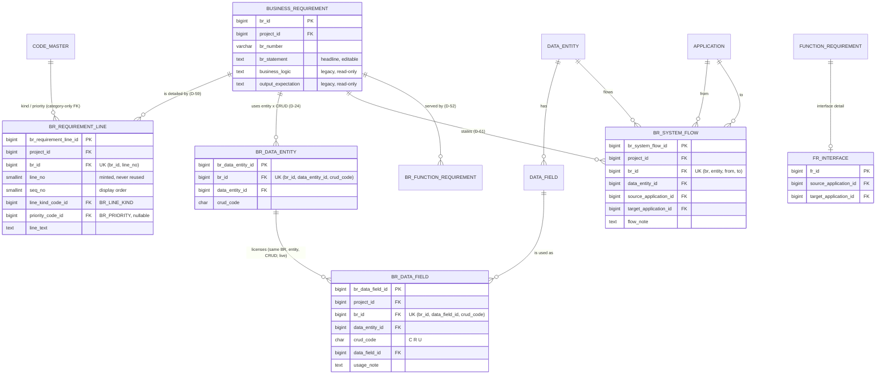

# Slice 11 — structured BR, attribute usage, system-to-system flows (D-59, D-60b, D-61): schema

**Accepted by Ben 2026-10-14 (S11-1) except [Q-11], [Q-17].** Those two stay open (`VB_design_history.md` §1)
and are modelled in §3.3 so that either answer is a later additive change. Nothing in this slice depends on them.

Author: `apple` · proposal 2026-10-12, refreshed for build 2026-10-15 · source of truth: `docs/VB_design.md`
(§4.3 functions, §5 entities BR_REQUIREMENT_LINE / BR_DATA_FIELD / BR_SYSTEM_FLOW, §7.3, hash specs, §8 vocabularies,
criteria 185–189). This file is the build detail. Where it differs from the spec text, §0 says so and why.
Status: **ready to build**, after slice 13c's migration (0054) is on `main`.
Sources: D-2, D-24, D-26, D-37, D-39, D-46, D-49, D-52, D-56, D-59, D-60, D-61, S1-5, S1-7, S5-1, S7-2, S10b-1, S11-1;
slice 13c's cross-spec diff rule (`slice13_schema.md` §3.7, Q-22, accepted S13-1); `models/requirement.py`,
`models/shared.py`, `models/data_model.py`, `models/application.py`, `models/function_requirement.py`,
`services/freeze_set.py`, `services/baseline.py`, `services/components.py`, `services/step_retire.py`,
`services/business_requirement.py`, `seeds/seed_code_master.py`, `seeds/seed_project_components.py`.

**House conventions throughout:**
- every table has a surrogate identity PK (S1-5);
- composite FKs are `(id, project_id)`, and every FK is `NO ACTION`;
- every table has `AuditMixin` and the `updated_at` trigger;
- link grains use a **full** UK, and relinking restores the old row (S1-7, 10b §1);
- a retire is a soft delete. Nothing is hard-deleted, and `vb_app` has no DELETE grant;
- a new table gets a generated shadow, a `FREEZE_SET` entry and a `SHADOWED` entry, and joins under a **hash
  spec bump** (S10b-1).

**Facts checked against the code (2026-10-15):**
- `main` is at **0052** (`0052_one_raci_per_process`). Slice 13b adds **0053** and slice 13c **0054**
  (`slice13_schema.md`), so slice 11 starts at **0055**. `CURRENT_HASH_SPEC = 2` today; 13c makes it 3.
- `business_requirement` carries three free-text columns: `br_statement`, `business_logic` and
  `output_expectation`. All three are hashed in `FREEZE_SET`, and today all three are in
  `services/business_requirement.EDITABLE`. The only other writers are `schemas/scope.py` (the request bodies).
  No BR import target exists yet, and the flow-file import never writes BR text.
- `code_master.ck_code_behaviour_present` is `(category IN ('FR_TYPE','RACI_TYPE')) = (behaviour_code IS NOT NULL)`:
  any other category **must** have a NULL behaviour code. `uq_code_category_target (code_id, category)` is the
  target for category-only FKs (as `complexity_code_id` and `pattern_code_id` use).
- **`code_master` rows are seeded after `alembic upgrade head`, never by Alembic** (`seed_code_master`, CLAUDE.md
  "Seeds: `backend/seeds/`, never Alembic"; `slice13_schema.md` F1). A migration therefore cannot find a
  `BR_LINE_KIND` row to point a backfilled line at. This moves the backfill out of the migration (§1.2).
- `services/baseline.diff`: an entity unknown at one side's spec is compared with its columns from the other side,
  so all its rows show ADDED (or REMOVED). 13c replaces `SCHEMA_VERSION_MISMATCH` for a differing list with a
  compare on the older list.

---

## 0. What changed in this refresh, and the two places the spec text needs a fix

| # | Change | Why |
|---|---|---|
| 1 | Migrations renumbered **0055–0057**, one table + its shadow per revision (was 0052–0058, seven revisions) | `main` moved; 13b/13c take 0053/0054. Shadow in the same revision keeps the parity test green at every commit (§7) |
| 2 | **Hash spec 4**, not 3; cross-spec diff for specs 2 / 3 / 4 stated (§5.1) | 13c takes spec 3 (S11-1) |
| 3 | **`BR_LINE_KIND` and `BR_PRIORITY` carry no behaviour code**; the line FKs are category-only (§1.3) | Resolves the clash with `ck_code_behaviour_present` |
| 4 | **The backfill of legacy text into lines is a one-off seed command run after `seed_code_master`**, not a migration (§1.2) | A migration cannot reference a `code_master` row that is only seeded afterwards |
| 5 | [Q-11] and [Q-17] modelled as later additive changes; no column now (§3.3) | Both still open |

**Spec text to correct (no change of meaning; route through the history file per CLAUDE.md):**
- `VB_design.md` §8, `BR_LINE_KIND` row: "each with an identical behaviour code" → "no behaviour code (nothing
  branches on a line kind)". See §1.3.
- `VB_design.md` §5, BR_REQUIREMENT_LINE: "copied once, by the migration that creates the table" → "copied once,
  by the slice 11 deploy's backfill command". See §1.2. Criterion 186 is unaffected: it describes the outcome.

---

## 1. D-59 — numbered requirement lines (Option A, accepted)

**The running example** is BR-0043, on the to-be process *Approve customer credit* (01.02.01.02.01):

| # | Kind | Priority | Line |
|---|---|---|---|
| BR-0043.1 | Rule | Must | Only customers with an active account may be granted credit. |
| BR-0043.2 | Calculation | Must | Remaining limit = credit limit − open receivables − open orders. |
| BR-0043.3 | Validation | Must | If the order amount exceeds the remaining limit, the credit result is HOLD. |
| BR-0043.4 | Control | Should | An approval above 50,000 needs the credit manager as second approver. |
| BR-0043.5 | Output | Must | The credit decision and any shortfall go back to Sales. |

Options B (one text block per section) and C (each line also names its attributes) were set aside; C can be added
later on top of §2 without rework (S11-1, Q-1).

### 1.1 `br_requirement_line`

**Grain:** one row per numbered requirement statement within one BR.

| Column | Type | Null | Note |
|---|---|---|---|
| `br_requirement_line_id` | bigint identity | NO | PK |
| `project_id` | bigint | NO | copied from the BR by the service |
| `br_id` | bigint | NO | `fk_brl_br (br_id, project_id) → business_requirement` |
| `line_no` | smallint | NO | the stable label "BR-0043.**3**". **Minted by the service** at save as max + 1 over all of the BR's lines, retired ones included. Never reused, never taken from a body (law 6). `ck_brl_line_no CHECK (line_no >= 1)` |
| `seq_no` | smallint | NO | display order, changed by dragging. Unique among live lines (partial `uq_brl_seq_live (br_id, seq_no) WHERE is_active`). A position column: not a scope change |
| `line_kind_code_id` | bigint | NO | `BR_LINE_KIND` |
| `line_kind_category` | varchar(40) | generated | `'BR_LINE_KIND'`; `fk_brl_kind (line_kind_code_id, line_kind_category) → code_master (uq_code_category_target)` |
| `priority_code_id` | bigint | **YES** | `BR_PRIORITY`; NULL = not yet prioritised |
| `priority_category` | varchar(40) | generated | `'BR_PRIORITY'`; `fk_brl_priority (priority_code_id, priority_category) → code_master (uq_code_category_target)`, checked only when the id is set |
| `line_text` | text | NO | `ck_brl_text CHECK (btrim(line_text) <> '')` |
| + `AuditMixin` | | | edited in place under `row_version` |

- **Keys:** UK `uq_brl_line_no (br_id, line_no)`, full. Indexes `ix_brl_project`, `ix_brl_kind`, `ix_brl_priority`.
- **The BR's own priority is derived**: the live line priority with the **lowest `sort_order`** (MUST 10 < SHOULD 20
  < COULD 30 < WONT 40), else none. Shown on the panel and BR list, never stored (law 6), so it cannot disagree
  with the lines. Ordering by `sort_order` rather than by code keeps law 5 intact (§1.3).
- **Not a number series.** Per-BR ordinals like `data_field.seq_no`, outside `numbering.next_number`'s ten series.
- **Concurrent adds:** two editors adding a line to one BR at once can compute the same `line_no`; the full UK
  refuses the second, which the service turns into a retry (or the service takes `SELECT … FOR UPDATE` on the BR
  row first, which it already locks for `row_version`). Either way the database is the guard.

### 1.2 The three text columns, and the backfill

| Column | Fate |
|---|---|
| `br_statement` | **Stays editable** as the BR's one-sentence headline |
| `business_logic`, `output_expectation` | **Copied once into lines, then read-only legacy.** Never cleared, dropped or retyped, so the BR's shadow and hashed list do not move. `EDITABLE` shrinks to `("br_statement",)` (status keeps its own route), and the create/patch bodies in `schemas/scope.py` refuse the two fields (`extra="forbid"` → 422). The panel shows non-blank legacy text collapsed, read-only, as "Earlier free text" |

**The backfill is a seed command, not a migration.** `line_kind_code_id` is NOT NULL and must point at the
`RULE` / `OUTPUT` rows of `BR_LINE_KIND`, which exist only after `seed_code_master` runs, and that runs after
`alembic upgrade head`. Putting the copy in a migration would need the migration to insert `code_master` rows
(banned) or a nullable kind (which would weaken the table forever for a one-off). So the copy follows the 7a
precedent (`seed_project_components`):

```
python -m seeds.backfill_br_lines --actor-email <active platform admin>      # after seed_code_master
```
- **Per project**, skipped if the project already has an `audit_event` `BR_LINES_BACKFILLED` (the marker, so a
  rerun is a no-op and a later user-added line never blocks the copy).
- For each live BR with non-blank `business_logic`: one line, kind = `code_master.resolve(project, 'BR_LINE_KIND')`
  code `RULE`; for non-blank `output_expectation`: one line, code `OUTPUT`. Text copied verbatim, never split by
  machine. Priority NULL (none is invented). `line_no` / `seq_no` = next free on the BR, so lines a user added
  before the command ran keep their numbers. `created_by` = the BR's `updated_by`, else its `created_by`.
- One `audit_event` `BR_LINES_BACKFILLED {count, line_ids}` per project, **written even when count is 0** (it is
  the marker), actor = the `--actor-email` admin.
- Picking the `RULE` row by code is a lookup, as an API body sends codes. It is not a branch on a code (law 5).
- **The window** between deploy and the command is harmless: the legacy text stays visible as "Earlier free
  text", no write is gated, and nothing is lost. Deploy order: `alembic upgrade head` → `seeds.seed_code_master`
  → `seeds.backfill_br_lines`. CLAUDE.md gains a one-line "slice 11 deploy only" note beside the 7a one.
- **A fresh database** (tests, demo) has no legacy text; the harness need not run it. `seed_demo` writes lines,
  never the legacy columns.
- **Diff from a pre-11 baseline:** the copied lines show as ADDED, with the banner of §5.1. The old text remains
  in the frozen BR row, so nothing is lost from history (Q-6).
- **Dropping the two legacy columns** would be destructive and would change a shadowed table: it pauses for Ben
  (laws 2, 10). Out of this slice.

### 1.3 `BR_LINE_KIND` and `BR_PRIORITY`: no behaviour code (the `ck_code_behaviour_present` clash)

**Decision: no behaviour codes on either category; do not widen the CHECK.**

| Category | `is_system` | Seeds (`seed_code_master.LIBRARY`, sort 10, 20, …) | Behaviour |
|---|---|---|---|
| `BR_LINE_KIND` | false (project can rename, extend) | `RULE` Rule, `CALCULATION` Calculation, `VALIDATION` Validation, `OUTPUT` Output, `CONTROL` Control | none |
| `BR_PRIORITY` | false | `MUST` Must, `SHOULD` Should, `COULD` Could, `WONT` Won't | none; order = `sort_order` |

Why:
1. **Nothing branches on a line kind.** D-59 gives kinds no behaviour: no kind is validated, counted or routed
   differently. A behaviour code no code reads is dead data. Law 5 asks for a behaviour code *where the code
   branches*; here it does not.
2. **The one ordering need, "highest priority", is data:** `sort_order`. A project that adds a priority slots it in
   by its own `sort_order`, which a fixed behaviour vocabulary could not express without another code change.
3. **Widening costs more than it buys:** a changed CHECK plus a new `ck_code_br_line_behaviour` on `code_master`,
   which every lookup in every project depends on, and behaviour codes become immutable once referenced (Q6),
   locking five values for nothing. Slice 13c made the same call for `VOLUME_PERIOD` (`slice13_schema.md` F2).
4. **The FK still proves the category**, through the generated category column and `uq_code_category_target`,
   as `complexity_code_id` and the interface pattern / method / frequency do.

**If a kind later needs behaviour** (say, CONTROL lines feeding a controls register), that migration widens the
CHECK, sets the behaviour on the existing library and override rows of that category, and moves the line FK to
`uq_code_behaviour_target`. It is a contained change, but not free; that is the reason to add it only when a
branch exists.

---

## 2. D-60(b) — the attributes a BR uses, with C / R / U per attribute

**Grain:** one row per (BR × data attribute × CRUD action). The new table is `br_data_field`.

**It refines `br_data_entity`; it never replaces it.** The D-24 licence chain, one level down:

> step I/O → licenses BR × entity × CRUD (`br_data_entity`) → licenses BR × attribute × CRUD (`br_data_field`)

| Column | Type | Null | Note |
|---|---|---|---|
| `br_data_field_id` | bigint identity | NO | PK |
| `project_id` | bigint | NO | from the BR |
| `br_id`, `data_entity_id`, `crud_code` | bigint, bigint, char(1) | NO | together, the **licence**: `fk_brdf_licence (br_id, data_entity_id, crud_code, brde_is_active) → br_data_entity (uq_brde_live_licence)`. The new UK `uq_brde_live_licence (br_id, data_entity_id, crud_code, brde_is_active)` on `br_data_entity` is additive (the shorter `uq_brde_grain` already makes it unique) |
| `brde_is_active` | boolean | generated | `CASE WHEN is_active THEN TRUE END`. A live attribute row needs a live entity row; a retired one is unchecked history |
| `data_field_id` | bigint | NO | `fk_brdf_field (data_field_id, data_entity_id) → data_field (uq_data_field_entity)`: the attribute belongs to that entity |
| `usage_note` | text | YES | e.g. "set to HOLD when the order is over the limit" |
| + `AuditMixin` | | | |

- **Keys:** UK `uq_brdf_grain (br_id, data_field_id, crud_code)`, full; `ix_brdf_field`, `ix_brdf_project`.
  Cross-project use is impossible: the BR fixes the project, `br_data_entity` fixes the entity, the field FK fixes
  the field in that entity. `ck_brdf_crud CHECK (crud_code IN ('C','R','U'))`: Delete stays entity-level (Q-8).
- **Example (BR-0043):** Customer · R → `customer_id`, `credit_limit`, `account_status`; Order · R → `order_id`,
  `amount`; Order · U → `credit_result`, `shortfall_amount`.
- **Saving:** the CRUD grid saves entity and attribute ticks **in one request**. Unticking an entity's action unticks
  its attributes on screen; the service retires them explicitly (nothing cascades). The licence FK refuses an
  orphan. Unlinking a `br_data_entity` row with live attribute ticks any other way → 409 naming them (Q-7).
- **Depth (D-39):** optional always; under `FULL`, an entity row with no ticked attribute is information
  (`br_entity_without_attributes`), never a warning or block; under `KEYS_ONLY`, nothing (Q-9).
- **Retiring a data field** a live BR uses → 409 naming the BRs (FK_LIVENESS) (Q-10).

---

## 3. D-61 — system-to-system data flows on a BR

**Grain:** one row per (BR × data entity × from-application × to-application). The new table is
`br_system_flow`. Both ends are FKs to the Applications master list (D-56); free text is never accepted.

| Column | Type | Null | Note |
|---|---|---|---|
| `br_system_flow_id` | bigint identity | NO | PK |
| `project_id` | bigint | NO | from the BR |
| `br_id` | bigint | NO | `fk_brsf_br (br_id, project_id) → business_requirement` |
| `data_entity_id` | bigint | NO | `fk_brsf_de (data_entity_id, project_id) → data_entity` |
| `source_application_id` | bigint | NO | `fk_brsf_source (…, project_id) → application`. "From" |
| `target_application_id` | bigint | NO | `fk_brsf_target (…, project_id) → application`. "To" |
| `flow_note` | text | YES | e.g. "on every credit decision", "nightly" |
| + `AuditMixin` | | | |

- **Keys:** UK `uq_brsf_grain (br_id, data_entity_id, source_application_id, target_application_id)`, full;
  `ck_brsf_endpoints_distinct CHECK (source_application_id <> target_application_id)`; `ix_brsf_de`,
  `ix_brsf_source`, `ix_brsf_target`, `ix_brsf_project`.
- **Example (BR-0043):** DE-0004 Customer, CRM → ERP, "before every credit check"; DE-0012 Credit decision,
  ERP → CRM, "as soon as the decision is made".
- **An entity the BR does not otherwise use** is allowed, with the information line `flow_entity_not_used_by_br`
  (Q-12).

### 3.1 Relation to interface FRs: derived coverage, no stored pointer (Q-13, Q-14)

- **Covered** = the same BR has a live `br_function_requirement` link to a live interface-behaviour FR whose
  `fr_interface` has the same source and target and whose `fr_interface_data_entity` includes the entity. The
  panel shows "covered by FR-0031" or "no interface yet"; coverage lists uncovered flows as information, as a
  warning when `FUNCTION_REQUIREMENT` is on, never a freeze block.
- **"Create interface FR from these flows"**: one or more of a BR's flows with one (source, target) pair, else
  422; one transaction creates the FR, `fr_interface`, one `fr_interface_data_entity` per entity and the BR ↔ FR
  link, numbers minted at save.
- **No `fr_id` on the flow:** a stored pointer would need a three-column agreement check against another object
  and would go stale when the interface's endpoints are edited. The derived match answers the same question.

### 3.2 Other points

- **To-be only**, as its BR (S7-2).
- **An as-is-only application** (lifecycle `AS_IS`) at either end: the schema places **no** lifecycle constraint on
  either end, in any answer to [Q-11]. The service shows it as information. If Ben answers "integration only", that
  hint may become a warning; that is service text, not schema.

### 3.3 The two open questions, modelled so either answer is additive later

**[Q-11] OPEN — flow kind: ongoing integration only, or also one-off data migration?**

| Answer | Schema now | Later change |
|---|---|---|
| Integration only | none | none |
| Both | none | one migration on `br_system_flow`: `flow_kind_code varchar(12) NOT NULL DEFAULT 'INTEGRATION'`, `ck_brsf_kind CHECK (flow_kind_code IN ('INTEGRATION','MIGRATION'))` (CHECK-listed, not `code_master`, because coverage would branch on it); the UK widens to `(br_id, data_entity_id, source_application_id, target_application_id, flow_kind_code)` (safe: existing rows stay unique, since all are INTEGRATION); shadow column `flow_kind_code VARCHAR(12)` nullable, no default, in the same migration (frozen rows read NULL = "before kinds", shown as integration); hashed list **appended** → next hash spec; the diff compares older baselines on the older list (13c rule). Open sub-point then: does a MIGRATION flow count as covered by an interface FR, or by a BATCH-behaviour FR? |

Why no column now: neither answer needs it, the later add is non-destructive, and a column that one answer makes
permanently constant would cost a frozen shadow column that can never be removed.

**[Q-17] OPEN — "the system has to be like a master": the master list only, or also a master system per data
entity?**

| Answer | Schema now | Later change |
|---|---|---|
| Master list of systems (as built: both flow ends are FKs to `application`) | none | none |
| Also a system of record per data entity | none | one migration on `data_entity`: `master_application_id bigint NULL`, `fk_de_master_app (master_application_id, project_id) → application`, `ix_de_master_app`; shadow column in the same migration, nullable, no default (frozen rows read NULL, which is true); hashed list appended → next hash spec, diff on the older list (13c rule). It is a column, not a table, because the master system depends on the entity alone (3NF: one value per entity). The flow's From defaults to it in the service only; a flow **from** a non-master system becomes an information line. `COMPONENT_ROWS["APPLICATION"]` gains the entities that name a master, so APPLICATION cannot be switched off under them; retiring that application → 409 naming the entities. Open sub-point then: is it set in the data model screen, the Systems screen, or both? |

Why no column now: the "list only" answer needs nothing, and the per-entity column is a plain additive change on a
shadowed table that the append-only hash rule already supports.

---

## 4. Components, step retire, soft delete

| Table | Write routes need | Freeze gate | Step retire |
|---|---|---|---|
| `br_requirement_line` | no component (a BR always exists) | ALWAYS | joins `OWNED_BY_BR`, in the tier with `BrSolution` |
| `br_data_field` | none, as for `br_data_entity` | ALWAYS | joins `OWNED_BY_BR` in a **new first tier ahead of `BrDataEntity`**, so it retires before and restores after its licence |
| `br_system_flow` | **`APPLICATION`** | `all_of={APPLICATION}` | joins `OWNED_BY_BR`, in the tier with `BrSolution`. `ROW_COMPONENTS[BrSystemFlow] = ("APPLICATION",)` |
| seeding action (§3.1) | `FUNCTION_REQUIREMENT` + `APPLICATION` | — | — |

- Routes: `object_guard(BusinessRequirement, "EDIT", component=…)` as above; `ROUTE_COMPONENTS` in
  `tests/test_route_guards.py` lists the flow and seeding routes (criterion 49b).
- **Switching APPLICATION off while flows exist** is already blocked: their applications are live rows in
  `COMPONENT_ROWS["APPLICATION"]`.
- **Retiring an application or a data entity** a live flow uses → 409 naming the BRs (FK_LIVENESS).
- **No new restore route.** Lines retire and restore through `RESTORABLE` or a step restore; ticks and flows return
  through relink (the full UK) (Q-15).
- `lifecycle.LABELS` names each row in a 409: "BR-0043.3", "BR-0043 · Order.credit_result (U)",
  "BR-0043 · Customer CRM→ERP".
- **Grants:** `vb_app` SELECT, INSERT, UPDATE; no DELETE. The grant test's DELETE set is unchanged.
- All three tables are added to `models/__init__.py` (law 10).

## 5. Baselines

- **Shadows**, generated by `baseline_shadow.shadow_table()` (`scripts/print_shadow_ddl.py`) and written as literal
  DDL in the table's own migration: `baseline_br_requirement_line`, `baseline_br_data_field`,
  `baseline_br_system_flow`, each with `immutable_guards()`. Generated category columns and `brde_is_active` are
  skipped by `snapshot_column_names`; the code pairs come from `code_pairs`.
- **`CURRENT_HASH_SPEC = 4`** (`# 4: br_requirement_line, br_data_field, br_system_flow joined (slice 11, S11-1)`).
  The three entities register with `since=4`. No existing entity's list changes: the BR keeps `business_logic` and
  `output_expectation` hashed and their values never change in the backfill; `bfc_node` keeps 13c's spec-3 list.
  13c's append-only assert holds trivially (each new entity has one list). `SPEC_1_ENTITIES` is unchanged (Q-16).

| Entity | Area | Hashed (spec 4) | Position | Label / refs | `SHADOWED` position |
|---|---|---|---|---|---|
| `br_requirement_line` | BR | `br_id, line_no, line_kind_code, priority_code, line_text` | `seq_no` | `line_no`; br_id → BR | after `br_org_role` |
| `br_data_field` | BR | `br_id, data_entity_id, data_field_id, crud_code, usage_note` | — | `crud_code`; → BR, DE, `data_field` | after `br_requirement_line` |
| `br_system_flow` | BR | `br_id, data_entity_id, source_application_id, target_application_id, flow_note` | — | → BR, DE, APP ×2 | after `application` (FK order) |

- Reordering lines changes only `seq_no`, a position column: MOVED, never CHANGED. A priority or text change is
  CHANGED.
- If 13c has not landed when slice 11 is built, slice 11 takes the next free spec instead, and 13c the one after;
  the numbers in this file and the spec's list move together.

### 5.1 Diff and verify across specs 2, 3 and 4

`verify`, `digest` and `rehash_mismatches` already work at each baseline's own spec: a spec-2 or spec-3 baseline
skips the three new entities (it holds no shadow rows for them) and re-digests **byte-identical** (criterion 189).

`diff` (built on 13c's rule: an entity whose two lists differ is compared field by field on the older list):

| Side A → side B | `bfc_node` | `br_function_requirement` | the three slice-11 entities |
|---|---|---|---|
| spec 2 → spec 3 / 4 / live | compared on the spec-1 list; `not_compared` = the volume columns (13c) | normal | absent at A: every B row ADDED |
| spec 3 → spec 4 / live | same list: normal | normal | absent at A: every B row ADDED |
| spec 4 → spec 4 / live | normal | normal | normal |
| newer → older (reversed) | as above, mirrored | normal | absent at B: every A row would read REMOVED |

- **The one diff change slice 11 makes:** where an entity is unknown at one side's spec, its entry gains
  `"not_frozen_in": "a" | "b"` and `"joined_at_spec": 4`. The screen shows the banner "vX.Y predates requirement
  lines / attribute ticks / system flows" and does **not** count those rows in the summary's added / removed scope,
  because they are new structure, not new scope. (Unlike 10b's `br_function_requirement`, nothing is derived for the
  older side: a line is not a re-encoding of something that existed before.)
- The legacy `business_logic` / `output_expectation` stay hashed and unchanged, so the BR rows themselves show no
  CHANGED across specs.

## 6. ER fragment (the changed area)



Flow coverage is derived (§3.1); no FK is stored. Neither [Q-11]'s `flow_kind_code` nor [Q-17]'s
`data_entity.master_application_id` exists yet (§3.3).

## 7. Migration plan — on `main`, after 0054, in order, one per commit

| Rev | Does | Downgrade |
|---|---|---|
| **0055** | create `br_requirement_line` (§1.1) **and** `baseline_br_requirement_line` + guards | refuses if the shadow holds rows, or if any line exists that is not in a `BR_LINES_BACKFILLED` event's `line_ids`, or any line has `row_version > 1` |
| **0056** | `uq_brde_live_licence` on `br_data_entity`; create `br_data_field` (§2) **and** `baseline_br_data_field` + guards | refuses if either table holds any row |
| **0057** | create `br_system_flow` (§3) **and** `baseline_br_system_flow` + guards | refuses if either table holds any row |

- **Table and shadow in one revision** so the parity test in `tests/test_baseline.py` (which reads the database)
  passes at every commit. Each commit adds its model to `models/__init__.py` and `SHADOWED`.
- **The freeze-set entries and `CURRENT_HASH_SPEC = 4` land together in 0057's commit**, so no build ever freezes a
  spec-4 baseline that lacks one of the three. Main is not deployed between 0055 and 0057; the three ship as one
  deploy.
- **Code half alongside 0055:** `EDITABLE` shrinks, the bodies refuse the legacy fields, the line routes, and
  `seeds/backfill_br_lines.py`. **Seeds:** `BR_LINE_KIND` and `BR_PRIORITY` in `seed_code_master.LIBRARY`, no
  behaviour (§1.3).
- **Deploy:** `alembic upgrade head` → `seeds.seed_code_master` → `seeds.backfill_br_lines --actor-email <admin>`.
- **Nothing is destructive**: no drop, clear or retype of an existing column; nothing pauses under law 10.
- **`sara` reviews before each commit**: baselines (spec bump, three shadows, the diff change), the retire set, the
  backfill and the migration chain.
- **Tests to add:** criteria 185–189; the licence FK refusing an orphan tick; `ck_brdf_crud` refusing D; the
  backfill twice (second run a no-op) and after a user-added line; a spec-2 and a spec-3 baseline still verify and
  diff against live with the slice-11 rows ADDED under the banner and no BR row CHANGED; 422 on `business_logic`
  in a PATCH body; 409 COMPONENT_OFF on a flow write with APPLICATION off.

---

## 8. Questions and their status

**Accepted by Ben 2026-10-14 (S11-1), as recommended:**

1. Option A, numbered lines with kind and priority. 2. Kinds Rule, Calculation, Validation, Output, Control,
project-editable. 3. A line keeps its number for life; dragging reorders. 4. MoSCoW per line, blank allowed; the BR's
priority is the highest of its lines, derived. 5. Statement stays the headline; logic and output copied once into a
Rule and an Output line, then read-only, never deleted. 6. Copied lines show as added against older versions, with a
note. 7. Unticking an entity unticks its attributes in the same save; other removals refused with the list.
8. Attributes take C / R / U only. 9. Attribute ticking optional; a hint only on `FULL`. 10. Removing a used
attribute is refused, naming the BRs. 12. A flow of an unused entity is allowed, with a hint. 13. Flows are business
statements; coverage by an interface FR is shown, never stored; a button creates the FR. 14. Uncovered flows: hint,
a warning with Function requirements on, never a freeze block. 15. Everything soft-deleted; restored with its
process; relink restores. 16. Frozen from the next hash spec, now **spec 4**; older baselines verify unchanged.

**Still open (VB_design_history.md §1):**

- **[Q-11] OPEN.** Is "copy from which system to which system" ongoing **integration** only, or does it include
  one-off **data migration**? If both, each flow gets a kind (Integration / Migration), added later as in §3.3.
  Built now either way: flows to or from an as-is-only system are allowed and shown as information.
- **[Q-17] OPEN.** "The system has to be like a master": one master list that flows pick from (built), or also a
  **master system (system of record) per data entity**, which the From system would default to? The latter is one
  later optional column on the data entity (§3.3).
