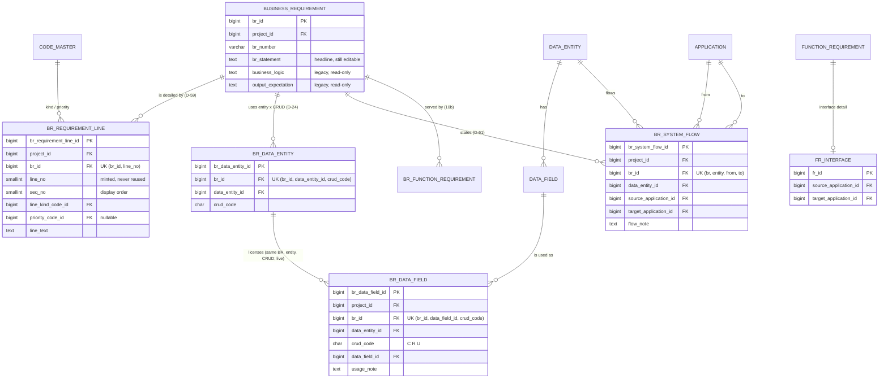

# Slice 11 — structured BR, attribute usage, system-to-system flows (D-59, D-60b, D-61): schema proposal

Author: `apple` · 2026-10-12 · source of truth: `docs/VB_design.md` §1a, where the D-56…D-62 rows win over older text.
Status: **proposal for Ben.** Do not build a [Q-n] until Ben has answered it.
Builds on slice 10b (`br_function_requirement`, hash spec 2, `docs/slice10b_schema.md`), which merges first.
Sources: D-2, D-24, D-26, D-37, D-39, D-46, D-49, D-52, D-56, D-59, D-60, D-61, S1-5, S1-7, S5-1, S7-2;
`models/requirement.py`, `models/data_model.py`, `models/application.py`, `models/function_requirement.py`,
`services/freeze_set.py`, `services/components.py`, `services/step_retire.py`.

**House conventions throughout:**
- every table has a surrogate identity PK (S1-5);
- composite FKs are `(id, project_id)`, and every FK is `NO ACTION`;
- every table has `AuditMixin` and the `updated_at` trigger;
- link grains use a **full** UK, and relinking restores the old row (S1-7, 10b §1);
- a retire is a soft delete. Nothing is hard-deleted, and `vb_app` has no DELETE grant;
- a new table gets a generated shadow, a `FREEZE_SET` entry and a `SHADOWED` entry, and joins under a **hash
  spec bump** (10b Q-14).

**Facts checked against the code:**
- `business_requirement` carries three free-text columns: `br_statement`, `business_logic` and
  `output_expectation`. All three are hashed in `FREEZE_SET` and are the BR's only editable fields
  (`services/business_requirement.EDITABLE`).
- No BR import target exists yet (`bulk.TARGETS` covers data entities and data fields only), and the flow-file
  import never writes BR text.
- No `BR_PRIORITY` or `BR_LINE_KIND` code category exists. The mockup BR screen
  (`docs/mockups/src/screens/03_BusinessRequirement.jsx`) shows Priority "Must", Frequency and Trigger, which
  D-51 left out because there was no data behind them.

---

## 1. D-59 — a structured BR: three options

**The running example** is BR-0043, on the to-be process *Approve customer credit* (01.02.01.02.01). Today it is
three text boxes:

- **Statement:** "Decide whether to accept the order against the customer's remaining credit."
- **Business logic:** "Remaining limit = limit − open receivables − open orders. If the amount exceeds it, hold
  the order. Above 50,000 the credit manager approves. Only active customers."
- **Output:** "Credit decision with the shortfall returned to Sales."

### Option A — Numbered requirement lines, each with a kind and a priority (the D-59 direction)

**Grain:** one row per **numbered requirement statement within one BR**. The new table is `br_requirement_line`.

| # | Kind | Priority | Line |
|---|---|---|---|
| BR-0043.1 | Rule | Must | Only customers with an active account may be granted credit. |
| BR-0043.2 | Calculation | Must | Remaining limit = credit limit − open receivables − open orders. |
| BR-0043.3 | Validation | Must | If the order amount exceeds the remaining limit, the credit result is HOLD. |
| BR-0043.4 | Control | Should | An approval above 50,000 needs the credit manager as second approver. |
| BR-0043.5 | Output | Must | The credit decision and any shortfall go back to Sales. |

- **Strengths:** each line is short and testable. Priority sits where it belongs (lines 1–3 are Must, line 4
  Should), each line can be referenced ("BR-0043.3"), and an FR's coverage note can name lines. The diff shows
  changes at line level ("BR-0043.4 priority Should → Must").
- **Costs:** one more table, and one more shadow.

### Option B — Typed sections: one text block per kind, priority on the BR

**Grain:** one row per **(BR × section kind)**, at most one live row per kind. The new table is `br_section`.
Priority becomes one column on the BR.

| Section | Text |
|---|---|
| Rules | Only active customers may be granted credit. Above 50,000 the credit manager approves. |
| Calculations | Remaining limit = limit − open receivables − open orders. |
| Validations | Amount > remaining limit → HOLD. |
| Outputs | Credit decision with the shortfall, to Sales. |

BR-level priority: **Must**.

- **Strengths:** simple to fill in, and close to today's boxes.
- **Costs:** inside a section it is still free text. Priority is all-or-nothing per BR (the Should control
  above is forced to Must), there is nothing to number and reference, and the diff only shows "Rules
  changed". It is a tidier version of today rather than real structure.

### Option C — Option A, plus each line names the data attributes it touches

Option C is the same `br_requirement_line` table, plus a junction **`br_line_data_field`** (one row per
line × attribute used). For example, line BR-0043.2 names `Customer.credit_limit`, `Customer.open_receivables`
and `Order.amount`.

- **Strengths:** this is the most precise traceability: rule → attribute → interface.
- **Costs:** it is the heaviest to fill in, it doubles the attribute ticking of §2, and consultants rarely work
  at this depth in scope phase.
- **Can wait:** it can be added later on top of A and §2 without rework, because the junction would point at
  the §2 rows.

### Recommendation: Option A [Q-1]

Option A is what Ben asked for: numbered lines, each with a kind and a priority. C's line-to-attribute tie
is deferred. B is rejected because it keeps the free text Ben objected to.

### 1.1 `br_requirement_line` (Option A)

| Column | Type | Null | Note |
|---|---|---|---|
| `br_requirement_line_id` | bigint identity | NO | PK |
| `project_id` | bigint | NO | copied from the BR by the service |
| `br_id` | bigint | NO | `fk_brl_br (br_id, project_id) → business_requirement` |
| `line_no` | smallint | NO | the stable label "BR-0043.**3**". **Minted by the service** at save as max + 1 over all of the BR's lines, retired ones included. It is never reused and never taken from the body (law 6). `CHECK (line_no >= 1)` [Q-3] |
| `seq_no` | smallint | NO | display order, which the user can change by dragging. Unique among live lines (partial index `uq_brl_seq_live`) |
| `line_kind_code_id` | bigint | NO | code_master `BR_LINE_KIND` (generated category column + composite FK, the house pattern). Seeds: RULE, CALCULATION, VALIDATION, OUTPUT, CONTROL, each with an identical behaviour code (law 5), editable per project [Q-2] |
| `priority_code_id` | bigint | **YES** | code_master `BR_PRIORITY`. Seeds: MUST, SHOULD, COULD, WONT (MoSCoW). NULL = not yet prioritised [Q-4] |
| `line_text` | text | NO | `CHECK (btrim(line_text) <> '')` |
| + `AuditMixin` | | | lines are edited in place under `row_version` |

- **Keys:** UK `uq_brl_line_no (br_id, line_no)`, full. `ix_brl_project`, `ix_brl_kind` and `ix_brl_priority`
  follow the sibling junctions.
- **The BR's own priority is derived** as the highest priority among its live lines. It is shown on the
  panel and the BR list and is never stored (law 6), so it cannot disagree with the lines [Q-4].
- **Not number series.** These are per-BR ordinals like `data_field.seq_no`. They are not one of the ten
  project series that `numbering.next_number` owns.

### 1.2 What happens to the three text columns [Q-5]

| Column | Fate |
|---|---|
| `br_statement` | **Stays editable** as the BR's one-sentence headline. The function chart already shows it beside the BR number. The lines are the detail under it |
| `business_logic`, `output_expectation` | **Backfilled once into lines, then frozen as legacy.** For each live BR with non-blank text, `business_logic` becomes one RULE line and `output_expectation` becomes one OUTPUT line. Priority is NULL, because none is invented. The text is copied verbatim and never split by machine; the consultant splits it into proper lines. The columns stay **untouched**: no clear, no drop, no type change, so the BR's shadow and hash list do not move. The API stops accepting them (`EDITABLE` shrinks to `br_statement`), and the panel shows any non-blank legacy text collapsed, read-only, as "Earlier free text" |

- **Provenance:** one `audit_event` `BR_LINES_BACKFILLED` per project, with `{count, line_ids}` (the 10b
  pattern). `created_by` is the BR's `updated_by`, or its `created_by` if `updated_by` is empty.
- **Diff from a pre-11 baseline:** the backfilled lines show as **ADDED** under area BR, with a banner
  "vX.Y predates requirement lines". Unlike 10b, no derived side is attempted: a line is a new structure, not
  a re-encoding of a link that already existed. Because the old text is still in the frozen BR row, nothing
  is lost from history [Q-6].
- **Dropping the two legacy columns** would be a destructive migration, and it would change a shadowed
  table. That pauses for Ben under laws 2 and 10. It is out of this slice.

---

## 2. D-60(b) — the attributes a BR uses, with CRUD per attribute

**Grain:** one row per **(BR × data attribute × CRUD action)**. The new table is `br_data_field`.

**It refines `br_data_entity`; it never replaces it.** An attribute row needs a **live entity-level row with
the same CRUD**. This is the D-24 licence chain taken one level down:

> step I/O → licenses BR × entity × CRUD (`br_data_entity`) → licenses BR × attribute × CRUD (`br_data_field`)

The rule is enforced by the database, using the house live-licence pattern (`fk_brde_io_licence`).

| Column | Type | Null | Note |
|---|---|---|---|
| `br_data_field_id` | bigint identity | NO | PK |
| `project_id` | bigint | NO | from the BR |
| `br_id`, `data_entity_id`, `crud_code` | bigint, bigint, char(1) | NO | together, the **licence**: `fk_brdf_licence (br_id, data_entity_id, crud_code, brde_is_active) → br_data_entity (br_id, data_entity_id, crud_code, is_active)`. This needs a new UK `uq_brde_live_licence` on `br_data_entity`, which is additive (the shorter `uq_brde_grain` already makes it unique) |
| `brde_is_active` | boolean | generated | `CASE WHEN is_active THEN TRUE END`. A live attribute row needs a live entity row; a retired one is not checked |
| `data_field_id` | bigint | NO | `fk_brdf_field (data_field_id, data_entity_id) → data_field` via the existing `uq_data_field_entity`, so the attribute must belong to that entity |
| `usage_note` | text | YES | e.g. "set to HOLD when the order is over the limit" |
| + `AuditMixin` | | | |

- **Keys:** UK `uq_brdf_grain (br_id, data_field_id, crud_code)`, full; `ix_brdf_field`, `ix_brdf_project`.
  Cross-project use is impossible: the BR fixes the project, `br_data_entity` fixes the entity in it, and the
  field FK fixes the field in that entity.
- **CRUD per attribute:** `CHECK (crud_code IN ('C','R','U'))`. A **D (delete) stays entity-level only**,
  because one cannot delete one attribute of a record (clearing a value is a U) [Q-8].
- **Example (BR-0043):**

| Entity CRUD | Attributes ticked |
|---|---|
| Customer · R | `customer_id` (key), `credit_limit`, `account_status` |
| Order · R | `order_id` (key), `amount` |
| Order · U | `credit_result`, `shortfall_amount` |

- **Saving:** the D-51 CRUD grid saves **in one request** (entity ticks plus attribute ticks). Unticking an
  entity's U also unticks its U attributes on screen *before* Save. The service then writes the attribute
  soft-deletes explicitly, because the user removed them, so nothing cascades. A request that would leave a
  live attribute without its entity row is refused by the licence FK, not just by review. A plain unlink of a
  `br_data_entity` row that still has live attribute rows returns **409, naming the attributes** [Q-7].
- **Under `KEYS_ONLY` (D-39):** ticking attributes is **optional everywhere** and never warned. The picker
  lists whatever fields the entity has (usually its keys). **Under `FULL`:** a BR entity row with no ticked
  attribute is an **information** line (`br_entity_without_attributes`) on the BR panel and in coverage. It is
  not a warning and never blocks a freeze, because D-26 makes partial lists normal [Q-9].
- **Retiring a data field** a live BR still uses returns **409, naming the BRs** (FK_LIVENESS, with no new
  code; the precedent is 10b Q-13) [Q-10].

---

## 3. D-61 — system-to-system data flows on a BR

**Grain:** one row per **(BR × data entity × from-application × to-application)**. The new table is
`br_system_flow`. It records Ben's "what data entity we want to copy from which system to which system", in
business terms, on the BR. **Applications are the master list** (D-56): both ends are FKs to `application`,
and free text is never accepted.

| Column | Type | Null | Note |
|---|---|---|---|
| `br_system_flow_id` | bigint identity | NO | PK |
| `project_id` | bigint | NO | from the BR |
| `br_id` | bigint | NO | `fk_brsf_br (br_id, project_id)` |
| `data_entity_id` | bigint | NO | `fk_brsf_de (data_entity_id, project_id)` |
| `source_application_id` | bigint | NO | `fk_brsf_source (…, project_id) → application`. The "from" system |
| `target_application_id` | bigint | NO | `fk_brsf_target (…, project_id) → application`. The "to" system |
| `flow_note` | text | YES | e.g. "on every credit decision", "nightly" |
| + `AuditMixin` | | | |

- **Keys:** UK `uq_brsf_grain (br_id, data_entity_id, source_application_id, target_application_id)`, full.
  `CHECK (source_application_id <> target_application_id)`, as `ck_fri_endpoints_distinct` does. The indexes
  are `ix_brsf_de`, `ix_brsf_source`, `ix_brsf_target` and `ix_brsf_project`.
- **Example (BR-0043):**

| Data entity | From | To | Note |
|---|---|---|---|
| DE-0004 Customer | CRM (Salesforce) | ERP (SAP S/4) | before every credit check |
| DE-0012 Credit decision | ERP | CRM | as soon as the decision is made |

- **Is the entity one the BR uses?** If the BR has no live `br_data_entity` row for the flowing entity, that
  is an **information** line (`flow_entity_not_used_by_br`). It is not refused: a BR may move data it does
  not itself read [Q-12].

### 3.1 Relation to interface FRs: a stated need, matched and seeded, never a stored pointer [Q-13]

An interface FR already holds source app → target app plus its entities (`fr_interface` +
`fr_interface_data_entity`). After 10b, an FR is linked to the BRs it serves (`br_function_requirement`).

- **Coverage is derived, so it cannot drift.** A flow is **covered** when the same BR has a live link to a live
  interface-behaviour FR with the same source and target whose `fr_interface_data_entity` includes the entity.
  The BR panel shows each flow as "covered by FR-0031" or "no interface yet". Coverage reports list uncovered
  flows as information, and as a warning when `FUNCTION_REQUIREMENT` is on [Q-14].
- **Seeding:** the action "Create interface FR from these flows" takes one or more of a BR's flows **with the
  same source and target**. In one transaction it creates the FR (interface-behaviour type), its
  `fr_interface`, one `fr_interface_data_entity` per entity, and the `br_function_requirement` link, and it
  mints the numbers at save. Several BRs' flows over the same pair can later be linked to that FR from their
  own BR screens.
- **Why no `fr_id` column on the flow:** a stored pointer would need an agreement check on three columns
  against another object, and it would go stale whenever the interface's endpoints were edited. The derived
  match gives the same "covered by" answer with nothing to keep in step.

### 3.2 Other points

- **To-be only.** The BR is to-be only (S7-2), and so is everything it owns.
- **An as-is-only application** (lifecycle AS_IS) at either end is allowed: decommissioning feeds and
  migrations are real. It shows as information [Q-11].

---

## 4. Components, step retire, soft delete

| Table | Write routes need | Freeze gate | Step retire |
|---|---|---|---|
| `br_requirement_line` | no component (a BR always exists) | ALWAYS | joins `OWNED_BY_BR`, in the tier with `BrSolution` |
| `br_data_field` | none, as for `br_data_entity` | ALWAYS | joins `OWNED_BY_BR` in a **new first tier ahead of `BrDataEntity`**, so its licence FK retires child before parent and restores parent before child |
| `br_system_flow` | **`APPLICATION`** | `all_of={APPLICATION}` | joins `OWNED_BY_BR`, in the tier with `BrSolution`. `ROW_COMPONENTS[BrSystemFlow] = ("APPLICATION",)` |
| seeding action (§3.1) | `FUNCTION_REQUIREMENT` + `APPLICATION` | — | — |

- **Switching APPLICATION off while flows exist** is already blocked: their applications are live rows in
  `COMPONENT_ROWS["APPLICATION"]`.
- **Retiring an application or a data entity** that a live flow uses returns 409, naming the BRs
  (FK_LIVENESS).
- **No new restore route.** Lines are retired and restored through `RESTORABLE` like other owned rows, or
  undone by a step restore. Attribute ticks and flows return through relink (the full UK) [Q-15].
- `lifecycle.LABELS` gains labels for each table, so that a 409 names the row: "BR-0043.3",
  "BR-0043 · Order.credit_result (U)" and "BR-0043 · Customer CRM→ERP".
- **Roles:** `vb_app` gets SELECT, INSERT and UPDATE, and no DELETE. The grant test's DELETE set is unchanged.

## 5. Baselines

- **Shadows**, generated by `baseline_shadow.shadow_table()` and written as literal DDL:
  `baseline_br_requirement_line`, `baseline_br_data_field` and `baseline_br_system_flow`. Each gets
  `immutable_guards()`.
- **`CURRENT_HASH_SPEC = 3`.** The three entities register under `{3: (…)}`. No existing entity's list
  changes; the BR keeps `business_logic` and `output_expectation` hashed, and their values never change
  after the backfill. Under the 10b skip rule, v1 and v2 digests stay byte-identical [Q-16].

| Entity | Area | Hashed | Position | Label / refs | `SHADOWED` position |
|---|---|---|---|---|---|
| `br_requirement_line` | BR | `br_id, line_no, line_kind_code, priority_code, line_text` | `seq_no` | `line_no`; br_id → BR | after `br_org_role` |
| `br_data_field` | BR | `br_id, data_entity_id, data_field_id, crud_code, usage_note` | — | `crud_code`; → BR, DE, `data_field` | after `br_requirement_line` |
| `br_system_flow` | BR | `br_id, data_entity_id, source_application_id, target_application_id, flow_note` | — | → BR, DE, APP ×2 | after `application` (FK order) |

- **Reordering lines** changes only `seq_no`, which is a position column, so it is not a scope change.
  Changing a line's priority or text is.

## 6. ER fragment (the changed area)

Flow coverage is derived (§3.1): `BR_SYSTEM_FLOW` matches `BR_FUNCTION_REQUIREMENT` → `FR_INTERFACE` on the
same source and target, plus `FR_INTERFACE_DATA_ENTITY` on the entity. No FK is stored.

## 7. Migration plan (on `main`, one per commit, after 10b's 0051; renumber if `main` has moved)

| Rev | Does | Downgrade |
|---|---|---|
| 0052 | create `br_requirement_line` | refuses if any row exists that the backfill did not write, or any row has `row_version > 1` |
| 0053 | its shadow + guards | refuses if the shadow holds rows |
| 0054 | backfill the lines (§1.2) + audit events | no-op (0052's downgrade guards the rows) |
| 0055 | `uq_brde_live_licence` on `br_data_entity`; create `br_data_field` | refuses if `br_data_field` holds any row |
| 0056 | its shadow + guards | refuses if the shadow holds rows |
| 0057 | create `br_system_flow` | refuses if any row exists |
| 0058 | its shadow + guards | refuses if the shadow holds rows |

- **Seeds, not Alembic:** the `BR_LINE_KIND` and `BR_PRIORITY` categories go in `seed_code_master`.
- **Nothing is destructive**, so nothing pauses under law 10.
- **`sara` reviews before commit**, because the slice touches baselines (a spec bump and three shadows), the
  retire set and the migration chain.

---

## 8. Questions for Ben (recommendation first; "accept all" takes every Rec)

1. **How a BR is structured.** **Rec: Option A**: numbered lines (BR-0043.1, .2 …), each with a kind and a
   priority. B (one text box per section) is too close to today. C (each line also names its attributes) can
   be added later.
2. **Line kinds.** **Rec:** Rule, Calculation, Validation, Output and Control, as a list each project can
   rename or extend.
3. **Line numbers.** **Rec:** a line keeps its number for life, even if lines above it are removed. Users
   reorder lines by dragging, and the number does not change.
4. **Priority.** **Rec:** Must / Should / Could / Won't on each line, blank allowed ("not yet prioritised").
   The BR's own priority is shown as the highest of its lines, never typed separately.
5. **The old text boxes.** **Rec:** keep "Requirement statement" as the BR's one-line headline. Copy each BR's
   "Business logic" and "Output expectation" once into a Rule line and an Output line, word for word, for the
   consultant to split. The old boxes become read-only and are never deleted.
6. **Comparing with versions frozen before this change.** **Rec:** the copied lines show as added, with a note
   that the older version predates requirement lines. The old text remains visible in that version.
7. **Unticking an entity in the CRUD grid.** **Rec:** its attribute ticks for that action go with it on
   screen, and both save together. Removing an entity some other way, while attributes are still ticked, is
   refused with the list of attributes.
8. **CRUD on attributes.** **Rec:** attributes take Create / Read / Update only. Delete stays at entity level.
9. **Attribute ticking and the data-model depth.** **Rec:** optional always. On `FULL` projects, an entity with
   no attributes ticked shows a hint, never a warning or a block. On `KEYS_ONLY` projects, no hint.
10. **Removing a data attribute a BR uses.** **Rec:** refused, naming the BRs, so that nobody loses a mapping
    silently.
11. **Flows to or from an as-is-only system.** **Rec:** allowed (decommissioning feeds, data migrations), shown
    as information. Please confirm: is "copy from which system to which system" mainly **ongoing
    integration**, or does it include **one-off data migration**? If both, we add a "kind" (Integration /
    Migration) to each flow.
12. **A flow of an entity the BR does not otherwise use.** **Rec:** allowed, with a hint.
13. **Flows and interface FRs.** **Rec:** a flow is a business statement. VB shows whether an interface FR
    already covers it (same BR, same from and to systems, same entity), and a button creates that interface
    FR from the flows. VB does not store a separate pointer that could go out of date.
14. **Flows with no interface.** **Rec:** a hint in coverage, which becomes a warning when the project uses
    Function requirements. Never a block on freezing.
15. **Removing lines, ticks and flows.** **Rec:** all soft-deleted. They come back with their process if the
    process is restored, and re-adding the same tick or flow restores the old record.
16. **Baselines.** **Rec:** the three new record types are frozen into baselines from this version on (hash
    spec 3). Existing baselines keep verifying exactly as before.
17. **What "the system has to be like a master" means.** **Rec:** read it as "systems are one master list
    that flows pick from" (D-56). If Ben meant **"each data entity has a master system (system of
    record)"**, that is one optional column on the data entity. The From system would then default to it. It
    is easy to add; please say if it is wanted.
