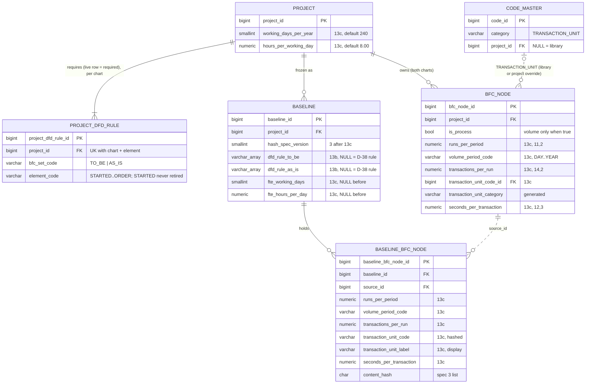

# Slice 13b / 13c — the project's DFD rule (D-70) and process volume & FTE (D-67): physical schema proposal

`apple`, 2026-10-13, rev 2. Rev 1 folded in the slice 13 design review (fail-closed rule, per-chart rule, automated
times, area matching). Rev 2 renumbers this file's questions after spec Q-13…Q-16. **Draft for Ben, nothing
decided.** Docs only. Source: `docs/slice13_spec.md` §4.2, §4.3, §5, §6, §8, §8a, §15; `docs/VB_design.md` is the
source of truth and wins where this file disagrees. Main is at migration **0051**, `CURRENT_HASH_SPEC = 2`. Slice
10d's **0052** (`docs/slice10d_raci_schema.md` §5) merges first, so the revisions here are written **0053 (13b)** and
**0054 (13c)**, or the next free numbers on `main` when built. 13a and 13d change no data and are not covered.

Ben has not answered spec Q-3…Q-16. This file models the **spec's recommended answers** and, where an answer
changes the model, shows the change (§2.7, §3.9). The spec's questions are written *spec Q-n*. This file's own
questions continue the slice's numbering from **[Q-17]** (§7), so the two never collide. Where a schema decision is
already a spec question, this file cites the spec's number instead of asking again.

Dialect PostgreSQL 16. House conventions as `slice7_schema.md`: identity PKs, S1-4 category columns on code FKs,
`AuditMixin` + `updated_at_trigger()`, every FK `NO ACTION`, CHECK-listed columns for fixed vocabularies the code
branches on (S2-1: `data_model_depth`, `bfc_set_code`, `performer_kind`, `trigger_kind`).

---

## 1. Facts found in code that shape this proposal

| # | Fact | Where | Consequence here |
|---|---|---|---|
| F1 | `code_master` rows are **seeded after** `alembic upgrade head`, never by Alembic. 7a had to move its backfill into a seed command (`seed_project_components`) for this reason, and lived with a 409 window | `seeds/seed_code_master.py`; `slice7_schema.md` §5.3 | A 13b backfill **inside the migration** (spec §6) cannot reference a `code_master` row. The rule's element is therefore a CHECK-listed code, not a `code_master` FK (§2.2), so the migration backfills in pure SQL with no window |
| F2 | `ck_code_behaviour_present`: `(category IN ('FR_TYPE','RACI_TYPE')) = (behaviour_code IS NOT NULL)` | `models/shared.py` | A `VOLUME_PERIOD` category "with behaviour" (spec §8) would need this CHECK widened. §3.4 avoids that |
| F3 | The cross-baseline diff marks an entity **`SCHEMA_VERSION_MISMATCH` with no rows** when its two sides' hashed lists differ | `services/baseline.py::diff` (`if cols_a != cols_b`) | Until now only *new* entities changed between specs, so this never fired. 13c is the **first change to an existing entity's list** (`bfc_node`). Without a fix, every diff of a pre-13c baseline against live or a post-13c baseline **loses the whole BFC node area**. Spec C5 and §6 ("the diff already compares per side's spec") assume otherwise. §3.7 specifies the fix |
| F4 | `freeze_set._e()` registers one hashed list under one `since=` | `services/freeze_set.py` | `bfc_node` needs `{1: today's list, 3: today's list + volume}`. `_e` gains a way to pass extra versions (§3.7) |
| F5 | `fn_baseline_header_guard()` (0047) names the frozen header columns **literally**; `vb_app` has column-level UPDATE on the header | `alembic/versions/0047_baseline.py` | A new header column is protected from the app by the column grant automatically, but **not** from the owner role until the guard function is replaced. 0053 and 0054 each `CREATE OR REPLACE` it |
| F6 | A nullable column added **without a default** is not a row write, so a shadow's reject trigger never fires and frozen rows read NULL | `vb_ops.immutable_guards`, 0050 precedent | Shadow columns are added nullable, no default (§3.6) |
| F7 | `bfc._step_blockers` refuses to un-make a process while the performer or `data_processing_desc` is set; `bfc_set.NODE_FIELDS` lists the node columns a chart copy carries | `services/bfc.py`, `services/bfc_set.py` | Volume joins both lists (§3.5, [Q-23], [Q-24]) |
| F8 | The volume write can use the existing node writer guard `object_guard(BfcNode, "EDIT", node_set_component)` (AS_IS for an as-is node, nothing for to-be) | `routers/scope.py` | No new component (spec Q-10). Criterion 49b already knows this resolver |
| F9 | Project settings are guarded `project_ctx("ADMIN")` (`_proj_admin`), not the bare `platform_admin` guard. The same people are allowed (only platform admins reach ADMIN), but the project lookup and the order 404 → 403 → 409 are kept | `routers/projects.py` (depth, components, restriction) | The spec §9 writes `platform_admin` for `/dfd-rule`, `/dfd-rule/preview`, `/fte-basis`. This file uses **`project_ctx("ADMIN")`** for all three |
| F10 | `hier_code` is re-derived when siblings are reordered (S1-2, two-phase renumber), per chart | `services/bfc.py` renumber | An as-is ↔ to-be match on `hier_code` alone drifts as soon as one chart is reordered (§3.8) |
| F11 | `AuditMixin.created_by` is NOT NULL | `models/base.py` | The 13b backfill rows take `project.created_by` as their author (the 0051 precedent: the source row's author) |

---

# Part 13b — The DFD rule (D-70)

## 2.1 Grain: per project **and chart**, recommended (spec Q-15)

Whether the rule is one per project or one per chart (to-be / as-is) is **spec Q-15**. This file models its
recommendation: **per chart.** A freeze is project-wide, so under one rule a rough as-is chart (often captured in a
workshop, with no data entities yet) blocks the to-be freeze the moment the project tightens its rule for the to-be.
That is the chart the client signs. With one rule per chart, the to-be can be strict and the as-is light. Switching
the AS_IS component off still removes its blocking entirely (S7-3, unchanged); the per-chart rule covers a project
that keeps its as-is on.

Grain: **one row per (project × chart × required element)**.

## 2.2 `project_dfd_rule` — a required DFD element on one chart of one project

| Column | Type | Null | Default | FK | Description |
|---|---|---|---|---|---|
| `project_dfd_rule_id` | bigint identity | NO | identity | — | PK |
| `project_id` | bigint | NO | — | → `project` | from the route, never the body |
| `bfc_set_code` | varchar(10) | NO | — | — | `ck_pdr_set CHECK (bfc_set_code IN ('TO_BE','AS_IS'))`, the chart the element applies to |
| `element_code` | varchar(12) | NO | — | — | `ck_pdr_element CHECK (element_code IN ('STARTED','DATA_IN','DATA_OUT','EXTERNAL','ORDER'))` (§2.3) |
| + `AuditMixin` | | | | | law 3. **A live row means "required"; a retired row means "not required"**, as `project_component` |

- **Keys:** PK `project_dfd_rule_id`. UK `uq_project_dfd_rule (project_id, bfc_set_code, element_code)` **full**,
  including retired rows. Re-adding an element **restores** the same row (S1-7). The UK leads with `project_id`
  and serves every read; no other index.
- **`ck_pdr_started_locked CHECK (element_code <> 'STARTED' OR is_active)`.** STARTED can never be retired (spec
  §7.2: a process nothing starts cannot be placed; A-13-3). Under spec Q-3 option C the CHECK widens to the floor
  (§2.7).
- **Cross-row rule (option A):** ORDER requires DATA_IN and DATA_OUT on the same chart, because order *is* data.
  A CHECK cannot see sibling rows. It is held by `dfd_rule.validate` (422) and re-proved by a must-be-empty
  consistency line `dfd_rule_invalid` (§2.5).
- **Not shadowed, not in `FREEZE_SET`** (a setting, not scope). **Not in `step_retire.OWNED`** (it points at the
  project, not a step). FK target `project` is in `lifecycle.EXCLUDED_TARGETS`, so no Link is derived. **Not
  `RESTORABLE`** through the generic restore route: changed only by `dfd_rule.set`, which audits.
- Grants: default (SELECT/INSERT/UPDATE), no DELETE. `models/__init__.py` exports `ProjectDfdRule` (law 10), with
  `owning_project_id()`. `purge_project` (Q15, when built) lists it.

**Why a child table now, not booleans on `project`.** Rev 0 of this file recommended four booleans, because they
make every rule a CHECK. With a per-chart rule that becomes eight columns. The review also asks for "no live rows ⇒
fail closed", which is a row concept. The child table mirrors `project_component`, keeps one predicate list per chart, and
loses only the ORDER CHECK, which the consistency line restores at freeze time. Under a **per-project** answer to
spec Q-15 (§2.7) the booleans would again be the simpler shape; both are shown there.

## 2.3 The element vocabulary: codes in code, labels in i18n [Q-17]

| Code | Predicate (spec §7.1) |
|---|---|
| `STARTED` | live step input, or live inbound external flow, or live trigger link (today's "input") |
| `DATA_IN` | live step input (a data entity) |
| `DATA_OUT` | live step output (today's "output") |
| `EXTERNAL` | live external flow; per process or per diagram is spec Q-6, and which diagram is spec Q-16 (§2.7) |
| `ORDER` | joined to another process of its chart by the derived order; a one-process chart passes |

The spec §8 proposes a system `code_master` category `DFD_RULE_ELEMENT`. **Recommended instead:** a CHECK-listed
`element_code`, with labels and plain descriptions in `en.settings.json` (`settings.dfdRule.<CODE>.label/.help`).
The vocabulary is closed and code-defined (each code is a predicate), so law 5 is not engaged (S2-1). A `code_master` FK
would make the in-migration backfill impossible (F1) and would force the 7a seed-command pattern with its window.
**If Ben prefers the category anyway**, it can be seeded `is_system = true` with no `behaviour_code` (F2) and read
for labels only, matched on `code`, with no FK. Nothing else here changes.

## 2.4 Fail closed: an empty rule is the D-38 rule

`dfd_rule.codes(db, project_id, bfc_set) -> tuple[str, ...]` is **the one reader**. `readiness`, the marks, the
warnings panel, `consistency_check`, the preview and the freeze all call it:

```
live = sorted(element_code of live rows for (project, chart))
if not live:                      # no row at all, or every row retired by hand outside the service
    return FIXED_RULE             # ("DATA_OUT", "STARTED") — D-38; never "nothing required"
return tuple(sorted(set(live) | {"STARTED"}))
```

- **Must-be-empty consistency line `project_without_dfd_rule`** lists each (project, chart) with no live rule row.
  It is an *error* line (not in `INFORMATIONAL`, `WARNINGS` or `FREEZE_BLOCKING_WARNINGS`), so the freeze refuses
  until an admin saves a rule. The readers never fall open in the meantime: they apply D-38.
- `create_project`, the 0053 backfill and `dfd_rule.set` (which keeps STARTED live, and the CHECK enforces it)
  all leave every (project, chart) with at least one live row. The line exists to catch a raw-SQL import, a restore
  from a dump, or a future writer that forgets.
- The same fail-closed rule applies to a chart whose DFD component is off: the rule is still stored and shown, it
  just does not apply (S7-3).

## 2.5 Service and guard contract (shape only; spec §7.2 pseudocode stands)

| Route | Guard | Notes |
|---|---|---|
| `GET /projects/{id}/dfd-rule` | `project_ctx("VIEW")` | per chart: codes, `rule_applies` (DFD on), locked and recommended flags; the catalogue (code, i18n key); the project's `row_version` |
| `POST /projects/{id}/dfd-rule/preview` | `project_ctx("ADMIN")` (F9) | body `{bfc_set_code, codes}`. Returns, for that chart, {ready, partly, not_ready, would_block} and `preview_digest` = sha256 over (chart, sorted codes, counts, sorted would-block node ids) |
| `PUT /projects/{id}/dfd-rule` | `project_ctx("ADMIN")` (spec Q-5) | body `{bfc_set_code, codes, row_version, preview_digest}`. Locks the project row `FOR UPDATE`, 409 on stale project `row_version` or a changed digest, `validate` → 422, restores/inserts added rows, retires dropped rows, sets `project.updated_by` (the mapper bumps `project.row_version`, never the body, law 6). One audit `PROJECT_DFD_RULE_CHANGED {bfc_set_code, from, to, would_block}` |

- **Concurrency:** `project.row_version` is the one token for the whole rule, both charts (spec §5 brief Q4). The
  rule rows' own `row_version` exists (law 3) but is not a request input.
- **No `component=`:** a project setting, not a component write.
- **Freeze-blocking keys** (`consistency.FREEZE_BLOCKING_WARNINGS`): today's `process_missing_input` (= STARTED) and
  `process_missing_output` (= DATA_OUT) keep their names, now driven by each chart's rule; new keys
  `process_missing_data_in`, `process_missing_order`, and `process_missing_external` (or `diagram_missing_external`
  under spec Q-6's recommendation). A key whose element is off for that chart lists nothing for it. New error lines:
  `project_without_dfd_rule`, `dfd_rule_invalid`.
- **`create_project`** inserts, for each chart, the codes from the create body or the defaults
  `dfd_rule.RECOMMENDED = {"TO_BE": STARTED, DATA_IN, DATA_OUT, ORDER; "AS_IS": STARTED}` (code constants;
  EXTERNAL off per spec Q-6) [Q-18]. Ben's review of the default after two client projects (spec §1a) is a code
  change, never a migration.
- The freeze reads both charts' rules **inside its REPEATABLE READ snapshot**, so the consistency check and the
  header copy see the same rule.

## 2.6 `baseline` — the rule a baseline passed [Q-19]

| Column | Type | Null | Description |
|---|---|---|---|
| `dfd_rule_to_be` | `varchar(12)[]` | YES | `dfd_rule.codes(project, 'TO_BE')` at the freeze, sorted |
| `dfd_rule_as_is` | `varchar(12)[]` | YES | the same for `AS_IS`. Written even when the as-is component is off: the frozen `project_component` rows say whether it applied |

```sql
ck_baseline_dfd_rule_pair CHECK (num_nonnulls(dfd_rule_to_be, dfd_rule_as_is) IN (0, 2))
ck_baseline_dfd_rule_vals CHECK (dfd_rule_to_be IS NULL OR (
      cardinality(dfd_rule_to_be) >= 1 AND cardinality(dfd_rule_as_is) >= 1
  AND dfd_rule_to_be <@ ARRAY['STARTED','DATA_IN','DATA_OUT','EXTERNAL','ORDER']::varchar(12)[]
  AND dfd_rule_as_is <@ ARRAY['STARTED','DATA_IN','DATA_OUT','EXTERNAL','ORDER']::varchar(12)[]))
```

- **Both NULL = frozen before 13b = "D-38 rule"** on both charts (spec B6).
- **A header column, not a frozen entity** (spec §5 brief Q3, agreed): no shadow, no `FREEZE_SET` entry, **no
  hash-spec bump**, never a diff row. Immutable as the other header facts: added to the frozen list of a replaced
  `fn_baseline_header_guard()` (F5), with no `vb_app` UPDATE grant. **Not in `content_digest`**, exactly as
  `data_model_depth`; the trigger and the grant are its protection.
- **Normalisation note:** the arrays are a deliberate 1NF exception. Each is a frozen record of a small set,
  read whole, never queried by element, never updated. The normalised alternative, a `baseline_dfd_rule` child
  table, would be a new immutable table with its own guards for a value that is only displayed. Not recommended.
- Once 13c lands, 0054 adds `ck_baseline_dfd_rule_from_spec_3 CHECK (hash_spec_version < 3 OR dfd_rule_to_be IS
  NOT NULL)`: every baseline frozen after both slices provably carries its rule.

## 2.7 What each unanswered question changes in 13b

| Question | Recommended → model above | Other answers → what changes |
|---|---|---|
| **spec Q-15** (per project or per chart) | **per chart**: `bfc_set_code` in the grain and the UK; two header arrays; preview and PUT take `bfc_set_code` | **Per project:** either (a) the same table without `bfc_set_code` (UK `(project_id, element_code)`), one header column `dfd_rule_codes varchar(12)[]`, and a backfill of two rows per project; or (b) simpler, no table: four booleans on `project` (`dfd_requires_data_in` default false, `_data_out` default true, `_external` false, `_order` false; STARTED implicit) with `CHECK (NOT dfd_requires_order OR (dfd_requires_data_in AND dfd_requires_data_out))`. The ADD COLUMN defaults *are* the backfill, the ORDER rule is a CHECK, and `dfd_rule_invalid` is not needed. "Fail closed" then has nothing to catch, because a column cannot be absent; `project_without_dfd_rule` is dropped. Under a per-project answer, **(b) is recommended** |
| **spec Q-3** (D-70 vs D-38) | **A**: STARTED locked by CHECK; ORDER needs both data elements (service + `dfd_rule_invalid`). A diagram without data entities lays processes out in chart order, **no schema** | **C**: `ck_pdr_started_locked` becomes `CHECK (element_code NOT IN ('STARTED','DATA_OUT') OR is_active)`, and the catalogue marks DATA_OUT locked. A ↔ C later is a one-constraint migration, so **0053 can be built before Q-3 if the answer is A or C**. **B**: everything above **plus** `project.dfd_order_source varchar(8) NOT NULL DEFAULT 'DERIVED' CHECK IN ('DERIVED','DRAWN')` (copied to a header column); `bfc_node_flow` un-retired (`GRANT INSERT, UPDATE … TO vb_app`, reversing 0045 and criterion 83); it **joins `FREEZE_SET`** for the first time with a generated `baseline_bfc_node_flow`, a chart gate and a hash-spec bump (if B lands first it takes spec 3 and 13c takes spec 4); `step_retire.OWNED` re-entry; the restore skip removed; a must-be-empty line "drawn flows in a DERIVED project"; DRAWN → DERIVED refused while live flows exist; ORDER's predicate reads the order source. A separate migration, a `sara` review, and a design change to D-38. **Not recommended** |
| **spec Q-4** (starting rule) | existing projects, **every project regardless of `is_active`**, both charts: STARTED + DATA_OUT, by the 0053 backfill. New: `RECOMMENDED` per chart | "Existing projects also get the recommended set": the backfill inserts that instead, and freezes change overnight (spec B1 dropped). "New projects get today's rule": `RECOMMENDED` = the D-38 pair on both charts, no schema change |
| **spec Q-5** (who changes it) | `project_ctx("ADMIN")` | "Project editors": `project_ctx("EDIT")`. No schema change; the audit event names the actor |
| **spec Q-6 / Q-16** (EXTERNAL scope; which diagram) | per diagram, off by default; the diagram is the DFD listed on the DFD screen (D-54). EXTERNAL drives a chart-level line `diagram_missing_external`. It never changes a process's light; the DFD index shows it | "Every process": the same row; per-process key `process_missing_external`. **No schema difference** under either question |
| **spec Q-13** (red = blocks the freeze) | the light reads the chart's rule (red: a rule element missing) and `RECOMMENDED[chart]` (yellow: a recommended element missing). Both are already modelled | **No schema difference.** "Recommended" is the code constant of §2.5, not stored |
| **spec Q-14** (a trigger as its own element) | no: STARTED covers it | "Yes": add `'TRIGGER'` (a live `bfc_node_trigger`) to `ck_pdr_element` and `ck_baseline_dfd_rule_vals`. This is a CHECK change in the migration of whichever slice adds it, plus one predicate; no backfill, because no project requires it at first |

## 2.8 Migration 0053 (13b) — one commit, as `vb_owner`, reversible

Upgrade, one transaction:
1. `CREATE TABLE project_dfd_rule` (§2.2): PK, `uq_project_dfd_rule`, FK to `project`, the three CHECKs,
   `updated_at_trigger`.
2. **Backfill: every project, live or retired, both charts, exactly today's rule.**
   ```sql
   INSERT INTO project_dfd_rule (project_id, bfc_set_code, element_code, created_by)
   SELECT p.project_id, s.c, e.c, p.created_by
   FROM project p CROSS JOIN (VALUES ('TO_BE'), ('AS_IS')) s(c) CROSS JOIN (VALUES ('STARTED'), ('DATA_OUT')) e(c);
   -- then assert: count(*) = 4 × (SELECT count(*) FROM project), else RAISE
   ```
   One `audit_event` `PROJECT_DFD_RULE_BACKFILLED {migration: "0053", rule: ["DATA_OUT","STARTED"], charts: [...]}`
   per project, `app_user_id` NULL (the 0038 precedent). This is data in a migration **only because the table is
   born empty and must equal today's behaviour** (spec §6), and it needs no seed (F1). A retired project is
   backfilled too, so restoring it never meets an empty rule.
3. `ALTER TABLE baseline ADD COLUMN dfd_rule_to_be varchar(12)[], ADD COLUMN dfd_rule_as_is varchar(12)[]`
   (nullable, no default, F6) + the two CHECKs.
4. `CREATE OR REPLACE FUNCTION fn_baseline_header_guard()` with both columns added to the frozen list.

Downgrade:
- **Refuses while any baseline has a non-NULL rule.** Dropping it would erase which rule a frozen baseline passed
  (law 2). This pauses for Ben.
- **Refuses while any live rule row differs from the backfilled pair.** Dropping the table would silently change
  that project's freeze. This pauses for Ben.
- Otherwise: restore the 0047 guard body, drop the header CHECKs and columns, drop the table. The backfill audit
  rows stay (append-only, landmine 2).

**Tests to add:** after upgrade every project, including a retired one, has STARTED + DATA_OUT live on both charts,
and a freeze that passed before upgrade still passes (B1, against a pre-upgrade fixture); retiring every row of a
chart by raw SQL makes `readiness` apply D-38 and makes the freeze refuse on `project_without_dfd_rule`; an ORDER row
without DATA_IN refuses the freeze on `dfd_rule_invalid`; `ck_pdr_started_locked` refuses for the owner role; a
stricter as-is rule never changes the to-be light; the guard refuses an owner UPDATE of the header arrays; a pre-13b
baseline still verifies and reads "D-38 rule"; the downgrade refusals.

**Fixture risk.** `conftest`'s `ed`/`world` and `seed_demo` create projects through `create_project`, so they would
start with the stricter *recommended* to-be rule, and every existing freeze test with trigger + output only would
start refusing. The fixture passes today's set in the create body (one helper); new tests cover the recommended
default. `seed_demo` does the same or fills DATA_IN and ORDER.

---

# Part 13c — Process volume and FTE (D-67)

## 3.1 Storage: columns on `bfc_node`, not a 1:1 table [Q-20]

Volume is one set of values per process step. It is single-valued, has no life of its own, is frozen with the
process and is diffed as a CHANGED field. That is the shape of `data_processing_desc` and the performer arc (7c §9.4).
A 1:1 `process_volume` table would add a new `FREEZE_SET` entity (`since=3`) with shadow, gate and labels, a
`step_retire.OWNED` entry, restore handling, a lifecycle Link and a second `row_version`, for a gain (history or
scenarios) the inputs do not ask for. If scenarios ever come, they are a new table keyed by (process, scenario),
and these columns stay the base case.

**Trade-off accepted:** a volume edit and a rename of the same node share `bfc_node.row_version`, so one of two
concurrent edits gets 409. This is the same as the performer today.

## 3.2 Sizing: human as-is and automated to-be in one set of types [Q-21]

A shadow column's type can never be ALTERed (DR8-D1), and the type fixes the hashed `::text` form, so the types
must hold both ends from the first migration. Two worked cases:

| Case | Runs | Transactions per run | Time per transaction | Annual hours (240 × 8 basis) |
|---|---|---|---|---|
| **as-is, human** (spec C1) | 3 a week | 40 invoices | 6 min = **360 s** | 3 × 52 × 40 × 360 / 3600 = **624 h → 0.33 FTE** |
| **to-be, automated** | 1 a day | 8,000 invoices | **0.3 s** | 240 × 8,000 × 0.3 / 3600 = **160 h → 0.083 FTE** |
| **to-be, real-time** | 2,000 a day | 1 message | 0.05 s | 240 × 2,000 × 0.05 / 3600 = 6.67 h |

Rev 0's `minutes_per_transaction numeric(9,2)` cannot hold 0.3 s (0.005 min would round to 0.01 min, doubling the
automated case), so **time is stored in seconds**:

| Column | Type | Range accepted (service cap) | Type headroom | Decimals accepted |
|---|---|---|---|---|
| `runs_per_period` | numeric(11,2) | 0 – 1,000,000 per period | 999,999,999.99 | 2 (fortnightly = 0.5 a week) |
| `transactions_per_run` | numeric(14,2) | 0 – 100,000,000 per run | 999,999,999,999.99 | 2 (an average: 2.5 lines per run) |
| `seconds_per_transaction` | numeric(12,3) | 0 – 86,400 (one day) per transaction | 999,999,999.999 | 3 (1 ms) |
| `working_days_per_year` (project) | smallint | 1 – 366 | | 0 |
| `hours_per_working_day` (project) | numeric(4,2) | 0.25 – 24 | | 2 |

- **Caps are service constants** (`process_volume.CAPS`), not CHECKs. A cap can move without a migration, and
  each type leaves at least 1,000× headroom above its cap. The CHECKs only hold `>= 0` and the basis ranges.
- **More decimals than the column holds → 422**, so PostgreSQL never rounds silently and the stored value is the
  typed value.
- **Entry in minutes or seconds is a screen choice.** The screen offers "min" / "s" and the API takes
  `seconds_per_transaction` only. Minutes × 60 is exact for any minute entry of up to 4 decimals at 3-decimal
  seconds (6 min → `360.000`, 1.25 min → `75.000`). Hashing and diffs see seconds; the screen shows whichever unit
  reads better.

## 3.3 `bfc_node` — new columns

| Column | Type | Null | FK | Description |
|---|---|---|---|---|
| `runs_per_period` | numeric(11,2) | YES | — | how often the process runs per `volume_period_code` |
| `volume_period_code` | varchar(10) | YES | — | `DAY` / `WEEK` / `MONTH` / `QUARTER` / `YEAR`, CHECK-listed (§3.4) |
| `transactions_per_run` | numeric(14,2) | YES | — | transactions handled each run (spec Q-8) |
| `transaction_unit_code_id` | bigint | YES | category FK | what a transaction is: `TRANSACTION_UNIT` |
| `transaction_unit_category` | varchar(40) | NO\* | — | GENERATED `'TRANSACTION_UNIT'` STORED (S1-4) |
| `seconds_per_transaction` | numeric(12,3) | YES | — | handling time of one transaction (spec Q-8) |

\* stored constant.

```sql
ck_bfc_volume_period    CHECK (volume_period_code IS NULL OR volume_period_code IN ('DAY','WEEK','MONTH','QUARTER','YEAR'))
ck_bfc_volume_nonneg    CHECK (coalesce(runs_per_period, 0) >= 0 AND coalesce(transactions_per_run, 0) >= 0
                               AND coalesce(seconds_per_transaction, 0) >= 0)
ck_bfc_volume_run_pair  CHECK ((runs_per_period IS NULL) = (volume_period_code IS NULL))     -- "3" means nothing without "a week"
ck_bfc_volume_unit      CHECK (transaction_unit_code_id IS NULL OR transactions_per_run IS NOT NULL)
ck_bfc_volume_process   CHECK (is_process OR num_nonnulls(runs_per_period, volume_period_code, transactions_per_run,
                               transaction_unit_code_id, seconds_per_transaction) = 0)        -- as ck_bfc_desc_process_only
fk_bfc_txn_unit (transaction_unit_code_id, transaction_unit_category) → code_master (uq_code_category_target) ON UPDATE NO ACTION
ix_bfc_txn_unit (transaction_unit_code_id) WHERE transaction_unit_code_id IS NOT NULL
```

- **The unit is optional** and is not an FTE input; with no unit the screen reads "transactions". A unit without a
  count is refused.
- **A project override unit:** as for every override FK, the FK proves the category and the service proves the
  scope (`code_master.resolve(project_id, 'TRANSACTION_UNIT')`). Codes are sent, never labels or ids (C8).
- **No hours or FTE column exists.** Derived values have nowhere to be stored, and the volume body is
  `extra="forbid"`, so `annual_hours` / `fte` → 422 (law 6, spec C2). Suggest adding `annual_hours` and `fte` to
  CLAUDE.md law 6's list.

## 3.4 Vocabularies [Q-17]

| Category | Storage | Why |
|---|---|---|
| **`VOLUME_PERIOD`** | **CHECK-listed `volume_period_code`**, labels in `en.processes.json`; **not** a `code_master` category | Closed, code-defined, and the code branches on it (`PERIODS_PER_YEAR`). The spec §8 version ("system, with behaviour") collides with `ck_code_behaviour_present` (F2) and would need that CHECK widened, a `volume_period_code_id` + generated category, and a seed, for a relabel screen over five words. **If Ben prefers `code_master`:** `is_system = true`, **no** `behaviour_code` (a system category may branch on its code, 7a §1), shadow pair `volume_period_code` / `_label`, hash on `volume_period_code`. Same hash input, so no hashed value differs |
| **`TRANSACTION_UNIT`** | `code_master`, library (`is_system = false`) + project override, in `seed_code_master.LIBRARY`: `INVOICE, ORDER, CASE, DOCUMENT, RECORD, CALL, PAYMENT, EMPLOYEE, OTHER` (spec §8) | Client vocabulary that a project relabels or extends (C8); never branched on |
| `DFD_RULE_ELEMENT` | none (§2.3) | |

0054 does **not** depend on the seed: the FK is nullable and every existing node is NULL. No window.

## 3.5 `project` — the FTE basis (spec Q-7), and the derivation

| Column | Type | Null | Default | CHECK |
|---|---|---|---|---|
| `working_days_per_year` | smallint | NO | `240` | `ck_project_fte_days CHECK (working_days_per_year BETWEEN 1 AND 366)` |
| `hours_per_working_day` | numeric(4,2) | NO | `8.00` | `ck_project_fte_hours CHECK (hours_per_working_day BETWEEN 0.25 AND 24)` |

- The server defaults fill existing projects (240 × 8 = 1,920 h). Written only by `PUT /projects/{id}/fte-basis`
  (`project_ctx("ADMIN")`, F9), with body `{working_days_per_year, hours_per_working_day, row_version}` and audit
  `PROJECT_FTE_BASIS_CHANGED {from, to}`. No process row changes (spec C4).
- **`DAY` reads `working_days_per_year`, not 365** (spec §5 brief Q4) [Q-27]. WEEK 52, MONTH 12, QUARTER 4, YEAR 1 are
  code constants in `process_volume.PERIODS_PER_YEAR`.
- **One owner** `process_volume.derive(node, basis)`, on every read, in Decimal:
  `annual_hours = runs × periods_per_year × transactions_per_run × seconds_per_transaction / 3600`;
  `fte = annual_hours / (working_days_per_year × hours_per_working_day)`. If runs, period, transactions or seconds
  is missing, both are `null` with `incomplete: [fields]`. Rounded for display only.
- Normalisation: hours and FTE depend transitively on the inputs and the basis, so storing them breaks 3NF and goes
  stale on every basis change. They are derived, never stored.
- **Other node writers** (F7): `bfc._step_blockers` adds "the volume figures" [Q-24]; `bfc_set.NODE_FIELDS` adds the
  five columns [Q-23]; the generic node PATCH body refuses them, so volume is written only by `process_volume.set`
  with audit `PROCESS_VOLUME_SET {from, to}`.

## 3.6 Baseline shadows and header (law 2)

**`baseline_bfc_node`, same migration, literal DDL** from `scripts/print_shadow_ddl.py` (as 0050), nullable, no
default (F6):

| Shadow column | Type | Hashed at spec 3 |
|---|---|---|
| `runs_per_period` | NUMERIC(11,2) | ✓ |
| `volume_period_code` | VARCHAR(10) | ✓ |
| `transactions_per_run` | NUMERIC(14,2) | ✓ |
| `transaction_unit_code_id` | BIGINT | — (the code is hashed, not the id) |
| `seconds_per_transaction` | NUMERIC(12,3) | ✓ |
| `transaction_unit_code` | VARCHAR(40) | ✓ (code pair from `code_pairs`) |
| `transaction_unit_label` | VARCHAR(200) | — (display; the label as it read at the freeze) |

`transaction_unit_category` is GENERATED, so it is skipped by `snapshot_column_names`. Pre-13c frozen rows read
NULL in all seven columns, which is true: they had no volume.

**`baseline` header**, so a baseline's FTE re-derives as frozen (spec C6) [Q-25]:

| Column | Type | Null | CHECK |
|---|---|---|---|
| `fte_working_days` | smallint | YES | `ck_baseline_fte_pair CHECK (num_nonnulls(fte_working_days, fte_hours_per_day) IN (0, 2))` |
| `fte_hours_per_day` | numeric(4,2) | YES | `ck_baseline_fte_from_spec_3 CHECK (hash_spec_version < 3 OR fte_working_days IS NOT NULL)` |

NULL means frozen before 13c (no FTE shown). Both go into `fn_baseline_header_guard()`'s frozen list (F5) and are not
in `content_digest`, like `data_model_depth`. The CHECK is keyed on `< 3`, so `test_hash_spec`'s monkeypatched
spec-1 freeze, which writes the basis anyway, still passes.

## 3.7 Hash spec 2 → 3, and the cross-spec diff fix (F3, F4) [Q-22]

```python
CURRENT_HASH_SPEC = 3   # 3: bfc_node gained the volume figures (slice 13c, D-67)
_BFC_1 = ("bfc_set_code", "is_process", "node_name", "purpose_desc", "data_processing_desc", "performer_kind",
          "performer_org_unit_id", "performer_org_role_id", "performer_application_id", "performer_label")
_e("bfc_node", "BFC", _BFC_1, …, more={3: _BFC_1 + ("runs_per_period", "volume_period_code", "transactions_per_run",
                                                  "transaction_unit_code", "seconds_per_transaction")})
# new module assert: every later list of an entity EXTENDS its earlier one (append-only) — the diff rule relies on it
```
- `columns_for(bfc_node, 2)` returns the spec-1 list, so spec-1 and spec-2 baselines re-hash and re-digest
  byte-identical (`verify`, `rehash_mismatches` and `digest` already work at each baseline's spec).
  `SPEC_1_ENTITIES` and the two existing asserts are unchanged, and `test_hash_spec`'s golden digest still holds.
- **Required diff change** (`services/baseline.diff`). When both lists exist and differ, the diff no longer returns
  `SCHEMA_VERSION_MISMATCH`. It compares on **the older list**: CHANGED iff `any(ra[c] != rb[c] for c in older)`.
  This is a field comparison, because the stored hashes cover different lists. MOVED works as today. The entry gains
  `"compared_on_spec": <older>, "not_compared": [the newer columns]`, so the screen can say "Volume is not in
  v1.2". Against a pre-13c baseline, no process is CHANGED because the columns exist (spec C5), and no BFC row is
  lost. `SCHEMA_VERSION_MISMATCH` stays for a non-prefix list, which the new assert makes impossible.
- The `bfc_node` freeze gate is unchanged (`by_step_set {"AS_IS": "AS_IS"}`). No new component, no column gate.

## 3.8 As-is vs to-be totals: matching areas (spec Q-9, F10) [Q-28]

The summary needs no schema under the recommendation; this records the matching rule, because a code-only match is
wrong:

- **Matched** = same level (L1 or L2), same `hier_code`, **and** the same normalised name (`lower(btrim(node_name))`).
  Each matched line shows **both names** (they are equal by the rule) and both codes.
- **Unmatched**, listed and never summed against the other side, each with its reason:
  `CODE_SAME_NAME_DIFFERS` (renamed, or a reorder put a different area under that code), `NAME_ELSEWHERE` (the same
  name sits under a different code on the other chart: "probably reordered", both codes shown), `ONLY_AS_IS`,
  `ONLY_TO_BE`. Unmatched areas still show their own totals.
- Processes with incomplete volume are counted and listed per area, never guessed (spec C7).

**Option: a stable area key, if Ben wants matching that survives reorders and renames.** Add
`bfc_node.area_key bigint NULL`, set on L1 and L2 non-process nodes as their own `bfc_node_id` at create, and
**carried unchanged by `bfc_set.copy_set`** (the copy's area gets its source's key). The summary then matches on
`area_key`. Its cost:
- **Shadow decision:** it is a new live column on a shadowed table. Either `SHADOW_EXCLUDED["bfc_node"] = ("area_key",)`
  (not scope: no shadow column, no hash change, recommended) or a shadow column, unhashed.
- **Areas created after the copy** have no counterpart key. A "match this area to…" action is needed (a write route,
  EDIT, audited) to set an area's key to the other chart's. That is screen work.
- **It partly reopens 7c [Q-24]** ("no provenance column"). That refusal was about processes, which merge and split.
  Areas rarely do, and the key stays off process rows (`CHECK (area_key IS NULL OR (NOT is_process AND level_no <= 2))`).
- **Backfill:** set `area_key` on existing pairs that match by code and name today; the rest start unmatched.
- **Recommendation: not now.** Code + name with the unmatched list is honest and costs nothing. If the summary is used
  on a real ROI case and reorders bite, add the key in its own migration. Being excluded from the shadow, it does not
  touch the hash spec then either.

## 3.9 What each unanswered spec question changes in 13c

| Question | Recommended → model above | Other answers → what changes |
|---|---|---|
| **spec Q-8** (units), **blocks 0054** | transactions **per run**, time **per transaction**: `runs_per_period` + `volume_period_code`, `transactions_per_run` (+ unit), `seconds_per_transaction`. Hours = runs × ppy × txns × s / 3600 | **(i) Transactions per period, not per run** ("400 invoices a month"): drop `runs_per_period`; `transactions_per_period numeric(14,2)` + `volume_period_code` (the pair CHECK moves to them); `seconds_per_transaction`. Hours = txns × ppy × s / 3600. Hashed: `transactions_per_period, volume_period_code, transaction_unit_code, seconds_per_transaction`. **(ii) Time per run, not per transaction:** `seconds_per_run numeric(12,3)` (cap 86,400) replaces `seconds_per_transaction`; hours = runs × ppy × s / 3600; `transactions_per_run` becomes informational and leaves `incomplete`. **(iii) Both** (set-up per run + handling per transaction): add `seconds_per_run` beside `seconds_per_transaction`; hours = runs × ppy × (s_run + txns × s_txn) / 3600, where one of the two may be NULL but not both. Every variant changes names and the hashed list, and **a shadow column's name or type can never change later**, so Q-8 is answered before 0054 is written |
| **spec Q-7** (basis) | per project, 240 × 8, `project_ctx("ADMIN")`, stamped on the header | "One FTC-wide basis": no `project` columns; `process_volume.DEFAULT_BASIS` in code; the header columns stay. "Editors may change it": `project_ctx("EDIT")` |
| **spec Q-9** (as-is vs to-be) | by area, code + name, mismatches listed (§3.8); **no schema** | "Area key": §3.8 option. "Process by process": a new M:N `process_correspondence (as_is_bfc_node_id, to_be_bfc_node_id)` junction (merge and split are real, 7c [Q-24]), with audit and step-owned retire. A separate design, not modelled |
| **spec Q-10** (frozen? component?) | frozen and hashed; no component | **Frozen, not hashed:** shadow columns stay, no spec bump, the `bfc_node` list is unchanged; but a volume change never shows in a diff and tampering goes undetected. Not recommended. **Not frozen** (working estimates, A-13-7): `SHADOW_EXCLUDED["bfc_node"]` = the five columns, no shadow columns, no header FTE columns, **no spec bump, no diff fix**, and a non-destructive downgrade for baselines. **A `VOLUME` component:** a `PROJECT_COMPONENT` seed code; the route declares `component="VOLUME"` (criterion 49b); a `COMPONENT_ROWS["VOLUME"]` probe blocks switch-off while any node has volume; the freeze still hashes the columns (NULL when off). No column gate |

## 3.10 Migration 0054 (13c) — one commit, as `vb_owner`, reversible; downgrade pauses for Ben

Upgrade, one transaction:
1. `bfc_node`: the five columns, the generated `transaction_unit_category` (a table rewrite, fine at A-35 sizes),
   the five CHECKs, `fk_bfc_txn_unit`, `ix_bfc_txn_unit`.
2. `baseline_bfc_node`: the seven shadow columns (§3.6), literal, nullable, no default. Steps 1 and 2 must be in the
   same revision, because the parity test in `tests/test_baseline.py` reads the database.
3. `project`: `working_days_per_year`, `hours_per_working_day` + CHECKs (defaults fill existing rows).
4. `baseline`: `fte_working_days`, `fte_hours_per_day`, `ck_baseline_fte_pair`, `ck_baseline_fte_from_spec_3`, and
   13b's `ck_baseline_dfd_rule_from_spec_3` (§2.6).
5. `CREATE OR REPLACE FUNCTION fn_baseline_header_guard()` with the two FTE columns added.

The code half of the commit: models; `freeze_set` spec 3 with `more=`; the diff change; `SHADOWED` unchanged (no new
entity); `TRANSACTION_UNIT` in the seed. Deploy order: `alembic upgrade head` → `seeds.seed_code_master`. There is
no backfill: existing nodes correctly have "no volume yet".

Downgrade, **destructive, so it pauses for Ben** (law 10) [Q-26]:
- **Refuses while any baseline has `hash_spec_version >= 3`.** Its digest covers the volume columns.
- **Refuses while any live `bfc_node` holds a volume value**, or any project's basis differs from 240 × 8.
- Otherwise: restore 0053's guard body, then drop CHECKs, FK, index and columns in reverse order.

**Tests to add:** shadow parity; a spec-2 baseline still verifies, matches its stored digest and diffs against live
with zero CHANGED on an untouched project (C5); a spec-3 baseline re-derives the same FTE after the basis changes
(C6); the three worked cases of §3.2 in Decimal (C1 included); 0.3 s stored and hashed as `0.300`; 422 on `fte` /
`annual_hours`, a non-process node, a negative value, too many decimals and a value over its cap (C2);
`ck_bfc_volume_process` refuses for the owner role; un-making a process with volume is refused; a chart copy carries
volume; the area matcher lists a reordered area as `NAME_ELSEWHERE`, never summed; the downgrade refusals.

---

## 4. ER fragment (13b + 13c)



## 5. Checklist against the VB laws

| Law | 13b | 13c |
|---|---|---|
| 1 no hard delete | dropping an element retires its row; re-adding restores it | clearing volume sets NULL; no rows |
| 2 baselines immutable | header arrays in the guard; no shadow; no bump | shadow columns in the same migration, generated DDL frozen literal; spec 3; types sized once (§3.2); old baselines verify; diff fix |
| 3 audit / soft delete / `row_version` | `project_dfd_rule` born with `AuditMixin`; `PROJECT_DFD_RULE_CHANGED`, `…_BACKFILLED` | on `bfc_node` / `project`; `PROCESS_VOLUME_SET`, `PROJECT_FTE_BASIS_CHANGED` |
| 5 behaviour, not code | closed code vocabulary (S2-1) | `PERIODS_PER_YEAR` on a CHECK-listed code; `TRANSACTION_UNIT` never branched on |
| 6 derived never from a body | `row_version`, the derived code set | hours, FTE, `row_version`; `extra="forbid"` → 422 |
| 10 one migration per commit, reversible; new table in `models/__init__.py` | 0053; `ProjectDfdRule` exported; downgrade refuses on frozen or chosen rules | 0054; no new table; destructive downgrade refuses and pauses |
| Guards | `project_ctx("VIEW")` GET; `project_ctx("ADMIN")` preview and PUT | `_node_w` (EDIT + `node_set_component`); `project_ctx("ADMIN")` basis; `project_ctx("VIEW")` summary via `visible_project_ids` |
| Fail closed | no live rows ⇒ D-38 + `project_without_dfd_rule` refuses the freeze | incomplete volume ⇒ `null`, never guessed |

## 6. Order of build

13a (no data) → **0053 / 13b** on `main` → **0054 / 13c** on `main`, never at the same time, each one commit with
its code half. `sara` reviews 0053 (freeze behaviour, access, backfill) and 0054 (shadows, hash spec, diff,
migration chain) before commit. 0053 can be written once spec Q-15 is answered and spec Q-3 is A or C (spec Q-14
"yes" only widens a CHECK). **0054 cannot be written before spec Q-8** (§3.9), and should wait for Q-10, because
"not frozen" removes half of it.

---

## 7. Questions for Ben

Each has a recommendation; **"accept all recommendations" is a valid answer.** Spec Q-3…Q-16 still stand. Whether
the rule is per project or per chart is **spec Q-15** and is not asked again here (this file models its
recommendation, per chart; §2.7 shows the per-project shape). These questions cover only what turning the spec
into tables decides.

- **[Q-17] The DFD elements and the "how often" periods (day, week, month, quarter, year) are fixed lists in the
  code, with their wording in the screen text files. Only transaction units (invoice, order, …) are an editable code
  list.**
  *Recommendation: yes.* The program depends on the elements and periods, so renaming them in code maintenance
  invites a mismatch. Units are client vocabulary.
- **[Q-18] Starting rules: every existing project, active or not, keeps today's rule on both charts. A new project
  starts with the full recommended set on the to-be chart and only "something starts it" on the as-is chart. If a
  chart's rule is ever found empty, today's rule applies and the freeze is refused until an admin saves one.**
  *Recommendation: yes.* Nothing changes overnight, a light as-is rule keeps workshops moving, and a missing rule can
  never quietly mean "nothing required". The test projects are set to today's rule so existing tests keep passing.
- **[Q-19] Each baseline records, in its header, the rule each chart was frozen under. An older baseline shows "D-38
  rule".**
  *Recommendation: yes.* It never appears as a change line in a comparison, because the rule is a setting, not scope.
  It is locked by the database once frozen.
- **[Q-20] Volume figures are fields on the process, not a separate table.**
  *Recommendation: yes.* They are frozen and compared with the process automatically. One side effect: two people
  editing the same process at the same moment (one its volume, one its name) means one is asked to refresh, as with
  the performer.
- **[Q-21] Time per transaction is kept in seconds, to the millisecond, so an automated step (0.3 seconds per
  invoice) and a manual one (6 minutes) both fit; the screen lets people type minutes or seconds. Each figure has an
  upper limit checked on save** (1,000,000 runs per period, 100,000,000 transactions per run, one day per transaction),
  **and "how often" needs both a number and a period.**
  *Recommendation: yes.* Frozen figures can never change type later, so they must fit both ends now. The limits can
  move without a database change.
- **[Q-22] Comparing a baseline frozen before volume existed with a later one compares everything except volume, and
  says "Volume is not in v1.2".**
  *Recommendation: yes. This is required.* Without it, comparing any older baseline would stop showing changes to
  processes at all. It is the first time a frozen item has gained fields, and the comparison code does not yet
  handle it.
- **[Q-23] Copying one chart to start the other copies the volume figures too.**
  *Recommendation: yes.* The to-be starts as "same as today" and the consultant lowers what the change saves, so time
  saved reads 0 until edited, which is honest.
- **[Q-24] A process cannot go back to being a plain chart box while it still has volume figures.**
  *Recommendation: yes.* This is the same rule as for its performer and description: figures are cleared on purpose,
  never silently dropped.
- **[Q-25] The working-year figures used for FTE are stamped on each baseline, outside its tamper-check fingerprint.**
  *Recommendation: yes.* This is how the data-model depth is treated. The database already refuses any change to a
  frozen header.
- **[Q-26] Undoing either database change is refused once it holds real decisions**: a baseline frozen under a rule
  or with volume, a project whose rule or working year was changed, or a process with volume.
  *Recommendation: yes.* Undoing either would silently erase frozen evidence or entered figures, so it stops and asks
  you.
- **[Q-27] "Daily" means every working day (240 a year by default), not 365.**
  *Recommendation: yes.* A process that truly runs every calendar day is entered as 365 a year.
- **[Q-28] As-is and to-be areas are matched when both their chart code and their name agree. Anything else is
  listed as unmatched with the reason (for example "same name under another code — probably reordered") and is
  never added into the time-saved figure.**
  *Recommendation: yes, for now.* A permanent area link that survives reordering and renaming is possible: one hidden
  field, carried across when a chart is copied, plus a "match this area to…" action for areas added later. Add it
  only if reordering causes trouble on a real ROI case.
