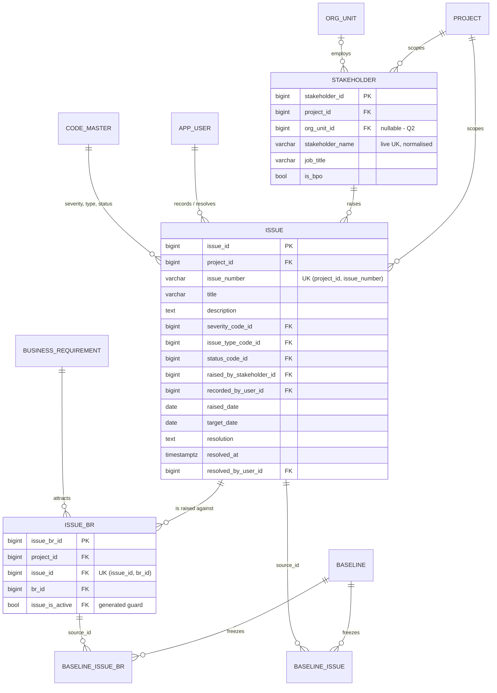

# Slice 14 — Issue module: logical + physical schema (apple, 2026-10-16)

Scope: the VB_remaining_work.md row **Issue module** — stakeholders; raise / link to BRs / resolve issues (`ISS-`);
issue dashboard; issues in the baseline freeze; the M3 tile (slice12_kpis.md: "Issues by severity").
Source of truth: VB_design.md §4.5 (functions), §4.13 `stakeholder_engagement`, §5.4 "ISSUE ↔ BR is
many-to-many", §5.3 *Issues (area 5)* and *STAKEHOLDER*, §6.1 rows 28/41/42, §6.2 rows `issue` / `stakeholder`,
§7.6, §7.9 `issue_dashboard`, §11 code lists, §15 routes. Decisions D-4, D8, D6, D-37, S1-4…S1-7, R2-D3.

**Checked before modelling:** no `stakeholder`, `issue` or `issue_br` model or migration exists
(`grep backend/models`: only the `ISSUE` sequence code and the import target name). `ISSUE_SEVERITY`,
`ISSUE_TYPE`, `ISSUE_STATUS` are seeded (`seeds/seed_code_master.py` l.64–71, all project-editable). The
`ISSUE` series is seeded per project with prefix `ISS` (`services/numbering.py`). Head migration is 0060.

**Risk grade (for Lilly's spec line):** the slice spans grades; its riskiest concern is **Grade 1 — the hash-spec
bump** (a mistake changes the digest of every signed baseline, or makes spec-5 baselines unverifiable). The
tables, routes and dashboard are Grade 2/3.

## 1. Grain

| Table | One row per … | Natural key | Frozen? |
|---|---|---|---|
| `stakeholder` | named client-side person (business user or BPO staff) **in one project**; no login (D-4) | live `(project_id, lower(btrim(stakeholder_name)))` (D6) | ✗ — a person is not scope (§6.1 row 28) |
| `issue` | issue raised in one project, anchored to the **project**, not a BR (§5.3) | `(project_id, issue_number)` — `ISS-0001`, minted at save | ✓ ⇐ `ISSUE` (§6.1 row 41) |
| `issue_br` | (issue × BR) association; 0..N per issue (§5.4 "ISSUE ↔ BR") | `(issue_id, br_id)` full UK (S1-7: relink restores) | ✓ ⇐ `ISSUE` (§6.1 row 42) |
| `baseline_issue`, `baseline_issue_br` | live row × baseline | `(baseline_id, source_id)` | n/a (immutable) |

## 2. ER diagram (changed part only)

## 3. Physical tables (PostgreSQL 16; every table also gets `audit_columns()` — `is_active`, `created_*`,
`updated_*`, `deleted_*`, `row_version` — and `updated_at_trigger`; vb_app gets no DELETE, law 1)

### 3.1 `stakeholder` (models/issue.py `Stakeholder`)
| Column | Type | Constraints |
|---|---|---|
| `stakeholder_id` | bigint identity | PK |
| `project_id` | bigint | NOT NULL, FK `project` |
| `org_unit_id` | bigint | NULL (Q2); `fk_stk_org_unit (org_unit_id, project_id) → org_unit (uq_org_unit_project)` |
| `stakeholder_name` | varchar(200) | NOT NULL; `ck_stk_name_not_blank CHECK (btrim(stakeholder_name) <> '')` |
| `job_title` | varchar(200) | NULL |
| `is_bpo` | boolean | NOT NULL DEFAULT false |

Keys: `uq_stk_project UNIQUE (stakeholder_id, project_id)` (composite-FK target); partial
`uq_stk_name_live UNIQUE (project_id, lower(btrim(stakeholder_name))) WHERE is_active` (§6.2, D6 — the importer's
lookup returns at most one). Index `ix_stk_org_unit (org_unit_id, project_id)`. No number series (none of the ten).

### 3.2 `issue` (`Issue`)
| Column | Type | Constraints |
|---|---|---|
| `issue_id` | bigint identity | PK |
| `project_id` | bigint | NOT NULL, FK `project` |
| `issue_number` | varchar(20) | NOT NULL; minted by `numbering.next_number(…, "ISSUE")` only; never from the body (law 6) |
| `title` | varchar(200) | NOT NULL; `ck_issue_title_not_blank` |
| `description` | text | NULL |
| `severity_code_id` | bigint | NOT NULL; `severity_category` varchar(40) GENERATED `'ISSUE_SEVERITY'` STORED; `fk_issue_severity (severity_code_id, severity_category) → code_master (uq_code_category_target)` ON UPDATE NO ACTION |
| `issue_type_code_id` | bigint | NOT NULL; `issue_type_category` GENERATED `'ISSUE_TYPE'`; `fk_issue_type` likewise |
| `status_code_id` | bigint | NOT NULL; `status_category` GENERATED `'ISSUE_STATUS'`; `fk_issue_status` likewise |
| `raised_by_stakeholder_id` | bigint | **NOT NULL** (D-4, D8); `fk_issue_raiser (raised_by_stakeholder_id, project_id) → stakeholder (uq_stk_project)` |
| `recorded_by_user_id` | bigint | **NOT NULL**, FK `app_user`; from the JWT, never the body (§9.2) |
| `raised_date` | date | NOT NULL (service defaults to today; editable — Q6) |
| `target_date` | date | NULL; `ck_issue_target_after_raised CHECK (target_date IS NULL OR target_date >= raised_date)` |
| `resolution` | text | NULL |
| `resolved_at` | timestamptz | NULL |
| `resolved_by_user_id` | bigint | NULL, FK `app_user` |

Keys and checks: `uq_issue_number UNIQUE (project_id, issue_number)` (full — minted numbers never reused, S1-6);
`uq_issue_project UNIQUE (issue_id, project_id)`; `uq_issue_live_target UNIQUE (issue_id, project_id, is_active)`
(target of the link guard); `ck_issue_resolved_pair CHECK ((resolved_at IS NULL) = (resolved_by_user_id IS NULL))`;
`ck_issue_resolution_text CHECK (resolved_at IS NULL OR btrim(coalesce(resolution, '')) <> '')` — the DB half of
"RESOLVED requires a non-empty resolution" (§4.5, §7.6). The status half (resolved_* set **iff** status is
RESOLVED/CLOSED) reads code_master and is service-enforced (Q1). Indexes: `ix_issue_raiser
(raised_by_stakeholder_id)`, `ix_issue_status (project_id, status_code_id)`, `ix_issue_severity
(severity_code_id)`, `ix_issue_type (issue_type_code_id)`.

`recorded_by_user_id` looks like a copy of `created_by` and is kept deliberately: it is a business fact in the
export / import shape (D8), and audit columns are **excluded** from shadows, so without it a baseline could not say
who recorded an issue.

### 3.3 `issue_br` (`IssueBr`)
| Column | Type | Constraints |
|---|---|---|
| `issue_br_id` | bigint identity | PK (S1-5 — surrogate on link rows; also the shadow's single `source_id`; Q8) |
| `project_id` | bigint | NOT NULL, FK `project` |
| `issue_id` | bigint | NOT NULL; `fk_ibr_issue (issue_id, project_id) → issue (uq_issue_project)` |
| `br_id` | bigint | NOT NULL; `fk_ibr_br (br_id, project_id) → business_requirement (uq_br_project)` |
| `issue_is_active` | boolean | GENERATED `CASE WHEN is_active THEN TRUE END` STORED; `fk_ibr_issue_live (issue_id, project_id, issue_is_active) → issue (uq_issue_live_target)` ON UPDATE NO ACTION |

`uq_ibr_grain UNIQUE (issue_id, br_id)` full (relink restores the row and keeps its `source_id`, S1-7). Indexes
`ix_ibr_br (br_id)`, `ix_ibr_project (project_id)`. The guard makes "a live link under a retired issue" impossible in
the DB (same class as `fk_fide_interface_live`, D1). BR liveness stays service-side, as for `br_solution` and
`br_function_requirement` (the composite FK proves same project; `raise_issue` / `link_issue_br` check live).

### 3.4 Shadows (generated by `scripts/print_shadow_ddl.py`, never hand-written — law 2)
`baseline_issue`: PK `baseline_issue_id`, `baseline_id` FK, `source_id` FK → `issue.issue_id` ON DELETE NO ACTION,
`uq_baseline_issue_source (baseline_id, source_id)`, `ix_baseline_issue_source`, `content_hash char(64) NOT NULL`;
copied (all nullable): `project_id, issue_number, title, description, severity_code_id, issue_type_code_id,
status_code_id, raised_by_stakeholder_id, recorded_by_user_id, raised_date, target_date, resolution, resolved_at,
resolved_by_user_id`; code pairs `severity_code/_label, issue_type_code/_label, status_code/_label` (varchar 40/200 —
the deliberate 3NF break of §5.5 decision 4). `baseline_issue_br`: same keys; copied `project_id, issue_id, br_id`
(`issue_is_active` is GENERATED, excluded). Both get `immutable_guards()`. Only the stakeholder **id** is frozen —
no name, title or email (§6.1 "deliberately not baselined"); a baseline renders the raiser from today's live row.

### 3.5 Code registrations (no DDL)
- `freeze_set.py`: `CURRENT_HASH_SPEC = 5` ("issue and issue_br joined the set, slice 14"); append after
  `project_component` (FK order is satisfied; appending keeps spec-1..4 order untouched):
  `_e("issue", "ISSUE", ("issue_number","title","description","severity_code","issue_type_code","status_code",
  "raised_by_stakeholder_id","raised_date","target_date","resolution"), label=("issue_number","title"), since=5)`;
  `_e("issue_br", "ISSUE", ("issue_id","br_id"), refs=(("issue_id","issue"),("br_id",BR)), since=5)` (Q5).
  New diff area `ISSUE` (D-50 list + diff screen). `models/baseline.SHADOWED` gains both, same order.
- `components.py`: `FREEZE_GATES["issue"] = FREEZE_GATES["issue_br"] = Gate(all_of={"ISSUE"})`;
  `COMPONENT_ROWS["ISSUE"] = (_rows(Issue, Issue.issue_number),)`; `"ISSUE"` into `BUILT`.
- `step_retire.py`: `IssueBr` into `OWNED_BY_BR` and the BR-links tier of `TIERS` (§4). `lifecycle.py`:
  `RESTORABLE += (Stakeholder, Issue)`; `LABELS` for `stakeholder` (name), `issue` (`ISS-0001 title`),
  `issue_br` (`ISS-0001 ↔ BR-0042`, both ends, DR1-P1). `models/__init__.py` imports all three.

## 4. What retires with what (all soft delete; `LINKS` derive from the FKs above)

| Event | Effect |
|---|---|
| **Step retired** (with its BR) | `issue_br` rows of that BR retire **with it** (OWNED_BY_BR, same action id); the **issue survives** — it is project-anchored (§5.3). An issue whose last live link went becomes project-level; the preview lists those issue numbers as information beside `confirm_hash`, like `tag_drift` (Q3). Restore brings the links back all-or-nothing; refused (RESTORE_FIRST) if an issue was retired meanwhile |
| **Link removed** (`link_issue_br` D) | that `issue_br` row retires; relink restores the same row |
| **Issue retired** (Q4) | refused 409 while it has live links (LINKS + `fk_ibr_issue_live`) — nothing cascades (law 1). "Done" is a status, not a retire |
| **Stakeholder retired** | refused 409 while any live issue names them as raiser (Q7) |
| **Org unit retired** | now also refused while a live stakeholder sits in it — a new blocker on the org chart screen |
| **BR retired outside a step retire** | not a path today (a BR retires only with its step, D-2) |
| **Issue linked to a retired BR** | the service refuses a *new* link to a retired BR; old links are retired rows, shown as history; the dashboard reads live links of live BRs only |

## 5. Migrations (one table + its shadow per migration, as 0055; next free ids on `main` at build time)

| Id | Creates | Downgrade guard (raise, never drop people's data) |
|---|---|---|
| 0061 | `stakeholder` | refuse while any `stakeholder` row exists |
| 0062 | `issue` + `baseline_issue` (+ `immutable_guards`) | refuse while any `baseline` has `hash_spec_version >= 5`; while `baseline_issue` has a row; while any `issue` row exists |
| 0063 | `issue_br` + `baseline_issue_br` | the same three guards on its own tables |

No backfill, no seed migration. 0062 and 0063 share spec 5, so they reach `main` **in one merge** with the
`freeze_set` bump (S11-6), and the bump is taken on `main` in order. If Q1 is answered (a), `seed_code_master`
gains `is_system=True` for `ISSUE_STATUS` — a seed, not a migration (and existing projects need the seed re-run).

## 6. Questions for Ben (design silent or self-contradictory)

1. **Can a project rename or retire the issue statuses?** `ISSUE_STATUS` is project-editable, but `resolve_issue`
   and the dashboard must know which code means "resolved" and which mean "open" — and law 5 bans branching on a
   code. (a) make `ISSUE_STATUS` `is_system` like `BASELINE_STATUS` (labels still editable); (b) give it behaviour
   codes (OPEN / RESOLVED…) — widens `ck_code_behaviour_present`, a code_master migration. Also: does CLOSED need a
   resolution too, and does reopening clear `resolved_*`? **Recommend (a); CLOSED needs a resolution; reopen
   clears `resolved_*` (the audit trail keeps the old text); "open" = OPEN + IN_PROGRESS.**
2. **Must every stakeholder belong to an org unit?** §4.5 lists "org unit" but BPO staff are often not in the
   client's chart. **Recommend nullable**; `stakeholder_engagement` shows a "BPO / no unit" row.
3. **Retiring a step whose BR has an open issue — allow or block?** **Recommend allow**: the link retires with the
   BR, the issue survives, and the preview names issues that become project-level.
4. **Can an issue be deleted at all?** §15 has no DELETE route. **Recommend** a soft retire for "raised in error"
   only, refused while linked (unlink first); everything else is CLOSED/DEFERRED.
5. **What does a baseline freeze of an issue mean — and is a status change a scope change?** With `status_code`
   and `resolution` hashed, resolving an issue shows as CHANGED in the next diff. **Recommend hash them** — "which
   issues were open when v1.0 was signed" is the point of freezing issues; `recorded_by` / `resolved_*` are copied
   but not hashed.
6. **Is `raised_date` the day it was typed or the day it was raised?** **Recommend** the day it was raised
   (workshops are written up later): NOT NULL, defaults to today, editable; `created_at` keeps the typing date.
7. **A stakeholder who has raised issues can never be retired (the FK liveness rule) — acceptable?** **Recommend
   yes**: to merge a duplicate, re-point the issues first; erasing a person is `purge_project`'s job (Q15).
8. **The spec says `ISSUE_BR` PK `(issue_id, br_id)`; §6.2's convention (S1-5) says surrogate PK + full UK on every
   link row.** **Recommend S1-5** (the shadow needs one `source_id`); the spec's §5.3 line is rewritten in the
   same commit.
9. **Are stakeholder writes gated by component `ISSUE`?** §15 names no component for them. **Recommend yes** —
   issues are their only consumer today; reads stay ungated (§4.13 `stakeholder_engagement`).
10. **Risk promotion (later wave): "the risk's owner becomes the raiser"** — a raiser is a stakeholder, but a risk
    owner is not modelled yet. **Recommend** record now that `RISK.owner` must be a `stakeholder_id` (or the
    consultant picks a raiser on promotion), so the risk slice does not reopen `issue`.
