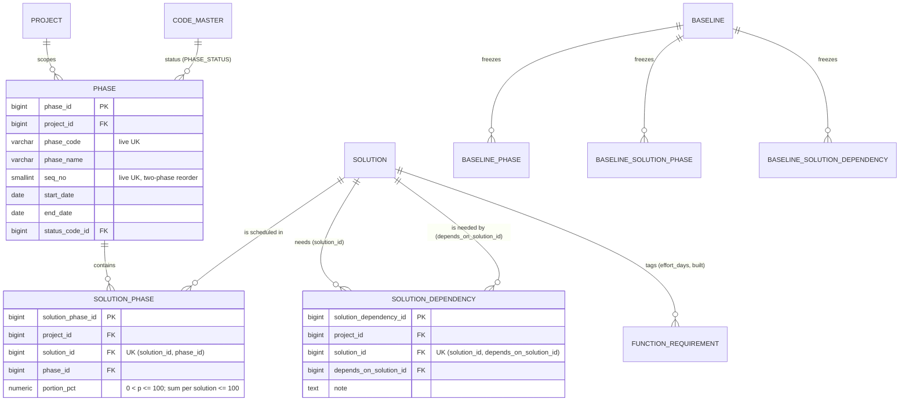

# Slice 15 — Phasing and dependency: logical + physical schema (apple, 2026-10-16)

**Status:** APPROVED by Ben 2026-10-18 with the spec (W-1…W-9, history §3). Revised the same day: users see
**"Wave"** everywhere (W-1) while these tables, models and routes keep `phase`; a split totals exactly 100 % or is
empty (W-5, replacing the "≤ 100" rule in §3.2 and §5); `PHASE_STATUS` is pinned and company-only (W-4);
migrations are 0065–0067 and the hash spec 6, after slice 14 (W-8). §9 now records the rulings.

Scope: the VB_remaining_work.md row **Phasing and dependency** (Phase 2, D-18) — phases, the solution-to-phase
split, prerequisite links with no cycles, the phase plan report. Source of truth: VB_design.md §2 entity list
(`PHASE`, `SOLUTION_PHASE`, `SOLUTION_DEPENDENCY`), §4.12, §5.2 ER, §5.3 *PHASE / SOLUTION_PHASE /
SOLUTION_DEPENDENCY*, §5.4.3 (UNASSIGNED bucket), §6.1 rows 36–38, §6.2 FK_LIVENESS rows, §6.2 constraint grid
("topological check on insert"), §7.13 pseudocode, §11 `PHASE_STATUS`, §15 wave-3 routes, criteria 67–68.

**Checked before modelling:** no `phase` / `solution_phase` / `solution_dependency` model or migration exists.
`PHASE_STATUS` (PLANNED, IN_DELIVERY, COMPLETE, CANCELLED) is seeded, **project-editable** (`is_system=False`,
seed_code_master.py l.112). There is **no phasing component** (`components.ALL`) and no `PHASE` number series
(`numbering.SERIES`, the ten of R2-D14) — `phase_code` is typed, like a trigger name. Slice 14 (Issue, merged
2026-10-18) took spec 5 and migrations 0061–0064, so this slice takes **spec 6** and **0065–0067** (W-8).
`requirement_volatility` (slice 1f) is not built.

**Risk grade (for Lilly's spec line):** riskiest concern is **Grade 1 — the hash-spec bump** (a mistake changes
the digest of every signed baseline). The cycle rule is Grade 2 (a cycle makes the plan unsolvable; recoverable,
and `consistency_check` proves it). Screens and the report are Grade 2/3.

## 1. Grain

| Table | One row per … | Natural key | Frozen? |
|---|---|---|---|
| `phase` | delivery wave in one project | live `(project_id, lower(btrim(phase_code)))`; live `(project_id, seq_no)` | ✓ (§6.1 row 36) |
| `solution_phase` | (solution × phase) assignment, carrying the solution's share in that phase | `(solution_id, phase_id)` full UK | ✓ (row 37) |
| `solution_dependency` | (solution × prerequisite solution): "A needs B delivered first" | `(solution_id, depends_on_solution_id)` full UK | ✓ (row 38) |
| `baseline_phase`, `baseline_solution_phase`, `baseline_solution_dependency` | live row × baseline | `(baseline_id, source_id)` | n/a (immutable) |

## 2. ER diagram (changed part only)

## 3. Physical tables (PostgreSQL 16; each also gets `audit_columns()` — `is_active`, `created_*`, `updated_*`,
`deleted_*`, `row_version` — and `updated_at_trigger`; vb_app has no DELETE, law 1). Models in `models/phase.py`.

### 3.1 `phase` (`Phase`)
| Column | Type | Constraints |
|---|---|---|
| `phase_id` | bigint identity | PK |
| `project_id` | bigint | NOT NULL, FK `project` |
| `phase_code` | varchar(20) | NOT NULL; `ck_phase_code_not_blank CHECK (btrim(phase_code) <> '')` — typed ("P1", "Wave 2"); no series |
| `phase_name` | varchar(200) | NOT NULL; `ck_phase_name_not_blank` |
| `seq_no` | smallint | NOT NULL; `ck_phase_seq CHECK (seq_no <> 0 AND seq_no BETWEEN -99 AND 99)` — negatives only mid-reorder (S1-2/S1-3 pattern) |
| `start_date`, `end_date` | date | NULL (early plans have no dates); `ck_phase_dates CHECK (end_date IS NULL OR start_date IS NULL OR end_date >= start_date)` |
| `status_code_id` | bigint | NOT NULL; `status_category` varchar(40) GENERATED `'PHASE_STATUS'` STORED; `fk_phase_status (status_code_id, status_category) → code_master (code_id, category)` ON UPDATE NO ACTION |

Keys: `uq_phase_project UNIQUE (phase_id, project_id)` (composite-FK target for `solution_phase` and, later,
`wbs_item`); partial `uq_phase_code_live (project_id, lower(btrim(phase_code))) WHERE is_active`; partial
`uq_phase_seq_live (project_id, seq_no) WHERE is_active`. Index `ix_phase_status (status_code_id)`. Dates may
overlap between phases: **`seq_no` is the order**, dates are information. The generated category means the 1g
code-list re-point covers `status_code_id` with no extra work.

### 3.2 `solution_phase` (`SolutionPhase`)
| Column | Type | Constraints |
|---|---|---|
| `solution_phase_id` | bigint identity | PK (S1-5 surrogate; the shadow's `source_id` — Q5) |
| `project_id` | bigint | NOT NULL, FK `project` |
| `solution_id` | bigint | NOT NULL; `fk_solph_solution (solution_id, project_id) → solution (uq_solution_project)` |
| `phase_id` | bigint | NOT NULL; `fk_solph_phase (phase_id, project_id) → phase (uq_phase_project)` |
| `portion_pct` | numeric(5,2) | NOT NULL; `ck_solph_portion CHECK (portion_pct > 0 AND portion_pct <= 100)` (one row; the per-solution total is §5's) |

`uq_solph_grain UNIQUE (solution_id, phase_id)` full (re-assigning restores the row and its `source_id`, S1-7).
Indexes `ix_solph_phase (phase_id, project_id)`, `ix_solph_project (project_id)`. **Σ live `portion_pct` per
solution = 100, or no live rows** (W-5) is a cross-row rule, so it is service-enforced under a lock on the whole saved
set (§5); a CHECK cannot see other rows.

### 3.3 `solution_dependency` (`SolutionDependency`)
| Column | Type | Constraints |
|---|---|---|
| `solution_dependency_id` | bigint identity | PK (S1-5) |
| `project_id` | bigint | NOT NULL, FK `project` |
| `solution_id` | bigint | NOT NULL (the dependent); `fk_soldep_solution (solution_id, project_id) → solution (uq_solution_project)` |
| `depends_on_solution_id` | bigint | NOT NULL (the prerequisite); `fk_soldep_prereq (depends_on_solution_id, project_id) → solution (uq_solution_project)` |
| `note` | text | NULL |

`ck_soldep_not_self CHECK (solution_id <> depends_on_solution_id)` (the one cycle a CHECK can see);
`uq_soldep_grain UNIQUE (solution_id, depends_on_solution_id)` full. Index `ix_soldep_prereq
(depends_on_solution_id, project_id)` — the reverse walk and the 409 on retire. The composite FKs make a
cross-project edge impossible, so the graph is always one project's.

### 3.4 Shadows (generated by `scripts/print_shadow_ddl.py`, never hand-written — law 2)
`baseline_phase`, `baseline_solution_phase`, `baseline_solution_dependency`: PK `baseline_<t>_id`, `baseline_id` FK,
`source_id` FK → live PK ON DELETE NO ACTION, `uq_baseline_<t>_source (baseline_id, source_id)`, `ix_…_source`,
`content_hash char(64) NOT NULL`, all copied columns nullable; `phase` gains the code pair `status_code` /
`status_label`; `status_category` (GENERATED) is excluded. Each gets `immutable_guards()`.

### 3.5 Code registrations (no DDL)
- `freeze_set.py`: `CURRENT_HASH_SPEC = 6` ("phase, solution_phase, solution_dependency joined, slice 15");
  appended after `issue_br` (FK order holds):
  `_e("phase", "PHASE", ("phase_code","phase_name","start_date","end_date"), ("seq_no",), ("phase_code","phase_name"), since=6)`;
  `_e("solution_phase", "PHASE", ("solution_id","phase_id","portion_pct"), refs=(("solution_id",SOL),("phase_id","phase")), since=6)`;
  `_e("solution_dependency", "PHASE", ("solution_id","depends_on_solution_id","note"), refs=(("solution_id",SOL),("depends_on_solution_id",SOL)), since=6)`.
  `status_code` copied, not hashed (Q4). New diff area `PHASE`. `models/baseline.SHADOWED` gains all three, same order.
- `components.py` (if Q1 = a): `"PHASING"` into `ALL`, `BUILT`; `COMPONENT_REQUIRES["PHASING"] = {"SOLUTION"}`;
  `FREEZE_GATES[t] = Gate(all_of={"PHASING","SOLUTION"})` for the three tables; `COMPONENT_ROWS["PHASING"] =
  (_rows(Phase, Phase.phase_code),)`; `ROW_COMPONENTS[Phase] = ("PHASING",)`. Seed: `("PHASING","Phasing")` in
  `PROJECT_COMPONENT`, and in the FULL_DELIVERY template (`seed_project_templates`). Routes name `component="PHASING"`
  (criterion 49b).
- `lifecycle.py`: `RESTORABLE += (Phase,)` only (§6); `LABELS`: `phase` (`P1 Foundation`), `solution_phase`
  (`SOL-0003 ↔ P1 (40%)`), `solution_dependency` (`SOL-0003 needs SOL-0001`) — both ends named (DR1-P1).
  `models/__init__.py` imports all three. **No `step_retire` change**: none of the tables points at a step or a BR.
- `consistency_check` gains two proofs that must return 0: `solution_phase_split_not_100` (a live split that is neither 100 nor empty — W-5) and `solution_dependency_cycle`
  (recursive walk) — belt and braces behind the service rule, and freeze preconditions like the rest.

## 4. The no-cycle rule (D-18, criterion 67)

Edge `(A, B)` = "A needs B". Adding it closes a cycle **iff A is already reachable from B** along live edges.

**Where:** `services/phasing.link_solution_dependency` — the **only** writer of live edges. A new link and a
re-link (restoring a retired row) both go through it; the generic `lifecycle.restore` does **not** accept
`SolutionDependency` (§6), because restoring an old edge can close a cycle just as an insert can.

**How, in one transaction (READ COMMITTED, the app default):**
1. `SELECT pg_advisory_xact_lock(<PHASING_LOCK int4 constant>, project_id::int4)` — the **two-key** form, so it never
   collides with `bfc_set.py`'s single-key `pg_advisory_xact_lock(project_id)`. It serialises dependency writes per
   project only; nothing else waits.
2. **Only after the lock**, check both solutions live and in the project, then
   `WITH RECURSIVE reach(s, path) AS (SELECT :B, ARRAY[:B] UNION SELECT d.depends_on_solution_id, path || … FROM
   solution_dependency d JOIN reach r ON d.solution_id = r.s WHERE d.is_active AND NOT d.depends_on_solution_id =
   ANY(path)) SELECT path FROM reach WHERE s = :A LIMIT 1`. A hit → **422 "Dependency cycle: SOL-A → … → SOL-A"**
   (the path, by solution number). The `path` guard terminates even on corrupt data.
3. Insert (or restore) the row; commit releases the lock.

**Why concurrent inserts cannot make a cycle:** without the lock, T1 adds A→B and T2 adds B→A; each sees the other's
edge uncommitted, both pass, the graph cycles. With it, T2 blocks at step 1 until T1 commits; under READ COMMITTED
T2's walk in step 2 is a **new statement with a new snapshot taken after the lock**, so it sees A→B and refuses.
This holds only because no graph read precedes the lock in the transaction — the service asserts the lock is its
first statement, and the route must not run at REPEATABLE READ / SERIALIZABLE (whose snapshot would predate the
lock). A retire of an edge needs no lock: removing an edge cannot create a cycle.

## 5. How a solution's effort splits across phases (D-13 × D-18)

- **Unit: percent, not days.** `portion_pct` is the share of the solution's **current** effort. FR `effort_days`
  moves with every rate-card change and FR edit; a percentage stays true through re-rating, stored days would go
  stale and need re-deriving (and law 6 bars accepting derived days from a body).
- **Effort of a solution** = Σ `effort_days` of its live, rated FRs (the `effort.summary` basis). FRs under a
  REJECTED solution are reported apart, as in the effort headline (S6c-8).
- **Σ per solution = 100, or no rows (W-5).** The split is saved whole (`PUT /solutions/{id}/phase-split`, spec R2):
  the service locks the solution row (`FOR NO KEY UPDATE`), checks every listed row's `row_version` and that no live row
  is left unlisted, and refuses 422 unless the new set totals exactly 100 or is empty. Saving the whole set is what
  makes the exact rule keepable — moving 40 % from W1 to W2 is one save, never an in-between state.
- **Not yet split:** `phase_plan.effort_by_phase` = per wave Σ `portion_pct/100 × solution effort`; plus
  **UNPHASED** = the effort of solutions with no split (listed per solution — a solution is wholly in waves or wholly
  unphased, W-5); plus **UNASSIGNED** = FRs with
  no solution (§5.4.3 knock-on 1). Phases + UNPHASED + UNASSIGNED **= the effort headline** (Decimal, rounded only for
  display); a test pins the reconciliation. Unrated FRs are counted, never given days.
- A freeze is **not** blocked by an unphased solution (a warning in the report); a split other than 100 is impossible.
- **No FR ↔ wave link (W-2).** An FR's effort reaches a wave only through its one solution's split.

## 6. Retire rules (all soft delete; nothing cascades — law 1; `LINKS` derive from the FKs)

| Event | Effect |
|---|---|
| **Phase retired** ("created in error" — the normal end is status COMPLETE / CANCELLED) | 409 while live `solution_phase` rows (names `SOL-… ↔ P…`) or, once WBS lands, live `wbs_item` links (Q4 of §5.3) |
| **Phase restored** | via `lifecycle.restore`; 409 if its code or `seq_no` is taken by a live phase |
| **Solution retired** | 409 while any live `solution_phase` **or** `solution_dependency` on **either** end (two FKs → two LINKS) — Q6 |
| **Assignment removed** | only through the whole-split PUT (spec §10 T1): a live row whose wave leaves the split retires, a wave named again restores its row, the new set re-checked as 100 or empty; refused if the wave or the solution is retired |
| **Dependency removed** | row retires, no lock needed; re-link restores it **only through `link_solution_dependency`** (cycle check) |
| **Step / BR retired** | no effect — none of these tables is in `OWNED_BY_STEP` / `OWNED_BY_BR`, and none needs to be |
| **Component PHASING off** (Q1) | refused while live phases exist (OR-1) |

## 7. Frozen into baselines? — yes (§6.1 rows 36–38, §5.3 freeze set)

All three join at **hash spec 6**, gated by the phasing component (Q1). A baseline frozen before spec 6 has no rows
in them; a diff across that boundary shows the rows ADDED, which is true. Phase reorders show as MOVED (`seq_no`
is a position column), a changed split or dates as CHANGED, a new prerequisite as ADDED. `wbs_item` stays unfrozen.

## 8. Migrations (one table + its shadow per migration, as 0055; renumber to the next free ids on `main`)

| Id | Creates | Downgrade guard (raise; never drop people's data) |
|---|---|---|
| 0065 | `phase` + `baseline_phase` (+ `immutable_guards`) | refuse while any `baseline.hash_spec_version >= 6`; while `baseline_phase` has a row; while any `phase` row exists |
| 0066 | `solution_phase` + shadow | the same three guards on its own tables |
| 0067 | `solution_dependency` + shadow | the same three guards on its own tables |

No backfill and no seed migration (the component code is a seed, `seed_code_master` + `seed_project_templates`).
0065–0067 share spec 6, so they reach `main` **in one merge** with the `freeze_set` bump (S11-6), after slice 14's
spec 5 (merged).

## 9. Ben's rulings (2026-10-18; the questions below were Q-55…Q-62)

1. **Q-55 — (a)**, component `PHASING` needing SOLUTION (W-3); shown to users as "Waves".
2. **Q-56 — percent, not days; revisited by Q-63 (W-5): exactly 100 % or empty**, saved whole. No partial split.
3. **Q-57 — `PHASE_STATUS` pinned and company-only** (W-4): an FTC admin relabels, projects cannot add, override or
   hide. "Current wave" = the live IN_DELIVERY wave with the lowest `seq_no`; a CANCELLED wave's effort is its own
   flagged line (Q-64); new splits into a CANCELLED wave are refused.
4. **Q-58 — yes**: code, name, dates hashed; `seq_no` a position (MOVED); status copied, not hashed.
5. **Q-59 — S1-5 surrogate keys**; §5.3 rewritten in the approval commit.
6. **Q-60 — refuse** with the 409 naming the links; unassign first.
7. **Q-61 — yes**: same wave, or a prerequisite with no wave while the dependent has one, is a warning.
8. **Q-62 — ship without "volatile areas"** until 1f lands.

Also ruled: **W-2** no FR ↔ wave link; **Q-65** REJECTED with a split warns; **Q-66** live plan only.
