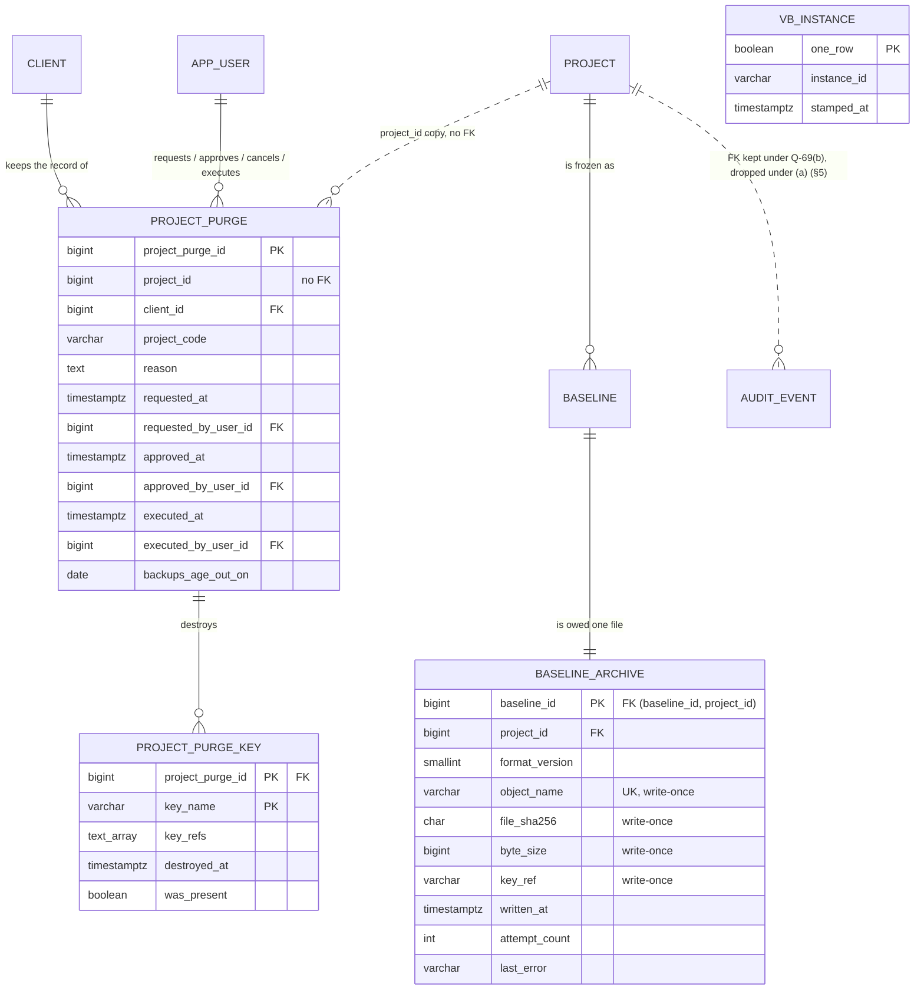

# Slice 16 — Baseline archive file + `purge_project`: logical + physical schema (apple, 2026-10-17)

**DRAFT for Ben — not approved.** Revised after design review round 1 (§11). Changes to the immutability law (§4)
and to `audit_event` (§5) are his.

Scope: S8-1, Q15 — the archive file owed at every freeze (§15.3, criterion 155) and the one hard-delete path of
business data (§6.1 *Contract wins*, §15.3, criterion 154). Source of truth: VB_design.md §6.1 (Q15 paragraph),
§6.6 role rules, §15.3; migrations 0001 (`fn_reject_modification`), 0003 (`audit_event`), 0047/0053/0054
(`fn_baseline_header_guard`), 0048 (shadows, `fn_shadow_insert_guard`); `services/freeze_set.py` (spec 4).

**Checked before modelling.** No archive or purge table exists. `fn_reject_modification` is **shared**: the 28
shadow triggers *and* `trg_audit_event_immutable` call it (0003 l.75), and 0001 reserves it for `decision`
(A-41) — so it cannot be loosened in place without loosening the audit log (§4). Every shadow copies `project_id`,
but as a **nullable** column (all copied columns are nullable, 0048 l.293); the header's `project_id` is NOT NULL.
`project.status_code_id` is in `code_lists.EXCLUDED` (PROJECT_STATUS company-only), so a project never points at
its own override — the `project ⇄ code_master` FK pair is a cycle in the catalog, not in the data.
`client.client_code` exists (varchar(30), NOT NULL, UNIQUE — `models/tenancy.py`), so the typed confirmation needs
no new column (§7).

**Risk grade:** **Grade 1** — the riskiest concern is the scoped trigger bypass: a fault either deletes another
project's signed baselines or leaves a purged client's rows behind. Archive writing is Grade 2 (a missing file is
noticed by the drill and is re-writable while the baseline exists).

**One correction to the brief:** `ALTER TABLE … DISABLE TRIGGER` takes SHARE ROW EXCLUSIVE in PostgreSQL 16, not
ACCESS EXCLUSIVE — it blocks other projects' *freezes*, not their reads. The scoped bypass is still the right call,
for a stronger reason: a disabled trigger protects nothing, so a wrong `WHERE` in the purge would delete other
projects' baselines unopposed. The bypass keeps the trigger armed for every row outside the one project.

## 1. Grain

| Table | One row per … | Key | Lives through a purge? |
|---|---|---|---|
| `baseline_archive` | frozen baseline — the archive file owed for it (outbox) | PK `baseline_id` (1:1 with `baseline`) | no — deleted with its baseline |
| `project_purge` | request to purge one project: approval, execution | PK `project_purge_id`; ≤ 1 open and ≤ 1 executed per `project_id` | **yes** — no FK to `project` |
| `project_purge_key` | key the purge must destroy | PK `(project_purge_id, key_name)` | **yes** |
| `vb_instance` | this database (exactly one row) | PK `one_row` (always true) | yes — not project data |

## 2. ER diagram (changed part only)



## 3. Physical tables (PostgreSQL 16)

### 3.1 `baseline_archive` (`BaselineArchive`, `models/baseline.py`)

| Column | Type | Constraints | Description |
|---|---|---|---|
| `baseline_id` | bigint | PK; `fk_ba_baseline (baseline_id, project_id) → baseline (uq_baseline_project)` | the baseline the file is for; 1:1, so the FK is the identity — no surrogate |
| `project_id` | bigint | NOT NULL (part of the FK) | the purge predicate and the bypass test; the composite FK keeps it equal to the header's |
| `format_version` | smallint | NOT NULL, `CHECK (format_version >= 1)` | archive JSON layout, set at freeze; a reader five years on needs it |
| `object_name` | varchar(400) | NULL until written; UNIQUE | built from the **instance id and ids only**: `<instance>/<project_id>/<baseline_id>.json.enc` — never a project or client name; unique across environments and restores (§6) |
| `file_sha256` | char(64) | NULL until written; `CHECK (file_sha256 ~ '^[0-9a-f]{64}$')` | hash of the stored (encrypted) bytes, so the drill proves the blob is the one written |
| `byte_size` | bigint | NULL until written; `CHECK (byte_size > 0)` | stored size |
| `key_ref` | varchar(400) | NULL until written | the **versioned** key that encrypted it (Key Vault key id + version; locally `<dir>/<key name>@<version>`). A reference, never key material (§6) |
| `written_at` | timestamptz | NULL = still owed | set by the writer when the blob is confirmed |
| `attempt_count` | integer | NOT NULL DEFAULT 0, `CHECK (attempt_count >= 0)` | writer tries so far |
| `last_attempt_at` | timestamptz | NULL | |
| `last_error` | varchar(2000) | NULL | the error **class** and a **fixed message per known error** (a constant in the writer); an unknown error stores its class and `"unexpected"`. Never `str(exc)` — a driver message can echo row content or a path |
| `created_at`, `created_by` | timestamptz, bigint | NOT NULL; `created_by` FK `app_user` (the freezer) | written in the freeze transaction |
| `updated_at`, `updated_by`, `row_version` | | as `audit_columns()`; `updated_at_trigger` | writer updates under `row_version` |

`ck_ba_written_set CHECK (num_nonnulls(object_name, file_sha256, byte_size, key_ref, written_at) IN (0, 5))`.
Queue index `ix_ba_owed (created_at) WHERE written_at IS NULL`. **No `is_active` / `deleted_*`** — Q-68.
**Guard `fn_baseline_archive_guard`** (BEFORE UPDATE OR DELETE): `baseline_id`, `project_id`, `format_version`,
`created_*` never change; once `OLD.written_at IS NOT NULL` **every** UPDATE is refused; DELETE only when
`fn_purge_allows(OLD.project_id)` (§4). **Grants:** vb_app SELECT, INSERT, and column UPDATE on `object_name,
file_sha256, byte_size, key_ref, written_at, attempt_count, last_attempt_at, last_error, updated_by, row_version`
(§6.6 column-grant list and the CI grant test both gain it). No DELETE.
**State is derived, not coded** (Q-67): owed = `written_at IS NULL`; failing = owed AND `last_error IS NOT NULL`.

### 3.2 `project_purge` (`ProjectPurge`, `models/tenancy.py`)

| Column | Type | Constraints | Description |
|---|---|---|---|
| `project_purge_id` | bigint identity | PK | |
| `project_id` | bigint | NOT NULL, **no FK** | the purged id; identities are never reused, so it stays unambiguous |
| `client_id` | bigint | NOT NULL, FK `client` | client survives the purge |
| `project_code` | varchar(30) | NOT NULL | copied at request; unique only with `client_id`, hence both. **No `project_name`** — it is client content |
| `reason` | text | NOT NULL, `ck_pp_reason CHECK (btrim(reason) <> '')` | contract clause / reference (criterion 154: 422 without) |
| `requested_at`, `requested_by_user_id` | timestamptz, bigint | NOT NULL; FK `app_user` | the created pair under the design's names; the guard sets `requested_at := now()` on INSERT |
| `approved_at`, `approved_by_user_id` | timestamptz, bigint | NULL; FK `app_user`; `ck_pp_approved num_nonnulls(…) IN (0,2)`; `ck_pp_four_eyes CHECK (approved_by_user_id <> requested_by_user_id)` | the second platform admin, through an authenticated in-app route (`platform_admin` guard). The guard **overwrites** `approved_at := now()` — the app cannot backdate an approval to skip the wait |
| `cancelled_at`, `cancelled_by_user_id` | timestamptz, bigint | NULL; FK `app_user`; `num_nonnulls(…) IN (0,2)` | withdrawn before execution, approved or not |
| `executed_at`, `executed_by_user_id` | timestamptz, bigint | NULL; FK `app_user`; `num_nonnulls(…) IN (0,2)` | set by the CLI as the last statement of the delete transaction. `executed_by` is the CLI's `--actor-email` — a **label** of who ran it, not the control; the control is the approval |
| `backups_age_out_on` | date | `CHECK ((executed_at IS NULL) = (backups_age_out_on IS NULL))` | `((now() AT TIME ZONE 'Asia/Bangkok')::date + interval '13 months')::date` — the database's `now()` read in ICT, so the date matches the business calendar whatever the server zone. Stored, not derived: it states the policy **at the time** |
| `updated_at`, `updated_by`, `row_version` | | as audit columns; `updated_at_trigger` | |

`ck_pp_one_end CHECK (num_nonnulls(cancelled_at, executed_at) <= 1)`;
`ck_pp_exec_approved CHECK (executed_at IS NULL OR approved_at IS NOT NULL)`. Partial uniques
`uq_pp_open (project_id) WHERE executed_at IS NULL AND cancelled_at IS NULL` and
`uq_pp_done (project_id) WHERE executed_at IS NOT NULL`. **Guard `fn_project_purge_guard`** (BEFORE INSERT OR
UPDATE OR DELETE): INSERT forces `requested_at := now()` and refuses any approved/cancelled/executed value; DELETE
always refused (any role); `project_id, client_id, project_code, reason, requested_*` never change; `approved_*`
only NULL → value, once, while open (and `approved_at` forced to `now()`); `cancelled_*` only while not executed;
once `executed_at` is set nothing but `updated_*`/`row_version` changes; a cancelled row never changes.
**Grants:** vb_app SELECT, INSERT, column UPDATE on `approved_at, approved_by_user_id, cancelled_at,
cancelled_by_user_id, updated_by, row_version` — **the running app cannot mark a purge executed**; only the
owner-run CLI can. Key destruction state lives in `project_purge_key`.

### 3.3 `project_purge_key` (`ProjectPurgeKey`, `models/tenancy.py`)

| Column | Type | Constraints | Description |
|---|---|---|---|
| `project_purge_id` | bigint | PK part; FK `project_purge` | |
| `key_name` | varchar(200) | PK part | `vb-<instance>-proj-<project_id>` — Key Vault deletes a **key**, not a version, so the grain is the name |
| `key_refs` | text[] | NOT NULL DEFAULT '{}' | the DISTINCT `baseline_archive.key_ref` versions seen under this name, collected inside the purge transaction — evidence of what the destruction covered |
| `destroyed_at` | timestamptz | NULL until done | set after the vault (or local) delete **and** purge succeeds (Q-71) |
| `was_present` | boolean | NULL until done; `CHECK ((destroyed_at IS NULL) = (was_present IS NULL))` | false = the key was already absent (a project whose first archive never got a key) |

Rows are inserted by the CLI in the purge transaction (§7 step 5): one per distinct name in the collected refs
**plus** the computed name for the project, even with no ref — a key created by a writer that crashed before
`written_at` is in no ref but must still go. **Guard:** INSERT only while the parent is being executed in the same
transaction (`fn_purge_allows`); `destroyed_at`/`was_present` only NULL → value; DELETE and every other UPDATE
refused. **Grants:** vb_app SELECT only. Audit columns: `created_at`, `updated_at`, `row_version` (owner-written).
Purge "keys destroyed" = no row with `destroyed_at IS NULL` (derived).

### 3.4 `vb_instance` (`VbInstance`, `models/shared.py`)

`one_row boolean PRIMARY KEY DEFAULT true CHECK (one_row)`, `instance_id varchar(40) NOT NULL CHECK (instance_id ~
'^[a-z0-9][a-z0-9-]{2,39}$')`, `stamped_at timestamptz NOT NULL DEFAULT now()`. Stamped once by an owner-run
`scripts/stamp_instance.py`; guard refuses UPDATE and DELETE; vb_app SELECT only. An ops table, not a business
table — no AuditMixin (recorded with Q-68).
**Source of truth: the table.** A restored database must know which instance wrote its archive names — a config
value describes the *host*, not the *data*. `VB_INSTANCE_ID` is required config, and the app **refuses to start**
when it is missing, the table is empty, or the two differ. So a prod backup restored into UAT stops at startup
until someone deliberately re-stamps it (and UAT then writes under its own names, never over prod's); a disaster
restore into prod keeps the id and its tombstones (§6).

## 4. The scoped bypass (replaces DISABLE TRIGGER)

One function owns the rule; four trigger functions ask it.

```sql
CREATE FUNCTION fn_purge_allows(p_project_id bigint) RETURNS boolean
LANGUAGE sql STABLE SET search_path = pg_catalog, public AS $$
  SELECT session_user = 'vb_owner' AND current_user = 'vb_owner'
     AND p_project_id IS NOT NULL
     AND p_project_id::text = current_setting('vb.purge_project_id', true)
     AND EXISTS (SELECT 1 FROM public.project_purge pp WHERE pp.project_id = p_project_id
                  AND pp.executed_at IS NULL AND pp.cancelled_at IS NULL
                  AND pp.approved_at IS NOT NULL
                  AND pp.approved_at <= now() - interval '24 hours') $$;
```

- **The 24 h runs from approval**, not from request: the wait exists so that a second person's decision can be
  reconsidered or noticed. Counted from request, an approval given 23 h later would allow execution an hour after
  it — the second pair of eyes would get no cooling time at all.
- **`fn_reject_modification_purgeable()`** (new; for the 28 shadows): UPDATE → raise, always. DELETE → look up
  `public.baseline.project_id` by `OLD.baseline_id` (the header's NOT NULL value, **not** the nullable copy) and
  `RETURN OLD` only if `fn_purge_allows` says so; else raise the existing message.
- **`fn_baseline_header_guard()`** replaced via the 0054 `_guard_sql` pattern with `FROZEN_0054` verbatim; only the
  DELETE branch changes to `IF NOT fn_purge_allows(OLD.project_id) THEN RAISE …; END IF; RETURN OLD;`.
- **`fn_reject_modification_audit_purgeable()`** — **Q-69(b) only**, used by `trg_audit_event_immutable` alone:
  UPDATE → raise, always; DELETE → `RETURN OLD` only if `fn_purge_allows(OLD.project_id) AND OLD.event_type NOT
  LIKE 'PURGE\_%'`, so purge events survive even a wrong predicate. Under (a) the audit trigger stays on the
  shared function.
- **`fn_reject_modification()` is not touched** — `decision` and anything else keep it, unconditional. A test
  finds every trigger still calling it (catalog query) and proves UPDATE and DELETE raise **as vb_owner, inside an
  open, approved, aged purge with the setting set** — the strongest position the bypass grants.
- **Six conditions, each closing a path:** owner role only (vb_app has no DELETE grant anyway); `session_user`
  too, so a future SECURITY DEFINER function owned by vb_owner cannot lend the bypass to an app session; the
  transaction-local setting names **one** project (`set_config(…, true)`, parameterised); a per-row project test,
  so a wrong `WHERE` hits a raise, not a deletion; an **open request approved by a second platform admin** in the
  app; and **24 h** since that approval.
- Tables are schema-qualified and `search_path` pinned, so a temp table cannot shadow `project_purge`.
- **Honest risk.** This is a change to law 2: the owner role *can* now delete frozen rows, under six conditions.
  What stays true: no role can UPDATE a frozen row; vb_app cannot delete one; a DELETE outside an approved, aged
  purge raises. What is new: anyone holding the owner credential and willing to insert an approved, backdated
  `project_purge` row (the owner bypasses grants, not the guard — but could drop it) can purge. That credential
  could already drop the triggers, so the attack surface does not grow; the *accidental* surface does — hence §7's
  counts and tests. TRUNCATE remains unguarded for the owner (S8-2), unchanged.
- **New shadows.** `vb_ops.py` is append-only, so add `immutable_guards_v2(table)` (same as today, purgeable
  function) and use it from the bypass migration on. A test asserts every `baseline_*` trigger calls the purgeable
  function; a shadow made with the old helper makes the purge **fail loudly**, never skip — safe direction.

## 5. `audit_event` — two branches, decided by Q-69

| | Q-69(a) keep the project's audit rows | Q-69(b) delete them, keep `PURGE_*` |
|---|---|---|
| FK `audit_event_project_id_fkey` | **dropped** (rows outlive the project) | **kept** — no row points at the project after the purge |
| Trigger | unchanged (`fn_reject_modification`) | re-pointed to `fn_reject_modification_audit_purgeable` (§4) |
| `PURGE_REQUESTED` / `_APPROVED` / `_CANCELLED`, `PROJECT_PURGED` | `project_id = :p` | `project_id` **NULL**, `detail.purged_project_id = :p` from the request on |
| Purge deletes | nothing | `project_id = :p AND event_type NOT LIKE 'PURGE\_%'` (§8 row 12) |

`PROJECT_PURGED` (written after the deletes, same transaction) carries `{project_code, client_code, reason,
project_purge_id, table counts, os_user, host}` — counts and codes, no content. Under (b) a mis-written `PURGE_*`
row with `project_id` set survives the delete and then blocks the project's own DELETE by FK — the purge rolls
back, never leaves a dangling id. Under (a) the FK-drop **downgrade** refuses on any dangling id, else re-adds the
FK — never `NOT VALID`, never deletes audit rows to make it fit. **Why (b) is recommended:** old audit rows carry
client text — `lifecycle` writes item labels (`"BR-0042 Approve invoice"`), `effort.py` a `change_rationale`.

## 6. Keys and the archive store

Key material never enters the database. Key Vault in Azure, a gitignored key directory locally; one key per
project per instance, named `vb-<instance>-proj-<project_id>` (ids only); rotation adds versions.
- **Create-if-absent, never replace.** Locally the writer creates the key file with `O_CREAT | O_EXCL`; on
  "exists" it reads the existing key. In Key Vault it creates only when `get` returns not-found and, on a
  create conflict, re-reads. Refs are **versioned in both** (`<dir>/<key name>@<version>`), so two writers racing
  on a first freeze both end up encrypting under the same recorded version, and no file ever names a key that was
  overwritten.
- **Tombstone.** The purge's key step first writes a write-once object `<instance>/purged/<project_id>`
  (`{project_purge_id, executed_at}`, no content). The writer **refuses to create a key or write a file for a
  tombstoned project**, so a database restored from before the purge cannot quietly re-key a client whose data was
  destroyed (what the restored rows mean is Q-85).
- `baseline_archive.key_ref` records the exact version per file; `project_purge_key` records each key's
  destruction. Names are a function of instance and project, so there is no key table (Q-71).

## 7. Purge transaction (CLI `scripts/purge_project.py`, as vb_owner)

1. `SELECT … FROM project WHERE project_id = :p FOR UPDATE`; an open request exists, approved, approval ≥ 24 h
   old (`fn_purge_allows` is re-checked by every trigger anyway); the operator types
   `<client_code>/<project_code>` (e.g. `ACME/ERP-2026`), compared exactly to the joined `client` and `project`
   rows — the client's code, so a same-coded project of another client cannot be named by habit;
   `set_config('vb.purge_project_id', :p, true)`.
2. **Classify every table in `public`** into exactly one of DELETE (computed from `pg_constraint`, §8), KEEP or
   NO_PROJECT_DATA (hand lists). Refuse if a table is unlisted, in two sets, or in NO_PROJECT_DATA while it has a
   `project_id` column or an FK path to `project` / `baseline`.
3. **Count before.** For each DELETE table: `n_project` (its §8 predicate) and `n_total` (all rows).
4. Delete, one statement per table (or per CTE group), in the order of §8. After each, require
   `rowcount = n_project` (a CTE group checks each member through `RETURNING` counts), else **ROLLBACK**.
5. **Prove.** Every DELETE table counts 0 for `:p`, and its total equals `n_total − n_project` exactly — a fall
   larger than the project's count means another project lost rows; ROLLBACK. Then insert the
   `project_purge_key` rows (§3.3), `UPDATE project_purge SET executed_*, backups_age_out_on`, insert
   `PROJECT_PURGED`; **COMMIT**.
6. Write the tombstone (§6), then destroy each `project_purge_key` name (delete **and** purge, Q-71) and set its
   `destroyed_at` / `was_present`. Keys go **after** commit: a rollback after the key is gone would leave a live
   project whose archive is unreadable; the reverse failure (rows gone, key alive) is retryable and visible as a
   row with `destroyed_at IS NULL`. The tombstone goes first so a crash between the two still blocks new keys.

## 8. Delete order for one project (child before parent; derived from the models' FKs)

Expected result of the catalog sort; the run-time order is computed, and a test pins it against this list.

| # | Table(s) | Predicate |
|---|---|---|
| 1 | `baseline_archive` | `project_id = :p` (bypass) |
| 2 | the 28 `baseline_*` shadows (mutually independent) | `baseline_id IN (SELECT baseline_id FROM baseline WHERE project_id = :p)` (bypass) |
| 3 | `baseline` — one statement; `prior_baseline_id` self-FK is NO ACTION, checked at statement end | `project_id = :p` (bypass) |
| 4 | `import_row` → `import_batch` (anchor FK → `bfc_node`) | via `import_batch_id`; then `project_id` |
| 5 | `diagram_layout` | `project_id` |
| 6 | `fr_interface_data_entity` → `fr_interface` → `br_function_requirement` → `application_solution` → `application_bfc_node` → `br_solution` | `project_id` |
| 7 | `br_system_flow`, `br_data_field`, `br_requirement_line`, `br_data_entity`, `br_org_role` | `project_id` |
| 8 | `function_requirement` → `solution` → `business_requirement` | `project_id` |
| 9 | `bfc_node_trigger` → `process_trigger`; `bfc_node_external_flow` → `bfc_node_flow` (retired, rows remain) → `bfc_node_org_role` → `bfc_node_data_entity` → `external_entity` | `project_id` |
| 10 | `bfc_node` — one statement (parent self-FK) | `project_id` |
| 11 | `application`, `data_field` → `data_entity`, `org_role` → `org_unit` (self-FK, one statement), `effort_rate` | `project_id` |
| 12 | `project_member`, `user_access_grant` (retired; rows remain), `project_component`, `project_dfd_rule`, `project_code_visibility`, `project_sequence`; **Q-69(b) only:** `audit_event` | `project_id` (audit: §5 predicate, bypass) |
| 13 | `code_master` overrides **and** `project`, in **one statement**: `WITH o AS (DELETE FROM code_master WHERE project_id = :p) DELETE FROM project WHERE project_id = :p` | — |

**`KEEP`** (hold project-linked rows that survive): `project_purge`, `project_purge_key`, and `audit_event` under
Q-69(a). `code_master` is a DELETE table — its predicate `project_id = :p` never matches a global row.
**`NO_PROJECT_DATA`** (no `project_id`, no FK path to a project; step 2 re-checks that claim): `client`,
`program`, `program_member`, `app_user`, `project_template_component`, `vb_instance`, `alembic_version`.
**On the bfc_node performer "cycle":** in the built schema it is an ordering, not a cycle — `application`,
`org_role`, `org_unit` do not reference `bfc_node` — so row 10 before 11 needs no nulling UPDATE. The only
table-level cycle is `project ⇄ code_master`, which row 13 handles.
**Catalog vs hand list — recommend catalog for DELETE.** A hand list silently misses the next table (slices 14 and
15 add six); the catalog sort (as `conftest._delete_order`) cannot. (a) every strongly connected set of tables is
deleted in one statement of chained CTEs; (b) predicates come from a small rule — `project_id` column, else via the
parent FK (`import_row`), shadows via `baseline_id`; (c) only KEEP and NO_PROJECT_DATA are hand-kept, and a new
table that is in neither and not computed stops the purge. A test plants two projects touching every table, purges
one, and asserts zero rows for it and that the other is byte-identical (shadows and `content_digest` included);
a second test plants a deliberately wrong predicate and asserts step 4 rolls back.

## 9. Migrations (ids = next free on `main` at build; shown as if this lands before slices 14/15)

| Id | Does | Downgrade |
|---|---|---|
| 0061 | `baseline_archive` + guard + grants; **backfill** one owed row per existing baseline (`created_by = frozen_by_user_id`) | refuse if any `written_at IS NOT NULL` |
| 0062 | `vb_instance` + guard + grant (empty; stamped by the CLI) | refuse if stamped (the restore identity would be lost) |
| 0063 | `project_purge` (incl. `approved_*`) + guard + grants | refuse if any row exists |
| 0064 | `project_purge_key` + guard + grant | refuse if any row exists |
| 0065 | `fn_purge_allows`, `fn_reject_modification_purgeable`; re-point the 28 shadow triggers; replace `fn_baseline_header_guard`; `vb_ops.immutable_guards_v2` | restore the old triggers and the 0054 guard — safe |
| 0066 — **if Q-69(a)** | drop `audit_event` → `project` FK | refuse on a dangling id (§5) |
| 0066 — **if Q-69(b)** | `fn_reject_modification_audit_purgeable`; re-point `trg_audit_event_immutable`; FK kept | re-point to `fn_reject_modification` — safe |

Exactly one 0066 is written. 0065 and 0066 weaken a guarantee, so each **pauses for Ben** (law 10) though none
drops data. No hash-spec bump: nothing enters the freeze set.

## 10. Questions for Ben

- **Q-67 Status codes or derived state?** All states are fully determined by `written_at` / `approved_at` /
  `executed_at` / `cancelled_at`; a stored status is a transitive dependency that can disagree with them.
  **Recommend derive**, labels via `t()`. If he wants codes, make them `is_system` and pinned (law 5).
- **Q-68 Full AuditMixin on the new tables?** None can be retired — an archive cannot be "soft-deleted", a purge
  ends by cancel, `vb_instance` is ops. **Recommend** the header precedent: no `is_active`/`deleted_*`, keep
  created/updated and `row_version`; record the law-3 exception in the spec.
- **Q-69 Do the project's old audit rows go?** They hold labels and rationale text. (a) keep them — FK dropped
  (0066a); (b) delete them in the purge, keeping only `PURGE_*` events — audit trigger re-pointed (0066b), FK
  kept; (c) encrypt `detail` per project key from now on. **Recommend (b)**, decided with whoever reads the
  contract; (a) only if legal confirms labels are fine.
- **Q-70 Should a client sign-off wait for the archive?** **Recommend no block**: show "archive owed" and alert
  ops on any row owed > 1 h; the drill (§15.3) proves the path.
- **Q-71 Key Vault soft-delete.** Azure keeps a deleted key recoverable 7–90 days; "destroyed" must mean deleted
  **and** purged. **Recommend** 7-day retention, no purge protection on the archive vault, and
  `project_purge_key.destroyed_at` = the purge time.
- **Q-72 Four eyes — confirm.** Built in: a second platform admin approves in the app (CHECK: not the requester),
  execution waits 24 h from approval, any platform admin may cancel before execution.
- **Q-73 How does "read-only while requested" hold?** **Recommend** `project_ctx` / `object_guard` refuse every
  write with 409 PURGE_PENDING while an open `project_purge` row exists, derived from that row; freeze included.
- **Q-85 What happens to a purged project brought back by a restore?** The tombstone stops new keys and files, but
  the restored rows are visible again. **Recommend** the app treats a project with a tombstone as not found (404)
  and the restore runbook re-purges it; that re-purge keeps the second approver but skips the 24 h wait, since
  the decision was already taken and aged once.

## 11. Revision after design review round 1 (design-auditor, 2026-10-17)

1. **BLOCKING — Q-69(b) had no mechanism.** Added `fn_reject_modification_audit_purgeable` (§4), the branch
   table (§5) and the two-branch 0066 (§9); `PURGE_*` events carry `project_id` NULL under (b), so the FK stays.
2. **HIGH — four eyes.** `approved_*` with not-the-requester CHECK, set by an authenticated in-app route; guard
   forces `approved_at := now()`; `fn_purge_allows` needs approval ≥ 24 h old, **counted from approval** (§4);
   `--actor-email` is a label. Cancel: any platform admin, not only the two parties (§3.2).
3. **HIGH — confirmation names the client.** `client.client_code` exists; typed text `<client_code>/<project_code>`
   (§7 step 1). No schema change.
4. **HIGH — names unique across environments and restores.** `vb_instance` (source of truth) + required
   `VB_INSTANCE_ID`, startup refuses on mismatch (§3.4); names in §3.1/§6; `project_purge_key` replaces
   `project_purge.key_ref`/`key_destroyed_at` (§3.3), and also covers a key that no ref names.
5. **HIGH — restore resurrects a purged project.** Tombstone object, writer refuses to re-key (§6, §7 step 6);
   the restored rows themselves raise Q-85.
6. **HIGH — other projects' rows.** Per-table counts before, rowcount per DELETE, totals proven before commit
   (§7 steps 3–5) and a wrong-predicate test (§8).
7. **MEDIUM — classify every table.** DELETE / KEEP / NO_PROJECT_DATA, unlisted refuses (§7 step 2, §8).
8. **MEDIUM — key creation race.** Create-if-absent, versioned refs locally too, never replaced (§6).
9. **LOW — `backups_age_out_on`** from the database `now()` in ICT (§3.2).
10. **LOW — `last_error`** is class + fixed message, never `str(exc)` (§3.1).
