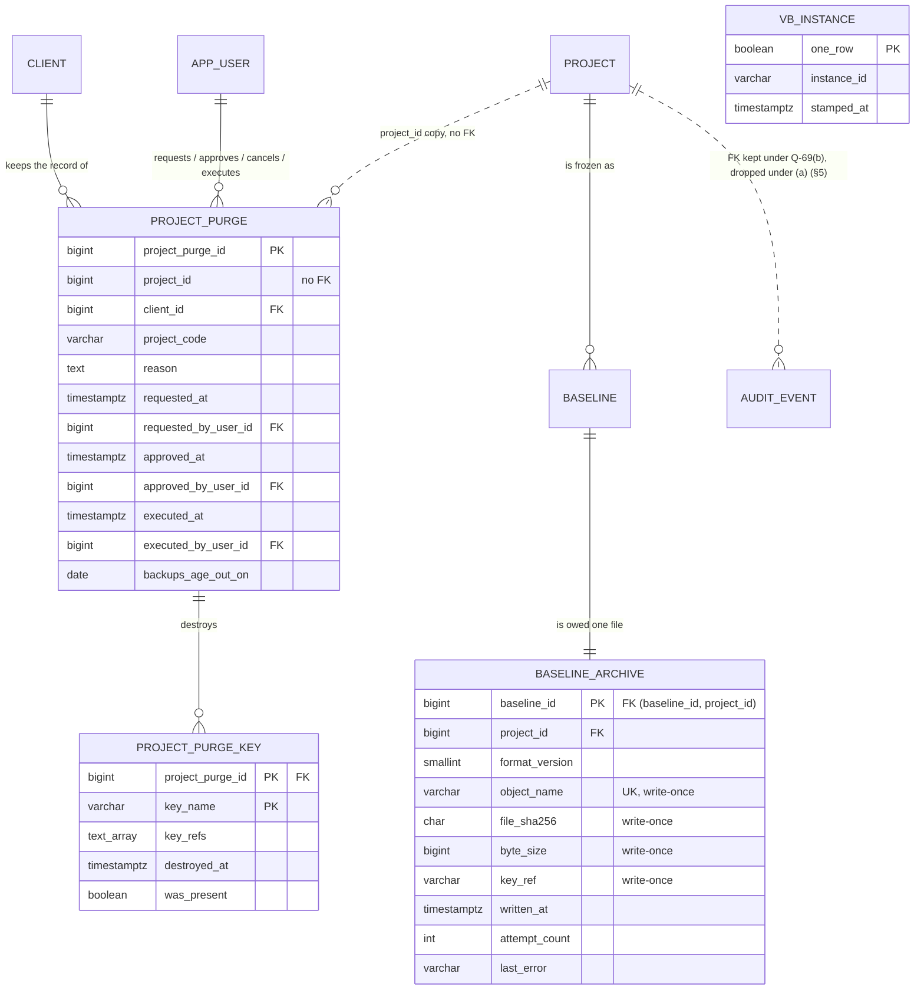
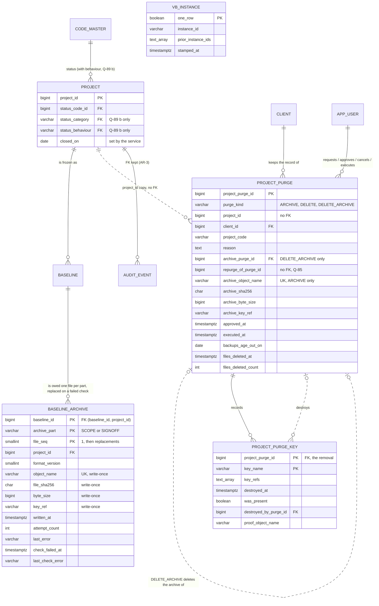

# Slice 16 — Baseline and project archive files + `purge_project`: logical + physical schema (apple, 2026-10-17; revised 2026-10-18)

**Status: Ben's rulings are in (2026-10-18, history §3 AR-1…AR-6), and Ben's answers to Q-86…Q-93 on 2026-10-20 (AR-7…AR-13, spec §20); the design is approved** (spec
§15a). This schema also raises Q-89…Q-92 (§12.9). **§12 is the current design wherever it disagrees with §1–§11**,
which are kept as the record of the 2026-10-17 draft and of design review round 1. The retention rule is AR-1's: two
years after a project closes it is due for archiving, and the project archive file is kept until a client contract or
Ben says delete it. There is **no five-year rule**. Q-69 is answered (b) (AR-3), so the audit FK stays and only the (b)
migration exists (§12.8). Q-72 is mandatory (AR-5). The changes to the immutability law (§4) and to `audit_event` (§5)
were accepted by Ben (AR-4 Q-75, AR-3).

Scope: S8-1, Q15, AR-1 — the archive file owed at every freeze (§15.3, criterion 155), the project archive file written
when a project leaves the app, and the one hard-delete path of business data (§6.1 *Contract wins*, §15.3, criterion
154). Source of truth: VB_design.md §6.1 (Q15 paragraph),
§6.6 role rules, §15.3; migrations 0001 (`fn_reject_modification`), 0003 (`audit_event`), 0047/0053/0054
(`fn_baseline_header_guard`), 0048 (shadows, `fn_shadow_insert_guard`); `services/freeze_set.py` (spec 4).

**Checked before modelling.** No archive or purge table exists. `fn_reject_modification` is **shared**: the 28
shadow triggers *and* `trg_audit_event_immutable` call it (0003 l.75), and 0001 reserves it for `decision`
(A-41) — so it cannot be loosened in place without loosening the audit log (§4). Every shadow copies `project_id`,
but as a **nullable** column (all copied columns are nullable, 0048 l.293); the header's `project_id` is NOT NULL.
`project.status_code_id` is in `code_lists.EXCLUDED` (PROJECT_STATUS company-only), so a project never points at
its own override — the `project ⇄ code_master` FK pair is a cycle in the catalog, not in the data.
`client.client_code` exists (varchar(30), NOT NULL, UNIQUE — `models/tenancy.py`), so the typed confirmation needs
no new column (§7).

**Risk grade:** **Grade 1** — the riskiest concern is the scoped trigger bypass: a fault either deletes another
project's signed baselines or leaves a purged client's rows behind. Archive writing is Grade 2 (a missing file is
noticed by the drill and is re-writable while the baseline exists).

**One correction to the brief:** `ALTER TABLE … DISABLE TRIGGER` takes SHARE ROW EXCLUSIVE in PostgreSQL 16, not
ACCESS EXCLUSIVE — it blocks other projects' *freezes*, not their reads. The scoped bypass is still the right call,
for a stronger reason: a disabled trigger protects nothing, so a wrong `WHERE` in the purge would delete other
projects' baselines unopposed. The bypass keeps the trigger armed for every row outside the one project.

## 1. Grain

*(2026-10-17 draft — `baseline_archive`, `project_purge` and `project_purge_key` change grain or meaning in §12.1.)*

| Table | One row per … | Key | Lives through a purge? |
|---|---|---|---|
| `baseline_archive` | frozen baseline — the archive file owed for it (outbox) | PK `baseline_id` (1:1 with `baseline`) | no — deleted with its baseline |
| `project_purge` | request to purge one project: approval, execution | PK `project_purge_id`; ≤ 1 open and ≤ 1 executed per `project_id` | **yes** — no FK to `project` |
| `project_purge_key` | key the purge must destroy | PK `(project_purge_id, key_name)` | **yes** |
| `vb_instance` | this database (exactly one row) | PK `one_row` (always true) | yes — not project data |

## 2. ER diagram (changed part only)

*(2026-10-17 draft; the current diagram is §12.2.)*



## 3. Physical tables (PostgreSQL 16)

### 3.1 `baseline_archive` (`BaselineArchive`, `models/baseline.py`)

*(Revised in §12.3: the key becomes `(baseline_id, archive_part, file_seq)` for the sign-off file (Q-79) and the
replacement file (§18 S5); every column below stays.)*

| Column | Type | Constraints | Description |
|---|---|---|---|
| `baseline_id` | bigint | PK; `fk_ba_baseline (baseline_id, project_id) → baseline (uq_baseline_project)` | the baseline the file is for; 1:1, so the FK is the identity — no surrogate |
| `project_id` | bigint | NOT NULL (part of the FK) | the purge predicate and the bypass test; the composite FK keeps it equal to the header's |
| `format_version` | smallint | NOT NULL, `CHECK (format_version >= 1)` | archive JSON layout, set at freeze; a reader years later needs it |
| `object_name` | varchar(400) | NULL until written; UNIQUE | built from the **instance id and ids only**: `<instance>/<project_id>/<baseline_id>.json.enc` — never a project or client name; unique across environments and restores (§6) |
| `file_sha256` | char(64) | NULL until written; `CHECK (file_sha256 ~ '^[0-9a-f]{64}$')` | hash of the stored (encrypted) bytes, so the drill proves the blob is the one written |
| `byte_size` | bigint | NULL until written; `CHECK (byte_size > 0)` | stored size |
| `key_ref` | varchar(400) | NULL until written | the **versioned** key that encrypted it (Key Vault key id + version; locally `<dir>/<key name>@<version>`). A reference, never key material (§6) |
| `written_at` | timestamptz | NULL = still owed | set by the writer when the blob is confirmed |
| `attempt_count` | integer | NOT NULL DEFAULT 0, `CHECK (attempt_count >= 0)` | writer tries so far |
| `last_attempt_at` | timestamptz | NULL | |
| `last_error` | varchar(2000) | NULL | the error **class** and a **fixed message per known error** (a constant in the writer); an unknown error stores its class and `"unexpected"`. Never `str(exc)` — a driver message can echo row content or a path |
| `created_at`, `created_by` | timestamptz, bigint | NOT NULL; `created_by` FK `app_user` (the freezer) | written in the freeze transaction |
| `updated_at`, `updated_by`, `row_version` | | as `audit_columns()`; `updated_at_trigger` | writer updates under `row_version` |

`ck_ba_written_set CHECK (num_nonnulls(object_name, file_sha256, byte_size, key_ref, written_at) IN (0, 5))`.
Queue index `ix_ba_owed (created_at) WHERE written_at IS NULL`. **No `is_active` / `deleted_*`** — Q-68.
**Guard `fn_baseline_archive_guard`** (BEFORE UPDATE OR DELETE): `baseline_id`, `project_id`, `format_version`,
`created_*` never change; once `OLD.written_at IS NOT NULL` **every** UPDATE is refused; DELETE only when
`fn_purge_allows(OLD.project_id)` (§4). **Grants:** vb_app SELECT, INSERT, and column UPDATE on `object_name,
file_sha256, byte_size, key_ref, written_at, attempt_count, last_attempt_at, last_error, updated_by, row_version`
(§6.6 column-grant list and the CI grant test both gain it). No DELETE.
**State is derived, not coded** (Q-67): owed = `written_at IS NULL`; failing = owed AND `last_error IS NOT NULL`.

### 3.2 `project_purge` (`ProjectPurge`, `models/tenancy.py`)

*(Revised in §12.5: `purge_kind`, the project-file columns, the DELETE_ARCHIVE link, and new uniques.)*

| Column | Type | Constraints | Description |
|---|---|---|---|
| `project_purge_id` | bigint identity | PK | |
| `project_id` | bigint | NOT NULL, **no FK** | the purged id; identities are never reused, so it stays unambiguous |
| `client_id` | bigint | NOT NULL, FK `client` | client survives the purge |
| `project_code` | varchar(30) | NOT NULL | copied at request; unique only with `client_id`, hence both. **No `project_name`** — it is client content |
| `reason` | text | NOT NULL, `ck_pp_reason CHECK (btrim(reason) <> '')` | contract clause / reference (criterion 154: 422 without) |
| `requested_at`, `requested_by_user_id` | timestamptz, bigint | NOT NULL; FK `app_user` | the created pair under the design's names; the guard sets `requested_at := now()` on INSERT |
| `approved_at`, `approved_by_user_id` | timestamptz, bigint | NULL; FK `app_user`; `ck_pp_approved num_nonnulls(…) IN (0,2)`; `ck_pp_four_eyes CHECK (approved_by_user_id <> requested_by_user_id)` | the second platform admin, through an authenticated in-app route (`platform_admin` guard). The guard **overwrites** `approved_at := now()` — the app cannot backdate an approval to skip the wait |
| `cancelled_at`, `cancelled_by_user_id` | timestamptz, bigint | NULL; FK `app_user`; `num_nonnulls(…) IN (0,2)` | withdrawn before execution, approved or not |
| `executed_at`, `executed_by_user_id` | timestamptz, bigint | NULL; FK `app_user`; `num_nonnulls(…) IN (0,2)` | set by the CLI as the last statement of the delete transaction. `executed_by` is the CLI's `--actor-email` — a **label** of who ran it, not the control; the control is the approval |
| `backups_age_out_on` | date | `CHECK ((executed_at IS NULL) = (backups_age_out_on IS NULL))` | `((now() AT TIME ZONE 'Asia/Bangkok')::date + interval '13 months')::date` — the database's `now()` read in ICT, so the date matches the business calendar whatever the server zone. Stored, not derived: it states the policy **at the time** |
| `updated_at`, `updated_by`, `row_version` | | as audit columns; `updated_at_trigger` | |

`ck_pp_one_end CHECK (num_nonnulls(cancelled_at, executed_at) <= 1)`;
`ck_pp_exec_approved CHECK (executed_at IS NULL OR approved_at IS NOT NULL)`. Partial uniques
`uq_pp_open (project_id) WHERE executed_at IS NULL AND cancelled_at IS NULL` and
`uq_pp_done (project_id) WHERE executed_at IS NOT NULL`. **Guard `fn_project_purge_guard`** (BEFORE INSERT OR
UPDATE OR DELETE): INSERT forces `requested_at := now()` and refuses any approved/cancelled/executed value; DELETE
always refused (any role); `project_id, client_id, project_code, reason, requested_*` never change; `approved_*`
only NULL → value, once, while open (and `approved_at` forced to `now()`); `cancelled_*` only while not executed;
once `executed_at` is set nothing but `updated_*`/`row_version` changes; a cancelled row never changes.
**Grants:** vb_app SELECT, INSERT, column UPDATE on `approved_at, approved_by_user_id, cancelled_at,
cancelled_by_user_id, updated_by, row_version` — **the running app cannot mark a purge executed**; only the
owner-run CLI can. Key destruction state lives in `project_purge_key`.

### 3.3 `project_purge_key` (`ProjectPurgeKey`, `models/tenancy.py`)

*(Revised in §12.6: an ARCHIVE records its keys and destroys none; a later DELETE_ARCHIVE destroys them.)*

| Column | Type | Constraints | Description |
|---|---|---|---|
| `project_purge_id` | bigint | PK part; FK `project_purge` | |
| `key_name` | varchar(200) | PK part | `vb-<instance>-proj-<project_id>` — Key Vault deletes a **key**, not a version, so the grain is the name |
| `key_refs` | text[] | NOT NULL DEFAULT '{}' | the DISTINCT `baseline_archive.key_ref` versions seen under this name, collected inside the purge transaction — evidence of what the destruction covered |
| `destroyed_at` | timestamptz | NULL until done | set after the vault (or local) delete **and** purge succeeds (Q-71) |
| `was_present` | boolean | NULL until done; `CHECK ((destroyed_at IS NULL) = (was_present IS NULL))` | false = the key was already absent (a project whose first archive never got a key) |

Rows are inserted by the CLI in the purge transaction (§7 step 5): one per distinct name in the collected refs
**plus** the computed name for the project, even with no ref — a key created by a writer that crashed before
`written_at` is in no ref but must still go. **Guard:** INSERT only while the parent is being executed in the same
transaction (`fn_purge_allows`); `destroyed_at`/`was_present` only NULL → value; DELETE and every other UPDATE
refused. **Grants:** vb_app SELECT only. Audit columns: `created_at`, `updated_at`, `row_version` (owner-written).
Purge "keys destroyed" = no row with `destroyed_at IS NULL` (derived).

### 3.4 `vb_instance` (`VbInstance`, `models/shared.py`)

*(Gains `prior_instance_ids` in §12.7, for §18 S6.)*

`one_row boolean PRIMARY KEY DEFAULT true CHECK (one_row)`, `instance_id varchar(40) NOT NULL CHECK (instance_id ~
'^[a-z0-9][a-z0-9-]{2,39}$')`, `stamped_at timestamptz NOT NULL DEFAULT now()`. Stamped once by an owner-run
`scripts/stamp_instance.py`; guard refuses UPDATE and DELETE; vb_app SELECT only. An ops table, not a business
table — no AuditMixin (recorded with Q-68).
**Source of truth: the table.** A restored database must know which instance wrote its archive names — a config
value describes the *host*, not the *data*. `VB_INSTANCE_ID` is required config, and the app **refuses to start**
when it is missing, the table is empty, or the two differ. So a prod backup restored into UAT stops at startup
until someone deliberately re-stamps it (and UAT then writes under its own names, never over prod's); a disaster
restore into prod keeps the id and its tombstones (§6).

## 4. The scoped bypass (replaces DISABLE TRIGGER)

*(`fn_purge_allows` gains the request kind and the Q-85 re-purge case in §12.4.)*

One function owns the rule; four trigger functions ask it.

```sql
CREATE FUNCTION fn_purge_allows(p_project_id bigint) RETURNS boolean
LANGUAGE sql STABLE SET search_path = pg_catalog, public AS $$
  SELECT session_user = 'vb_owner' AND current_user = 'vb_owner'
     AND p_project_id IS NOT NULL
     AND p_project_id::text = current_setting('vb.purge_project_id', true)
     AND EXISTS (SELECT 1 FROM public.project_purge pp WHERE pp.project_id = p_project_id
                  AND pp.executed_at IS NULL AND pp.cancelled_at IS NULL
                  AND pp.approved_at IS NOT NULL
                  AND pp.approved_at <= now() - interval '24 hours') $$;
```

- **The 24 h runs from approval**, not from request: the wait exists so that a second person's decision can be
  reconsidered or noticed. Counted from request, an approval given 23 h later would allow execution an hour after
  it — the second pair of eyes would get no cooling time at all.
- **`fn_reject_modification_purgeable()`** (new; for the 28 shadows): UPDATE → raise, always. DELETE → look up
  `public.baseline.project_id` by `OLD.baseline_id` (the header's NOT NULL value, **not** the nullable copy) and
  `RETURN OLD` only if `fn_purge_allows` says so; else raise the existing message.
- **`fn_baseline_header_guard()`** replaced via the 0054 `_guard_sql` pattern with `FROZEN_0054` verbatim; only the
  DELETE branch changes to `IF NOT fn_purge_allows(OLD.project_id) THEN RAISE …; END IF; RETURN OLD;`.
- **`fn_reject_modification_audit_purgeable()`** — **Q-69(b) only**, used by `trg_audit_event_immutable` alone:
  UPDATE → raise, always; DELETE → `RETURN OLD` only if `fn_purge_allows(OLD.project_id) AND OLD.event_type NOT
  LIKE 'PURGE\_%'`, so purge events survive even a wrong predicate. Under (a) the audit trigger stays on the
  shared function. *(§18 S8 and §12.8: the kept event types are named explicitly, not matched by pattern.)*
- **`fn_reject_modification()` is not touched** — `decision` and anything else keep it, unconditional. A test
  finds every trigger still calling it (catalog query) and proves UPDATE and DELETE raise **as vb_owner, inside an
  open, approved, aged purge with the setting set** — the strongest position the bypass grants.
- **Six conditions, each closing a path:** owner role only (vb_app has no DELETE grant anyway); `session_user`
  too, so a future SECURITY DEFINER function owned by vb_owner cannot lend the bypass to an app session; the
  transaction-local setting names **one** project (`set_config(…, true)`, parameterised); a per-row project test,
  so a wrong `WHERE` hits a raise, not a deletion; an **open request approved by a second platform admin** in the
  app; and **24 h** since that approval.
- Tables are schema-qualified and `search_path` pinned, so a temp table cannot shadow `project_purge`.
- **Honest risk.** This is a change to law 2: the owner role *can* now delete frozen rows, under six conditions.
  What stays true: no role can UPDATE a frozen row; vb_app cannot delete one; a DELETE outside an approved, aged
  purge raises. What is new: anyone holding the owner credential and willing to insert an approved, backdated
  `project_purge` row (the owner bypasses grants, not the guard — but could drop it) can purge. That credential
  could already drop the triggers, so the attack surface does not grow; the *accidental* surface does — hence §7's
  counts and tests. TRUNCATE remains unguarded for the owner (S8-2), unchanged.
- **New shadows.** `vb_ops.py` is append-only, so add `immutable_guards_v2(table)` (same as today, purgeable
  function) and use it from the bypass migration on. A test asserts every `baseline_*` trigger calls the purgeable
  function; a shadow made with the old helper makes the purge **fail loudly**, never skip — safe direction.

## 5. `audit_event` — two branches, decided by Q-69

**Decided (b)** — AR-3, 2026-10-18. Column (a) is kept below as the record of the option not taken; only the (b)
mechanism is built (§12.8).

| | Q-69(a) keep the project's audit rows | Q-69(b) delete them, keep `PURGE_*` |
|---|---|---|
| FK `audit_event_project_id_fkey` | **dropped** (rows outlive the project) | **kept** — no row points at the project after the purge |
| Trigger | unchanged (`fn_reject_modification`) | re-pointed to `fn_reject_modification_audit_purgeable` (§4) |
| `PURGE_REQUESTED` / `_APPROVED` / `_CANCELLED`, `PROJECT_PURGED` | `project_id = :p` | `project_id` **NULL**, `detail.purged_project_id = :p` from the request on |
| Purge deletes | nothing | `project_id = :p AND event_type NOT LIKE 'PURGE\_%'` (§8 row 12) |

`PROJECT_PURGED` (written after the deletes, same transaction) carries `{project_code, client_code, reason,
project_purge_id, table counts, os_user, host}` — counts and codes, no content. Under (b) a mis-written `PURGE_*`
row with `project_id` set survives the delete and then blocks the project's own DELETE by FK — the purge rolls
back, never leaves a dangling id. Under (a) the FK-drop **downgrade** refuses on any dangling id, else re-adds the
FK — never `NOT VALID`, never deletes audit rows to make it fit. **Why (b) was recommended:** old audit rows carry
client text — `lifecycle` writes item labels (`"BR-0042 Approve invoice"`), `effort.py` a `change_rationale`.

## 6. Keys and the archive store

Key material never enters the database. Key Vault in Azure, a gitignored key directory locally; one key per
project per instance, named `vb-<instance>-proj-<project_id>` (ids only); rotation adds versions.
- **Create-if-absent, never replace.** Locally the writer creates the key file with `O_CREAT | O_EXCL`; on
  "exists" it reads the existing key. In Key Vault it creates only when `get` returns not-found and, on a
  create conflict, re-reads. Refs are **versioned in both** (`<dir>/<key name>@<version>`), so two writers racing
  on a first freeze both end up encrypting under the same recorded version, and no file ever names a key that was
  overwritten.
- **Tombstone.** The purge's key step first writes a write-once object `<instance>/purged/<project_id>`
  (`{project_purge_id, executed_at}`, no content). The writer **refuses to create a key or write a file for a
  tombstoned project**, so a database restored from before the purge cannot quietly re-key a client whose data was
  destroyed (what the restored rows mean is Q-85). *(§12.6: the tombstone also carries the purge kind, and
  DELETE_ARCHIVE adds a second marker.)*
- `baseline_archive.key_ref` records the exact version per file; `project_purge_key` records each key's
  destruction. Names are a function of instance and project, so there is no key table (Q-71).

## 7. Purge transaction (CLI `scripts/purge_project.py`, as vb_owner)

*(§12.5–§12.6 add the ARCHIVE steps before step 1 and the DELETE_ARCHIVE flow; steps 1–6 are unchanged for ARCHIVE
and DELETE, except that ARCHIVE skips step 6's key destruction.)*

1. `SELECT … FROM project WHERE project_id = :p FOR UPDATE`; an open request exists, approved, approval ≥ 24 h
   old (`fn_purge_allows` is re-checked by every trigger anyway); the operator types
   `<client_code>/<project_code>` (e.g. `ACME/ERP-2026`), compared exactly to the joined `client` and `project`
   rows — the client's code, so a same-coded project of another client cannot be named by habit;
   `set_config('vb.purge_project_id', :p, true)`.
2. **Classify every table in `public`** into exactly one of DELETE (computed from `pg_constraint`, §8), KEEP or
   NO_PROJECT_DATA (hand lists). Refuse if a table is unlisted, in two sets, or in NO_PROJECT_DATA while it has a
   `project_id` column or an FK path to `project` / `baseline`.
3. **Count before.** For each DELETE table: `n_project` (its §8 predicate) and `n_total` (all rows).
4. Delete, one statement per table (or per CTE group), in the order of §8. After each, require
   `rowcount = n_project` (a CTE group checks each member through `RETURNING` counts), else **ROLLBACK**.
5. **Prove.** Every DELETE table counts 0 for `:p`, and its total equals `n_total − n_project` exactly — a fall
   larger than the project's count means another project lost rows; ROLLBACK. Then insert the
   `project_purge_key` rows (§3.3), `UPDATE project_purge SET executed_*, backups_age_out_on`, insert
   `PROJECT_PURGED`; **COMMIT**.
6. Write the tombstone (§6), then destroy each `project_purge_key` name (delete **and** purge, Q-71) and set its
   `destroyed_at` / `was_present`. Keys go **after** commit: a rollback after the key is gone would leave a live
   project whose archive is unreadable; the reverse failure (rows gone, key alive) is retryable and visible as a
   row with `destroyed_at IS NULL`. The tombstone goes first so a crash between the two still blocks new keys.

## 8. Delete order for one project (child before parent; derived from the models' FKs)

Expected result of the catalog sort; the run-time order is computed, and a test pins it against this list.
*(Slices 14 and 15 add their tables to the computed order — §12.10.)*

| # | Table(s) | Predicate |
|---|---|---|
| 1 | `baseline_archive` | `project_id = :p` (bypass) |
| 2 | the 28 `baseline_*` shadows (mutually independent) | `baseline_id IN (SELECT baseline_id FROM baseline WHERE project_id = :p)` (bypass) |
| 3 | `baseline` — one statement; `prior_baseline_id` self-FK is NO ACTION, checked at statement end | `project_id = :p` (bypass) |
| 4 | `import_row` → `import_batch` (anchor FK → `bfc_node`) | via `import_batch_id`; then `project_id` |
| 5 | `diagram_layout` | `project_id` |
| 6 | `fr_interface_data_entity` → `fr_interface` → `br_function_requirement` → `application_solution` → `application_bfc_node` → `br_solution` | `project_id` |
| 7 | `br_system_flow`, `br_data_field`, `br_requirement_line`, `br_data_entity`, `br_org_role` | `project_id` |
| 8 | `function_requirement` → `solution` → `business_requirement` | `project_id` |
| 9 | `bfc_node_trigger` → `process_trigger`; `bfc_node_external_flow` → `bfc_node_flow` (retired, rows remain) → `bfc_node_org_role` → `bfc_node_data_entity` → `external_entity` | `project_id` |
| 10 | `bfc_node` — one statement (parent self-FK) | `project_id` |
| 11 | `application`, `data_field` → `data_entity`, `org_role` → `org_unit` (self-FK, one statement), `effort_rate` | `project_id` |
| 12 | `project_member`, `user_access_grant` (retired; rows remain), `project_component`, `project_dfd_rule`, `project_code_visibility`, `project_sequence`; **Q-69(b) only:** `audit_event` | `project_id` (audit: §5 predicate, bypass) |
| 13 | `code_master` overrides **and** `project`, in **one statement**: `WITH o AS (DELETE FROM code_master WHERE project_id = :p) DELETE FROM project WHERE project_id = :p` | — |

**`KEEP`** (hold project-linked rows that survive): `project_purge`, `project_purge_key`, and `audit_event` under
Q-69(a). `code_master` is a DELETE table — its predicate `project_id = :p` never matches a global row.
**`NO_PROJECT_DATA`** (no `project_id`, no FK path to a project; step 2 re-checks that claim): `client`,
`program`, `program_member`, `app_user`, `project_template_component`, `vb_instance`, `alembic_version`.
**On the bfc_node performer "cycle":** in the built schema it is an ordering, not a cycle — `application`,
`org_role`, `org_unit` do not reference `bfc_node` — so row 10 before 11 needs no nulling UPDATE. The only
table-level cycle is `project ⇄ code_master`, which row 13 handles.
**Catalog vs hand list — recommend catalog for DELETE.** A hand list silently misses the next table (slices 14 and
15 add six); the catalog sort (as `conftest._delete_order`) cannot. (a) every strongly connected set of tables is
deleted in one statement of chained CTEs; (b) predicates come from a small rule — `project_id` column, else via the
parent FK (`import_row`), shadows via `baseline_id`; (c) only KEEP and NO_PROJECT_DATA are hand-kept, and a new
table that is in neither and not computed stops the purge. A test plants two projects touching every table, purges
one, and asserts zero rows for it and that the other is byte-identical (shadows and `content_digest` included);
a second test plants a deliberately wrong predicate and asserts step 4 rolls back.

## 9. Migrations (2026-10-17 draft — superseded)

**Superseded by §12.8** (numbering from 0068, after slice 14's 0061–0064 and slice 15's 0065–0067; Q-69 decided
(b)). Kept for the review record.

| Id | Does | Downgrade |
|---|---|---|
| 0061 | `baseline_archive` + guard + grants; **backfill** one owed row per existing baseline (`created_by = frozen_by_user_id`) | refuse if any `written_at IS NOT NULL` |
| 0062 | `vb_instance` + guard + grant (empty; stamped by the CLI) | refuse if stamped (the restore identity would be lost) |
| 0063 | `project_purge` (incl. `approved_*`) + guard + grants | refuse if any row exists |
| 0064 | `project_purge_key` + guard + grant | refuse if any row exists |
| 0065 | `fn_purge_allows`, `fn_reject_modification_purgeable`; re-point the 28 shadow triggers; replace `fn_baseline_header_guard`; `vb_ops.immutable_guards_v2` | restore the old triggers and the 0054 guard — safe |
| 0066 — **if Q-69(a)** | drop `audit_event` → `project` FK | refuse on a dangling id (§5) |
| 0066 — **if Q-69(b)** | `fn_reject_modification_audit_purgeable`; re-point `trg_audit_event_immutable`; FK kept | re-point to `fn_reject_modification` — safe |

## 10. Questions for Ben (2026-10-17)

**All answered 2026-10-18** (AR-3…AR-6): Q-67, Q-68, Q-70, Q-71, Q-73, Q-85 as recommended; Q-69 **(b)**; Q-72
**mandatory**, with at least two live platform admins. Kept as the record of what was asked.

- **Q-67 Status codes or derived state?** All states are fully determined by `written_at` / `approved_at` /
  `executed_at` / `cancelled_at`; a stored status is a transitive dependency that can disagree with them.
  **Recommend derive**, labels via `t()`. If he wants codes, make them `is_system` and pinned (law 5).
- **Q-68 Full AuditMixin on the new tables?** None can be retired — an archive cannot be "soft-deleted", a purge
  ends by cancel, `vb_instance` is ops. **Recommend** the header precedent: no `is_active`/`deleted_*`, keep
  created/updated and `row_version`; record the law-3 exception in the spec.
- **Q-69 Do the project's old audit rows go?** They hold labels and rationale text. (a) keep them — FK dropped
  (0066a); (b) delete them in the purge, keeping only `PURGE_*` events — audit trigger re-pointed (0066b), FK
  kept; (c) encrypt `detail` per project key from now on. **Recommend (b)**, decided with whoever reads the
  contract; (a) only if legal confirms labels are fine.
- **Q-70 Should a client sign-off wait for the archive?** **Recommend no block**: show "archive owed" and alert
  ops on any row owed > 1 h; the drill (§15.3) proves the path.
- **Q-71 Key Vault soft-delete.** Azure keeps a deleted key recoverable 7–90 days; "destroyed" must mean deleted
  **and** purged. **Recommend** 7-day retention, no purge protection on the archive vault, and
  `project_purge_key.destroyed_at` = the purge time.
- **Q-72 Four eyes — confirm.** Built in: a second platform admin approves in the app (CHECK: not the requester),
  execution waits 24 h from approval, any platform admin may cancel before execution.
- **Q-73 How does "read-only while requested" hold?** **Recommend** `project_ctx` / `object_guard` refuse every
  write with 409 PURGE_PENDING while an open `project_purge` row exists, derived from that row; freeze included.
- **Q-85 What happens to a purged project brought back by a restore?** The tombstone stops new keys and files, but
  the restored rows are visible again. **Recommend** the app treats a project with a tombstone as not found (404)
  and the restore runbook re-purges it; that re-purge keeps the second approver but skips the 24 h wait, since
  the decision was already taken and aged once.

## 11. Revision after design review round 1 (design-auditor, 2026-10-17)

1. **BLOCKING — Q-69(b) had no mechanism.** Added `fn_reject_modification_audit_purgeable` (§4), the branch
   table (§5) and the two-branch 0066 (§9); `PURGE_*` events carry `project_id` NULL under (b), so the FK stays.
2. **HIGH — four eyes.** `approved_*` with not-the-requester CHECK, set by an authenticated in-app route; guard
   forces `approved_at := now()`; `fn_purge_allows` needs approval ≥ 24 h old, **counted from approval** (§4);
   `--actor-email` is a label. Cancel: any platform admin, not only the two parties (§3.2).
3. **HIGH — confirmation names the client.** `client.client_code` exists; typed text `<client_code>/<project_code>`
   (§7 step 1). No schema change.
4. **HIGH — names unique across environments and restores.** `vb_instance` (source of truth) + required
   `VB_INSTANCE_ID`, startup refuses on mismatch (§3.4); names in §3.1/§6; `project_purge_key` replaces
   `project_purge.key_ref`/`key_destroyed_at` (§3.3), and also covers a key that no ref names.
5. **HIGH — restore resurrects a purged project.** Tombstone object, writer refuses to re-key (§6, §7 step 6);
   the restored rows themselves raise Q-85.
6. **HIGH — other projects' rows.** Per-table counts before, rowcount per DELETE, totals proven before commit
   (§7 steps 3–5) and a wrong-predicate test (§8).
7. **MEDIUM — classify every table.** DELETE / KEEP / NO_PROJECT_DATA, unlisted refuses (§7 step 2, §8).
8. **MEDIUM — key creation race.** Create-if-absent, versioned refs locally too, never replaced (§6).
9. **LOW — `backups_age_out_on`** from the database `now()` in ICT (§3.2).
10. **LOW — `last_error`** is class + fixed message, never `str(exc)` (§3.1).

## 12. Revision for Ben's rulings (2026-10-18)

Folds in AR-1…AR-6 (spec §15a) and the two schema items spec §18 left "for the schema at build" (S5's check columns,
the key-gone proof) plus S6's re-stamp record, so that the migration list in §12.8 is final. **No hash-spec change:**
nothing here enters the freeze set, no shadow gains or loses a column, and `project.closed_on` is not copied into the
baseline header. Q-86 (what the project file holds beyond baselines and sign-offs) changes the file's **content**
only, not any table, so nothing below waits on it. Q-88 is modelled as recommended (four eyes, keys then files); if
Ben answers otherwise, the columns still fit and only the guard's DELETE_ARCHIVE branch changes.

### 12.1 Grain (current)

| Table | One row per … | Key | Lives through a purge? |
|---|---|---|---|
| `project` *(changed: attributes only)* | project — unchanged | PK `project_id` | no |
| `baseline_archive` *(grain changed)* | **file owed or written for one part of one frozen baseline**: the scope file at freeze, the sign-off file at client approval (Q-79), and a replacement when the weekly check fails a written file (§18 S5) | PK `(baseline_id, archive_part, file_seq)`; ≤ 1 owed per `(baseline_id, archive_part)` | no — deleted with its baseline |
| `project_purge` *(widened)* | **request to take one project out of VB, or to delete its archive**: kind ARCHIVE (write the project file, then remove), DELETE (remove under a contract, Q15), or DELETE_ARCHIVE (destroy an archived project's keys and files) | PK `project_purge_id`; per `project_id`: ≤ 1 open of any kind, ≤ 1 executed ARCHIVE-or-DELETE, ≤ 1 executed DELETE_ARCHIVE | **yes** — no FK to `project` |
| `project_purge_key` *(meaning changed)* | **project key name recorded by a removal** (ARCHIVE or DELETE); destroyed by that DELETE, or later by the DELETE_ARCHIVE of that ARCHIVE | PK `(project_purge_id, key_name)` | **yes** |
| `vb_instance` *(attribute added)* | this database — unchanged | PK `one_row` | yes |

Why the sign-off file is a second row of `baseline_archive` and not a second table: both files have exactly the same
attributes, writer, queue, key and verification, and differ only in what they hold. A twin table would duplicate
every column and the writer would poll two outboxes. The part is a key column, so each part has its own owed row and
its own write-once state. The approval set on the header is written once and then closed (0047 guard), so one
sign-off file per baseline is enough; it is owed from the moment the approval is recorded.

### 12.2 ER diagram (changed part only)



### 12.3 `project.closed_on`, and `baseline_archive` in its final shape

**`project.closed_on`** — `date NULL`. The day the project's status became closed, in ICT (`local_today()`); cleared
when the status leaves closed; closing again sets a new date, so the two years restart (Q-87). **Set by the project
service only, never accepted from a request body** (law 6). Index `ix_project_closed_on (closed_on) WHERE closed_on IS
NOT NULL` for the due list. **Due** stays derived (Q-67): `closed_on + interval '2 years' <= local_today()` and no
executed ARCHIVE or DELETE for the project (which, outside a restore, simply means the row still exists).

How the database knows "closed" depends on **Q-89** (§12.9) — PROJECT_STATUS today has no behaviour and CLOSED is not
pinned, so a status comparison would be the code-branch law 5 forbids:
- **Q-89 (b), recommended — the I-1 precedent.** PROJECT_STATUS becomes a behaviour category (OPEN / CLOSED);
  `project` gains `status_category varchar(30) NOT NULL DEFAULT 'PROJECT_STATUS' CHECK (status_category =
  'PROJECT_STATUS')` and `status_behaviour varchar(20) NOT NULL`, and `fk_project_status` becomes the composite
  `(status_code_id, status_category, status_behaviour) → code_master (code_id, category, behaviour_code)` with
  `onupdate NO ACTION`, as `fk_issue_status` (0063). Then **`ck_project_closed_on CHECK ((status_behaviour =
  'CLOSED') = (closed_on IS NOT NULL))`** — the database refuses a closed project with no clock and an open one with
  a stale date, and a status an admin adds later must declare whether it closes the project.
- **Q-89 (a).** `('PROJECT_STATUS', 'CLOSED')` joins `code_lists.PINNED`; the service compares the code; no composite
  FK and no CHECK — `closed_on` is held by the service alone, and a new "closed-like" status never starts the clock.

**Backfill (Q-92):** every project whose status is CLOSED at migration time gets `closed_on` = the migration day (ICT),
so nothing becomes due on the day the rule arrives. A project retired (`is_active = false`) while not closed never
gets a date — Q-90.

**`baseline_archive` (final; replaces the key and adds four columns to §3.1):**

| Column | Type | Constraints | Description |
|---|---|---|---|
| `archive_part` | varchar(10) | PK part; NOT NULL; `ck_ba_part CHECK (archive_part IN ('SCOPE', 'SIGNOFF'))` | which file of the baseline. A CHECK list, not `code_master`: the writer branches on it to choose what goes in the file — the `data_model_depth` precedent; labels via `t()` |
| `file_seq` | smallint | PK part; NOT NULL DEFAULT 1, `CHECK (file_seq >= 1)` | 1 for the first file of the part; the weekly check adds `n + 1` when file `n` fails (§18 S5). The current file of a part is its highest `file_seq` (derived) |
| `check_failed_at` | timestamptz | NULL; only on a written row | when `verify_archive --all` found the stored file missing, short or with a different sha256 |
| `last_check_error` | varchar(2000) | NULL; `num_nonnulls(check_failed_at, last_check_error) IN (0, 2)`; `CHECK (check_failed_at IS NULL OR written_at IS NOT NULL)` | class + fixed message, as `last_error` |

Every §3.1 column stays. `object_name` per part and seq, ids only: `<instance>/<project_id>/<baseline_id>.json.enc`
(SCOPE), `….signoff.json.enc` (SIGNOFF), with `.r<file_seq>` before `.json.enc` from seq 2 on — UNIQUE as before, and
the failed file is never overwritten or deleted by the check.
**Unique** `uq_ba_owed (baseline_id, archive_part) WHERE written_at IS NULL` (≤ 1 owed per part); `ix_ba_owed`
unchanged. **Guard `fn_baseline_archive_guard`** gains: INSERT of `SIGNOFF` only when the header's approval set is
recorded (`baseline.client_approver_name IS NOT NULL`); INSERT with `file_seq > 1` only when row `file_seq − 1` of
the same part is written and has `check_failed_at` set; on a written row the **only** permitted UPDATE is
`check_failed_at` / `last_check_error` NULL → value, once (the S5 exemption from the written-row lock); every key column
and `format_version` never change. **Grants** gain column UPDATE on `check_failed_at, last_check_error`.
**Who inserts:** the freeze transaction (SCOPE, seq 1); the baseline approval transaction (SIGNOFF, seq 1); the weekly
check (seq `n + 1`, in the same transaction that sets `check_failed_at` on `n`). Derived states: owed, failing, check
failed, superseded (a higher seq exists).

### 12.4 `fn_purge_allows` by kind

```sql
CREATE FUNCTION fn_purge_allows(p_project_id bigint) RETURNS boolean
LANGUAGE sql STABLE SET search_path = pg_catalog, public AS $$
  SELECT session_user = 'vb_owner' AND current_user = 'vb_owner'
     AND p_project_id IS NOT NULL
     AND p_project_id::text IS NOT DISTINCT FROM current_setting('vb.purge_project_id', true)
     AND EXISTS (SELECT 1 FROM public.project_purge pp WHERE pp.project_id = p_project_id
                  AND pp.purge_kind IN ('ARCHIVE', 'DELETE')
                  AND pp.executed_at IS NULL AND pp.cancelled_at IS NULL
                  AND pp.approved_at IS NOT NULL
                  AND (pp.approved_at <= now() - interval '24 hours'
                       OR pp.repurge_of_purge_id IS NOT NULL)
                  AND (pp.purge_kind = 'DELETE' OR pp.archive_object_name IS NOT NULL)) $$;
```

| Kind | Scoped bypass | What the extra conditions add |
|---|---|---|
| **ARCHIVE** | yes | **No row can be deleted until the verified project file is recorded on the request** (`archive_object_name IS NOT NULL`). Every trigger thus enforces "recorded, then delete"; that the script verifies before it records is proven by spec criterion 22 (spec §19 U7) |
| **DELETE** | yes | unchanged from §4 |
| **DELETE_ARCHIVE** | **never** — not in the kind list | it deletes no database row; a DELETE_ARCHIVE request open for a project can never lend the bypass to anything |

**Q-85 re-purge (AR-6, spec §18 "the function gains that one case"):** `repurge_of_purge_id` (§12.5) waives the 24 h —
the second approver is still required. Only the owner sets that column, and only from a tombstone it has read (§12.6).
**Q-72 (two live platform admins) is not in this function** — it runs per deleted row; it is checked once, by the
`project_purge` guard on the `executed_at` transition (§12.5), which is in the same transaction as the deletes, so a
refusal there rolls the whole purge back.

### 12.5 `project_purge` — kinds, project file, uniques, guard

**Columns added** (all §3.2 columns stay):

| Column | Type | Constraints | Description |
|---|---|---|---|
| `purge_kind` | varchar(15) | NOT NULL; `ck_pp_kind CHECK (purge_kind IN ('ARCHIVE', 'DELETE', 'DELETE_ARCHIVE'))`; never changes | **a CHECK list, not `code_master`**: the script and the triggers branch on it (law 5's purpose — a kind an admin could add would reach a branch nobody wrote). Labels via `t()` |
| `archive_purge_id` | bigint | NULL; `ck_pp_archive_ref CHECK ((purge_kind = 'DELETE_ARCHIVE') = (archive_purge_id IS NOT NULL))`; FK below | the ARCHIVE whose files this request deletes — **yes, DELETE_ARCHIVE references it**: it is the only link from the deletion to the keys it must destroy (§12.6), the project row being long gone |
| `archive_purge_kind` | varchar(15) | `GENERATED ALWAYS AS (CASE WHEN archive_purge_id IS NOT NULL THEN 'ARCHIVE' END) STORED` | FK helper, as `project.program_is_active` |
| `repurge_of_purge_id` | bigint | NULL, **no FK** (the original request may be absent from the restored database); `CHECK (purge_kind <> 'DELETE_ARCHIVE' OR repurge_of_purge_id IS NULL)` | Q-85: the id read from the tombstone of a removal that a restore undid. Waives the 24 h only |
| `archive_object_name` | varchar(400) | NULL; UNIQUE | the project file: `<instance>/<project_id>/project-<project_purge_id>.json.enc` (ids only) |
| `archive_sha256` | char(64) | NULL; `~ '^[0-9a-f]{64}$'` | of the stored (encrypted) bytes |
| `archive_byte_size` | bigint | NULL; `> 0` | |
| `archive_key_ref` | varchar(400) | NULL | the versioned key that encrypted the project file — added beyond the brief's three: the file must be readable and verifiable without the purged `baseline_archive` rows, and §12.6 collects it with the other refs |
| `files_deleted_at` | timestamptz | NULL | DELETE_ARCHIVE: when the script finished deleting the project's files from the store |
| `files_deleted_count` | integer | NULL; `>= 0` | how many objects it deleted (the tombstones are kept) |

**Checks tying them to kind and execution**
- `ck_pp_archive_set CHECK (num_nonnulls(archive_object_name, archive_sha256, archive_byte_size, archive_key_ref) IN (0, 4))`
- `ck_pp_archive_kind CHECK (purge_kind = 'ARCHIVE' OR archive_object_name IS NULL)` — only an ARCHIVE has a project file
- `ck_pp_archive_exec CHECK (purge_kind <> 'ARCHIVE' OR executed_at IS NULL OR archive_object_name IS NOT NULL)` — an executed ARCHIVE always names its file
- `ck_pp_files_deleted CHECK (num_nonnulls(files_deleted_at, files_deleted_count) IN (0, 2) AND (files_deleted_at IS NULL OR (purge_kind = 'DELETE_ARCHIVE' AND executed_at IS NOT NULL)))`
- `ck_pp_backups` replaces §3.2's backups CHECK: `CHECK ((executed_at IS NOT NULL AND purge_kind <> 'DELETE_ARCHIVE') = (backups_age_out_on IS NOT NULL))` — a DELETE_ARCHIVE removes no database rows, so it starts no backup clock

**Uniques** (`uq_pp_done` is dropped — it would refuse the executed DELETE_ARCHIVE that follows an executed ARCHIVE):
- `uq_pp_open (project_id) WHERE executed_at IS NULL AND cancelled_at IS NULL` — unchanged, **across kinds**: one
  open request per project of any kind, so Q-73's pending check stays one lookup
- `uq_pp_removed (project_id) WHERE executed_at IS NOT NULL AND purge_kind IN ('ARCHIVE', 'DELETE')` — a project
  leaves VB once per database timeline
- `uq_pp_archive_deleted (archive_purge_id) WHERE executed_at IS NOT NULL` — an archive is deleted once
- `uq_pp_id_project_kind (project_purge_id, project_id, purge_kind)` — FK target for
  `fk_pp_archive (archive_purge_id, project_id, archive_purge_kind) → project_purge (project_purge_id, project_id, purge_kind)`:
  the database proves the DELETE_ARCHIVE names an ARCHIVE **of the same project**

**Guard `fn_project_purge_guard`** — §3.2's rules stay; added:
- **INSERT, every kind:** at least two live platform admins (`app_user.is_active AND is_platform_admin`), else raise
  (Q-72, AR-5); `archive_*`, `repurge_of_purge_id`, `files_deleted_*` must be NULL.
- **INSERT ARCHIVE / DELETE:** the `project` row exists. (Whether ARCHIVE also requires the project to be due is Q-91,
  enforced in the service either way.)
- **INSERT DELETE_ARCHIVE:** the referenced ARCHIVE is executed; `client_id` and `project_code` are **overwritten**
  from it (a deliberate copy — the record must read alone; the guard keeps it equal to its source).
- **Approve:** approver and requester are both live platform admins, and two or more exist.
- **`archive_*`:** NULL → value once, by `vb_owner` only, kind ARCHIVE, while open and approved. They stay on a
  request cancelled afterwards, so an orphan project file is always named (and later made unreadable by DELETE or
  DELETE_ARCHIVE).
- **`repurge_of_purge_id`:** NULL → value once, by `vb_owner` only, while open, kind ARCHIVE or DELETE.
- **`executed_*` NULL → value** (owner only; the app has no grant) requires, re-checked in the database at that
  moment: approved; `approved_at <= now() − 24 h` or `repurge_of_purge_id` set; requester ≠ approver and both still
  live platform admins (§18 S7); at least two live platform admins; then by kind —
  ARCHIVE: `archive_object_name` set **and** no `project` row with this `project_id` remains;
  DELETE: no `project` row remains;
  DELETE_ARCHIVE: no `project_purge_key` row of the referenced ARCHIVE has `destroyed_at IS NULL` — **for this kind
  "executed" means "keys destroyed"**.
- **`files_deleted_*`:** NULL → value once, DELETE_ARCHIVE, after execution; otherwise an executed row is frozen as before.

**Grants** unchanged: vb_app cannot write `purge_kind` after insert, `archive_*`, `repurge_of_purge_id`, `executed_*`,
`backups_age_out_on` or `files_deleted_*`. The app INSERTs `purge_kind` (and `archive_purge_id` for DELETE_ARCHIVE);
both are then fixed by the guard.

**The ARCHIVE run** (operator script, ahead of §7 step 1): build the project file from the **current** verified file
of every part of every baseline (AR-2) plus Q-86's content → encrypt under the project key → `put_once` → read the
stored bytes back and verify them end to end → record `archive_*` and audit `PURGE_ARCHIVE_WRITTEN`, **commit** → §7
steps 1–5 unchanged, with the file's ref added to the collected key refs → step 6 writes the tombstone
(`{project_purge_id, purge_kind: ARCHIVE, executed_at}`) and **destroys nothing**. A re-run after a failed purge
transaction finds `archive_*` already recorded, re-verifies that file and reuses it — the project's writes have been
refused since the request opened (Q-73), so the file is still current.
**Name change from spec §15a:** the project file name carries the request id (`project-<project_purge_id>.json.enc`,
not `project.json.enc`). The store is write-once, so a fixed name would make a cancelled ARCHIVE's file block — or
worse, be adopted by — a later ARCHIVE of the same project holding newer content.

### 12.6 `project_purge_key` under each kind

| Kind | Key rows | Destroyed |
|---|---|---|
| DELETE | inserted in its purge transaction (unchanged) | by itself, after commit (unchanged) |
| **ARCHIVE** | inserted in its purge transaction, the same way, **plus** `archive_key_ref`'s name | **none** — the rows stay `destroyed_at IS NULL`: "keys held for the archive", an expected state, not R11's alert |
| DELETE_ARCHIVE | **none of its own** | destroys every row of its `archive_purge_id` |

**Columns added:**
- `destroyed_by_purge_id bigint NULL`, FK `project_purge` — the request that destroyed this key: the parent itself for
  a DELETE, the DELETE_ARCHIVE for an ARCHIVE's key. Without it, the destruction of an archive's keys would have no
  owner in the data.
- `proof_object_name varchar(400) NULL` — the stored file that **failed to decrypt** after destruction (spec §18's
  "prove the key is gone"); NULL with `destroyed_at` set means no file existed to prove on, and the script says so.
- `ck_ppk_destroyed CHECK (num_nonnulls(destroyed_at, was_present, destroyed_by_purge_id) IN (0, 3))` replaces the
  pair CHECK; `CHECK (proof_object_name IS NULL OR destroyed_at IS NOT NULL)`.

**Guard** adds: INSERT only for a parent of kind ARCHIVE or DELETE (and still only under `fn_purge_allows`); the
destroyed columns NULL → value once, by `vb_owner`, where `destroyed_by_purge_id` is either (a) the parent itself,
kind DELETE, executed; or (b) an open, approved DELETE_ARCHIVE with approval ≥ 24 h old whose `archive_purge_id` is
the parent. **An ARCHIVE can never mark its own keys destroyed.** Derived purge states: DELETE "keys outstanding" =
rows with `destroyed_at IS NULL`; ARCHIVE "archive readable" = the same rows, until a DELETE_ARCHIVE.

**The DELETE_ARCHIVE run** (no database rows deleted, no bypass): checks as §7 step 1 against the ARCHIVE row (the
operator types `<client_code>/<project_code>` from it) → writes a second write-once marker
`<instance>/purged/<project_id>.keys-destroyed` (`{project_purge_id, archive_purge_id}`) → destroys each key row of the
ARCHIVE under this instance's prefix (S2), proves each, sets `destroyed_*` → sets `executed_*` (the guard refuses while
any key is left) and audits `PURGE_KEYS_DESTROYED` → deletes every object under `<instance>/<project_id>/` where the
store allows, sets `files_deleted_*`, audits `PURGE_ARCHIVE_DELETED`. The tombstones are kept.
**Restore (Q-85):** the script reads the tombstone's kind and the marker — tombstone ARCHIVE and no marker → re-purge
as ARCHIVE, **adopting** the existing project file after verifying it; marker present, or tombstone DELETE → re-purge as
**DELETE** (the keys are gone, so no file could be written). Either way the owner sets `repurge_of_purge_id`. §18 S3's
sequence move must also advance `project_purge`'s identity past every `project_purge_id` found in tombstones, so a new
request can never reuse an id a tombstone names.

### 12.7 `vb_instance.prior_instance_ids`

`prior_instance_ids text[] NOT NULL DEFAULT '{}'` — every instance id this data was stamped under before the current
one, appended by `stamp_instance` when it re-stamps a restored database (§18 S6). An array, not a single
`restored_from_instance_id`, because a restore of a restore (prod → UAT → dev) must still find prod's tombstones; the
writer and the restore runbook check tombstones under the current id **and every prior one**. Guard: UPDATE only by
`vb_owner`, only appending `OLD.instance_id` to the array while changing `instance_id`, `stamped_at := now()`; DELETE
refused. Grain unchanged.

### 12.8 Migrations (final, from 0068)

Slice 14 took 0061–0064 and slice 15 takes 0065–0067; ids are the next free on `main` when built, in this order. One
table or one change per migration, each its own commit, each reversible; every new model joins `models/__init__.py`
(law 10). **Pauses for Ben** marks the ones that weaken a guarantee or touch the immutability/audit triggers.

| Id | Does | Downgrade guard | Pause |
|---|---|---|---|
| **0068** | `baseline_archive` (final shape §12.3) + guard + grants; **backfill** one owed `SCOPE` row per existing baseline (`created_by = frozen_by_user_id`) and one owed `SIGNOFF` row per baseline with an approval recorded (`created_by = approved_by_user_id`) | refuse if any `written_at IS NOT NULL` (a written file's record would be lost) | no |
| **0069** | `vb_instance` (with `prior_instance_ids`) + guard + grant (empty; stamped by the script) | refuse if stamped (the restore identity would be lost) | no |
| **0070** | *Q-89 (b) only:* PROJECT_STATUS becomes a behaviour category — refuse on project-tier or unknown PROJECT_STATUS codes (as 0061), widen `ck_code_behaviour_present`, add `ck_code_project_status_behaviour IN ('OPEN','CLOSED')`, set PLANNING / ACTIVE / ON_HOLD → OPEN, CLOSED → CLOSED; `seed_code_master` carries the same | refuse while `project.status_behaviour` exists (0071 first); else clear the four behaviours and restore the CHECK | no |
| **0071** | `project.closed_on` + `ix_project_closed_on`; backfill (Q-92). *Under Q-89 (b) also:* `status_category`, `status_behaviour` (backfilled from the status row), the composite `fk_project_status` and `ck_project_closed_on` | refuse while any `project_purge` table exists (0072 first) or any `closed_on IS NOT NULL` set after the migration day (a real clock would be lost); else drop, and under (b) restore the single-column FK | no |
| **0072** | `project_purge` (incl. `purge_kind`, `archive_*`, `archive_purge_id` + generated helper + `fk_pp_archive`, `repurge_of_purge_id`, `files_deleted_*`, the uniques of §12.5) + guard + grants | refuse if any row exists | no |
| **0073** | `project_purge_key` (incl. `destroyed_by_purge_id`, `proof_object_name`) + guard + grant | refuse if any row exists | no |
| **0074** | the scoped bypass: `fn_purge_allows` (§12.4), `fn_reject_modification_purgeable`; re-point **every** `baseline_*` shadow trigger (the 28 plus slices 14–15's, read from the catalog, not counted by hand); replace `fn_baseline_header_guard` from the **latest** frozen-column list on `main` (0054's, or slice 15's if it changed it); `vb_ops.immutable_guards_v2` | refuse if any `project_purge` row is executed (a downgrade must not re-arm guards under a half-run purge); else restore the old triggers and the latest header guard | **yes** — law 2 exception (AR-4 Q-75) |
| **0075** | **final.** `fn_reject_modification_audit_purgeable` (DELETE only under `fn_purge_allows`, and never an event of the named kept types: `PURGE_REQUESTED`, `PURGE_APPROVED`, `PURGE_CANCELLED`, `PURGE_ARCHIVE_WRITTEN`, `PROJECT_PURGED`, `PURGE_KEYS_DESTROYED`, `PURGE_ARCHIVE_DELETED` — §18 S8, by name, not pattern); re-point `trg_audit_event_immutable`; FK `audit_event → project` **kept** | re-point to `fn_reject_modification` — safe | **yes** — the audit log's immutability (AR-3) |

Q-89 (b) was chosen (AR-10), so 0070 is written and the numbering 0068–0075 stands. No migration drops data on upgrade; no
hash-spec bump.

### 12.9 Questions raised by this revision — answered 2026-10-20, all as recommended (AR-10…AR-12)

Numbered as the next free ids in the history on 2026-10-18; renumber if another session took them first.
- **Q-89 — How does VB know a project is "closed", so the two-year clock starts?** Today "Closed" is just one of four
  editable project statuses with no meaning attached; an admin could add "Cancelled" or "Completed" and those projects
  would never come due. (a) treat the code CLOSED as the only closed status (pinned); (b) give every project status an
  open/closed meaning, as issue statuses got in slice 14 (I-1), so any closed-meaning status starts the clock and the
  database refuses a closed project without a date. **Recommend (b)** — one more small migration (0070), and the
  reminder can never miss a project because of how a status was named.
- **Q-90 — Does a retired (soft-deleted) project that was never closed ever come due?** It still holds client data,
  but with no `closed_on` it would never be flagged. **Recommend:** yes — retiring a project counts as closing it for
  the archive clock (the service sets `closed_on` when it retires a project that is not closed); no new column.
- **Q-91 — May a project be archived before its two years are up?** **Recommend:** no — ARCHIVE only when due; an
  earlier removal is a DELETE under a contract (Q15), which leaves no project file. If Ben wants "archive on the
  client's request" too, the service allows any closed project; the schema is the same either way.
- **Q-92 — When does the clock start for projects already closed when this lands?** We don't hold the day they
  closed. **Recommend:** the day of the migration, so nothing becomes due on day one. (Reading old audit events for
  the status change would be more exact but rests on text never meant for it.)

### 12.10 Normalization notes for this revision

- **1NF.** `project_purge_key.key_refs` and `vb_instance.prior_instance_ids` are arrays kept as **evidence lists** —
  never searched, joined or updated element by element; each is written once (or appended once) as a whole. Treated
  as one value, as in §3.3.
- **2NF.** `baseline_archive`'s new composite key `(baseline_id, archive_part, file_seq)`: every file column depends on
  the whole key (each file has its own name, hash, key ref and check result); `project_id` depends on `baseline_id`
  alone — a partial dependency, **kept deliberately** as before because it is half of the composite FK that makes it
  equal to the header's, and it is the purge predicate the bypass tests per row.
- **3NF.** The project-file columns live on `project_purge` because they depend only on the ARCHIVE request (1:1,
  optional); a separate `project_archive` table would add a join and a second write-once guard for no new fact.
  `client_id` / `project_code` on a DELETE_ARCHIVE row are transitively determined by `archive_purge_id` — a labelled
  copy, forced equal by the guard, so the record reads alone. "Due", "keys held", "keys outstanding", "check failed"
  and "superseded" are all **derived** from dates and keys, never stored (Q-67).
- **Delete order (§8).** `audit_event` moves from KEEP to the DELETE set (row 12, AR-3). Slices 14 and 15 add their
  tables (stakeholder, issue, issue_br and their shadows; slice 15's wave tables) to the computed order — no hand edit;
  the classification test fails if any lands unlisted.
