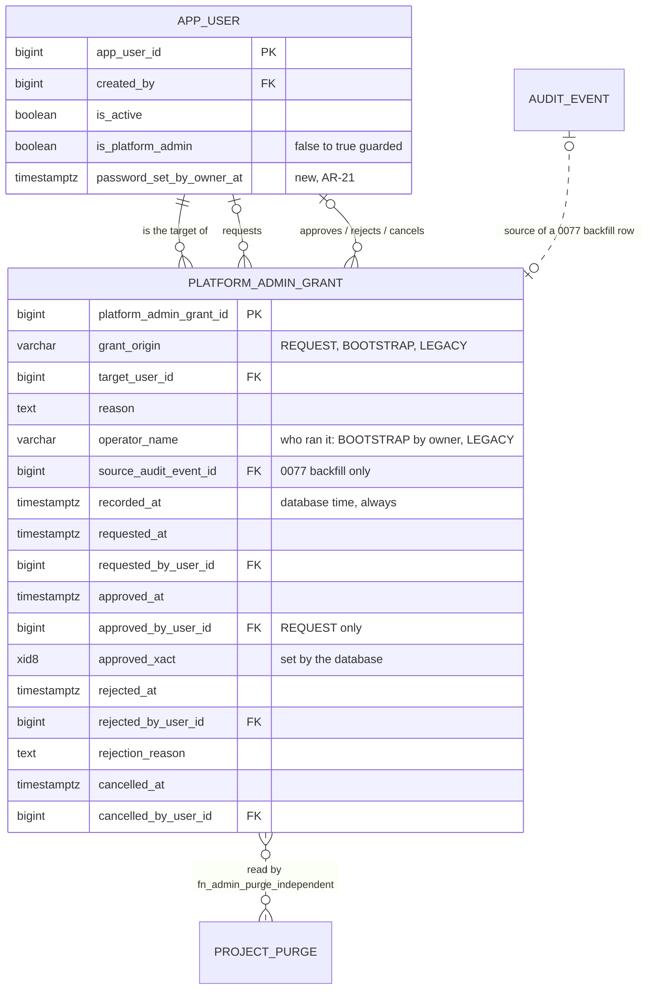

# Slice 17 — Platform-admin grant approval: logical + physical schema (apple, rev 2, 2026-10-21)

**Status: for design review round 2**, against `docs/slice17_admin_grant_spec.md` §16 (round 1 "Fix now" rows) and §17
(AR-16…AR-23, which win). Source of truth: VB_design.md §9.10, §6.6; history AR-13, AR-15, AR-16…AR-23; migration 0072
(`fn_project_purge_guard`); slice 16 schema §3.2 (named actor pairs instead of `AuditMixin`, state from dates).

**Checked before modelling.** `app_user` (`models/identity.py`) has `created_by`, `last_login_at`, `is_active`,
`is_platform_admin`, no guard; vb_app can UPDATE every column. Admins are made today by `user_admin.set_platform_admin`
(UPDATE), `auth_service.first_run_setup` (INSERT, empty table) and `seeds.create_admin` (INSERT, app URL, no limit).
0072 reads AR-13 from `audit_event`, which vb_app can write with any time and detail (VB-005) — **this design moves
AR-13 onto the grant record, whose times the database sets.** **There is no self-service password change in VB**
(`routers/auth.py` has login, setup, me; every password is set by `create_user`, `first_run_setup`, `create_admin` or
`seed_demo`) — AR-21 consequence in §5.

**Risk grade: Grade 1** — riskiest concern: the `app_user` guard (a gap lets one person make an admin who sees every
client's data and can approve a purge).

## 1. Grain

| Table | One row per … | Key | Notes |
|---|---|---|---|
| `platform_admin_grant` *(new)* | **way one user was made, or asked to be made, a platform admin**: REQUEST (open → approved / rejected / cancelled), BOOTSTRAP (AR-16, the first two) or LEGACY (owner-run, AR-19; or backfilled by 0077) | PK `platform_admin_grant_id`; ≤ 1 open REQUEST per target | kept forever; no DELETE for any role |
| `app_user` *(one column, a guard)* | FTC staff member who can log in — unchanged | PK `app_user_id` | `is_platform_admin` stays the current state; the grant table records how it became true |

Wider than "one row per request" because AR-13/AR-18 need *every* admin's grant from a source the app cannot backdate.

## 2. ER diagram (changed part only)



## 3. `platform_admin_grant` (`PlatformAdminGrant`, `models/identity.py`)

| Column | Type | Constraints | Description |
|---|---|---|---|
| `platform_admin_grant_id` | bigint identity | PK | |
| `grant_origin` | varchar(10) | NOT NULL; `ck_pag_origin IN ('REQUEST','BOOTSTRAP','LEGACY')`; never changes | a CHECK list, not `code_master`: the guard branches on it (law 5's purpose, the `purge_kind` precedent). Labels via `t()` |
| `target_user_id` | bigint | NOT NULL, FK `app_user` | the user made (or to be made) an admin |
| `reason` | text | NOT NULL, not blank | REQUEST: the requester's; LEGACY: the operator's (AR-19); BOOTSTRAP: fixed text from the trigger; backfill: audit `detail->>'rationale'`, else fixed text |
| `operator_name` | varchar(200) | `ck_pag_operator`: NULL for REQUEST, NOT NULL for LEGACY | **who ran it** (AR-16, AR-19): the IS operator (AR-22) — not an app user, so text, not an FK. BOOTSTRAP: set when run by the owner; NULL only for `first_run_setup`. Backfill: `'migration 0077'` |
| `source_audit_event_id` | bigint | FK `audit_event`; set only by the 0077 backfill (guard refuses it elsewhere) | the event the backfill trusted (D2) |
| `recorded_at` | timestamptz | NOT NULL; forced `:= statement_timestamp()` on INSERT | when the row was written — the weekly check's "after 0077" and backdating test (§6) |
| `requested_at` | timestamptz | NOT NULL | REQUEST / BOOTSTRAP: forced `:= statement_timestamp()`. LEGACY: forced too, **except on a test/demo database** (§3.2). Backfill: the audit time |
| `requested_by_user_id` | bigint | FK `app_user`; `ck_pag_requester CHECK (grant_origin <> 'REQUEST' OR requested_by_user_id IS NOT NULL)` | REQUEST: the proposing admin (token, law 6). BOOTSTRAP: the live admin who asked (`--actor-email`), NULL for the first admin. LEGACY: the admin who asked, if any (`--actor-email`); backfill: the audit actor |
| `approved_at`, `approved_by_user_id`, `approved_xact` | timestamptz, bigint FK, xid8 | `ck_pag_approved` | REQUEST: the second admin; the guard forces `approved_at := statement_timestamp()`, `approved_xact := pg_current_xact_id()` (D1). BOOTSTRAP / LEGACY: born approved, `approved_at = requested_at`, `approved_xact` stamped, no approver |
| `rejected_at`, `rejected_by_user_id`, `rejection_reason` | timestamptz, bigint FK, text | `num_nonnulls IN (0,3)`; reason not blank | REQUEST only; time forced |
| `cancelled_at`, `cancelled_by_user_id` | timestamptz, bigint FK | `num_nonnulls IN (0,2)` | REQUEST only; time forced |
| `updated_at`, `updated_by`, `row_version` | | as `audit_columns()` minus `is_active`/`deleted_*`/`created_*` | optimistic lock for approve / reject / cancel |

**Checks.** `ck_pag_approved`: `(grant_origin = 'REQUEST' AND num_nonnulls(approved_at, approved_by_user_id,
approved_xact) IN (0,3)) OR (grant_origin <> 'REQUEST' AND approved_at IS NOT NULL AND approved_xact IS NOT NULL AND
approved_by_user_id IS NULL)` · `ck_pag_four_eyes`: approver ≠ requester, approver ≠ target, requester ≠ target (NULLs
pass) · `ck_pag_reject_not_requester` · `ck_pag_one_end`: at most one of approved / rejected / cancelled ·
`ck_pag_request_only`: rejected / cancelled only on REQUEST · `ck_pag_source`: `source_audit_event_id IS NULL OR
grant_origin <> 'REQUEST'`.

**Indexes.** `uq_pag_open (target_user_id) WHERE approved_at IS NULL AND rejected_at IS NULL AND cancelled_at IS NULL`
· `ix_pag_target_granted (target_user_id, approved_at DESC) WHERE approved_at IS NOT NULL` (the "latest grant" lookup).

### 3.1 Guard `fn_platform_admin_grant_guard` (BEFORE INSERT OR UPDATE OR DELETE, every role; `search_path` pinned)
- **DELETE:** always refused.
- **Every INSERT:** `recorded_at := statement_timestamp()`; `source_audit_event_id` must be NULL (the backfill runs
  before the trigger exists); target `is_active AND NOT is_platform_admin` (BOOTSTRAP: the flag is already true).
- **REQUEST (born open):** decision columns all NULL; `requested_at := statement_timestamp()`; requester a live admin;
  **AR-21:** refused when `target.created_by = requested_by_user_id AND target.password_set_by_owner_at IS NULL`.
- **BOOTSTRAP:** only when `pg_trigger_depth() > 1` (from `trg_app_user_bootstrap_grant`, §4; an app statement runs at
  depth 1); no earlier grant row for the target; times forced; `approved_xact := pg_current_xact_id()`.
- **LEGACY (AR-19):** only `session_user = 'vb_owner'`; `reason` and `operator_name` required; `approved_xact :=
  pg_current_xact_id()`; times per §3.2. A deferred check (below) requires the flag set by commit.
- **UPDATE:** identity, origin, target, reason, operator, source, `recorded_at`, `requested_*` never change; a closed
  row never changes again (so BOOTSTRAP / LEGACY rows never change).
- **Approve** (once): open; approver a live admin, ≠ requester, ≠ target; requester still a live admin; target live and
  not an admin; **`fn_admin_grant_independent(NEW.approved_by_user_id, OLD.requested_by_user_id)`** (AR-18, AR-20 — no
  30 days); forces `approved_at := statement_timestamp()`, `approved_xact := pg_current_xact_id()`.
- **Reject** (once): open; live admin ≠ requester; reason; time forced. **Cancel** (once): open; any live admin; time forced.

**Deferred `trg_pag_grant_effective`** (CONSTRAINT TRIGGER AFTER INSERT OR UPDATE, DEFERRABLE INITIALLY DEFERRED): a
REQUEST approved, or a LEGACY row inserted, by this transaction requires the target `is_platform_admin AND is_active` at
commit — record and flag land together or not at all.

**Grants:** vb_app SELECT, INSERT, and column UPDATE on `approved_by_user_id, rejected_by_user_id, rejection_reason,
cancelled_by_user_id, updated_by, row_version` only — the times and `approved_xact` are the database's, so the app is
not granted them (rev 1 granted the time columns; dropped). No DELETE; the §6.6 list and the CI grant test gain the table.

### 3.2 When a LEGACY row may carry an earlier date (AR-19, S3)
The guard keeps owner-supplied `requested_at` / `approved_at` (equal, `<= statement_timestamp()`) **only when
`current_database() ~* '(test|uat|demo)'`**; anywhere else both are overwritten with `statement_timestamp()`, so a
LEGACY admin waits 30 days for purges like anyone. The guard reads `current_database()` itself — the server's own name
for the connected database, which no URL parameter or setting can change (the seed_demo rule, sara H1). Test databases
are `vb_test_db*`; demo/UAT ones already must contain `uat` or `demo`. Production's name is IS's (AR-22); as a second
line, the weekly check lists every LEGACY row whose `approved_at < recorded_at` (backdated) — on production that is
always a finding.

**The single fixture path (S3):** `seeds/owner_grant.py::legacy_grant(owner_conn, user_id, reason, operator,
actor_id=None, days=0)` — one transaction as `vb_owner`: INSERT LEGACY, then `UPDATE app_user SET is_platform_admin =
true`. `tests.conftest.make_admin(owner, uid, days=…)` is a thin wrapper over it; `seed_demo` uses it for any admin
beyond its first (whose creation on the empty demo database is the ordinary bootstrap); the IS "way back" script (AR-16)
is a CLI over the same function, with `--reason`, `--operator`, `--actor-email`. Every test that flips the flag by SQL
moves to it, slice 16's `test_project_purge_record` included.

## 4. The guard on `app_user`

**`fn_app_user_admin_guard`** — BEFORE INSERT OR UPDATE OF `is_platform_admin, is_active, password_set_by_owner_at`:

```sql
IF TG_OP = 'INSERT' THEN
  IF NEW.is_platform_admin THEN
    IF NOT NEW.is_active THEN RAISE ... 'an admin is born active' (D3); END IF;
    PERFORM pg_advisory_xact_lock(hashtext('vb.platform_admin_bootstrap'));
    IF session_user = 'vb_owner' THEN                                     -- seeds.create_admin (AR-16)
      IF (SELECT count(DISTINCT target_user_id) FROM public.platform_admin_grant
           WHERE approved_at IS NOT NULL) >= 2 THEN
        RAISE ... 'two admins have already been granted: every further admin comes through a request (AR-16)';
      END IF;
    ELSIF EXISTS (SELECT 1 FROM public.app_user) THEN                     -- first_run_setup: empty table only
      RAISE ... 'a new user is born an admin only on an empty database, or by the owner (AR-16)';
    END IF;
  END IF;
  NEW.password_set_by_owner_at := CASE WHEN NEW.password_set_by_owner_at IS NULL THEN NULL
                                       ELSE statement_timestamp() END;   -- §5
  RETURN NEW;
END IF;
IF NEW.is_platform_admin AND (NOT OLD.is_platform_admin OR (NEW.is_active AND NOT OLD.is_active)) THEN
  IF NOT EXISTS (SELECT 1 FROM public.platform_admin_grant g
                  WHERE g.target_user_id = NEW.app_user_id
                    AND g.approved_xact = pg_current_xact_id()          -- D1: this transaction, nothing older
                    AND (g.grant_origin = 'REQUEST'
                         OR (g.grant_origin = 'LEGACY' AND session_user = 'vb_owner'))) THEN
    RAISE ... 'admin rights come only from a grant approved in this transaction (AR-13)';
  END IF;
END IF;
-- password_set_by_owner_at: NULL → value only, in the same UPDATE as a password_hash change, forced to statement time
RETURN NEW;
```

Counting **ever-granted** admins (distinct targets of approved rows, any origin) means removing or deactivating admins
never reopens the command line (AR-16 / Q-99); the 0077 backfill counts, so an existing database with two admins is
closed from the start. vb_app's only INSERT branch is the empty table, so `create_admin` run as the app role fails.

**`trg_app_user_bootstrap_grant`** (AFTER INSERT `WHEN (NEW.is_platform_admin)`) inserts the BOOTSTRAP row. As
`vb_owner` it reads two transaction-local settings the CLI sets: `vb.operator` (required → `operator_name`) and
`vb.grant_actor_id` (the `--actor-email` user → `requested_by_user_id`; **required, and must be a live admin, whenever a
live admin exists** — P1). For vb_app (`first_run_setup`) both are ignored and stay NULL. A setting is acceptable here
only because it is read under `session_user = 'vb_owner'`, which vb_app cannot become; the owner gains nothing it lacks.
`seeds.create_admin` moves to `MIGRATION_DATABASE_URL` and gains `--actor-email` and `--operator`, plus a friendly
pre-check of the same count. Removal (true → false) is not guarded (AR-17).

**"Approved in this transaction" (D1).** `pg_current_xact_id()` returns the **top-level** transaction id (xid8, never
reused), also inside a SQLAlchemy savepoint; the grant guard writes it, the app cannot. Equality means a transaction
left open cannot replay an approval from another transaction, and an old approval can never re-flag a removed admin.
Rejected alternatives: a `vb.*` setting from vb_app (anyone may set one), the clock rule of rev 1 (D1's replay), `xmin`
(subtransaction ids). **Build note:** `db.flush()` the grant UPDATE before setting the flag.

**Reactivation (D3, corrected).** A deactivated user still flagged admin cannot be reactivated with the flag on (no
approval exists for them), and cannot be requested either (the target must not be an admin). The way back: clear the
flag in the same UPDATE as the reactivation, then request.

## 5. AR-21 — "the owner has set their own password"

**New column `app_user.password_set_by_owner_at timestamptz NULL`**: when the account's owner last chose their own
password. Set (forced to statement time by the guard) by `first_run_setup` (the person typed it) and by a self-service
password change. NULL from `create_user`, `create_admin` (IS types it, AR-22) and `seed_demo`. Existing rows stay NULL —
true: every existing password was set by someone else or by first-run setup, which the backfill leaves NULL (unknowable).

**No self-service password change exists**, so today the column stays NULL for every account an admin creates, and
AR-21 reads in practice as: **an admin can never request admin rights for an account they created; another admin must
request it.** Smallest model change is this one column plus the REQUEST check in §3.1. Making it reachable needs a
"change my password" route (`POST /auth/me/password`, current + new password) and a small screen — **a scope question
for Ben**: build it in slice 17, or accept the stricter interim rule until it exists. Honest limit: vb_app can write the
column (with a fresh hash), so AR-21 is app-trusted like `created_by` — it stops a careless admin, not a compromised app
(that is VB-011's ground).

## 6. Independence — AR-18 and AR-20 (two functions; replace 0072's audit lookup)

```sql
CREATE FUNCTION fn_admin_grant_independent(p_approver bigint, p_requester bigint) RETURNS boolean
LANGUAGE sql STABLE SET search_path = pg_catalog, public AS $$
  WITH latest AS (SELECT DISTINCT ON (target_user_id) target_user_id, requested_by_user_id, approved_by_user_id
                    FROM public.platform_admin_grant
                   WHERE target_user_id IN (p_approver, p_requester) AND approved_at IS NOT NULL
                   ORDER BY target_user_id, approved_at DESC, platform_admin_grant_id DESC)
  SELECT count(*) = 2                                       -- both have a grant on record (AR-15)
     AND bool_and(CASE WHEN target_user_id = p_approver
                       THEN p_requester IS DISTINCT FROM requested_by_user_id
                        AND p_requester IS DISTINCT FROM approved_by_user_id
                       ELSE p_approver  IS DISTINCT FROM requested_by_user_id
                        AND p_approver  IS DISTINCT FROM approved_by_user_id END)
    FROM latest $$;

CREATE FUNCTION fn_admin_purge_independent(p_approver bigint, p_requester bigint) RETURNS boolean
LANGUAGE sql STABLE SET search_path = pg_catalog, public AS $$
  SELECT fn_admin_grant_independent(p_approver, p_requester)
     AND (SELECT approved_at FROM public.platform_admin_grant
           WHERE target_user_id = p_approver AND approved_at IS NOT NULL
           ORDER BY approved_at DESC, platform_admin_grant_id DESC LIMIT 1)
         <= statement_timestamp() - interval '30 days' $$;
```

Grant approval = four eyes (CHECK + guard) + `fn_admin_grant_independent`; purge approval = four eyes +
`fn_admin_purge_independent` (AR-20). Python never re-codes either: `services/access.independent_grant_approver` and
`independent_purge_approver` each `SELECT` its function (slice 16's `independent_approver` callers move to the purge
one). **0078** replaces, in `fn_project_purge_guard`, the block from `SELECT e.app_user_id, e.occurred_at INTO grant_by,
grant_at FROM audit_event` through its `RAISE` with `IF NOT fn_admin_purge_independent(NEW.approved_by_user_id,
OLD.requested_by_user_id) THEN RAISE … (AR-13, AR-18, AR-20)`; the rest of 0072's body is copied verbatim as a frozen
literal (the `FROZEN_0054` pattern). No guard reads `audit_event` any more.

A requester with no grant on record (an admin the backfill skipped) makes both functions false — conservative, and the
D2 NOTICE names every such admin so IS can record a LEGACY grant for them before 0078 bites.

## 7. Weekly check (P2 / AR-23) — no new table

The admin lines read existing rows only, and ride on slice 16's run record and its "last run" card on the `/admin`
Removals tab: open REQUESTs with `requested_at` > 7 days old · REQUESTs approved in the last 7 days · live admins
(`is_active AND is_platform_admin`) below two · every BOOTSTRAP / LEGACY row with `source_audit_event_id IS NULL`
recorded in the last 7 days (i.e. written after 0077), flagging `approved_at < recorded_at` · removals
(`audit_event` `PLATFORM_ADMIN_REMOVED`, display only — removal is not on the grant record, AR-17) and admin
deactivations (`app_user.deleted_at`, flag true) in the last 7 days. Confirmed: no table and no index needed (a small
table; the scans are trivial).

## 8. Migrations (from 0076 — 0074 / 0075 stay slice 16's)

One change per migration, own commit, reversible; the model joins `models/__init__.py` (law 10). **No hash-spec change:**
nothing enters `freeze_set`, no table is shadowed (`app_user` is not in the freeze set — checked).

| Id | Does | Downgrade | Pauses for Ben |
|---|---|---|---|
| **0076** | `app_user.password_set_by_owner_at` (nullable, no backfill) | refuse if any value is set (not re-derivable) | no — additive |
| **0077** | `platform_admin_grant` + checks, indexes, both functions, `fn_platform_admin_grant_guard`, grants; **backfill** (as vb_owner, before the triggers are created) one row per flagged admin from their latest grant event: `FIRST_ADMIN_CREATED` / `ADMIN_CREATED_BY_CLI` → BOOTSTRAP (no requester), `PLATFORM_ADMIN_GRANTED` → LEGACY (requester = its actor); `approved_xact` = the migration's, `source_audit_event_id` set, `operator_name = 'migration 0077'`; **a NOTICE per admin backfilled (origin, source event id) and per admin skipped** (no event → no row → cannot approve or request-and-be-approved until IS records a LEGACY grant). **The backfill trusts audit history as of the migration day** (D2); no production database exists yet. Then the guard and deferred triggers | refuse if any row has `source_audit_event_id IS NULL` (a record written since would be lost); backfilled rows are re-derivable | **yes** — its NOTICE output is what Ben checks (D2) |
| **0078** | `CREATE OR REPLACE fn_project_purge_guard`: 0072's body re-pointed to `fn_admin_purge_independent` (§6) | restore 0072's body verbatim | **yes** — changes slice 16's four-eyes check |
| **0079** | `fn_app_user_admin_guard` + trigger; `trg_app_user_bootstrap_grant` | drop both — no data | **yes** — the access guard every admin passes through |

Order: 0078 and 0079 after 0077's backfill (else every existing admin fails AR-13 at once). Deploy line for CLAUDE.md
("Slice 17 deploy"): read 0077's NOTICEs; `seeds.create_admin` now runs on the owner URL with `--operator`
(`--actor-email` once an admin exists), and only while fewer than two admins have ever been granted.

## 9. Normalization notes

- **1NF.** Atomic columns, no lists; each row identified by its surrogate key (no natural key — a user can be requested
  many times). `operator_name` is a single name, not a list.
- **2NF.** Single-column keys; no partial dependency possible.
- **3NF.** People are FKs, never copied names or flags. State (open / approved / rejected / cancelled) is derived from
  the dates; "admin since / granted by" from the latest approved row. `grant_origin` constrains *which* columns may be
  set; it determines no value. `recorded_at` is not redundant with `requested_at`: they differ for backfilled and
  test-backdated rows, which is exactly what the weekly check reads. `operator_name` is text because the operator (IS,
  AR-22) is not an app user — if IS staff ever get accounts it becomes an FK. `password_set_by_owner_at` depends on the
  user alone. **Not derived on purpose:** `is_platform_admin` stays stored (removals are not on the grant record,
  AR-17); the guard keeps it consistent with the record.

## 10. What this model means

- **The database enforces, for every role:** no admin by UPDATE without a grant approved (REQUEST, four eyes, AR-18) or
  owner-recorded (LEGACY) **in the same transaction**; a new account is born an admin only on an empty database or by
  the owner while fewer than two admins have ever been granted; a request is decided once; no grant time can be
  backdated outside a test/demo database; a purge approver's own grant is 30 days old and unlinked to the requester.
- **The app can:** propose, decide, list requests, show "admin since / granted by / created by / password set by
  owner" for every admin. **Cannot:** delete the record, grant alone, revive an admin from an old approval, reach the
  BOOTSTRAP or LEGACY paths.
- **Trade-offs.** (1) **Fresh-install deadlock** — see the disagreement in the hand-back: with AR-16 recording admin 1 as
  the requester of admin 2's BOOTSTRAP, AR-18 makes admins 1 and 2 dependent on each other, so neither can approve a
  request from the other; the third admin needs one IS LEGACY grant. (2) AR-21 without a password-change feature means
  the creator of an account can never be its requester (§5). (3) A pre-17 admin the backfill skips cannot take part in
  any approval until IS records a LEGACY grant for them.
