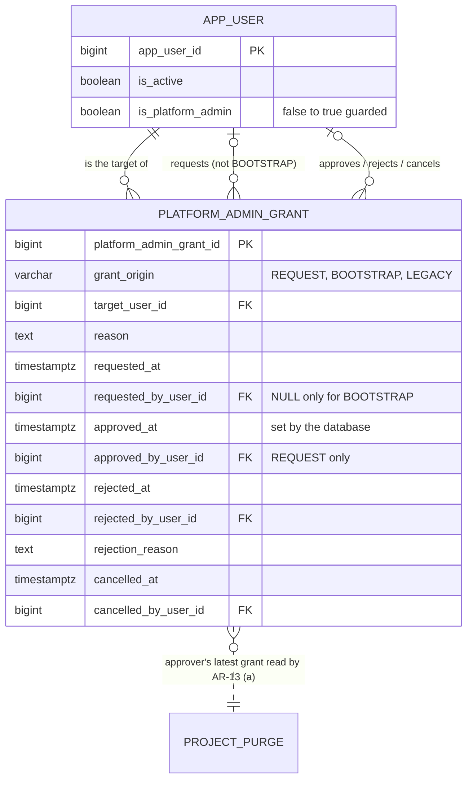

# Slice 17 — Platform-admin grant approval: logical + physical schema (apple, 2026-10-21)

**Status: DRAFT for Ben**, written against `docs/slice17_admin_grant_spec.md` (BR grid §4, functions §7, criteria §10).
Q-95…Q-97 are modelled as recommended; §7 says what each other answer would change. Source of truth: VB_design.md §9.10,
§6.6; history AR-13, AR-15; migration 0072 (`fn_project_purge_guard`); slice 16 schema §3.2 / §12.5 (the request-record
pattern followed here: named actor pairs instead of `AuditMixin`, state derived from dates, guard for every role).

**Checked before modelling.** `app_user` (`models/identity.py`) has `TimestampMixin`, `is_active`, `is_platform_admin`
and no guard; vb_app can UPDATE every column. Three code paths make an admin today: `user_admin.set_platform_admin`
(UPDATE, audit `PLATFORM_ADMIN_GRANTED`, actor = the one granter), `auth_service.first_run_setup` (INSERT, only with no
user, `FIRST_ADMIN_CREATED`) and `seeds.create_admin` (INSERT, no limit, `ADMIN_CREATED_BY_CLI`). 0072's AR-13 (a)
check reads the approver's latest of those three audit events. **That read is forgeable:** vb_app may INSERT
`audit_event` with any `occurred_at` and any `detail` (BUGLOG VB-005, 2026-10-21 own note), so the app can write an
aged grant row. Reading the requester from audit `detail` (the brief's option) would add a second forgeable field.
**This design moves AR-13 onto the grant record**, whose times the database sets — see §5.

**Risk grade: Grade 1** — the riskiest concern is the `app_user` guard: a gap lets one person make an admin who sees
every client's data and can approve a purge.

## 1. Grain

| Table | One row per … | Key | Notes |
|---|---|---|---|
| `platform_admin_grant` *(new)* | **way one user was made, or asked to be made, a platform admin**: a REQUEST (open → approved / rejected / cancelled), a BOOTSTRAP (Q-95 path, recorded by the database) or a LEGACY grant (an admin made before slice 17, backfilled once) | PK `platform_admin_grant_id`; ≤ 1 open REQUEST per `target_user_id` | kept forever; no DELETE for any role |
| `app_user` *(guard added, no column)* | FTC staff member who can log in — unchanged | PK `app_user_id` | `is_platform_admin` stays the current state; the grant table records how it became true |

**Why wider than the spec's "one row per request" (§3).** AR-13 needs *every* admin's grant time and grantors from a
source the app cannot backdate. Requests alone cover only admins made after slice 17; bootstrap and pre-17 admins would
still be read from `audit_event`, which is forgeable. Recording all three origins in one table gives AR-13 a single,
database-dated source (§5). The origins share the same attributes, so a second table would only add a UNION.

## 2. ER diagram (changed part only)



## 3. `platform_admin_grant` (`PlatformAdminGrant`, `models/identity.py`)

| Column | Type | Constraints | Description |
|---|---|---|---|
| `platform_admin_grant_id` | bigint identity | PK | |
| `grant_origin` | varchar(10) | NOT NULL; `ck_pag_origin CHECK (grant_origin IN ('REQUEST','BOOTSTRAP','LEGACY'))`; never changes | **a CHECK list, not `code_master`** — the guard branches on it (law 5's purpose, the `purge_kind` precedent). Labels via `t()` |
| `target_user_id` | bigint | NOT NULL, FK `app_user` | the user made (or to be made) an admin |
| `reason` | text | NOT NULL, `ck_pag_reason CHECK (btrim(reason) <> '')` | the requester's reason; BOOTSTRAP gets a fixed text from the trigger; LEGACY the audit `detail->>'rationale'`, else a fixed text |
| `requested_at` | timestamptz | NOT NULL | REQUEST / BOOTSTRAP: forced `:= statement_timestamp()` on INSERT. LEGACY: the audit event's time, owner-written |
| `requested_by_user_id` | bigint | FK `app_user`; `ck_pag_requester CHECK ((grant_origin = 'BOOTSTRAP') = (requested_by_user_id IS NULL))` | REQUEST: the proposing admin (from the token, law 6). LEGACY: the one person who granted it. BOOTSTRAP: nobody |
| `approved_at`, `approved_by_user_id` | timestamptz, bigint | FK `app_user`; `ck_pag_approved` below | REQUEST: the second admin; the guard **forces** `approved_at := statement_timestamp()`. BOOTSTRAP / LEGACY: `approved_at = requested_at`, no approver |
| `rejected_at`, `rejected_by_user_id`, `rejection_reason` | timestamptz, bigint, text | FK `app_user`; `num_nonnulls(…) IN (0,3)`; `btrim(rejection_reason) <> ''` | REQUEST only |
| `cancelled_at`, `cancelled_by_user_id` | timestamptz, bigint | FK `app_user`; `num_nonnulls(…) IN (0,2)` | REQUEST only |
| `updated_at`, `updated_by`, `row_version` | | as `audit_columns()` minus `is_active`/`deleted_*`/`created_*`; `updated_at_trigger` | optimistic lock for approve / reject / cancel |

**Checks**
- `ck_pag_approved CHECK ((grant_origin = 'REQUEST' AND num_nonnulls(approved_at, approved_by_user_id) IN (0,2)) OR (grant_origin <> 'REQUEST' AND approved_at IS NOT NULL AND approved_by_user_id IS NULL))`
- `ck_pag_four_eyes CHECK (approved_by_user_id <> requested_by_user_id AND approved_by_user_id <> target_user_id AND requested_by_user_id <> target_user_id)` (NULLs pass; the guard covers BOOTSTRAP)
- `ck_pag_reject_not_requester CHECK (rejected_by_user_id <> requested_by_user_id)`
- `ck_pag_one_end CHECK (num_nonnulls(approved_at, rejected_at, cancelled_at) <= 1)`
- `ck_pag_request_only CHECK (grant_origin = 'REQUEST' OR num_nonnulls(rejected_at, cancelled_at) = 0)`

**Indexes.** `uq_pag_open (target_user_id) WHERE approved_at IS NULL AND rejected_at IS NULL AND cancelled_at IS NULL`
(one open request per user; BOOTSTRAP/LEGACY are born approved, so never open). `ix_pag_target_granted (target_user_id,
approved_at DESC) WHERE approved_at IS NOT NULL` — the AR-13 lookup.

**Guard `fn_platform_admin_grant_guard`** (BEFORE INSERT OR UPDATE OR DELETE, every role; `search_path` pinned):
- **DELETE:** always refused — the record is kept forever.
- **INSERT REQUEST (born open):** approved / rejected / cancelled all NULL; `requested_at := statement_timestamp()`;
  requester a live platform admin; target `is_active AND NOT is_platform_admin`.
- **INSERT BOOTSTRAP:** only when `pg_trigger_depth() > 1` (i.e. from `trg_app_user_bootstrap_grant`, §4 — a plain
  statement from the app runs at depth 1), target is a platform admin, no earlier grant row for the target;
  `requested_at := approved_at := statement_timestamp()`.
- **INSERT LEGACY:** only `session_user = 'vb_owner'` (the 0076 backfill; §7 Q-98); `approved_at = requested_at <=
  statement_timestamp()`.
- **UPDATE, every row:** `platform_admin_grant_id, grant_origin, target_user_id, reason, requested_*` never change; a
  row with any of `approved_at / rejected_at / cancelled_at` set never changes again (closed rows fixed) — so BOOTSTRAP
  and LEGACY rows never change.
- **Approve** (`approved_*` NULL → value, once): open; approver a live platform admin ≠ requester ≠ target (CHECK too);
  requester still a live admin; target `is_active AND NOT is_platform_admin`;
  `fn_admin_grant_independent(NEW.approved_by_user_id, OLD.requested_by_user_id)` (§5, Q-97);
  **`approved_at := statement_timestamp()`** whatever was sent.
- **Reject** (once): open; live admin ≠ requester; reason not blank; `rejected_at := statement_timestamp()`.
- **Cancel** (once): open; any live admin; `cancelled_at := statement_timestamp()`.

**Deferred check `trg_pag_grant_effective`** (CONSTRAINT TRIGGER AFTER UPDATE, DEFERRABLE INITIALLY DEFERRED): when a
REQUEST was approved by the row's change, at commit the target must be `is_platform_admin AND is_active` — approval and
flag land together or not at all (spec §7 "same transaction", held by the database, not by the service's discipline).

**Grants:** vb_app SELECT, INSERT, column UPDATE on `approved_at, approved_by_user_id, rejected_at, rejected_by_user_id,
rejection_reason, cancelled_at, cancelled_by_user_id, updated_by, row_version`. No DELETE (§6.6 list and the CI grant
test gain the table). State is **derived** (Q-67 precedent): open / approved / rejected / cancelled from the dates.

## 4. The guard on `app_user`

**`fn_app_user_admin_guard`** — BEFORE INSERT OR UPDATE OF `is_platform_admin, is_active` ON `app_user`, every role:

```sql
IF TG_OP = 'INSERT' THEN
  IF NEW.is_platform_admin THEN                                     -- Q-95 (a): the bootstrap
    PERFORM pg_advisory_xact_lock(hashtext('vb.platform_admin_bootstrap'));  -- two CLI runs cannot both pass
    IF (SELECT count(*) FROM public.app_user WHERE is_active AND is_platform_admin) >= 2 THEN
      RAISE EXCEPTION 'a new user is born an admin only while fewer than two live platform admins exist (Q-95)'
        USING ERRCODE = 'restrict_violation';
    END IF;
  END IF;
  RETURN NEW;
END IF;
IF NEW.is_platform_admin AND (NOT OLD.is_platform_admin OR (NEW.is_active AND NOT OLD.is_active)) THEN
  IF NOT EXISTS (SELECT 1 FROM public.platform_admin_grant g
                  WHERE g.target_user_id = NEW.app_user_id AND g.grant_origin = 'REQUEST'
                    AND g.approved_at >= transaction_timestamp()) THEN
    RAISE EXCEPTION 'admin rights come only from an approved request in the same transaction (AR-13)'
      USING ERRCODE = 'restrict_violation';
  END IF;
END IF;
RETURN NEW;
```

**`trg_app_user_bootstrap_grant`** (AFTER INSERT, `WHEN (NEW.is_platform_admin)`) inserts the BOOTSTRAP row, so
`first_run_setup` and `seeds.create_admin` need no code change to be recorded (AR-15 kept: their creation is their
grant). Removal (true → false) is not guarded — Q-96.

**How the trigger sees "approved in this transaction" — the choice.**
- **Rejected: a transaction-local setting** (`set_config('vb.…', id, true)`). Any session may set any custom `vb.*`
  setting, so vb_app could set it without approving anything. It proves only that someone *said* so.
- **Rejected: `xmin = pg_current_xact_id()`.** A SQLAlchemy savepoint (`begin_nested`) stamps the subtransaction id, so
  a legitimate approval inside a savepoint would be refused; and it ties the rule to an internal.
- **Chosen: the row and the clock.** `approved_at` is forced to `statement_timestamp()`, which within a transaction is
  always `>= transaction_timestamp()`; every approval committed before this transaction began is strictly earlier. So
  `approved_at >= transaction_timestamp()` finds this transaction's approval and **can never replay an old one** (e.g.
  re-flag an admin removed last month). The one residual: a transaction that started later, approved the same user
  four-eyes and committed first is also visible — harmless, because that approval is genuine and its own deferred
  check requires the flag anyway. The app cannot forge `approved_at` (the guard overwrites it).
- **Build note:** the service must `db.flush()` the grant UPDATE **before** setting the flag — SQLAlchemy's unit of work
  may otherwise flush `app_user` (the FK parent) first, and the guard would refuse.
- Reactivation is covered: a deactivated admin set `is_active = true` with the flag still true is "becoming a live
  admin" and is refused without an approval. Clear the flag in the same UPDATE, or request.

## 5. AR-13 (a) on the grant record — Q-97 (replaces 0072's audit lookup)

One function owns the rule; both guards and `services/access.independent_approver` (via `SELECT
fn_admin_grant_independent(:approver, :requester)`, never re-coded in Python) call it:

```sql
CREATE FUNCTION fn_admin_grant_independent(p_approver bigint, p_requester bigint) RETURNS boolean
LANGUAGE sql STABLE SET search_path = pg_catalog, public AS $$
  SELECT COALESCE((
    SELECT g.approved_at <= statement_timestamp() - interval '30 days'
       AND p_requester IS DISTINCT FROM g.requested_by_user_id   -- Q-97: whoever proposed the approver's grant
       AND p_requester IS DISTINCT FROM g.approved_by_user_id    --        and whoever approved it
      FROM public.platform_admin_grant g
     WHERE g.target_user_id = p_approver AND g.approved_at IS NOT NULL
     ORDER BY g.approved_at DESC, g.platform_admin_grant_id DESC LIMIT 1), false) $$;
```

No grant on record → `false` (AR-15's "an admin with no grant on record cannot approve" holds). In
`fn_project_purge_guard` the block from `SELECT e.app_user_id, e.occurred_at INTO grant_by, grant_at FROM audit_event`
through its `RAISE` becomes `IF NOT fn_admin_grant_independent(NEW.approved_by_user_id, OLD.requested_by_user_id) THEN
RAISE … (AR-13, Q-97)`; the rest of 0072's body is copied **verbatim** as a frozen literal (the `FROZEN_0054` pattern —
the migration does not import 0072). `GRANT_EVENTS` stay written to `audit_event` for people; no guard reads them any
more. The VB-005 note (force `audit_event.occurred_at`) stops mattering for AR-13 but is still worth doing for the log.

## 6. Migrations (from 0076 — 0074/0075 are slice 16's, paused for Ben)

One change per migration, own commit, reversible; the model joins `models/__init__.py` (law 10). **No hash-spec
change:** nothing enters `freeze_set`, no table is shadowed, `app_user` gains no column — confirmed.

| Id | Does | Downgrade guard | Ben sees |
|---|---|---|---|
| **0076** | `platform_admin_grant` + checks, indexes, `fn_admin_grant_independent`, `fn_platform_admin_grant_guard`, `trg_pag_grant_effective`, grants; **backfill** (as vb_owner) one row per user with `is_platform_admin = true`: their latest of the three grant audit events → BOOTSTRAP for `FIRST_ADMIN_CREATED` / `ADMIN_CREATED_BY_CLI` (`requested_at = approved_at = occurred_at`), LEGACY for `PLATFORM_ADMIN_GRANTED` (`requested_by` = its actor); none → no row (cannot approve — as today). The backfill trusts audit history once, as of the migration | refuse if any REQUEST row exists (a four-eyes record would be lost); BOOTSTRAP/LEGACY rows are re-derivable from audit, so dropping them loses nothing | no (new table) |
| **0077** | `fn_app_user_admin_guard` + `trg_app_user_admin_guard`; `trg_app_user_bootstrap_grant` | drop both — no data | **yes** — the access guard every admin passes through |
| **0078** | `CREATE OR REPLACE fn_project_purge_guard`: 0072's body with the AR-13 block replaced (§5) | restore 0072's body verbatim — safe | **yes** — changes slice 16's four-eyes check |

Order matters: 0078 after 0076's backfill, or every existing admin would fail AR-13 the moment the lookup moves; 0077
after 0076, as its guard reads the table. Deploy line for CLAUDE.md: none beyond `upgrade head` — the backfill runs in
0076; `seeds.create_admin` gains its own count check (a friendly message) ahead of the guard.

## 7. Where an answer would change the model

- **Q-95 (b) — the single admin's first request approves itself:** drop the INSERT branch of the `app_user` guard and the
  BOOTSTRAP origin for new admins; `ck_pag_four_eyes` moves into the guard with a "fewer than two live admins" exception.
  Not recommended: permanent code for a one-time event.
- **Q-96 yes — removal needs a second admin too:** add `grant_action varchar(6) CHECK IN ('GRANT','REVOKE')`; grain
  becomes "one proposed change of admin rights"; `uq_pag_open` stays per user; the `app_user` guard gains the true →
  false branch, and `set_platform_admin`'s preview hash moves onto the request. One column and one branch.
- **Q-97 — only the requester counts:** drop the `approved_by_user_id` line in `fn_admin_grant_independent`. Nothing else.
- **Q-98 (new) — how do the test harness and a future restore make a third admin?** The `app_user` guard binds `vb_owner`
  too (criterion 7), and an approval needs an approver whose grant is 30 days old — a test cannot wait 30 days.
  **Recommend** an owner-only LEGACY path: in one transaction, as `vb_owner`, insert a LEGACY row (backdated
  `approved_at`), set `set_config('vb.legacy_admin_grant', <target id>, true)`, then set the flag; the `app_user` guard
  allows it only when `session_user = 'vb_owner'`, the setting names the target and a LEGACY row for the target exists.
  The setting is acceptable *here* because `session_user` cannot be forged by vb_app. It gives the owner nothing it
  lacks (it can drop triggers), and every use is visible as a LEGACY row. Criterion 7 then reads "for vb_app, and for
  vb_owner outside the recorded LEGACY path". Without it, test fixtures can seed admins only by bootstrap (two at most).

## 8. Normalization notes

- **1NF.** Every column atomic; no arrays or lists; each row identified by its surrogate key (no natural key: the same
  user can be requested many times).
- **2NF.** Single-column key, so no partial dependency is possible.
- **3NF.** No names, e-mails or flags of the people are copied — every actor column is an FK. State (open / approved /
  rejected / cancelled) is **derived** from the dates, not stored; "admin since" and "granted by" are derived from the
  latest approved row. `grant_origin` constrains *which* columns may be set (the CHECKs); it determines no value — not a
  transitive dependency. **Deliberately not derived:** `app_user.is_platform_admin` could in principle come from grants
  minus removals, but removals are not recorded here (Q-96 no); the flag stays the current state and the guard keeps it
  consistent with the record.

## 9. What this model means

- **Rules the database now enforces, for every role:** nobody becomes an admin by UPDATE without a four-eyes approval
  in the same transaction; a new account is born an admin only while fewer than two live admins exist; a request is
  approved, rejected or cancelled once and then never changes; the approval time cannot be backdated; the approver's
  own rights must be 30 days old and not given by the requester (in purges and in grants alike).
- **What the app can do:** list requests, propose, decide, show "admin since / granted by" for every admin. **Cannot:**
  remove the record, grant without a second admin, revive a removed admin from an old approval.
- **Trade-offs.** The first two admins, and every admin they approve, wait 30 days before they can approve anything
  (AR-13 applied to grants), so a new install cannot add a third admin for a month unless Ben accepts that or the Q-98
  path is used. Deactivating admins down to one reopens the CLI bootstrap — by Q-95's own wording ("fewer than two
  live"); worth a line in the weekly check.
