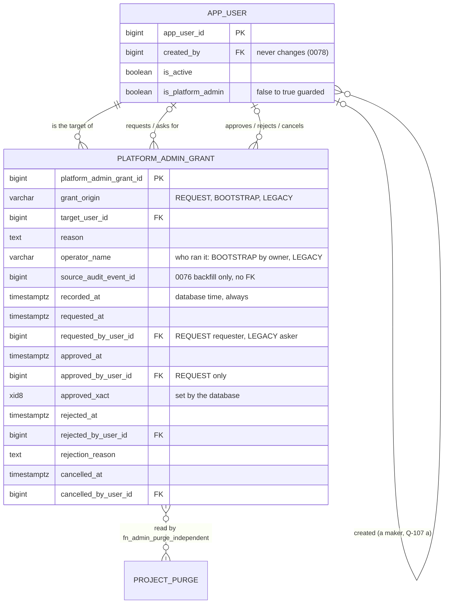

# Slice 17 — Platform-admin grant approval: logical + physical schema (apple, rev 3, 2026-10-22)

**Status: for Ben's OK and build.** Folds in Ben's answers Q-105 (a) and Q-107 (a) (so Q-106 is (b)) and the round-2
fixes N4, N5, N6 (`docs/slice17_admin_grant_spec.md` §18). Round 2 was the last review (two-round cap). Anything still
open gets settled against the running code. Source of truth: VB_design.md §9.10, §6.6; history AR-13, AR-15,
AR-16…AR-23; migration 0072 (`fn_project_purge_guard`); slice 16 schema §3.2 (named actor pairs instead of
`AuditMixin`, state from dates).

## Rev 3 changes

**What moved.**
- **AR-21 is now the creator rule (Q-107 a). The `password_set_by_owner_at` column is gone,** along with its migration
  (rev 2's 0076), its `app_user` guard branch and rev 2's §5. Under the creator rule, an account's creator is one of
  that admin's makers, permanently. The database enforces it in four places, for every role:
  1. the grant guard refuses a REQUEST or a LEGACY row whose asker is the target's creator;
  2. the grant guard refuses an approval by the target's creator;
  3. both independence functions count `target.created_by` as a maker (exact SQL in §6);
  4. the `app_user` guard makes `created_by` unchangeable after INSERT, and makes an app-side INSERT name a live
     platform admin as creator. **This one is new.** vb_app can update `created_by` today, and the creator rule is only
     as strong as that column.
- **Three migrations instead of four, all paused for Ben** (§8):
  - 0076: the grant table, the functions, the guard and the backfill;
  - 0077: the purge guard re-pointed. Its copied body is checked against the live one at its parent revision, and the
    migration refuses to run on a mismatch;
  - 0078: the `app_user` guard and the bootstrap trigger.
  0074, 0075 and 0073 were read and **none of them changes `fn_project_purge_guard`**. 0074 replaces
  `fn_project_purge_key_guard` and the shadow triggers; 0075 replaces the `audit_event` trigger. So 0072's body is the
  body at 0077's parent.
- **N4:** a single anchored pattern for databases allowed to backdate, owned by `fn_backdating_allowed()` (§3.2). It
  matches by suffix, so this worktree's `vb_s17try_test_db` and `vb_s16_demo_db` qualify.
- **N5:** a LEGACY row requires the asking admin (`ck_pag_requester`), who must be a live admin and not the target's
  creator.
- **N6:** the AR-16 count is `GREATEST(ever-granted targets, live flagged admins)` (§4).
- **Found while checking (not in the brief):**
  - `source_audit_event_id` loses its FK. `audit_event` is a purge DELETE table, so an FK would give
    `platform_admin_grant` a delete predicate in `purge_run`, and a purge would then hit the grant guard's DELETE
    refusal. The column stays a plain bigint, and the table joins `purge_run.NO_PROJECT_DATA` (VB law 1).
  - The functions take 0074's `search_path` with `pg_temp` last (sara L4) and never return NULL (the
    `fn_purge_allows` lesson).

**Each of the 13 acceptance criteria (spec §10), and what in the database enforces it.** Where part of a criterion is
the app's (an HTTP code, a screen), the table names the database backstop and says what it does not cover.

| # | Criterion | Enforced in the database by | Not the database's |
|---|---|---|---|
| 1 | Request: one open row, reason, admin only, no second open | `fn_platform_admin_grant_guard` REQUEST branch (requester a live admin; target live and not an admin) · `ck_pag_reason` · `uq_pag_open` (0076) | the 403/422 codes (route guard, service) |
| 2 | Requester or target cannot approve | `ck_pag_four_eyes` + guard approve branch (0076); a target who is already an admin is refused at INSERT | — |
| 3 | Approval makes the admin, at database time | guard approve branch forces `approved_at`, `approved_xact` · `trg_pag_grant_effective` (0076) · `fn_app_user_admin_guard` (0078) | the `PLATFORM_ADMIN_GRANTED` audit row is written by the service |
| 4 | AR-18 both directions, no 30 days for grants | `fn_admin_grant_independent`, called by the grant guard (0076) | — |
| 5 | AR-20 for purges, purge guard never reads `audit_event`, copy equals parent | `fn_admin_purge_independent` called by `fn_project_purge_guard` (0077) · 0077's pre-check refuses to run unless the live body equals the frozen 0072 literal | the diff test re-proves it at head |
| 6 | Reject/cancel close the request; closed never changes; re-request allowed | guard: decided once, closed row frozen · `ck_pag_one_end` · `uq_pag_open` is partial, so a closed row does not block (0076) | — |
| 7 | `PATCH … true` → 422; removal unchanged | backstop: `fn_app_user_admin_guard` refuses the flag without an approval in this transaction (0078), so a regressed service still cannot grant | the 422 itself (service) |
| 8 | vb_app flag only via this transaction's approval; INSERT only on empty table; no inactive admin | `fn_app_user_admin_guard` (0078) · `approved_xact` stamped by the grant guard (0076) | — |
| 9 | Owner paths: bootstrap closes at two ever-granted; LEGACY needs owner, reason, operator, asker; database time except named DBs | `fn_app_user_admin_guard` owner branch with the `GREATEST` count · `trg_app_user_bootstrap_grant` (0078) · grant guard LEGACY branch, `ck_pag_operator`, `ck_pag_requester`, `fn_backdating_allowed()` (0076) | — |
| 10 | Creator may not request or approve; creator is a maker | grant guard creator clauses + both functions (0076) · `created_by` unchangeable and required on app INSERT (0078) | that `created_by` names the real actor at INSERT is app-trusted (law 6, token). The database checks it names a live admin, not that it is *this* admin |
| 11 | No DELETE; no backdating by either role; flag and approval together | guard DELETE refusal + no DELETE grant · times forced by the guard and not granted to vb_app · `trg_pag_grant_effective` (0076) | TRUNCATE (D4, tracked on VB-005; a TRUNCATE trigger would break the test harness's `TRUNCATE app_user CASCADE`) |
| 12 | Weekly check lists unrecorded admins, LEGACY without asker or backdated, removals | the facts it reads are database-set: `recorded_at` forced, `ck_pag_requester`, `created_by` frozen | the query is read-only app code |
| 13 | Users page shows requests, creator, age | the data shown is database-set (`requested_at` forced, `created_by` frozen) | display, proven in a browser (ui-verifier) |

**Checked before modelling.**
- `app_user` (`models/identity.py`) has `created_by`, `last_login_at`, `is_active` and `is_platform_admin`, and no
  guard. vb_app can UPDATE every column, `created_by` included.
- Accounts are created by:
  - `user_admin.create_user` (vb_app, `created_by = actor`, platform_admin route);
  - `auth_service.first_run_setup` (vb_app, empty table, `created_by` NULL);
  - `seeds.create_admin` (`created_by` NULL);
  - `seeds.seed_demo` (first admin on an empty database).
- Admins are made today by `user_admin.set_platform_admin` (UPDATE), `first_run_setup` and `create_admin` (INSERT).
- 0072 reads AR-13 from `audit_event`, which vb_app can write with any time and any detail (VB-005). **This design
  moves AR-13 onto the grant record, whose times the database sets.**

**Risk grade: Grade 1.** The riskiest concern is the `app_user` guard: a gap there lets one person make an admin who
sees every client's data and can approve a purge.

## 1. Grain

| Table | One row per … | Key | Notes |
|---|---|---|---|
| `platform_admin_grant` *(new)* | **one way a user was made, or asked to be made, a platform admin**: REQUEST (open → approved / rejected / cancelled), BOOTSTRAP (AR-16, the first two) or LEGACY (owner-run, AR-19; or backfilled by 0076) | PK `platform_admin_grant_id`; ≤ 1 open REQUEST per target | kept forever; no DELETE for any role |
| `app_user` *(guard only, no new column)* | FTC staff member who can log in — unchanged | PK `app_user_id` | `is_platform_admin` stays the current state; the grant table records how it became true; `created_by` becomes unchangeable |

The grain is wider than "one row per request" because AR-13 and AR-18 need *every* admin's grant from a source the app
cannot backdate.

## 2. ER diagram (changed part only)



## 3. `platform_admin_grant` (`PlatformAdminGrant`, `models/identity.py`)

| Column | Type | Constraints | Description |
|---|---|---|---|
| `platform_admin_grant_id` | bigint identity | PK | |
| `grant_origin` | varchar(10) | NOT NULL; `ck_pag_origin IN ('REQUEST','BOOTSTRAP','LEGACY')`; never changes | A CHECK list, not `code_master`: the guard branches on it (the purpose of law 5; same precedent as `purge_kind`). Labels via `t()` |
| `target_user_id` | bigint | NOT NULL, FK `app_user` | the user made (or to be made) an admin |
| `reason` | text | NOT NULL; `ck_pag_reason`: not blank | REQUEST: the requester's. LEGACY: the operator's (AR-19). BOOTSTRAP: fixed text from the trigger. Backfill: audit `detail->>'rationale'`, else fixed text |
| `operator_name` | varchar(200) | `ck_pag_operator`: NULL for REQUEST, NOT NULL for LEGACY | **Who ran it** (AR-16, AR-19): the IS operator (AR-22). The operator is not an app user, so this is text, not an FK. BOOTSTRAP: set when run by the owner; NULL only for `first_run_setup`. Backfill: `'migration 0076'` |
| `source_audit_event_id` | bigint | **no FK** (rev 3); set only by the 0076 backfill (the guard refuses it elsewhere) | The event the backfill trusted (D2). There is no FK because `audit_event` is a purge DELETE table, and an FK would put this table under `purge_run`'s delete rule. The sources are admin events with no `project_id`, so they are never purged |
| `recorded_at` | timestamptz | NOT NULL; forced `:= statement_timestamp()` on INSERT | When the row was written. Used by the weekly check's "after 0076" line and the backdating test (§3.2) |
| `requested_at` | timestamptz | NOT NULL | REQUEST / BOOTSTRAP: forced `:= statement_timestamp()`. LEGACY: forced too, **except where `fn_backdating_allowed()`** (§3.2). Backfill: the audit time |
| `requested_by_user_id` | bigint | FK `app_user`; **`ck_pag_requester CHECK (grant_origin = 'BOOTSTRAP' OR requested_by_user_id IS NOT NULL OR source_audit_event_id IS NOT NULL)`** (N5) | REQUEST: the proposing admin (from the token, law 6). **LEGACY: the asking admin, required** (`--actor-email`, N5). Only a backfilled row may lack one, and the weekly check lists those. BOOTSTRAP: the live admin who asked (`--actor-email`); NULL only for the first admin |
| `approved_at`, `approved_by_user_id`, `approved_xact` | timestamptz, bigint FK, xid8 | `ck_pag_approved` | REQUEST: the second admin. The guard forces `approved_at := statement_timestamp()` and `approved_xact := pg_current_xact_id()` (D1). BOOTSTRAP / LEGACY: born approved, with `approved_at = requested_at`, `approved_xact` stamped and no approver |
| `rejected_at`, `rejected_by_user_id`, `rejection_reason` | timestamptz, bigint FK, text | `num_nonnulls IN (0,3)`; reason not blank | REQUEST only; time forced |
| `cancelled_at`, `cancelled_by_user_id` | timestamptz, bigint FK | `num_nonnulls IN (0,2)` | REQUEST only; time forced |
| `updated_at`, `updated_by`, `row_version` | | as `audit_columns()` minus `is_active` / `deleted_*` / `created_*` | optimistic lock for approve / reject / cancel |

**Checks.**
- `ck_pag_approved`: `(grant_origin = 'REQUEST' AND num_nonnulls(approved_at, approved_by_user_id, approved_xact) IN
  (0,3)) OR (grant_origin <> 'REQUEST' AND approved_at IS NOT NULL AND approved_xact IS NOT NULL AND
  approved_by_user_id IS NULL)`.
- `ck_pag_four_eyes`: approver ≠ requester, approver ≠ target, requester ≠ target (NULLs pass).
- `ck_pag_reject_not_requester`.
- `ck_pag_one_end`: at most one of approved / rejected / cancelled.
- `ck_pag_request_only`: rejected / cancelled only on REQUEST.
- `ck_pag_source`: `source_audit_event_id IS NULL OR grant_origin <> 'REQUEST'`.

The creator rule is not a CHECK, because it reads another row (`app_user.created_by`). The guard enforces it (§3.1).

**Indexes.**
- `uq_pag_open (target_user_id) WHERE approved_at IS NULL AND rejected_at IS NULL AND cancelled_at IS NULL`.
- `ix_pag_target_granted (target_user_id, approved_at DESC) WHERE approved_at IS NOT NULL` (the "latest grant" lookup).

### 3.1 Guard `fn_platform_admin_grant_guard` (BEFORE INSERT OR UPDATE OR DELETE, every role; `search_path = pg_catalog, public, pg_temp`)
- **DELETE:** always refused.
- **Every INSERT:**
  - `recorded_at := statement_timestamp()`;
  - `source_audit_event_id` must be NULL (the backfill runs before the trigger exists);
  - the target must be `is_active AND NOT is_platform_admin`. For BOOTSTRAP the flag is already true.
- **REQUEST (born open):**
  - decision columns all NULL; `requested_at := statement_timestamp()`; the requester a live admin;
  - **creator rule (Q-107 a):** refused when `target.created_by = NEW.requested_by_user_id`, with the message *"an
    admin cannot ask for admin rights for an account they created (AR-21, Q-107)"*.
- **BOOTSTRAP:**
  - only when `pg_trigger_depth() > 1`, i.e. from `trg_app_user_bootstrap_grant` (§4); an app statement runs at depth 1;
  - no earlier grant row for the target; times forced; `approved_xact := pg_current_xact_id()`;
  - the creator rule does not apply. The account is born in the same statement, and its asker is already recorded as
    its maker in `requested_by_user_id`.
- **LEGACY (AR-19, N5):**
  - only `session_user = 'vb_owner'`;
  - `reason`, `operator_name` and `requested_by_user_id` required, and the asker must be a live admin;
  - **creator rule:** refused when `target.created_by = NEW.requested_by_user_id`;
  - `approved_xact := pg_current_xact_id()`; times per §3.2;
  - a deferred check (below) requires the flag to be set by commit.
- **UPDATE:**
  - identity, origin, target, reason, operator, source, `recorded_at` and `requested_*` never change;
  - a closed row never changes again, so BOOTSTRAP and LEGACY rows never change.
- **Approve** (once):
  - the request is open; the approver is a live admin, ≠ requester, ≠ target;
  - the requester is still a live admin; the target is live and not an admin;
  - **creator rule:** refused when `NEW.approved_by_user_id = target.created_by`;
  - **`fn_admin_grant_independent(NEW.approved_by_user_id, OLD.requested_by_user_id)`** (AR-18, AR-20, Q-107; no
    30-day wait);
  - forces `approved_at := statement_timestamp()` and `approved_xact := pg_current_xact_id()`.
- **Reject** (once): open; by a live admin ≠ requester; reason required; time forced. The creator may reject, since
  rejection is the safe direction.
- **Cancel** (once): open; any live admin; time forced.

**Deferred `trg_pag_grant_effective`** (CONSTRAINT TRIGGER AFTER INSERT OR UPDATE, DEFERRABLE INITIALLY DEFERRED). When
this transaction approves a REQUEST or inserts a LEGACY row, the target must be `is_platform_admin AND is_active` at
commit. The record and the flag land together or not at all.

**Grants:**
- vb_app gets SELECT and INSERT, plus column UPDATE on `approved_by_user_id`, `rejected_by_user_id`,
  `rejection_reason`, `cancelled_by_user_id`, `updated_by` and `row_version` only.
- No DELETE. The §6.6 list and the CI grant test gain the table.
- **The table joins `purge_run.NO_PROJECT_DATA`.** It has no `project_id` and references only `app_user`, so without
  this every purge stops (VB law 1).

### 3.2 When a LEGACY row may carry an earlier date (AR-19, S3, N4)
The guard keeps owner-supplied `requested_at` / `approved_at` (equal, and `<= statement_timestamp()`) **only when
`fn_backdating_allowed()` is true**. Everywhere else both are overwritten with `statement_timestamp()`, so a LEGACY
admin waits 30 days for purges like anyone.

```sql
CREATE FUNCTION public.fn_backdating_allowed() RETURNS boolean
LANGUAGE sql STABLE SET search_path = pg_catalog, public, pg_temp AS $$
  -- N4: whole-name, case-sensitive patterns; never a substring. One optional token before the suffix.
  SELECT current_database() ~ '^vb_([a-z0-9]+_)?test_db(_gw[0-9]+)?$'      -- vb_test_db, vb_test_db_gw3,
                                                                            -- vb_s17try_test_db, vb_s17try_test_db_gw0
      OR current_database() ~ '^vb_([a-z0-9]+_)?(uat|demo)_db$' $$;         -- vb_demo_db, vb_uat_db, vb_s16_demo_db
```

**Recommendation on N4: match on the suffix with one optional token, as above, not the spec's `vb_uat_` /
`vb_demo_` prefixes.**
- Rev 2's list (`vb_test_db`, `vb_test_db_gw<n>`, names starting `vb_uat_` / `vb_demo_`) misses this worktree's
  `vb_s17try_test_db*` and `vb_s16_demo_db`. Every `make_admin(days=31)` purge test in a parallel worktree would then
  stop backdating and fail on the 30 days.
- A prefix ending in `_` also accepts anything after it (`vb_demo_prod`).
- The suffix form stays exact. The whole name must have the shape `vb_` + at most one `[a-z0-9]` token + `test_db` (with
  an optional `_gw<n>`) or `uat_db` / `demo_db`. Names like "latest", "evaluation" or `vb_db` never match.
- What it does not stop: a production database deliberately named like a test one. That is IS's naming (AR-22), and
  the deploy line has IS confirm `SELECT fn_backdating_allowed()` returns false on production. As a second line, the
  weekly check lists every LEGACY row with `approved_at < recorded_at`; on production that is always a finding.
- The function reads `current_database()`, the server's own name for the connected database, which no URL parameter or
  setting can change (the seed_demo rule, sara H1).

**One owner of the rule:**
- `seeds/owner_grant.py::legacy_grant` refuses `days > 0` by asking this function, before it writes anything.
- `seed_demo`'s own name check (the "contains `uat` or `demo`" substring rule) is not changed in this slice. Moving it
  onto this function is a one-line follow-up for whoever touches `seed_demo` next.

**The single fixture path (S3):**
- `seeds/owner_grant.py::legacy_grant(owner_conn, user_id, reason, operator, actor_id, days=0)` runs one transaction
  as `vb_owner`: INSERT LEGACY, then `UPDATE app_user SET is_platform_admin = true`. **`actor_id` is now required**
  (N5).
- `tests.conftest.make_admin(owner, uid, days=…)` is a thin wrapper over it, passing a live admin as asker. That admin
  must not be the target's creator; a fixture that needs one creates the user as a different admin.
- `seed_demo` uses it for any admin beyond its first.
- The IS "way back" script (AR-16) is a CLI over the same function, with `--reason`, `--operator` and `--actor-email`,
  all required.
- Every test that flips the flag by SQL moves to it, slice 16's `test_project_purge_record` included.

## 4. The guard on `app_user`

**`fn_app_user_admin_guard`** runs BEFORE INSERT OR UPDATE OF `is_platform_admin, is_active, created_by`, for every
role, with `search_path = pg_catalog, public, pg_temp`:

```sql
IF TG_OP = 'INSERT' THEN
  -- Q-107 a: an account made in the app names the live admin who made it (create_user sets it from the token).
  -- Empty table = first_run_setup; vb_owner = seeds.create_admin / IS, recorded on the BOOTSTRAP row instead.
  IF session_user <> 'vb_owner' AND EXISTS (SELECT 1 FROM public.app_user)
     AND NOT EXISTS (SELECT 1 FROM public.app_user c
                      WHERE c.app_user_id = NEW.created_by AND c.is_active AND c.is_platform_admin) THEN
    RAISE ... 'an account is created by a live platform admin, named as its creator (Q-107)';
  END IF;
  IF NEW.is_platform_admin THEN
    IF NOT NEW.is_active THEN RAISE ... 'an admin is born active' (D3); END IF;
    PERFORM pg_advisory_xact_lock(hashtext('vb.platform_admin_bootstrap'));
    IF session_user = 'vb_owner' THEN                                     -- seeds.create_admin (AR-16)
      IF GREATEST((SELECT count(DISTINCT target_user_id) FROM public.platform_admin_grant
                    WHERE approved_at IS NOT NULL),
                  (SELECT count(*) FROM public.app_user
                    WHERE is_active AND is_platform_admin)) >= 2 THEN     -- N6
        RAISE ... 'two admins have already been granted: every further admin comes through a request (AR-16)';
      END IF;
    ELSIF EXISTS (SELECT 1 FROM public.app_user) THEN                     -- first_run_setup: empty table only
      RAISE ... 'a new user is born an admin only on an empty database, or by the owner (AR-16)';
    END IF;
  END IF;
  RETURN NEW;
END IF;
IF NEW.created_by IS DISTINCT FROM OLD.created_by THEN                    -- Q-107 a: the maker is permanent
  RAISE ... 'an account''s creator never changes (Q-107)';
END IF;
IF NEW.is_platform_admin AND (NOT OLD.is_platform_admin OR (NEW.is_active AND NOT OLD.is_active)) THEN
  IF NOT EXISTS (SELECT 1 FROM public.platform_admin_grant g
                  WHERE g.target_user_id = NEW.app_user_id
                    AND g.approved_xact = pg_current_xact_id()          -- D1: this transaction, nothing older
                    AND (g.grant_origin = 'REQUEST'
                         OR (g.grant_origin = 'LEGACY' AND session_user = 'vb_owner'))) THEN
    RAISE ... 'admin rights come only from a grant approved in this transaction (AR-13)';
  END IF;
END IF;
RETURN NEW;
```

**What the rules mean in practice.**
- **The AR-16 count (N6).** It is the greater of ever-granted admins (distinct targets of approved rows, any origin) and
  live flagged admins. Removing or deactivating admins never reopens the command line (AR-16 / Q-99). Where the 0076
  backfill skipped an admin who has no grant event, the live count still sees them, so a database with two flagged
  admins is closed from the start.
- **The app's INSERT branches.** vb_app's only admin INSERT branch is the empty table, so `create_admin` run as the app
  role fails. vb_app's only creator-less INSERT is also the empty table: every other app-made account names a live
  admin as creator.
- **What the creator check cannot prove.** That the named creator is *the acting* admin is app-trusted (law 6, the
  token). The database proves only that a live admin is named. A compromised app is VB-011's ground.
- **Effect on existing callers.** `user_admin.create_user` already sets `created_by = actor` (checked), and test users
  come through that route. `tests/test_migration_0035_0038.py` inserts with an explicit `created_by` but runs below
  0078. **Build check:** grep for any other app-role `app_user` INSERT, and for any UPDATE of `created_by`, before 0078
  lands.

**`trg_app_user_bootstrap_grant`** (AFTER INSERT `WHEN (NEW.is_platform_admin)`) inserts the BOOTSTRAP row.
- As `vb_owner` it reads two transaction-local settings the CLI sets:
  - `vb.operator`: required; becomes `operator_name`;
  - `vb.grant_actor_id`: the `--actor-email` user; becomes `requested_by_user_id`. **Required, and must be a live
    admin, whenever a live admin exists** (P1).
- For vb_app (`first_run_setup`) both are ignored and stay NULL.
- Reading a setting is acceptable here only because it is read under `session_user = 'vb_owner'`, which vb_app cannot
  become; the owner gains nothing it lacks.
- `seeds.create_admin` moves to `MIGRATION_DATABASE_URL` and gains `--actor-email` and `--operator`, plus a friendly
  pre-check of the same `GREATEST` count.
- Removal (true → false) is not guarded (AR-17).

**"Approved in this transaction" (D1).**
- `pg_current_xact_id()` returns the **top-level** transaction id (xid8, never reused), including inside a SQLAlchemy
  savepoint. The grant guard writes it; the app cannot.
- Requiring equality means a transaction left open cannot replay an approval from another transaction, and an old
  approval can never re-flag a removed admin.
- Rejected alternatives:
  - a `vb.*` setting from vb_app (anyone may set one);
  - the clock rule of rev 1 (it allows D1's replay);
  - `xmin` (gives subtransaction ids).
- **Build note:** `db.flush()` the grant UPDATE before setting the flag.

**Reactivation (D3).** A deactivated user who is still flagged admin cannot be reactivated with the flag on, because no
approval exists for them. They cannot be requested either, because the target must not be an admin. The way back is to
clear the flag in the same UPDATE as the reactivation, then request.

## 5. AR-21: the creator rule (Q-107 a)

**The rule: whoever created an account counts as having made that admin, for as long as the account exists.**
Consequences:
- The creator may not request the account's grant (REQUEST), ask IS for it (LEGACY), or approve it.
- Both independence functions list the creator among the account's makers. A creator and the account they created can
  therefore never be the two people on any grant or purge approval, in either role. That holds directly, and also when
  a second admin requested or approved the account's grant, which is the laundering path N1 found.

**Why no column replaces `password_set_by_owner_at`.** The fact the rule needs is `app_user.created_by`, which already
exists and is set from the token by `create_user`. That column was the dropped migration's only reason to exist. What
the dropped migration enforced in the database now has a home in the database too:

| Rev 2 control (dropped) | Rev 3 control, all in the database |
|---|---|
| `password_set_by_owner_at` forced to statement time by the `app_user` guard (0079) | not needed: the rule no longer depends on a password fact |
| REQUEST refused while the requester is the creator and the owner has not set a password (grant guard, 0077) | REQUEST and LEGACY refused whenever the asker is the creator (grant guard, 0076). **Stricter**, with no password escape hatch |
| — (rev 2 bound only the requester; N1) | approval refused when the approver is the creator (grant guard, 0076) |
| — | the creator is a maker in `fn_admin_grant_independent` and `fn_admin_purge_independent` (0076) |
| — (rev 2 left `created_by` writable by vb_app) | `created_by` never changes, for every role; an app INSERT must name a live admin as creator (0078) |

No control in the approved spec is weaker. Rev 2's AR-21 had an escape (a set password) that N1 showed the creator
could produce. Rev 3 has no escape and adds three controls.

**What it means.**
- Accounts created by `first_run_setup`, `seeds.create_admin` or `seed_demo`'s first admin have `created_by` NULL. The
  rule then adds no maker for them; their BOOTSTRAP row's asker already counts.
- `created_by` is permanent, so a creator never pairs with that account, even years later and after any re-grant. In a
  small team this narrows who may approve what (§10).
- The password route (Q-106) is not built (Q-106 → b) and can come with the Entra ID sign-in work (D-35).

## 6. Independence: AR-18, AR-20, Q-107 (two functions; replace 0072's audit lookup)

**Makers of an admin X** = the requester and the approver of X's latest approved grant, **plus the creator of X's
account** (`app_user.created_by`). The approver and requester of an approval are independent when each has a grant on
record and neither is a maker of the other.

```sql
CREATE FUNCTION public.fn_admin_grant_independent(p_approver bigint, p_requester bigint) RETURNS boolean
LANGUAGE sql STABLE SET search_path = pg_catalog, public, pg_temp AS $$
  WITH latest AS (                    -- each one's latest approved grant (AR-13 on the grant record, AR-15)
    SELECT DISTINCT ON (g.target_user_id) g.target_user_id, g.requested_by_user_id, g.approved_by_user_id
      FROM public.platform_admin_grant g
     WHERE g.target_user_id IN (p_approver, p_requester) AND g.approved_at IS NOT NULL
     ORDER BY g.target_user_id, g.approved_at DESC, g.platform_admin_grant_id DESC),
  makers AS (                         -- AR-18 + Q-107 a: requester, approver and the account's creator
    SELECT l.target_user_id, m.maker_id
      FROM latest l
      JOIN public.app_user u ON u.app_user_id = l.target_user_id
     CROSS JOIN LATERAL (VALUES (l.requested_by_user_id),
                                (l.approved_by_user_id),
                                (u.created_by)) AS m(maker_id))
  -- never NULL: every conjunct is a definite boolean once both ids are present (the fn_purge_allows lesson)
  SELECT p_approver IS NOT NULL AND p_requester IS NOT NULL
     AND p_approver <> p_requester
     AND (SELECT count(*) FROM latest) = 2                     -- both have a grant on record
     AND NOT EXISTS (SELECT 1 FROM makers
                      WHERE (target_user_id = p_approver  AND maker_id = p_requester)    -- requester made approver
                         OR (target_user_id = p_requester AND maker_id = p_approver)) $$; -- approver made requester

CREATE FUNCTION public.fn_admin_purge_independent(p_approver bigint, p_requester bigint) RETURNS boolean
LANGUAGE sql STABLE SET search_path = pg_catalog, public, pg_temp AS $$
  -- AR-20: everything a grant approval needs (creator clause included, through the call), plus
  -- the approver's latest grant at least 30 days old. COALESCE: no grant on record reads false, never NULL.
  SELECT public.fn_admin_grant_independent(p_approver, p_requester)
     AND COALESCE((SELECT g.approved_at <= statement_timestamp() - interval '30 days'
                     FROM public.platform_admin_grant g
                    WHERE g.target_user_id = p_approver AND g.approved_at IS NOT NULL
                    ORDER BY g.approved_at DESC, g.platform_admin_grant_id DESC
                    LIMIT 1), false) $$;
```

**How the function applies the rule.**
- A NULL maker (no requester on a first BOOTSTRAP, no approver on BOOTSTRAP / LEGACY, NULL `created_by`) never matches,
  because `NULL = id` is not true. NULL therefore means "no maker", never "everyone".
- The purge function inherits the creator clause by calling the grant function, so the rule lives in one place and
  "both functions treat the creator as a maker" holds by construction. A test proves it on each function directly.
- The *target's* creator on a grant approval is not a function argument. The guard checks that pairing itself (§3.1
  creator clauses).

**Who calls what.**
- A grant approval is four eyes (CHECK + guard) + creator clauses + `fn_admin_grant_independent`.
- A purge approval is four eyes + `fn_admin_purge_independent` (AR-20).
- Python never re-codes either function. `services/access.independent_grant_approver` and `independent_purge_approver`
  each `SELECT` their function; slice 16's `independent_approver` callers move to the purge one.

**0077 replaces 0072's audit lookup.**
- In `fn_project_purge_guard`, the block from `-- AR-13 (Q-93 a, U9): …` through its `RAISE … (AR-13)'
  USING …; END IF;` becomes:
  `IF NOT public.fn_admin_purge_independent(NEW.approved_by_user_id, OLD.requested_by_user_id) THEN RAISE EXCEPTION
  'the approver must be independent of the requester and hold admin rights at least 30 days (AR-13, AR-18, AR-20)'
  USING ERRCODE = 'restrict_violation'; END IF;`
- The now-unused `grant_by bigint; grant_at timestamptz;` declarations go with it.
- Everything else is 0072's body verbatim, held in 0077 as a frozen literal (the `FROZEN_0054` pattern), with 0072's own
  `SET search_path` kept unchanged.
- After 0077, no guard reads `audit_event`.

**A requester with no grant on record** (an admin the backfill skipped) makes both functions false. This is
conservative. The D2 NOTICE and the weekly check (N3) name every such admin, so IS can record a LEGACY grant for them.

## 7. Weekly check (P2 / AR-23 / N3 / N5): no new table

The admin lines read existing rows only. They ride on slice 16's run record and its "last run" card on the `/admin`
Removals tab:
- open REQUESTs with `requested_at` more than 7 days old;
- REQUESTs approved in the last 7 days;
- live admins (`is_active AND is_platform_admin`) below two;
- **live flagged admins with no approved grant row** (N3);
- every BOOTSTRAP / LEGACY row with `source_audit_event_id IS NULL` recorded in the last 7 days (written after 0076),
  flagging `approved_at < recorded_at` (N4);
- **LEGACY rows with no asking admin** (only backfilled rows can lack one; N5);
- removals (`audit_event` `PLATFORM_ADMIN_REMOVED`; display only, since removal is not on the grant record, AR-17) and
  admin deactivations (`app_user.deleted_at`, flag true) in the last 7 days.

Confirmed: no table and no index needed (a small table; the scans are trivial).

## 8. Migrations (0076–0078; 0074 / 0075 stay slice 16's)

One change per migration, each in its own commit and reversible; the model joins `models/__init__.py` (law 10). **No
hash-spec change:** nothing enters `freeze_set`, no table is shadowed (`app_user` is not in the freeze set — checked).
**All three pause for Ben.**

| Id | Does | Downgrade | Why it pauses |
|---|---|---|---|
| **0076** | `platform_admin_grant` + checks and indexes; `fn_backdating_allowed`, `fn_admin_grant_independent`, `fn_admin_purge_independent`, `fn_platform_admin_grant_guard`, `trg_pag_grant_effective`, grants. **Backfill**, run as vb_owner before the triggers are created: one row per flagged admin, taken from their latest grant event. `FIRST_ADMIN_CREATED` / `ADMIN_CREATED_BY_CLI` become BOOTSTRAP (no requester); `PLATFORM_ADMIN_GRANTED` becomes LEGACY (requester = its actor). Each row gets the migration's `approved_xact`, `source_audit_event_id` set and `operator_name = 'migration 0076'`. **A NOTICE is raised for each admin backfilled (origin, source event id) and each admin skipped** (no event → no row → cannot approve, or be approved, until IS records a LEGACY grant). **The backfill trusts audit history as of the migration day** (D2); no production database exists yet. Then the guard and the deferred trigger are created | refuse if any row has `source_audit_event_id IS NULL` (a record written since would be lost); backfilled rows are re-derivable | its NOTICE output is what Ben checks (D2); new access functions |
| **0077** | `CREATE OR REPLACE fn_project_purge_guard` with 0072's body re-pointed to `fn_admin_purge_independent` (§6). **Pre-check in the same transaction:** a `DO` block compares `pg_proc.prosrc` of the live function with the frozen 0072 literal and raises if they differ, so the migration cannot run over a body it did not copy. In Python, the old AR-13 block must occur exactly once in the literal before `.replace()` | pre-check that the live body equals 0077's, then restore the frozen 0072 body | changes slice 16's four-eyes check |
| **0078** | `fn_app_user_admin_guard` + trigger (§4: the flag, D3, the AR-16 `GREATEST` count, `created_by` unchangeable and required on app INSERT); `trg_app_user_bootstrap_grant` | drop both; no data | the access guard every admin passes through |

**Parent revision of 0077's copy, verified.** 0073 (`project_purge_key`), 0074 (`fn_purge_allows`, shadow triggers,
`fn_project_purge_key_guard`, `fn_baseline_*_guard`) and 0075 (`audit_event` trigger) do not create, replace or alter
`fn_project_purge_guard` or `trg_project_purge_guard`. At 0076 the live body is therefore exactly 0072's, and the
pre-check proves it on each database.

**Criterion 5's diff test:** at head, `prosrc` equals `FROZEN_0072.replace(OLD_BLOCK, NEW_BLOCK)` and does not contain
`audit_event`.

**Order.** 0077 and 0078 come after 0076's backfill; otherwise every existing admin fails AR-13 at once.

**Deploy line for CLAUDE.md ("Slice 17 deploy"):**
- read 0076's NOTICEs;
- IS confirms `SELECT fn_backdating_allowed()` is false on production;
- `seeds.create_admin` now runs on the owner URL with `--operator` (`--actor-email` once an admin exists), and only
  while fewer than two admins have ever been granted or are live;
- a fresh install's third admin is one IS LEGACY grant naming the asking admin (Q-105 a).

## 9. Normalization notes

- **1NF.** Columns are atomic, with no lists, and each row is identified by its surrogate key. There is no natural key,
  because a user can be requested many times. `operator_name` is a single name, not a list.
- **2NF.** All keys are single-column, so no partial dependency is possible.
- **3NF.**
  - People are FKs, never copied names or flags.
  - State (open / approved / rejected / cancelled) is derived from the dates, and "admin since / granted by" from the
    latest approved row.
  - `grant_origin` constrains *which* columns may be set; it determines no value.
  - `recorded_at` is not redundant with `requested_at`: they differ for backfilled and test-backdated rows, which is
    exactly what the weekly check reads.
  - `operator_name` is text because the operator (IS, AR-22) is not an app user. If IS staff ever get accounts, it
    becomes an FK.
  - **The creator is not copied onto the grant row.** The functions read `app_user.created_by` live. That is safe only
    because 0078 makes it unchangeable; a copy would be a second source of the same fact.
  - **Not derived, on purpose:** `is_platform_admin` stays stored, because removals are not on the grant record
    (AR-17). The guard keeps the flag consistent with the record.

## 10. What this model means

- **The database enforces, for every role:**
  - no admin by UPDATE without a grant approved (REQUEST: four eyes, AR-18, creator rule) or owner-recorded (LEGACY,
    with a non-creator asker) **in the same transaction**;
  - a new account is born an admin only on an empty database, or by the owner while fewer than two admins have ever
    been granted or are live;
  - an account's creator is permanent, and that creator never pairs with the account on any approval;
  - a request is decided once;
  - no grant time can be backdated outside a named test / demo database;
  - a purge approver's own grant is 30 days old and unlinked to the requester.
- **The app can:** propose, decide and list requests, and show "admin since / granted by / created by" for every admin.
- **The app cannot:** delete the record, grant alone, revive an admin from an old approval, reach the BOOTSTRAP or
  LEGACY paths, or rewrite who created an account.
- **Trade-offs.**
  1. **A fresh install's third admin is one IS LEGACY grant** (Q-105 a). With AR-16 recording admin 1 as the asker of
     admin 2's BOOTSTRAP, admins 1 and 2 are each other's makers.
  2. **The creator rule narrows pairs in a small team.** Each admin's makers are up to three people, and a creator's
     tie lasts forever.
     - Practical guidance for IS and the admins: the admin who creates a new account should also be the one who asks
       for it. Then that account has one maker instead of two, and stays independent of the rest.
     - Example: admin 1 creates admin 3's account and asks IS for its LEGACY grant. Admins 2 and 3 then form an
       independent pair. If admin 2 had created the account, admin 3 would be independent of nobody among the first
       two, and a fourth admin would again need IS.
  3. **A pre-17 admin the backfill skips** cannot take part in any approval until IS records a LEGACY grant for them.
  4. **`created_by` at INSERT is app-trusted.** The database refuses a missing or non-admin creator and any later
     change, but it cannot prove the named admin is the one acting. That is VB-011's ground, accepted by Ben until the
     first non-local deploy.
