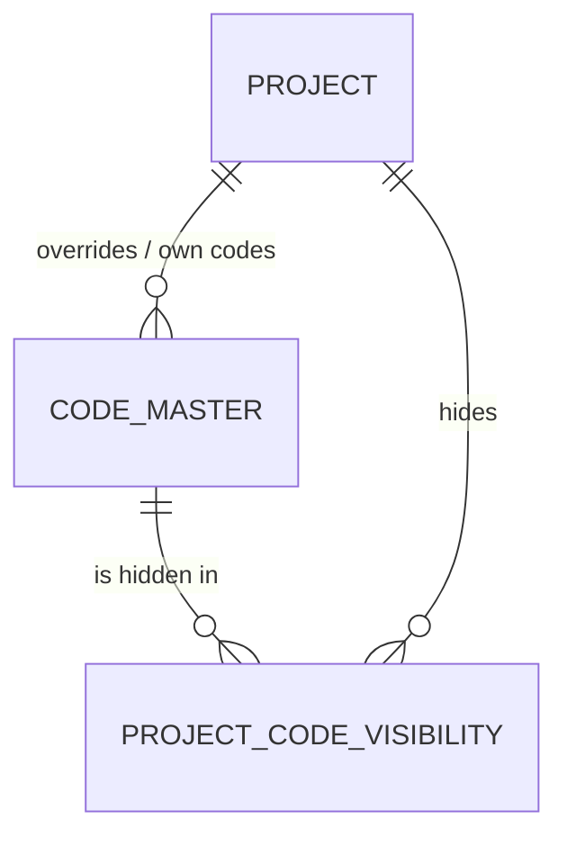

# Wave 1g — code-list maintenance (spec, draft for Ren / Ben, 2026-10-16)

**Status:** APPROVED by Ben 2026-10-16 (history G-1…G-5, D-71). One working assumption of mine remains tagged: A5.
**Source of truth:** `docs/VB_design.md` §4 (`maintain_fr_types`), §5.3 / §5.4.13 (CODE_MASTER, behaviour immutable once
referenced, Q6, R2-D8), §7.12 (`code_master.maintain`), §8 (the categories). This spec adds the screen, the routes and
one small table; it does not change any rule those sections already state.
**Modelling:** `apple` (2026-10-16) — the per-project hide is a separate table (§5 below), not a column.

## 1. Purpose
Let the people who run a project keep its drop-down and status lists (statuses, priorities, line kinds, FR types, …)
in their own words — rename, add, hide — and let FTC keep the company-wide library, without ever breaking a record that
already uses a code or a code the application itself relies on.

## 1a. Interface
- **Input:** a platform admin's edits to the company library; a project admin's edits to one project's lists
  (A1, confirmed G-5). Typed in the "Code lists" screen; no file import.
- **Output:** the lists every picker in the app shows, resolved two-tier (project over company) by
  `code_master.resolve`; existing records keep displaying the code they hold.
- **Validation:** refused before any write — system categories (fully read-only); pinned codes (§7.4: relabel only);
  a behaviour change on an FR or RACI type that any row uses (409, Q6/R2-D8); duplicate codes in one tier; hiding a
  project-only code (retire it instead).
- **Archive:** every change is an `audit_event` (who, when, before → after). Codes are never deleted (soft delete);
  baselines keep the code and label they froze, so a later rename never changes history.
- **Maintenance loop:** none automatic. The VB-005 backlog and the "Data entities to finish"-style tiles are not
  affected; a reviewer reads `audit_event` if a list looks wrong.

## 2. Playbook / doctrine references
Playbook §5 (all lookups in `code_master`, codes sent not labels), §9 non-negotiables 2, 3, 7, 10, 11; VB laws 1, 3, 5,
6, 10 (CLAUDE.md). No deviation proposed.

## 3. The keystone grain
`code_master`: **one row per (tier, category, code)** — tier = the company library (`project_id` NULL) or one project.
A project row either overrides the company code of the same (category, code) or is a project-only code.
New: `project_code_visibility` — **one row per (project, company code) the project has ever hidden**.

## 4. Business Requirement — the grid

| Function | Entity | Use | Business logic → output data |
|---|---|---|---|
| `list_codes_for_admin` | `code_master`, `project_code_visibility` | R | every category with its company rows, the project's overrides / own codes, hidden flags, pinned and in-use flags → the screen's table |
| `maintain_global_code` (platform admin) | `code_master` (company) | C/U | add a code (with behaviour for FR_TYPE / RACI_TYPE); relabel; reorder (`sort_order`); behaviour change refused while referenced (Q6) → company row |
| `retire_global_code` (platform admin) | `code_master` (company) | U (soft) | pinned → 409; else retire; rows already holding it keep it (never blocked, §5.4.15) → `is_active=false` |
| `maintain_project_code` (project admin, A1) | `code_master` (project) | C/U | relabel a company code for this project (= override row, A-16); add a project-only code; reorder → project row |
| `maintain_fr_types` (project admin, A1) | `code_master` (FR_TYPE), `effort_rate`, `function_requirement` | C/U | the design's rule (§7.12): a project override of a company FR type re-points the project's rate cells and FRs to the override **in one transaction**; behaviour fixed once in use → override row + re-pointed rows |
| `retire_project_code` | `code_master` (project) | U (soft) | retiring an override restores the company label; retiring a project-only code hides it from pickers, existing rows keep it |
| `hide_company_code` / `unhide` (A2) | `project_code_visibility` | C/U (soft) | pinned or project-only → refused; else the company code leaves this project's pickers → visibility row |
| `resolve` (existing, one change) | `code_master`, `project_code_visibility` | R | `for_picker=True` drops hidden codes; the default (display, validation, pinned lookups) is unchanged |
| (manual) FTC decides a company-wide rename | — | — | done by a platform admin on the screen; baselines keep their frozen labels |

## 5. Logical design (apple)

- Visibility is its own fact (one per project × company code), so a relabel and a hide stay independent and neither
  overloads `is_active` on `code_master` (apple: a hide column there would copy the company label into a dummy row —
  not 3NF — and give "retired" two meanings).
- Visibility is **not** frozen into baselines: it only changes what pickers offer.

## 6. Physical design (apple)

**`project_code_visibility` — NET-NEW**

| Column | Type | Constraints | Description |
|---|---|---|---|
| `project_code_visibility_id` | bigint identity | PK | |
| `project_id` | bigint | NOT NULL, FK → project | |
| `code_id` | bigint | NOT NULL, FK → code_master | a **company** row (service-enforced: a CHECK cannot see another table, and global rows have `project_id` NULL so a composite FK cannot) |
| + `AuditMixin` | | | `created_by` from the JWT; `is_active` = hidden now; `row_version` |

`UNIQUE (project_id, code_id)` (full — one row per pair for life; unhide/hide flip it). `vb_app`: SELECT, INSERT,
UPDATE, no DELETE. Migration: one, additive; **downgrade refuses while the table holds rows** (house precedent).

**`code_master` — NO CHANGE.** **`effort_rate`, `function_requirement` — NO CHANGE** (re-pointed rows only, §7.3).

## 7. Function

### 7.1 Who may do what
- Company library: platform admin only (`platform_admin` guard).
- A project's lists: **project admin** (`project_ctx(ADMIN)`, G-5). Under D-71 that is a project member at Admin,
  an admin of the project's program, or a platform admin.
- Reading the lists: anyone who can see the project (`project_ctx(VIEW)`), as today.

### 7.2 System categories
`is_system` categories (APP_LIFECYCLE, BASELINE_STATUS, IMPORT_STATUS, PROJECT_COMPONENT, SOLUTION_CATEGORY) are shown
read-only: the program branches on them. `PROJECT_TEMPLATE` is company-only (§8 of the design): labels editable by a
platform admin, never overridden or hidden per project.

### 7.3 FR types (the design's rule, unchanged)
```
maintain_fr_types(project, code, label, behaviour):            # D-27, §7.12
    company code, no override yet → ONE transaction: insert the override (same code, new label, same behaviour)
        UPDATE effort_rate SET fr_type_code_id = override WHERE project AND type = company
        UPDATE function_requirement SET fr_type_code_id = override, fr_type_behaviour = override.behaviour WHERE …
    behaviour change on a code any FR or rate cell uses → 409 "in use, so its behaviour is fixed — add a new type"
    new project-only type → needs a behaviour; its rate cells are added at the company default for that behaviour
        (A4, confirmed G-4: the cells copy the INTERFACE/FORM/… company row of the same behaviour, marked unconfirmed)
```
RACI types follow the same behaviour rule (Q7); no rate cells.

### 7.4 Pinned codes
A constant `code_master.PINNED: frozenset[(category, code)]` — the codes the application looks up by value:
BR_STATUS DRAFT / CONFIRMED / BASELINED / SUPERSEDED; FR_FULFILMENT_STATUS SPECIFIED; SOLUTION_STATUS PROPOSED /
REJECTED; BR_LINE_KIND RULE / OUTPUT; FR_TYPE FORM / INTERFACE / REPORT / BATCH / MIGRATION (the rate card is keyed by
them); plus every code of a system category. Pinned → relabel allowed (company or project), **never retired or hidden**
(409 naming why). A test greps the services for literal code lookups and fails if one is missing from `PINNED`, so a
new lookup cannot silently become hideable.

### 7.5 Hide / unhide (A2, confirmed G-1)
```
hide(project, code_id):    company row? else 422 "a project's own code is retired, not hidden"
                           pinned? 409 · system category? 409
                           visibility row exists → relink (S1-7) else insert; audit CODE_HIDDEN
unhide(project, code_id):  soft-retire the visibility row; audit CODE_UNHIDDEN
```
Hidden codes leave this project's pickers only. A row that already holds one keeps it, displays its label and saves
unchanged (validation reads the default, non-picker resolve).

### 7.6 Retire
Company code: platform admin; pinned → 409; existing rows keep it (§5.4.15, never blocked). Project override: retiring
it brings the company label back. Project-only code: hidden from pickers, existing rows keep it.

### 7.7 Baselines
No change: shadows store `<code>_code` and `<code>_label` as frozen text, so a later rename or hide never alters a
baseline or its digest.

## 8. `code_master` categories needed
None new. Japanese / Thai labels wait for wave 4 (A3, confirmed G-1).

## 9. API surface (all under `/api/v1`)

| Method · path | Guard | Body → response |
|---|---|---|
| `GET /projects/{id}/code-lists` | `project_ctx(VIEW)` | → every category: company rows, project rows, hidden, pinned, system, in-use counts |
| `POST /projects/{id}/code-lists/{category}` | `project_ctx(ADMIN)` (A1) | code, label, behaviour? sort_order? → the project row (override or own code) |
| `PATCH /code-master/{code_id}` | object guard on the row's tier: company → `platform_admin`; project → `project_ctx(ADMIN)` | row_version, label?, sort_order?, behaviour? → row |
| `DELETE /code-master/{code_id}` · `PATCH …/restore` | same | row_version → 204 / row |
| `POST /projects/{id}/code-lists/hidden` · `DELETE …/hidden/{code_id}` | `project_ctx(ADMIN)` (A1) | code_id → visibility row / 204 |
| `GET /code-lists` · `POST /code-lists/{category}` | `platform_admin` | the company library and adding to it |
| `GET /projects/{id}/code-master/{category}` (exists) | `project_ctx(VIEW)` | unchanged shape; now `for_picker=True` (hidden codes left out) |

No body ever carries `created_by`, `row_version` increments or a `code_id` to create (law 6).

## 10. Acceptance criteria
1. A platform admin adds a company code; every project's picker for that category offers it unless the project hid it.
2. A project relabel shows the new label in that project only; other projects keep the company label.
3. Retiring that project override brings the company label back.
4. A hidden company code is missing from that project's picker and present in others'; a record that already holds it
   still shows its label and saves unchanged.
5. Hiding or retiring a pinned code → 409 naming the reason; relabelling it works.
6. A system category refuses every write (409); `PROJECT_TEMPLATE` refuses project overrides and hides.
7. A behaviour change on an FR type that any FR or rate cell uses → 409; on an unused type it is accepted.
8. A project override of a company FR type re-points that project's rate cells and FRs in one save; rating an FR of
   that type still works (no 422 from `rate_function_requirement`).
9. Every write is in `audit_event` with before → after; nothing is ever deleted (law 1).
10. Non-admins see the lists read-only (no write controls) and get 403 on writes; a user who cannot see the project gets
    404.
11. A baseline frozen before a rename still shows the old label and still verifies.
12. The pinned-code test fails if a service looks up a code by value that is not in `PINNED`.

## 11. Assumptions
- **A1 — confirmed (G-5):** only the project admin changes a project's lists (D-71). *Changes the guard, not the data
  model.*
- **A2 — confirmed (G-1):** a project may hide a company code it doesn't use. *Changes the data model* — the
  `project_code_visibility` table exists only for this.
- **A3 — confirmed (G-1):** Japanese / Thai labels wait for wave 4 (D-44).
- **A4 — confirmed (G-4):** a new project-only FR type gets rate cells copied from the company type of the same
  behaviour, marked unconfirmed — otherwise rating its FRs returns 422 until someone fills four cells by hand.
- **ASSUMPTION A5** (mine): hiding refuses a *new* pick of a hidden code only through the picker; the API still accepts
  it from a direct call. Refusing it server-side needs the row's previous value on every save — a decision for Ben if
  wanted (apple's note).

## 12. Out of scope
Translating labels (wave 4); importing / exporting code lists; a code-list history screen (the audit log holds it);
changing a code's *code* (only labels, order and, while unused, behaviour); per-user lists.

## 13. Build checklist
One migration (`project_code_visibility`), its own commit, reversible, refusing downgrade while rows exist; model in
`models/__init__.py`; `audit_columns`; no DELETE grant; routes each with one guard and named in `ROUTE_COMPONENTS` where
a component applies (none here); `resolve(for_picker=)` the only resolution change; `PINNED` + its test; screen under
Settings composed from `components/kit.jsx`, strings through `t()`, edit controls through `useCanEdit` / admin flag;
tests by risk (Grade 2: a wrong rename mislabels figures; the behaviour lock is already enforced by the database —
proven directly, criteria 5–8); Sara before the commit (it touches code_master, which every lookup depends on);
full suite on 4 workers; browser check.

## 14. Revision after design review round 1 (design-auditor, 2026-10-16: 2 high, 4 medium, 3 low)

These rules supersede anything above that disagrees.

**R1 (HIGH ×2 — one invariant).** *Every live row in a project holds the `code_id` that `resolve` returns for its
(category, code).* So creating, retiring or restoring a project override **re-points every live row of that project
in that category** to the row `resolve` now returns, in the same transaction — for every code column, not only FR
types (`function_requirement`, `effort_rate`, `business_requirement`, `solution`, `br_requirement_line`, `fr_interface`,
`application`, `external_entity`, `data_field`, `org_unit`, `bfc_node`, `br_org_role`, `bfc_node_org_role`). The
columns are found from the catalog (each code FK carries its generated `<x>_category`), so a new table is covered
without a new list; a test fails if a code FK exists that the re-point does not reach. Baseline shadows are never
touched (they hold the frozen text). "No override yet" means **no row at all**: a retired override is restored and
re-pointed, never re-inserted. Retiring the override of a **pinned** code is allowed (it only withdraws a relabel) and
re-points back like any other. The behaviour columns re-point with FR / RACI types (`fr_type_behaviour`,
`raci_behaviour`). *This extends the design's existing FR-type rule (§7.12) to every category* — DECISION for Ben,
see the history §1 entry; the alternative (label every backend read by (project, category, code)) touches every exporter
and the freeze, and is not recommended.

**R2 (MEDIUM).** A1 contradicts the signed-off design: §7.12 and the API table give `maintain_fr_types` and
`PUT …/code-master/FR_TYPE` the **EDIT** guard. Recorded in history §1 *Open* for Ben; the build waits for his answer.
Either way, a project's **pinned** codes may be relabelled only by a platform admin (a relabel of CONFIRMED to "Draft"
would mislead a client-facing baseline).

**R3 (LOW).** `maintain_project_code`, `maintain_fr_types` and FR create / retype take the same lock — the project row
`FOR UPDATE` / `FOR SHARE` — so a create cannot land on the old `code_id` between the override and its re-point.

**R4 (MEDIUM).** `PINNED` also holds every FR_COMPLEXITY and FR_TYPE code in `seeds/ftc_rate_card.FTC_DEFAULT_RATE_CARD`
(the rate card is keyed by them); the test derives those members from the card itself and greps the services, the
seeds and the frontend for value lookups (`.code ==`, `_code ==`, `=== '…'`), failing on any not in `PINNED`.

**R5 (MEDIUM).** Hiding never changes display. `GET …/code-master/{category}` stays **unfiltered** (labels for every
code a row may hold); option lists ask `?for_picker=true`. Every edit form adds the record's current value to its own
options, so a hidden or retired code still shows and saves unchanged. The `.xlsx` template's dropdowns use the picker
list.

**R6 (MEDIUM).** Adding a company FR_TYPE or FR_COMPLEXITY seeds the missing rate cells (unconfirmed, from the company
row of the same behaviour, or the card's median for a new complexity) in **every live project**, in the same
transaction, audited per project — so rating never returns 422 for a type the picker offers. A4 is withdrawn into this
rule (it also covers project-only types).

**R7 (LOW).** A typed code must match `^[A-Z][A-Z0-9_]{0,39}$`; labels are trimmed and non-empty (422).

**R8 (LOW).** Adding a company code that some project already owns as a project-only code is refused (409) with the
projects named; the admin picks another code.

**R9 (LOW).** In-use counts on `GET /projects/{id}/code-lists` are this project's only. Only the company-tier behaviour
check counts across projects, and it is a **service check** (effort_rate carries no behaviour FK), not the database —
§13's "already enforced by the database" holds for FR and RACI links only. A company row is 404 to a non-admin
(object_guard), so criterion 10's "403" reads "403 on a project row, 404 on a company row".

**Added acceptance criteria.** 13. After a project relabels a code, every live row of that project in that category
shows the new label in exports and in the next baseline; after the override is retired, every row shows the company
label again. 14. Retiring and re-creating an FR-type override restores the same row and its rate cells follow it; rating
still works. 15. A new company FR type can be rated in every existing project at once. 16. A record holding a hidden
code still shows its label in lists, detail, edit forms and exports.

## 15. Design review round 2 (final under the cap, 2026-10-16) — what it settled and what it leaves for Ben

Round-1 findings: 7 closed, A1 waiting on Ben (Q-32), the race partly closed (folded into N3 below). Round 2 calls
**R1 structural** — a new mechanism, not a fix — so it is Ben's decision (Q-33), with its costs stated there.
Fixes taken now (no further round):

- **R10 (N1, HIGH).** An override always carries the company row's behaviour; a request with a different behaviour is
  refused (409 "add a new code"). Without this, R1 would rewrite e.g. every Consulted into an Accountable.
- **R11 (N2).** The re-point covers live **and retired** rows of the project (neither is frozen), so restoring a retired
  row never brings back a code row `resolve` no longer returns.
- **R12 (N4).** The re-point's column list is discovered from the catalog **with an explicit exclusion list, each with
  its reason**: `user_access_grant.project_role_code_id` (retired table, SELECT-only); `baseline.status_code_id`,
  `import_batch.status_code_id`, `project_component.*`, `project_template_component.*` (system or company-only
  categories — never overridden). `project.status_code_id` waits on Ben (Q-36). The test fails on a code FK in neither
  list.
- **R13 (N5).** The re-point is one Core `UPDATE` per table: `row_version` is **not** bumped (the code the user sees is
  unchanged, so open forms keep working); `updated_by` = the acting admin; one `audit_event CODE_REPOINTED` per
  override change with per-table counts and the row ids.
- **R14.** R8's check also runs when a retired company code is restored. R7's format rule applies to new codes only (an
  override reuses the company code as it is).
- **N3 (lock) — part of Q-33.** If R1 is taken: the write guard takes the project row `FOR SHARE` once, before any row
  lock or code lookup, on **every** write at EDIT or above; the re-point takes it `FOR UPDATE`. One lock order
  everywhere, so a save during a re-point waits and then lands on the new row.

Added acceptance criteria: 17. An override with a different behaviour → 409. 18. A retired row restored after a
re-point holds the code row `resolve` returns. 19. A requirement or FR saved while a re-point runs lands on the new
code row (no 500).

**Cross-check run:** every grid entity is in §5/§6 (`code_master`, `project_code_visibility`, `effort_rate` and
`function_requirement` are re-pointed only); every grid function has pseudocode or a reused rule in §7; criteria 1–12
trace to §7.1–7.7; the one new table carries audit columns.

## 16. Status after Ben's answers (2026-10-16)

- **A1 / Q-32: confirmed** (history G-5, D-71). A project's lists go to the **project admin** (`project_ctx(ADMIN)`),
  which project members and program admins reach under D-71. Until access slice A is built, ADMIN means platform admins
  only, so **1g is built after access slice A**, never before it.
- **A2, A3 / Q-34: confirmed** (history G-1). A project may hide a company code; Japanese / Thai labels wait for wave 4.
- **Q-36: confirmed** (history G-2). PROJECT_STATUS is company-wide. `project.status_code_id` joins R12's exclusion list
  ("company-only category — never overridden").
- **Q-33: confirmed** (history G-3). A relabel moves the project's existing rows to the new label (R1, with R10–R13
  and N3).
- **Q-35: confirmed** (history G-4). A new company FR type or complexity copies each project's own cell for the
  existing type with the same behaviour, marked unconfirmed. Behaviour OTHER and a new complexity have no source, so
  their cells stay blank and rating returns 422 until they are filled.
- **Approved by Ben 2026-10-16** ("yes to all four"); built after access slice A.
