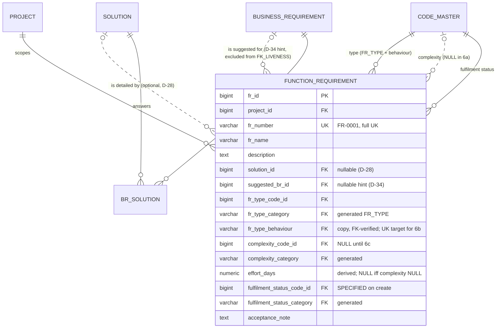

> **Ruling S6a-1 (Ben, 2026-10-09):** `suggested_br_id`, `fk_fr_suggested_br`, `ix_fr_suggested_br`, `EXCLUDED_FKS`, the clearing points and the two suggestion consistency lines are **deferred to the FR import slice** (see `docs/slice6a_spec.md` §10). Migration 0023 ships without them. Everything else here stands.

# Slice 6a — Function Requirements (first cut): physical schema spec

Author: `apple` · 2026-10-09 · source of truth: `docs/VB_design.md` (signed off 2026-09-28), with the
§1a rows winning over older text. **No redesign.** Where the design is silent once it is made
physical, a **proposed** choice is marked **[Q-n]** and listed in §7 for Ben. Do not build a [Q-n]
until Ben has answered it.

Scope (Lilly's carve): `function_requirement` (§6.1 row 21) and the view `v_br_function_requirement`
(§7.5). Sources: D-27/D-28/D-34, §4.4, §5.3 FUNCTION_REQUIREMENT, §5.4.3/.8/.13/.15, §6.2, §6.3,
§7.5, §7.12, §8, §9, criteria 9, 10a, 104, 105. **Out:** `application*`, `fr_interface*`,
`v_interface_list` (6b); `effort_rate`, the rate card and rating (6c); `fr_bfc_node`; FR import; code
maintenance. Dialect is **PostgreSQL 16**, using the house conventions of `docs/slice5_schema.md`:
identity PK, `(id, project_id)` composite FKs, category-verified code FKs (S1-4), `AuditMixin` plus
`updated_at_trigger()`, every FK `NO ACTION`, and partial or expression indexes in raw `op.execute`.

---

## 1. `function_requirement` — one row per FTC-specified system function in one project

| Column | Type | Null | Default | FK | Description |
|---|---|---|---|---|---|
| `fr_id` | bigint identity | NO | identity | — | PK |
| `project_id` | bigint | NO | — | → `project`; in every composite | taken from the route, never from the body |
| `fr_number` | varchar(20) | NO | — | — | `FR-0001`, minted at save by `numbering.next_number(…, "FR")`. The FR series is already seeded by `create_project` |
| `fr_name` | varchar(200) | NO | — | — | trimmed by the service. Not unique **[Q-1]** |
| `description` | text | YES | — | — | |
| `solution_id` | bigint | **YES** | — | composite | **D-28**: NULL means unlinked, which is a warning and never an error |
| `suggested_br_id` | bigint | YES | — | composite | **D-34** hint. Read-only on every route. Its only writer is the FR import (later) **[Q-2]** |
| `fr_type_code_id` | bigint | NO | — | behaviour FK | `FR_TYPE` (project-editable) |
| `fr_type_category` | varchar(40) | NO\* | **GENERATED `'FR_TYPE'`** | behaviour FK | `vb_ops.category_column`. It is varchar(40) like `raci_category`, not the design's (20) |
| `fr_type_behaviour` | varchar(20) | NO | — | behaviour FK | **D-27 copy**. The service writes it from the resolved code at save, and the FK rejects a wrong copy |
| `complexity_code_id` | bigint | YES | — | category FK | `FR_COMPLEXITY`. **Always NULL in 6a** (§3) |
| `complexity_category` | varchar(40) | NO\* | **GENERATED `'FR_COMPLEXITY'`** | category FK | S1-4 |
| `effort_days` | numeric(7,2) | YES | — | — | **derived** at rating (D-13, A-38), never accepted from a body (law 6). Always NULL in 6a. 6c must give `effort_rate.standard_days` the same type |
| `fulfilment_status_code_id` | bigint | NO | — | category FK | `FR_FULFILMENT_STATUS`. The service sets it to SPECIFIED on create **[Q-3]** |
| `fulfilment_status_category` | varchar(40) | NO\* | **GENERATED `'FR_FULFILMENT_STATUS'`** | category FK | named by the `<prefix>_category` rule |
| `acceptance_note` | text | YES | — | — | |
| + `AuditMixin` | | | | | `created_*`, `updated_*`, `is_active`, `deleted_*`, `row_version` (law 3) |

\* never NULL, because it is a stored constant.

**Keys** (all FKs `NO ACTION`)
- PK `fr_id`.
- UK `uq_fr_number (project_id, fr_number)`, **full**. A minted number is never reused (§6.2).
- UK `uq_fr_project (fr_id, project_id)`. The future target for `fr_bfc_node`, `cr_impact` and the
  rest.
- UK `uq_fr_behaviour_target (fr_id, project_id, fr_type_behaviour)`. This is the 6b target for
  `fr_interface`. It is created now so that 6b never alters this table.
- `project_id → project`, unnamed as on every table.
- `fk_fr_solution (solution_id, project_id) → solution (solution_id, project_id)` uses
  `uq_solution_project`. Under MATCH SIMPLE a NULL `solution_id` skips the check, which is exactly D-28.
- `fk_fr_suggested_br (suggested_br_id, project_id) → business_requirement (br_id, project_id)` uses
  `uq_br_project`, which **is built** (0011). This keeps a suggestion inside its project (R2-D16).
- `fk_fr_type_code (fr_type_code_id, fr_type_category, fr_type_behaviour) → code_master (code_id,
  category, behaviour_code) ON UPDATE NO ACTION`. Its target, **`uq_code_behaviour_target`, is built**
  (`models/shared.py`, already used by `br_org_role`). So the code is provably an FR_TYPE, and its
  behaviour cannot change once any FR uses it (Q6, R2-D8, §5.4.13).
- `fk_fr_complexity_code (complexity_code_id, complexity_category)` and
  `fk_fr_fulfilment_code (fulfilment_status_code_id, fulfilment_status_category) → code_master
  (code_id, category)` use `uq_code_category_target`.

**CHECKs**
- `ck_fr_name_not_blank (btrim(fr_name) <> '')`. The service trims the name first and returns 422 for
  a blank one.
- `ck_fr_effort_with_complexity ((complexity_code_id IS NULL) = (effort_days IS NULL))`. This is §6.2
  "effort_days NOT NULL once complexity is set", written as an equivalence. The reverse half (no
  effort without a complexity) holds because effort only ever comes from a rate.
- `ck_fr_effort_nonneg (effort_days IS NULL OR effort_days >= 0)`.

**Indexes** (§6.3: every FK gets an index, plus the named ones)
- `ix_fr_solution (solution_id, project_id)` serves the FK, "FRs under this solution",
  `v_br_function_requirement`, and the FK_LIVENESS scan when a solution is retired.
- `ix_fr_unlinked (project_id) WHERE solution_id IS NULL AND is_active` is from §6.3 and serves the
  D-28 warning.
- `ix_fr_behaviour (project_id, fr_type_behaviour) WHERE is_active` is from §6.3 and serves 6b's
  interface list and the type filter on the FR list.
- `ix_fr_suggested_br (suggested_br_id) WHERE suggested_br_id IS NOT NULL` is from §6.3 and serves
  "FRs suggested for this BR" and the clearing UPDATE.
- `ix_fr_type (fr_type_code_id)` serves the "type in use" test (R2-D8) and the override re-point later.
- `ix_fr_complexity (complexity_code_id)` and `ix_fr_fulfilment (fulfilment_status_code_id)` follow
  `ix_sol_status`.
- `uq_fr_number` (leading `project_id`) serves the list order and `purge_project`, so no separate
  `project_id` index is needed.

**Model:** `FunctionRequirement(AuditMixin, Base)` in a new `models/function_requirement.py`, exported
from `models/__init__.py` (law 10). It follows `Solution`:
- view-only `*_code_row` relationships, with `fr_type_code` / `complexity_code` /
  `fulfilment_status_code` properties;
- `owning_project_id()`, for `object_guard`.

## 2. `v_br_function_requirement` — a DB view, created now

**Recommended: a real view, not a service query.** §7.5 writes it as `CREATE VIEW`. Criterion 10a
counts rows "in `v_br_function_requirement`" and requires that "no `fr_br` table exists". The
D-7/§5.4.3 point is that BR→FR is derived in exactly **one** place, which later readers
(traceability, coverage, `analyse_cr_impact`) join. The view is cheap: one migration and no model.
- The body is §7.5's SQL **plus `bs.project_id`** (apple addition). Callers then filter by project
  without a join. The composite FKs already guarantee that all three tables are in that project.
- It is created `WITH (security_invoker = true)`, so it reads with `vb_app`'s rights rather than the
  owner's. Then `REVOKE INSERT, UPDATE ON v_br_function_requirement FROM vb_app`. The 0001 default
  privileges grant them on every new relation. A join view is not updatable anyway, so this is
  hygiene.
- **No SQLAlchemy model and not in `Base.metadata`.** The service reads it through
  `sqlalchemy.text`, or through a `Table` on a separate `MetaData`. `compare_metadata` reflects tables
  only, so `test_schema_parity` stays green, and tests build the schema with Alembic (conftest), so
  the view exists there.
- 6a has no screen for it. The route `GET /business-requirements/{id}/function-requirements` (§9)
  is a one-liner over it. Build it if Lilly wants the BR panel's FR list, and test criterion 10a
  either way.

## 3. Effort without a rate card (question 2)

**Recommendation: complexity cannot be set in 6a.** The columns and the equivalence CHECK ship now,
and every 6a row holds `complexity_code_id = effort_days = NULL`, which the CHECK accepts. Nothing is
relaxed or deferred:
- **The design already puts complexity behind the rating service.** Complexity has its own route
  (`PATCH /function-requirements/{id}/complexity`, §9), and `rate_function_requirement` sets
  complexity and days together or returns 422 (criterion 104). Neither belongs in 6a's create or
  PATCH bodies, which carry `fr_type_code`, not complexity. 6c adds the route and the card. No row
  ever has to be backfilled or re-checked.
- **The alternative (complexity allowed, days NULL until 6c)** would need the D-13 CHECK dropped and
  re-added later. It would also leave FRs that look rated but are unpriced. 6c would have to find and
  price them, or reject its own CHECK on existing rows. That is a migration with data risk, for a
  field nobody can price yet.
- **Shipping the columns now (not in 6c)** follows §13's "ship in wave 1": the CHECK is born with the
  table, and 6c adds no ALTER to it.
- **A type change in 6a** rewrites `fr_type_code_id` and `fr_type_behaviour` together. There is no
  effort to re-derive, because complexity is NULL. 6b adds the "live interface detail" 409.

## 4. Retire, restore, and the D-34 suggestion (questions 3 and 4)

**4.1 FK_LIVENESS needs a per-FK exclusion. As built, the suggestion would *block* a BR's retire.**
`lifecycle._links()` derives a link from **every** FK whose target has `is_active`. It excludes only
by target table (`EXCLUDED_TARGETS`). `fk_fr_suggested_br` would therefore become a dependent of
`BusinessRequirement`, with three effects:
- the plain BR DELETE would return a 409 naming the FR;
- `step_retire._assess` (through `active_dependent_ids`) would list the FR as a step **blocker**;
- `inactive_parents` would refuse to restore an FR whose suggested BR is retired.

All three contradict §5.4.15 and §7.12. **Fix:** add
`lifecycle.EXCLUDED_FKS = frozenset({"fk_fr_suggested_br"})` and skip those names in `_links()`.
`test_lifecycle.test_every_business_fk_is_covered_or_excluded` must skip the same names, and a new
test asserts that the excluded FK is **not** in `LINKS`.

**4.2 One clearing helper, called at the three places §7.5 and §7.12 name.**
`function_requirement.clear_suggestions(db, actor_id, *, br_id, solution_id=None, cause)` runs one
UPDATE:
- it sets `suggested_br_id = NULL, updated_by = :actor, row_version = row_version + 1`;
- **it bumps `row_version` explicitly.** A Core UPDATE bypasses `version_id_col`, so an open FR form
  would otherwise save over a changed row unnoticed (D-6);
- it writes one `RECORD_UPDATED` audit event per cleared FR, with detail
  `{suggested_br_cleared: "BR-0012", cause}`;
- it returns the FR numbers, so the caller's response can list them.

| Trigger | Where in the code | WHERE | Note |
|---|---|---|---|
| **The BR retires**, by any route | **`lifecycle.retire_row`**, when `obj` is a `BusinessRequirement`, after the soft delete | `suggested_br_id = :br` (live **and** retired FRs, as in §7.12's SQL) | `retire_row` is the single choke point. Both `lifecycle.retire` (plain `DELETE /business-requirements/{id}`) and `step_retire.retire_row` (tier 3, inside the one step-retire transaction) call it, so a BR that **retires with its step is covered with no step_retire edit**. Clearing retired FRs too means an FR restore can never revive a pointer to a dead BR |
| A `BR_SOLUTION` is linked | `services/solution.link`, replacing the `# D-34 hook` comment, after the insert **or** relink branch and before commit | `solution_id = :s AND suggested_br_id = :br` | The rule is confirmed: the path now exists, so the hint is true. The live-pair branch 409s first. **[Q-4]** whether to keep §7.5's `AND is_active` |
| An FR is linked to a solution, or created with one | `function_requirement.update` / `create` | that FR, if `path_exists(br, s)` | Otherwise the suggestion stays and the response carries the `prompt` (R2-D16). Unlinking a BR_SOLUTION **never** re-creates a hint |

**4.3 The step's owned set does not change.** No FR row joins `OWNED_BY_STEP` or `OWNED_BY_BR`. An
FR is owned by neither a step nor a BR. Its only BR pointer is the excluded hint, and its parent
(the solution) survives a step retire. The step-retire **preview** should list the FRs whose
suggestion will clear, as information outside `confirm_hash`. A step **restore does not restore the
hints** **[Q-5]**.

**4.4 Other cases**
- **A solution retires while it has live FRs:** 409, derived from `fk_fr_solution` with no code
  (§5.4.15 row 21; §7.12 "a solution with active FRs").
- **`lifecycle.LABELS`** gains `function_requirement` → ("Function requirement",
  `f"{fr_number} {fr_name}"`), so that 409 names the FRs.
- **FR retire:** plain `lifecycle.retire`. 6a gives it no dependents (6b's `fr_interface` will).
- **FR restore:** add `FunctionRequirement` to `RESTORABLE`. `inactive_parents` already skips a NULL
  `solution_id`, so restore is refused only under a retired solution.
- **`EXCLUDED_TARGETS`** keeps the three code FKs out, as on every table.

**4.5 Lock order (SR-5 extended; this closes a D-34 race).**
- Without care, `link_fr_solution` and `link_br_solution` can each miss the other's uncommitted row,
  leaving a hint that is already true.
- **Rule:** create/link-FR locks the solution **FOR UPDATE** when the FR carries a suggestion, and
  FOR SHARE otherwise, before the liveness and path checks.
- `link_br_solution` already holds the solution FOR SHARE, so the two serialise.
- A suggested BR is locked FOR SHARE before its liveness check, which serialises with BR retire.
- **Proofs** (`consistency_check`, both must return 0): `fr_suggestion_traced` (the hint already
  reaches its solution through a live BR_SOLUTION) and `fr_suggestion_on_retired_br`.

## 5. Baseline (question 7)

- Row 21 is in the frozen set. **6a creates no shadow, trigger or parity entry**, because `baseline`
  does not exist yet.
- The gap: `baseline_shadow.snapshot_column_names()` would copy `suggested_br_id` today, because it
  drops only audit, PK and generated columns.
- **Recommendation for 6a:** add the one-line constant
  `SHADOW_EXCLUDED = {"function_requirement": {"suggested_br_id"}}`, used by
  `snapshot_column_names`, with a unit test that:
  - excludes `suggested_br_id` and the three generated `*_category` columns;
  - keeps `fr_type_behaviour` and `effort_days`.
- The freeze slice still owns `baseline_solution_id`, `fr_type_label`, and `content_hash` excluding
  the hint (R2-D16).

## 6. ER fragment

`v_br_function_requirement` = `BR_SOLUTION ⋈ SOLUTION ⋈ FUNCTION_REQUIREMENT`, all live (no table).

## 7. Questions for Ben (recommendation first)

1. **Is `fr_name` unique among live FRs?** **Rec: no** (this departs from the S1-6/S5-5 pattern):
   - an FR is identified by its number;
   - the FR import keys on the FR number;
   - two solutions can legitimately specify a same-titled function ("Customer search").
   The service may warn on a live duplicate name.
2. **Ship `suggested_br_id`, its FK and the three clearing points in 6a, though no 6a route writes it?**
   **Rec: yes.** It is in the design's table, and the retire paths must be right before the import
   ever writes it. Tests set it directly. The alternative is an ALTER plus the lifecycle work in the
   import slice.
3. **Initial fulfilment status.** **Rec: the service sets FR_FULFILMENT_STATUS/SPECIFIED; the column is
   NOT NULL; it is editable on PATCH.** This mirrors S5-5's PROPOSED.
4. **The link hook's `AND is_active`.** **Rec: drop it.** Once the path exists the hint is true for a
   retired FR too. A restored FR then never carries a hint that `fr_suggestion_traced` flags.
5. **Step restore and cleared hints.** **Rec: not restored.** They are hints, outside the hash and
   the scope. The preview says so. This adds a line to the S3-SR spec (A-SR-5 "all or nothing" covers
   owned rows only).
6. **Complexity in 6a.** **Rec: not settable until 6c** (§3). No CHECK is relaxed.
7. **`v_br_function_requirement` as a DB view in 6a**, with `project_id` added and
   `security_invoker`. **Rec: yes** (§2).

## 8. Migration plan (one per commit, reversible, on `main`, in order; head is **0022**)

| Rev | Creates | Depends on |
|---|---|---|
| 0023 | `function_requirement`: `audit_columns()` and the generated columns via `category_column`; three UKs; five FKs; three CHECKs; raw `ix_fr_unlinked`, `ix_fr_behaviour` and `ix_fr_suggested_br` (partial); the plain indexes; `trg_function_requirement_updated_at` | `solution` (`uq_solution_project`), `business_requirement` (`uq_br_project`), `code_master` (`uq_code_behaviour_target`, `uq_code_category_target`) |
| 0024 | `v_br_function_requirement` (`CREATE VIEW … WITH (security_invoker = true)` + the REVOKE) | 0022, 0023 |

- **Downgrades:** 0024 drops the view; 0023 drops the trigger, then the table. Neither upgrade is
  destructive.
- **No seed change:** `FR_TYPE` (with behaviours), `FR_COMPLEXITY` and `FR_FULFILMENT_STATUS` are
  seeded, and `create_project` seeds the FR series.
- **`purge_project`, when built,** deletes `function_requirement` before `solution` and
  `business_requirement`.
- **`sara` reviews before commit:** the change touches the retire set (`EXCLUDED_FKS`,
  `retire_row`) and the migration chain.
