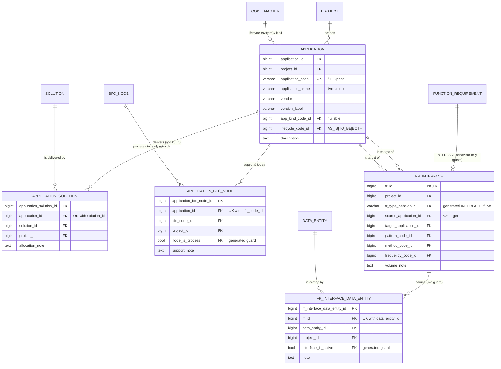

# Slice 6b — Applications and interface detail: physical schema spec

Author: `apple` · 2026-10-11 · source of truth: `docs/VB_design.md` (signed off 2026-09-28), §1a rows
win. **No redesign.** Where the design is silent once made physical, a **proposed** choice is marked
**[Q-n]** (§9). Do not build a [Q-n] until Ben has answered it.

Scope: `application`, `application_solution`, `fr_interface`, `fr_interface_data_entity`, the view
`v_interface_list`, and (recommended, [Q-1]) `application_bfc_node`. Sources: D-8, D-22, D-23, D-27,
A-27, A-55, R2-D2, R2-D6, R2-D8, R2-D11; §4.4; §5.3 (APPLICATION … v_interface_list); §5.4.8; §5.4.15;
§6.2; §6.3; §7.5; §8; §9; criteria 10c, 101–103. **Out:** rate card/effort (6c), FR import,
`application_gap_report`, traceability, `interface_load`, program roll-ups, shadows (no `baseline` yet).
Dialect **PostgreSQL 16**, house conventions of `docs/slice5_schema.md` / `slice6a_schema.md`:
identity PKs, S1-5 surrogate PK on link rows with the design key as a **full** UNIQUE (re-link
restores, S1-7), `(id, project_id)` composite FKs, S1-4 category columns, `AuditMixin` +
`updated_at_trigger()`, every FK `NO ACTION`, partial/expression indexes in raw `op.execute`.

---

## 1. `application` — one row per application or technology in one project's landscape (D-8)

| Column | Type | Null | Default | FK | Description |
|---|---|---|---|---|---|
| `application_id` | bigint identity | NO | identity | — | PK |
| `project_id` | bigint | NO | — | → `project` | from the route, never the body |
| `application_code` | varchar(30) | NO | — | — | typed business key ("SAP-ECC"), **not minted** (no APP series; the ten series stay ten). Service trims and upper-cases **[Q-3]** |
| `application_name` | varchar(200) | NO | — | — | trimmed by the service |
| `vendor` | varchar(200) | YES | — | — | |
| `version_label` | varchar(50) | YES | — | — | |
| `app_kind_code_id` | bigint | YES | — | category FK | `APP_KIND` (project-editable). Nullable: unknown during discovery **[Q-4]** |
| `app_kind_category` | varchar(40) | NO\* | GENERATED `'APP_KIND'` | category FK | S1-4 |
| `lifecycle_code_id` | bigint | NO | — | category FK | `APP_LIFECYCLE` = AS_IS / TO_BE / BOTH, `is_system` (seeded so). The service may branch on the code here (§8): it is fixed |
| `lifecycle_category` | varchar(40) | NO\* | GENERATED `'APP_LIFECYCLE'` | category FK | S1-4 |
| `description` | text | YES | — | — | |
| + `AuditMixin` | | | | | law 3 |

\* stored constant, never NULL.

- **Keys:** PK `application_id`. UK `uq_application_code (project_id, application_code)` **full**
  (§6.2 "business keys quoted in client documents") **[Q-3]**. UK `uq_application_project
  (application_id, project_id)` — the target for both `fr_interface` endpoints and the two links.
  Partial UK `uq_application_name_live (project_id, lower(btrim(application_name))) WHERE is_active`
  (mirrors S5-5) **[Q-3]**.
- **FKs:** `project_id → project`; `fk_app_kind_code (app_kind_code_id, app_kind_category)` and
  `fk_app_lifecycle_code (lifecycle_code_id, lifecycle_category) → code_master (code_id, category)`
  via `uq_code_category_target`, ON UPDATE NO ACTION.
- **CHECKs:** `ck_app_code_not_blank (btrim(application_code) <> '')`, `ck_app_code_upper
  (application_code = upper(btrim(application_code)))`, `ck_app_name_not_blank`.
- **Indexes:** `ix_app_kind (app_kind_code_id)`, `ix_app_lifecycle (lifecycle_code_id)`;
  `uq_application_code` (leading `project_id`) serves the list and `purge_project`.

## 2. `application_solution` — one row per to-be allocation (application × solution)

| Column | Type | Null | FK | Description |
|---|---|---|---|---|
| `application_solution_id` | bigint identity | NO | — | PK (S1-5) |
| `project_id` | bigint | NO | → `project`; in both composites | copied from the solution |
| `application_id` | bigint | NO | composite | |
| `solution_id` | bigint | NO | composite | |
| `allocation_note` | text | YES | — | editable in place, previous note to the audit (mirrors S5-3) **[Q-8]** |
| + `AuditMixin` | | | | |

- UK `uq_appsol_grain (application_id, solution_id)` full. FKs `fk_appsol_application
  (application_id, project_id) → application`, `fk_appsol_solution (solution_id, project_id) →
  solution (uq_solution_project)`. Indexes: grain UK serves the application side;
  `ix_appsol_solution (solution_id, project_id)`; `ix_appsol_project (project_id)`.
- **R2-D11 rule, service-enforced (no CHECK can see the application's lifecycle):**
  `application.link_solution` locks the application, then the solution, **FOR SHARE** (SR-5;
  application-before-solution everywhere), refuses a retired end (409 "… is retired. Restore it
  first.", as `solution.link`), and returns **422** for an `AS_IS` application (§7.5; criterion 10c:
  `BOTH` accepted). Re-linking a removed pair restores the same row.
- **The other write path:** `PATCH /applications/{id}` that moves `lifecycle_code` **to AS_IS**
  locks the application **FOR UPDATE** and returns **409 naming the live allocations** while any
  exist (§6.2). The two locks serialise, so neither path can slip past the other.
  `consistency_check.as_is_allocated` (when built) is the proof and returns 0.

## 3. `application_bfc_node` — as-is support on a process step (D-8, pinned by D-23) **[Q-1]**

| Column | Type | Null | FK | Description |
|---|---|---|---|---|
| `application_bfc_node_id` | bigint identity | NO | — | PK (S1-5) |
| `project_id` | bigint | NO | in every composite | copied from the node |
| `application_id` | bigint | NO | composite | |
| `bfc_node_id` | bigint | NO | composite + guard | |
| `node_is_process` | boolean | YES | guard FK | GENERATED `CASE WHEN is_active THEN TRUE END` (`vb_ops.live_guard`; model `_live(True)`) |
| `support_note` | text | YES | — | editable in place **[Q-8]** |
| + `AuditMixin` | | | | |

- UK `uq_appnode_grain (application_id, bfc_node_id)` full. FKs `fk_appnode_application`, and
  `*_process_node_fk("appnode")` from `models/bfc.py` (plain `(bfc_node_id, project_id)` plus the
  guard `(bfc_node_id, project_id, node_is_process) → uq_bfc_node_process_target` ON UPDATE NO
  ACTION). Indexes `ix_appnode_node (bfc_node_id, project_id)` (§6.3 guard referencing side),
  `ix_appnode_project (project_id)`.
- **Step retire (law 1).** The table points at a step, so `active_dependent_ids` would make every
  live row a **blocker** of step retire until it is placed. **Recommendation: owned** — add
  `ApplicationBfcNode` to `step_retire.OWNED_BY_STEP` and to tier 2 of `TIERS` (beside
  `BfcNodeDataEntity`), add it to `_owned()`'s per-model loop, and give `describe()` a branch
  (`"APP-CODE name"`). It is a step-level fact exactly like step I/O, roles and external flows: it
  exists only because the step does; the application survives. Restore goes through A-SR-5: a
  since-retired application is asked for first, generically, via `inactive_parents` **[Q-2]**.
- **Demotion:** the guard FK already refuses demoting a step with a live link; add
  `(ApplicationBfcNode, "as-is applications")` to `bfc._step_blockers` so the 409 names it (§4.1
  `mark_process` lists "as-is application links").
- **Lifecycle on this side:** design is silent. **Rec: warn, do not refuse**, when a `TO_BE`
  application is linked as today's support **[Q-7]**.

## 4. `fr_interface` — 1:0..1 subtype of an INTERFACE-behaviour FR (D-27, A-55)

| Column | Type | Null | Default | FK | Description |
|---|---|---|---|---|---|
| `fr_id` | bigint | NO | — | PK; plain + guard FK | identity is the FR (no interface series) |
| `project_id` | bigint | NO | — | in every composite | copied from the FR |
| `fr_type_behaviour` | varchar(20) | YES | GENERATED `CASE WHEN is_active THEN 'INTERFACE' END` STORED | guard FK | new append-only helper `vb_ops.live_tag(name, value, length=20)` (`live_guard` is boolean-only) |
| `source_application_id` | bigint | NO | — | composite | A-55: no endpoints → no row |
| `target_application_id` | bigint | NO | — | composite | |
| `pattern_code_id` | bigint | YES | — | category FK | `INTERFACE_PATTERN` |
| `pattern_category` | varchar(40) | NO\* | GENERATED `'INTERFACE_PATTERN'` | | |
| `method_code_id` | bigint | YES | — | category FK | `INTERFACE_METHOD` |
| `method_category` | varchar(40) | NO\* | GENERATED `'INTERFACE_METHOD'` | | |
| `frequency_code_id` | bigint | YES | — | category FK | `INTERFACE_FREQUENCY` |
| `frequency_category` | varchar(40) | NO\* | GENERATED `'INTERFACE_FREQUENCY'` | | |
| `volume_note` | text | YES | — | — | |
| + `AuditMixin` | | | | | `row_version` guards the PUT (D-6) |

- **Keys:** PK `fr_id` (enforces 1:0..1; a removed detail is restored by the next PUT, never
  re-inserted). UK `uq_fri_project (fr_id, project_id)`; UK `uq_fri_live_target (fr_id, project_id,
  is_active)` — targets for §5.
- **FKs:** `fk_fri_fr (fr_id, project_id) → function_requirement (uq_fr_project)`;
  `fk_fri_fr_behaviour (fr_id, project_id, fr_type_behaviour) → function_requirement
  (uq_fr_behaviour_target)` ON UPDATE NO ACTION; `fk_fri_source (source_application_id,
  project_id)` and `fk_fri_target (target_application_id, project_id) → application
  (uq_application_project)`; three code FKs onto `uq_code_category_target`.
- **CHECK** `ck_fri_endpoints_distinct (source_application_id <> target_application_id)`.
- **Indexes:** `ix_fri_pair (project_id, source_application_id, target_application_id)` (§6.3; also
  serves the source FK scan, whose Link pairs include `project_id`); `ix_fri_target
  (target_application_id, project_id)`; `ix_fri_pattern`, `ix_fri_method`, `ix_fri_frequency`.
  The PK serves both FR FKs.
- **Endpoints may have any lifecycle** (an interface from a legacy AS_IS system into a new one is
  normal). No rule is added. The FR's own solution is a different fact (A-27, §5.4.3 note).

## 5. `fr_interface_data_entity` — one row per (interface FR × data entity carried)

| Column | Type | Null | FK | Description |
|---|---|---|---|---|
| `fr_interface_data_entity_id` | bigint identity | NO | — | PK (S1-5) |
| `project_id` | bigint | NO | in every composite | |
| `fr_id` | bigint | NO | plain + guard FK → `fr_interface` | |
| `data_entity_id` | bigint | NO | composite → `data_entity (uq_data_entity_project)` | |
| `interface_is_active` | boolean | YES | guard FK | `vb_ops.live_guard("interface_is_active", True)` |
| `note` | text | YES | — | |
| + `AuditMixin` | | | | |

- UK `uq_fide_grain (fr_id, data_entity_id)` full. FKs `fk_fide_interface (fr_id, project_id) →
  fr_interface (uq_fri_project)`; `fk_fide_interface_live (fr_id, project_id, interface_is_active)
  → fr_interface (uq_fri_live_target)` ON UPDATE NO ACTION; `fk_fide_de`. Indexes: grain UK serves
  both `fr_interface` FKs; `ix_fide_de (data_entity_id, project_id)`; `ix_fide_project (project_id)`.
- **Write path:** only `describe_interface` writes it — "replace the set": rows not in
  `data_entity_ids` retire, missing ones insert or restore (S1-7). Each named DE is locked FOR SHARE
  and must be live and in-project (404 out of project, 409 retired).

## 6. `v_interface_list` — the generated interface list (D-27), migration mirrors 0024

- Body = §5.3's SQL **verbatim** (it already leads with `fr.project_id`, which 0024 had to add). It
  depends on `v_br_function_requirement` (0024), so it is dropped first on downgrade.
- `CREATE VIEW v_interface_list WITH (security_invoker = true) AS …`, then `REVOKE INSERT, UPDATE ON
  v_interface_list FROM vb_app` (0001's default privileges grant them). No model, not in
  `Base.metadata`; read via `sqlalchemy.text` with `WHERE project_id = :p` after `require_project`.
- It filters on **behaviour** (`fr_type_behaviour = 'INTERFACE'`), never the code: criterion 101
  ("連携", "API") holds with no code change. An FR with no live detail lists with
  `is_described = false` (criterion 103). Served by `ix_fr_behaviour` (built in 0023).

## 7. Lifecycle, guards and the type change

**Required code fix — `lifecycle.GUARD_TARGET_COLUMNS` gains `"fr_type_behaviour"`.** `_links()`
drops only `is_active`/`is_process` target columns, so `fk_fri_fr_behaviour` would become a
*second* Link `fr_interface → function_requirement` with pairs `(fr_id, fr_type_behaviour,
project_id)`. `active_dependents` would then count each interface twice in an FR's 409. With the
column added, its pairs equal `fk_fri_fr`'s and the `seen` set dedups it. `fk_fide_interface_live`
already dedups (its extra target column is `is_active`). A test asserts exactly one Link per
(child, parent, pairs) for both tables.

Derived from FK_LIVENESS with no new code (§5.4.15 rows 22, 23, 25–27):

| Action | Result |
|---|---|
| Retire an **application** with live allocations, as-is links, or interfaces naming it as source or target | **409**, each named |
| Retire a **solution** with live `application_solution` rows | 409 (new blocker on an existing route) |
| Retire a **data entity** carried by a live interface | 409 |
| Retire an **FR** with live interface detail | 409 (law 1: nothing cascades) **[Q-6]** |
| Restore an application | allowed (code parents only); add `Application` to `RESTORABLE` |
| Re-link / re-PUT under a retired application, solution, step or DE | 409 "… is retired. Restore it first." |

- **Lifecycle → AS_IS while live allocations exist: 409** naming them (§2). Retire and lifecycle
  change both lock the application FOR UPDATE.
- **`DELETE /function-requirements/{id}/interface`** retires the carried rows, then the detail, in
  one transaction: one `describe_interface` "D" over its two tables (§4.4 C/U/D), not a cascade
  across objects. Without it the guard FK refuses the DELETE **[Q-5]**.
- **`lifecycle.LABELS`** gains `application` (`f"{code} {name}"`), `application_solution` and
  `application_bfc_node` (two-ended, as `br_solution`), `fr_interface` (`f"Interface {fr_number}"`
  via a view-only `fr_row`), and `fr_interface_data_entity` (`de_number`).

**What `change_fr_type` must refuse (criterion 102):** when the old type's behaviour is INTERFACE,
the new type's is not, **and a live `fr_interface` row exists → 409** "This FR has interface detail.
Remove it first, or keep an interface type". The DB is the backstop: the UPDATE changes the key
`uq_fr_behaviour_target` references, and NO ACTION rejects it. Two cases are allowed: INTERFACE →
another INTERFACE-behaviour type ("API"), and any move when the detail is retired (its guard is
NULL). The FR is locked FOR UPDATE; `describe_interface` locks it FOR SHARE before its behaviour
check, so they serialise. A later PUT on retired detail under a non-interface FR is the plain
**422** of criterion 102. *Note for code-maintenance:* `maintain_fr_types`' override re-point is
refused by the same FK when it would change a live interface FR's behaviour. Map it to a 409.

## 8. ER fragment

`v_interface_list` = live interface-behaviour FRs ⟕ live `fr_interface` ⟕ endpoints/codes/DEs/BRs.

## 9. Questions for Ben (recommendation first)

1. **`application_bfc_node` in 6b?** **Rec: yes.** It is one small table on an established pattern.
   Without it AS_IS is a label nothing reads; `process_flow.py` already has the AS_IS/TO_BE variant
   waiting for applications (D-22); and law 1 forces the step-retire decision the moment the table
   lands, so take it once, here. `application_gap_report` stays out.
2. **As-is links retire and restore with their step.** **Rec: owned** (`OWNED_BY_STEP`, tier 2), as
   S5-1 did for `br_solution`. Alternative: blocker, so every step retire first needs a manual
   unlink.
3. **Application code and name.** **Rec:** code is a full UK, stored upper-case and trimmed; creating
   a code a retired application holds → 409 "restore it". Name is unique among live applications
   (as S5-5).
4. **`app_kind_code_id` nullable?** **Rec: yes.** Kind is often unknown when the landscape is first
   listed; lifecycle stays NOT NULL.
5. **`DELETE …/interface` retires its carried-entity rows in the same transaction** (one
   `describe_interface` write, §4.4 C/U/D). **Rec: yes.** It is not a cross-object cascade, so no
   `step_retire.OWNED` change.
6. **FR retire with live interface detail.** **Rec: 409** (law 1). The FR page offers "Remove interface
   detail" first.
7. **TO_BE-only application linked as today's support.** **Rec: warn, not refuse.** The design adds no
   rule, and `application_gap` already filters on AS_IS/BOTH.
8. **Notes on both links edited in place** (`PATCH …/applications/{link_id}`), mirroring S5-3.
   **Rec: yes.**

## 10. Migration plan (one per commit, reversible, on `main`, in order; head after 6a is **0024**)

| Rev | Creates | Depends on |
|---|---|---|
| 0025 | `application` + generated categories, 3 UKs (name UK raw partial), 3 FKs, 3 CHECKs, indexes, trigger | `code_master` |
| 0026 | `application_solution` | 0025, `solution` (0021) |
| 0027 | `application_bfc_node` **[Q-1]** (same commit: `OWNED_BY_STEP`, `TIERS`, `_step_blockers`) | 0025, `bfc_node` (`uq_bfc_node_process_target`) |
| 0028 | `fr_interface` (+ `vb_ops.live_tag` helper; `GUARD_TARGET_COLUMNS` change in the same commit) | 0023 (`uq_fr_behaviour_target`), 0025 |
| 0029 | `fr_interface_data_entity` | 0028, `data_entity` |
| 0030 | `v_interface_list` (`security_invoker` + REVOKE) | 0024, 0028, 0029 |

- **Downgrades** drop in reverse (0030 view; then trigger and table). None is destructive. If [Q-1]
  is deferred, renumber 0028–0030 down by one. Do not leave a gap.
- **Seeds: none.** `APP_LIFECYCLE` (`is_system`), `APP_KIND`, `INTERFACE_PATTERN/METHOD/FREQUENCY`
  and `FR_TYPE` behaviours are already in `seeds/seed_code_master.py` with the design's codes. No
  new number series.
- **Models:** `models/application.py` (`Application`, `ApplicationSolution`, `ApplicationBfcNode`);
  `FrInterface`, `FrInterfaceDataEntity` in `models/function_requirement.py`. All are exported from
  `models/__init__.py` (law 10), with view-only code relationships and `owning_project_id()`.
- **Baseline:** rows 22, 23, 25–27 are frozen. No shadow, because `baseline` does not exist yet.
  `snapshot_column_names` already drops the generated guards and categories.
- **`purge_project`, when built:** `fr_interface_data_entity` → `fr_interface` →
  `application_solution` / `application_bfc_node` → `application`, all before `function_requirement`,
  `solution` and `bfc_node`.
- **`sara` before commit:** touches the retire set (`GUARD_TARGET_COLUMNS`, `OWNED_BY_STEP`) and the
  migration chain.
