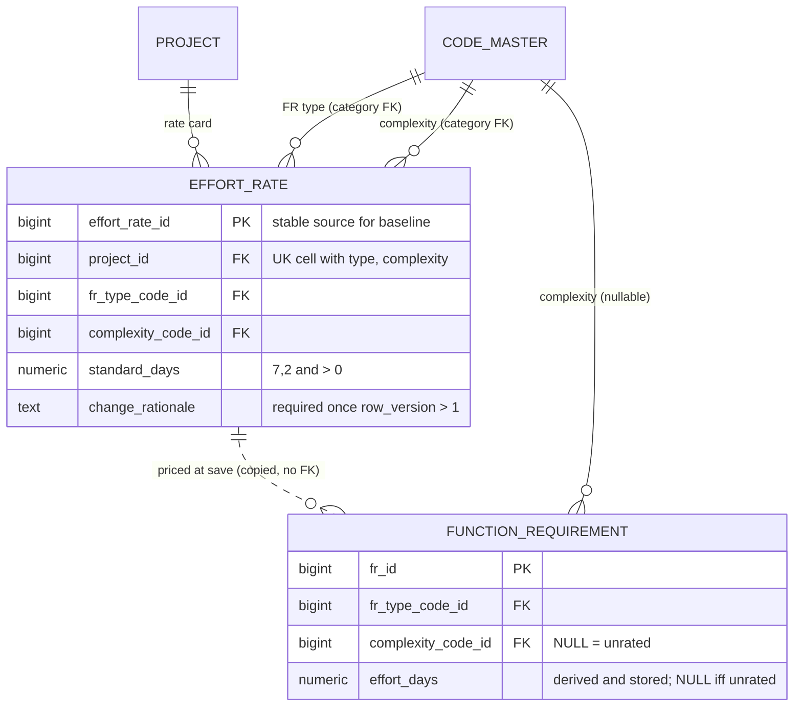

# Slice 6c — Rate card and FR effort days: physical schema spec

Author: `apple` · 2026-10-11 · source of truth: `docs/VB_design.md` (signed off 2026-09-28). The §1a rows
override everything else. **No redesign.** Where the design says nothing about a physical detail, the
choice here is **proposed** and marked **[Q-n]** (§9). Do not build a [Q-n] until Ben has answered it.

Scope: the `effort_rate` table (the project's rate card), seeding it at `create_project`,
`maintain_rate_card`, `rate_function_requirement`, re-deriving effort on an FR type change, and
(recommended, [Q-9]) `effort_summary` by type and solution. Sources: D-13, D-27, D-28, R2-D3, R2-D6,
R2-D7, R2-D8, A-16, A-38, A-39, S6a-3; §4.8; §5.3 EFFORT_RATE / FUNCTION_REQUIREMENT; §5.4.15 row
`effort_rate`; §5.4.16; §6.1 row 29; §6.2 (R2-D7 and D-13 rows); §7.5 `change_fr_type`, `maintain_fr_types`;
§7.9 `effort_summary`; §7.10 `create_project`; §7.13; §8 FR_COMPLEXITY; §9; criteria 56, 57, 104, 124, 125.
**Out:** `baseline_effort_rate` (no `baseline` table yet), `priced_diff` (criteria 57, 58, 121, 122), the FR
import rows of R2-D6, code maintenance (`maintain_fr_types`, A-16 re-point), `program_effort`, effort by phase
and by L1 area. Dialect **PostgreSQL 16**. House conventions follow `slice6a_schema.md` / `slice6b_schema.md`:
identity PKs, S1-4 category columns, `AuditMixin` + `updated_at_trigger()`, every FK `NO ACTION`.

---

## 1. `effort_rate` — one rate-card cell: (project × FR type × complexity) → standard man-days

| Column | Type | Null | Default | FK | Description |
|---|---|---|---|---|---|
| `effort_rate_id` | bigint identity | NO | identity | — | PK **[Q-1]**. It is also the stable source pointer for `baseline_effort_rate.source_effort_rate_id` later (R2-D7) |
| `project_id` | bigint | NO | — | → `project` | taken from the route, never from the body |
| `fr_type_code_id` | bigint | NO | — | category FK | `FR_TYPE`. Keys on the **type**, not on its behaviour (D-27) |
| `fr_type_category` | varchar(40) | NO\* | GENERATED `'FR_TYPE'` | category FK | S1-4 |
| `complexity_code_id` | bigint | NO | — | category FK | `FR_COMPLEXITY` |
| `complexity_category` | varchar(40) | NO\* | GENERATED `'FR_COMPLEXITY'` | category FK | S1-4 |
| `standard_days` | numeric(7,2) | NO | — | — | man-days (A-39). Same precision as `function_requirement.effort_days`, so the copy is exact **[Q-6]** |
| `change_rationale` | text | YES | — | — | the reason for the **current** value. NULL only on a cell nobody has changed since it was seeded |
| + `AuditMixin` | | | | | law 3. `row_version` is the per-cell optimistic lock |

\* stored constant, never NULL.

- **Keys:** PK `effort_rate_id`. UK `uq_effort_rate_cell (project_id, fr_type_code_id,
  complexity_code_id)` **full**. This is the design's natural key (§5.3). It leads with `project_id`, so it
  also serves the card read, the rate lookup and `purge_project`.
- **FKs:** `project_id → project`. `fk_effort_rate_type (fr_type_code_id, fr_type_category)` and
  `fk_effort_rate_complexity (complexity_code_id, complexity_category) → code_master (code_id, category)`,
  both via `uq_code_category_target` with ON UPDATE NO ACTION. The behaviour is not in the FK: the card
  does not care what a type does.
- **CHECKs:** `ck_effort_rate_days_positive (standard_days > 0)` **[Q-5]**.
  `ck_effort_rate_rationale (row_version = 1 OR change_rationale IS NOT NULL)` comes verbatim from §6.2
  (R2-D7). `ck_effort_rate_rationale_not_blank (change_rationale IS NULL OR btrim(change_rationale) <> '')`.
- **Indexes:** `ix_effort_rate_type (fr_type_code_id)` and `ix_effort_rate_complexity (complexity_code_id)`.
  `maintain_global_fr_type`'s "is this type in use" test needs them (R2-D8, §7.5), and so does the A-16
  re-point. The UK covers everything else.
- **Lifecycle:** both FKs point at excluded targets (`project`, `code_master`; §5.4.15 row 29). That means
  `lifecycle._links()` derives **no** Link, nothing references the table in 6c, and it is **not**
  `RESTORABLE`. `is_active` exists because law 3 requires it, but 6c never sets it false **[Q-4]**. Every
  read filters on `is_active` anyway, so a later "remove cell" needs no read changes.
- **Baseline readiness:** this is row 29 of the freeze set. The shadow is generated later by
  `baseline_shadow.py`. `snapshot_column_names` already drops the generated category columns. §5.3 names
  the hash columns (`fr_type_code`, `complexity_code`, `standard_days`); the rationale is provenance and is
  not hashed.

## 2. `function_requirement` — no DDL change

0023 already ships what 6c needs: `complexity_code_id` with its category FK, `effort_days numeric(7,2)`,
`ck_fr_effort_with_complexity` (§6.2 "NOT NULL once complexity is set", in declarative form),
`ck_fr_effort_nonneg` and `ix_fr_complexity`. 6c **lifts S6a-3**: the columns become writable, but only by
the two services in §4. `EDITABLE` and the request schemas must still never list `complexity_code_id` or
`effort_days` (law 6). A body that carries `effort_days` has it ignored (§9 row for `PATCH /function-requirements`).

## 3. The FTC default card and seeding (§7.10)

- **Where the default lives:** `seeds/ftc_rate_card.py`, as one constant
  `FTC_DEFAULT_RATE_CARD: dict[tuple[str, str], Decimal]` keyed by **code**: `(FR_TYPE code, FR_COMPLEXITY code)`.
  It is in a seed module, not in Alembic, and it is not a database tier. The design's PK makes `project_id`
  part of the key, so the table cannot hold a `project_id IS NULL` house tier the way `control_rule` does
  **[Q-3]**. The proposed values are in [Q-7].
- **`create_project`** (it replaces the line-75 placeholder) calls `effort.seed_rate_card(db, project_id, actor_id)`
  in the same transaction. That function resolves FR_TYPE and FR_COMPLEXITY through
  `code_master.resolve(db, project_id, …)`. A new project has no overrides, so this returns the globals.
  It inserts one row per resolved (type × complexity) pair that the default covers, with `row_version` 1,
  `change_rationale` NULL and `created_by` set to the creating admin. If a pair is not in the default, **no
  row** is written: an FR of that type still saves, and rating it returns 422 (criterion 104). The
  `PROJECT_CREATED` audit detail gains `rate_cells_seeded: n`.
- **Existing projects** have no card. There is no production data yet, but dev and UAT databases do have
  projects. `python -m seeds.seed_effort_rate --actor-email <platform admin>` fills **missing cells only**.
  It never overwrites a cell, it is idempotent, and it writes one `RATE_CARD_SEEDED` audit event per
  project **[Q-8]**. The test harness needs nothing new: it creates projects through `create_project`.

## 4. Write paths (services/effort.py; the one reader is `effort.rate_for`)

**`rate_for(db, project_id, fr_type_code_id, complexity_code_id, lock=True)`.** It looks up the live cell
through `uq_effort_rate_cell`, `FOR SHARE`. This is the **only** query that reads a rate. It looks up by
**code_id**, never by code string, so a later A-16 re-point that moves the FR and its rate rows together
keeps working without any change here (§7).

**`maintain_rate_card` — `PUT /projects/{id}/rate-card`**, guard `project_ctx(OWNER)` (§4.8, §7.13, §9).
- Body: `change_rationale` (required) and `cells: [{fr_type_code, complexity_code, standard_days,
  row_version | null}]`. Codes are sent, never ids or labels. Only changed cells are sent **[Q-2]**.
- After trimming, a blank rationale returns **422** "Changing the rate card is a commercial decision and
  needs a reason" (criterion 125). A code that does not resolve returns **400**, via `validate_required_code`.
  A duplicate cell in the body returns 422. More than 2 decimal places, or a value of 0 or less, returns 422.
- For each cell: if it exists and `row_version` matches, the ORM UPDATE sets `standard_days` and
  `change_rationale` (it bumps `row_version`, so the CHECK is satisfied in the same statement). If the version
  is stale, or the cell exists but no `row_version` was sent, the result is **409**. If the cell does not
  exist and `row_version` is null, the cell is INSERTed with the rationale. If the value is unchanged, the
  cell is skipped (no bump, no audit line). The whole request is one transaction: one 409 rolls back every cell.
- One `AUDIT_EVENT` `RATE_CARD_CHANGED` per request: `detail = {changes: [{fr_type_code, complexity_code,
  from, to}], change_rationale}`. A request where every cell is unchanged returns 200 and writes no event.
- **No FR is repriced** (A-38, criteria 56 and 125). The response reports
  `frs_rated_at_old_rate: n` per changed cell. This is information only: it makes the rate change
  **visible**, not silent (§6.2 "must not silently reprice").

**`GET /projects/{id}/rate-card`**, guard `project_ctx(REVIEWER)` **[Q-2]**. It returns the full grid of
resolved FR_TYPE × FR_COMPLEXITY, in `sort_order`. A pair with no row comes back as `standard_days: null`,
so the OWNER can see the gap that criterion 104 refuses on. Each cell carries `effort_rate_id`,
`row_version`, `change_rationale`, `updated_at` and `updated_by`. Labels come from `resolve`.

**`rate_function_requirement` — `PATCH /function-requirements/{id}/complexity`**, guard
`object_guard(FunctionRequirement, EDITOR)` (§7.13).
- Body: `complexity_code | null` and `row_version`. Steps: `lifecycle.check_live(fr, row_version)`, then
  lock the FR `FOR UPDATE`. Resolve the complexity (400 if it does not resolve). Call `rate_for(project,
  fr.fr_type_code_id, complexity_code_id)`. If no cell exists → **422** "No rate card entry for {type label}
  × {complexity label}". The message names the cell (criterion 104).
- Set `complexity_code_id` and `effort_days = rate.standard_days` together. The CHECK makes a half-write
  impossible. `null` clears both **[Q-10]**. Audit: `RECORD_UPDATED` with `previous_complexity_code` and
  `previous_effort_days`.
- **Re-rating with the same complexity** re-derives the FR at today's rate. That is the one deliberate
  "reprice this FR" act. It is explicit, done per FR, and audited, so it is not silent **[Q-11]**.
- Lock order is FR `FOR UPDATE`, then rate `FOR SHARE`. `maintain_rate_card` locks only rate rows, so the
  two cannot deadlock. An FR rated while the card is changing gets a consistent value: either the old rate
  or the new one, never a torn value.

**`change_fr_type` — inside `function_requirement.update_fr`** (§7.5, §9 `PATCH /function-requirements/{id}`).
The existing interface check runs first (409, criterion 102). Then, if `complexity_code_id` is set, call
`rate_for(project, new_type.code_id, fr.complexity_code_id)`. No cell → **422** naming the cell, and the
PATCH is refused as a whole (this mirrors criterion 124's import row error). Otherwise set `effort_days` to the
new rate. If the FR is unrated, nothing is derived. The existing `RECORD_UPDATED` detail gains
`previous_effort_days`. The FR import (R2-D6) will call this same function, never the columns.

## 5. `effort_summary` — `GET /projects/{id}/effort-summary`, `project_ctx(REVIEWER)` **[Q-9]**

The read-only report in §7.9. It covers live FRs only, filtered on `project_id` after `require_project`.
- `by_type`: Σ `effort_days` and a count, per FR type (label from `resolve`).
- `by_solution`: the same, `LEFT JOIN solution`. `solution_id IS NULL` becomes **Unassigned** and is never
  dropped (D-28, criterion 105; `ix_fr_unlinked` serves it).
- `unrated`: the count of live FRs with `complexity_code_id IS NULL`. Their effort is **unknown, not zero**,
  so they are reported beside the totals and never added in as 0.
- `headline_value` = total rated man-days (the §7.9 contract). `by_phase` (no `phase` table yet; §7.13
  uses `SOLUTION_PHASE.portion_pct`) and `by_l1_area` are omitted, not returned empty. See [Q-9].

## 6. Retiring a type or a complexity code (FK_LIVENESS exclusion)

`code_master` is excluded from FK_LIVENESS (§5.4.15). So a rate row **never blocks** a code from retiring,
and retiring a code **never cascades** into the card. The consequences, once code maintenance exists:
- `resolve` drops the retired code, so the card grid hides its row or column. The cells stay as they are
  (no delete, law 1). If the code is restored, its rates come back unchanged.
- FRs already rated keep `complexity_code_id` and `effort_days` (A-38). The FKs are category-only and have
  no live guard, so they stay valid.
- A **new** rating on a retired complexity returns 400 (it does not resolve). Rating an FR whose **type** has
  been retired would still find its cell by id. Recommendation: refuse it with 409 "{type} is retired;
  choose a live type first" **[Q-12]**.
- R2-D8: a global type that any rate row references has a **fixed behaviour** (409). `ix_effort_rate_type`
  serves that test.

## 7. Leaving room for the A-16 override re-point (built with code maintenance, not in 6c)

When a project overrides a global FR_TYPE, `maintain_fr_types` re-points the project's rate rows and FRs
to the override's `code_id` in one transaction (§7.5). 6c makes that a later one-statement change:
1. **The surrogate key is stable.** The cell's natural key moves, but `effort_rate_id` does not. The baseline
   diff therefore sees the same row, not REMOVED + ADDED (§5.3).
2. **The re-point must be a Core `UPDATE`, not an ORM flush.** The ORM bumps `row_version`. On a seeded cell
   (`row_version` 1, rationale NULL) that bump violates `ck_effort_rate_rationale`. A Core UPDATE of the
   key changes no rate, so it needs neither a version bump nor a rationale. It writes one
   `RATE_CARD_REPOINTED` audit event. Write this into `maintain_fr_types`' spec now.
3. **`rate_for` looks up by id** (§4), so after the re-point the FR and its cell move together.
4. **FR_COMPLEXITY has the same exposure, and the design names only FR_TYPE.** A project override of
   `COMPLEX` gets a new `code_id`. `validate_required_code` then returns the override's id, no cell matches,
   and every rating returns 422. The code-maintenance slice must apply the same re-point to
   `complexity_code_id` (cells and FRs), or forbid project overrides of FR_COMPLEXITY **[Q-13]**.
5. **Same-project codes are enforced by the service, not by a constraint.** Codes reach the card only
   through `resolve(project_id)`, so a cell can never hold another project's override. A declarative
   guard would need a nullable `project_id` in the FK, which is not worth building.

## 8. ER fragment

The dotted line is deliberate. There is **no FK from an FR to its rate**. The days are copied (A-38), and
that copy is exactly what stops a rate change from repricing agreed scope.

## 9. Questions for Ben (recommendation first)

1. **PK form.** **Rec:** physical PK `effort_rate_id`, with the design's `(project_id, fr_type_code_id,
   complexity_code_id)` as a full UK. The constraints are identical. The house S1-5 pattern applies, and the
   ORM's identity stays fixed when A-16 moves the key columns. The alternative is the literal design PK with
   the identity as UK.
2. **Who edits, who reads.** **Rec:** **OWNER edits** (§4.8, §7.13, §9 all say so: it is a commercial term).
   **REVIEWER reads**, because §9's guard rule is REVIEWER for GET, and effort days already show to
   reviewers. PUT carries only changed cells, each with its own `row_version`.
3. **Where the FTC default lives.** **Rec:** a code constant in `seeds/ftc_rate_card.py`, changed by a
   developer. A platform-admin-editable house tier, as `control_rule` has, would need a nullable
   `project_id` or a second table. That is a design change, so it is deferred.
4. **Removing a cell.** **Rec:** not in 6c. A cell is edited, never retired. A mistaken cell is set to its
   correct value with a rationale.
5. **Zero days.** **Rec:** `standard_days > 0`. A rated FR that costs nothing is a missing estimate, and
   `value_ranking` divides by effort.
6. **Precision.** **Rec:** `numeric(7,2)` (matching 0023; half-day and quarter-day granularity). Reject a
   third decimal place with 422 rather than rounding it silently.
7. **FTC default values (man-days, placeholders for FTC to confirm).** **Rec:** FORM 2 / 4 / 8 / 15 ·
   REPORT 2 / 4 / 8 / 15 · INTERFACE 3 / 6 / 12 / 20 · BATCH 2 / 5 / 10 / 18 (SIMPLE / MEDIUM / COMPLEX /
   VERY_COMPLEX). These fit criterion 121's 2 → 8 example.
8. **Backfill existing projects** with the `seeds.seed_effort_rate` command (missing cells only, audited).
   **Rec:** yes. Otherwise a pre-6c UAT project returns 422 on every rating.
9. **`effort_summary` in 6c?** **Rec:** yes, with by-type, by-solution + Unassigned, and the unrated count.
   It is two GROUP BYs, and it is the first place the numbers 6c creates become visible. By phase waits for
   `phase`/`solution_phase`. **By L1 area waits for a ruling:** an FR reaches L1 areas through solution →
   BR → step, possibly several. Either it splits evenly, or it counts in each area (with a note that the
   totals do not add up). Program `/effort` is out of scope.
10. **Can complexity be cleared?** **Rec:** yes (`null` clears both columns, audited). Rating is reversible
    before a freeze, and a frozen baseline keeps its own copy.
11. **Re-rating at the same complexity** takes today's rate. **Rec:** allow it, as the explicit per-FR
    reprice, and audit it. There is no bulk "reprice all" in 6c: that would be exactly the silent repricing
    the design forbids.
12. **Rating an FR whose type is retired.** **Rec:** 409, so the user retypes first.
13. **FR_COMPLEXITY overrides.** **Rec:** the code-maintenance slice re-points complexity the same way as
    type (§7 point 4). Record it now as a design note against §7.5 `maintain_fr_types`.

## 10. Migration plan (one per commit, reversible, on `main`; head after 6b-2 is **0030**)

| Rev | Creates | Depends on |
|---|---|---|
| 0031 | `effort_rate`: generated categories, PK, `uq_effort_rate_cell`, 3 FKs, 3 CHECKs, 2 indexes, `updated_at_trigger` | `project`, `code_master` (`uq_code_category_target`) |

- **Downgrade:** drop the trigger, then the table. It is not destructive before any negotiated card
  exists. After that, the downgrade loses agreed terms, so it pauses for Ben.
- **Code changes in the same slice (not migrations):** `seeds/ftc_rate_card.py`,
  `seeds/seed_effort_rate.py`, `services/effort.py`, `create_project` (§3), `update_fr` (§4),
  `routers/effort.py` (3 routes, one guard each). The `EffortRate` model goes in `models/effort.py` and is
  exported from `models/__init__.py` (law 10), with view-only code relationships and `owning_project_id()`.
- **No new number series. No `step_retire` change** (nothing here points at a step). No `GUARD_TARGET_COLUMNS` change.
- **`purge_project`, when built:** delete `effort_rate` before `code_master` project overrides.
- **`sara` before commit:** it touches the migration chain, OWNER-guarded commercial data and audit events.
