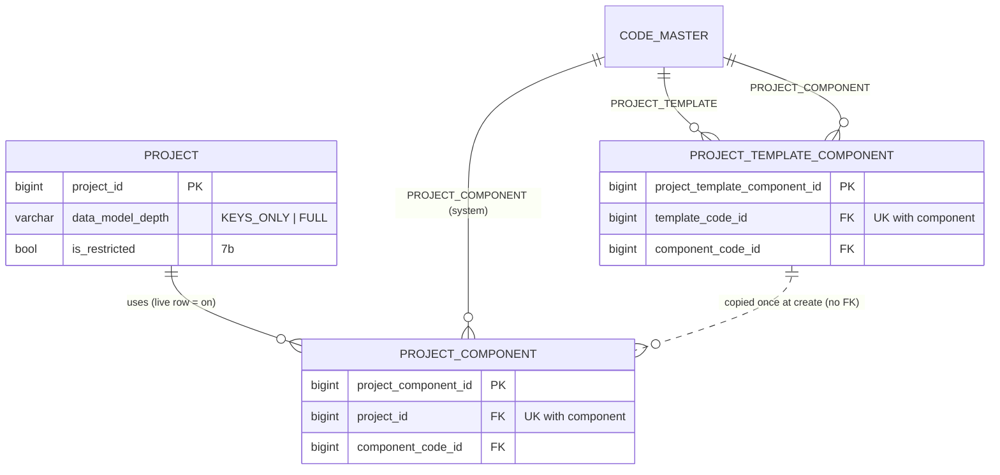
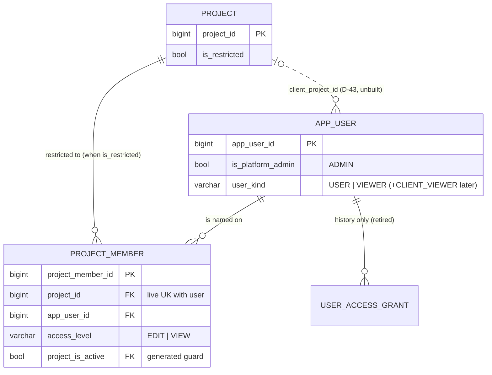
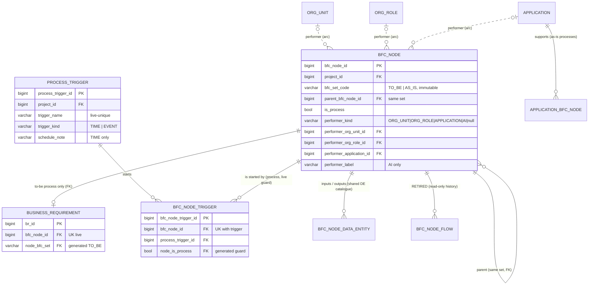

# Slice 7 — Project components, access, and the one DFD: physical schema spec

Author: `apple` · 2026-10-11 · source of truth: `docs/VB_design.md`. **The §1a block "Revision 2026-10-11 —
one platform, many kinds of project (D-37…D-49)" is authoritative.** It overrides D-9, D-11, D-20…D-22,
D-24's lane wording, D-25's edges, D-31, D-32, R2-D9 (lane rule), A-46, Q10, Q16, §4.1a, §4.7 and §7.8
where they disagree. **No redesign.** Where the design is silent once a choice is made physical, the
choice here is **proposed** and marked **[Q-n]** (§10). **Ben, 2026-10-11: all [Q-n] accepted as recommended** (design §1a, S7-1), with the amendments S7-2…S7-6.

Scope, in the wave order of the revision's delivery table:

| Part | Wave | Decisions | Tables |
|---|---|---|---|
| **7a** components and data model depth | 1a | D-37, D-39, OR-1…OR-3 | `project_component`, `project_template_component`; `project.data_model_depth` |
| **7b** access | 1b | D-40, OR-5, OR-6; D-43 shaped, **not built** | `project_member`; `app_user.user_kind`, `project.is_restricted`; `user_access_grant` retired |
| **7c** the DFD rework | 1c | D-38, D-46, D-47, D-49 | `process_trigger`, `bfc_node_trigger`; `bfc_node.bfc_set_code` + performer arc; `business_requirement` to-be guard; `bfc_node_flow` retired |

**Out:** the baseline freeze (1d; only its freeze-set deltas are listed here), the flow-file import (1e; its
file contract is fixed in §9.9 and its `import_row` migration is owed to that slice), PDF (D-42), WBS
progress (D-41), languages (D-44), client login and the offline file (D-43; the shape is in §8.7).
Dialect **PostgreSQL 16**. House conventions follow `slice6b_schema.md` / `slice6c_schema.md`: identity
PKs, S1-5 surrogate PK on link rows with the design key as a UNIQUE, `(id, project_id)` composite FKs,
S1-4 category columns, `AuditMixin` + `updated_at_trigger()`, every FK `NO ACTION`, partial and expression
indexes in raw `op.execute`. Head before this slice is **0031**.

---

# Part 7a — Project components and data model depth

## 1. The component vocabulary (`code_master`, seeded)

**Category `PROJECT_COMPONENT`, `is_system = true`, global only (no project override)** [Q-2]. The code may
branch on these codes, as it does on `SOLUTION_CATEGORY` (S5-4) and `APP_LIFECYCLE`: a system category
cannot be renamed or retired by a project, so VB law 5 ("branch on behaviour, never on a code") is not
engaged. Law 5 targets project-editable vocabularies (FR type, RACI).

| Code | Label | Built today | Requires (OR-2) [Q-3, Q-4] | Its live rows, for the switch-off test (OR-1) [Q-6] |
|---|---|:--:|---|---|
| `SOLUTION` | Solutions | ✓ | — | live `solution` |
| `FUNCTION_REQUIREMENT` | Function requirements | ✓ | — | live `function_requirement` |
| `APPLICATION` | Applications & interfaces | ✓ | — (interface routes also need `FUNCTION_REQUIREMENT`, [Q-4]) | live `application` |
| `EFFORT` | Effort & rate card | ✓ | `FUNCTION_REQUIREMENT` | live FRs with `complexity_code_id IS NOT NULL`. The rate card is configuration, not scope, and is seeded for every project, so it never blocks |
| `ISSUE` | Issues | — | — | live `issue` (when built) |
| `TO_BE_DFD` | To-be DFD | ✓ (7c) | — | on **to-be** processes: live `bfc_node_trigger`, live `bfc_node_external_flow`, a non-null performer |
| `AS_IS` | As-is BFC + DFD | ✓ (7c) | — | live `bfc_node WHERE bfc_set_code = 'AS_IS'` |
| `WBS` | WBS | — | — | live `wbs_item` (when built) |
| `BENEFIT` | Benefits | — | `SOLUTION` | live `benefit` (when built) |
| `RISK` | Risks | — | — | live `risk` (when built) |
| `CHANGE_REQUEST` | Change requests | — | `EFFORT` (D-16: priced before decided) | live `change_request` (when built) |

**Always on, never a component:** the to-be BFC, business requirements and their CRUD, step I/O (D-24, it
belongs to the BR), RACI links, data entities and fields, the org chart, external entities, stakeholders.
D-47: "a project with neither DFD component still has the to-be BFC, because BRs hang off it".

The two maps (requires, live rows) are code constants in `services/components.py`: `COMPONENT_REQUIRES` and
`COMPONENT_ROWS` [Q-3]. A dependency exists because code reads another component's tables, so it is a code
fact. Templates are data (OR-3).

**Category `PROJECT_TEMPLATE`** (global only, `is_system = false`, labels editable in code maintenance 1g):
`REQUIREMENTS_ONLY`, `DATA_AND_PROCESS`, `FULL_DELIVERY` [Q-5].

## 2. `project_component` — one row per component switched on for one project

| Column | Type | Null | Default | FK | Description |
|---|---|---|---|---|---|
| `project_component_id` | bigint identity | NO | identity | — | PK. Stable `source_id` for the baseline shadow |
| `project_id` | bigint | NO | — | → `project` | from the route, never the body |
| `component_code_id` | bigint | NO | — | category FK | `PROJECT_COMPONENT` |
| `component_category` | varchar(40) | NO\* | GENERATED `'PROJECT_COMPONENT'` | category FK | S1-4 |
| + `AuditMixin` | | | | | law 3. **A live row means "on"; a retired row means "off"** [Q-1] |

\* stored constant, never NULL.

- **Keys:** PK `project_component_id`. UK `uq_project_component (project_id, component_code_id)` **full**.
  Switching a component back on **restores** the same row (S1-7), so its baseline `source_id` stays stable.
- **FKs:** `project_id → project`; `fk_pc_component (component_code_id, component_category) → code_master
  (uq_code_category_target)` ON UPDATE NO ACTION.
- **Indexes:** the UK (leading `project_id`) serves `require_on` and `purge_project`; `ix_pc_component
  (component_code_id)`.
- **Lifecycle:** both FKs point at `EXCLUDED_TARGETS` (`project`, `code_master`), so `lifecycle._links()`
  derives no Link. **Not** `RESTORABLE` through the generic restore route: on/off goes only through
  `set_components` (§5.1), which audits it.
- **Grants:** default (SELECT/INSERT/UPDATE). No DELETE.

## 3. `project_template_component` — one row per (template × component), global

| Column | Type | Null | Default | FK | Description |
|---|---|---|---|---|---|
| `project_template_component_id` | bigint identity | NO | identity | — | PK |
| `template_code_id` | bigint | NO | — | category FK | `PROJECT_TEMPLATE` |
| `template_category` | varchar(40) | NO\* | GENERATED `'PROJECT_TEMPLATE'` | | S1-4 |
| `component_code_id` | bigint | NO | — | category FK | `PROJECT_COMPONENT` |
| `component_category` | varchar(40) | NO\* | GENERATED `'PROJECT_COMPONENT'` | | S1-4 |
| + `AuditMixin` | | | | | **`created_by` nullable**, as on `code_master` (seeded rows have no author; deviation 7, landmine 4) [Q-5] |

- UK `uq_ptc_grain (template_code_id, component_code_id)` full; `ix_ptc_component (component_code_id)`.
- **No `project_id`.** A template is a starting point, copied once into `project_component` at
  `create_project` and never linked afterwards (as control-rule house defaults, criterion 79). The project
  does not record its template; the `PROJECT_CREATED` audit detail does.
- **Seeded contents** (`seeds/seed_project_templates.py`, idempotent, never in Alembic) [Q-5]:

| Template | Components |
|---|---|
| `REQUIREMENTS_ONLY` | `ISSUE` |
| `DATA_AND_PROCESS` | `TO_BE_DFD`, `AS_IS`, `APPLICATION`, `ISSUE` |
| `FULL_DELIVERY` | `SOLUTION`, `FUNCTION_REQUIREMENT`, `APPLICATION`, `EFFORT`, `ISSUE`, `TO_BE_DFD`, `BENEFIT`, `RISK`, `CHANGE_REQUEST`, `WBS` |

`AS_IS` is in no template except Data & process: D-47 says it "is always going to be optional".

## 4. `project.data_model_depth` (D-39)

| Column | Type | Null | Default | Description |
|---|---|---|---|---|
| `data_model_depth` | varchar(10) | NO | `'FULL'` | `ck_project_depth CHECK (data_model_depth IN ('KEYS_ONLY', 'FULL'))` [Q-8] |

A CHECK-listed column, not a `code_master` FK (S2-1 precedent: a fixed, two-value vocabulary that the code
branches on). The server default fills existing projects with `FULL`, which is today's behaviour, and it
stays as the default for a create body that omits it. Readers, all through one helper
`components.depth(project)`:

| Reader | `KEYS_ONLY` | `FULL` |
|---|---|---|
| `validate_entity_model` | warns: no PK field; FK to an entity with no PK | the same, **plus** "has keys but no other attributes" |
| consistency line `entities_without_fields` (S4-12 freeze warning) | warns (no fields = no keys either) | warns |
| new consistency line `entities_keys_only` (WARNINGS set) | never listed | listed |
| ERD, import preview | no "attributes missing" hint | hint |

Extra fields are always accepted (D-39).

## 5. Service and guard contract

### 5.1 `services/components.py` — the one owner of "is this component on"

```python
COMPONENT_REQUIRES = {"EFFORT": {"FUNCTION_REQUIREMENT"}, "BENEFIT": {"SOLUTION"},
                      "CHANGE_REQUEST": {"EFFORT"}}                     # [Q-3]; closure is transitive
COMPONENT_ROWS = {...}                                                 # §1 last column, as select()s

def enabled(db, project_id) -> frozenset[str]                          # codes of live rows
def require_on(db, project_id, codes: str | tuple[str, ...]) -> None:
    # SELECT ... FROM project_component JOIN code_master ... WHERE is_active ... FOR SHARE
    # Missing any → 409 {"detail": "<label> is not used on this project", X-VB-Error: COMPONENT_OFF}
def closure(codes) -> set[str]                                          # codes ∪ everything they need
def set_components(db, actor, project, wanted: set[str], confirm_hash: str | None) -> dict
def depth(project) -> str
```

**`require_on` locks FOR SHARE** (not KEY SHARE: switch-off updates `is_active`, a non-key column, which
KEY SHARE would not block). It runs in the request's session, so the lock is held until the handler
commits. A write and a switch-off therefore serialise. If the switch-off wins, the writer's re-checked row
is no longer live and it gets 409. If the writer wins, the switch-off's live-row count sees the new row and
refuses.

**`set_components`** (`PUT /projects/{project_id}/components`, platform admin) [Q-10]. The body is the
**whole wanted set** plus `confirm_hash | null`:
1. `turn_on = closure(wanted) − enabled`, `turn_off = enabled − closure(wanted)`.
2. For each code in `turn_off`: still required by a component that stays on → blocker "Effort needs
   Function requirements". Any `COMPONENT_ROWS[code]` live → blocker naming up to 10 rows plus a count, as
   `soft_delete` does (OR-1, R2-D2).
3. With no `confirm_hash`, return `{turn_on, added_by_dependency, turn_off, blockers, confirm_hash}` and
   write nothing. OR-2 says "the admin is shown the list first".
4. With a hash: lock the project's `project_component` rows FOR UPDATE, re-run 1–2, and compare the hash
   (409 if it changed). Any blocker → 409 naming them. Otherwise insert or restore the `turn_on` rows,
   retire the `turn_off` rows, and write **one** `PROJECT_COMPONENTS_CHANGED` audit event `{on: [...],
   off: [...], added_by_dependency: [...]}`. One commit.

**`create_project`** gains `component_codes: list[str]` (required), `template_code: str | null` (audit
provenance only) and `data_model_depth`. A list that is not closed under `COMPONENT_REQUIRES` → **422
naming the missing dependency**. The UI pre-fills the list from the template and shows what is added, so
the server never adds anything silently. The rows are inserted in the same transaction as the ten number
series and the rate card (R2-D14). `PROJECT_CREATED` detail gains `{template_code, components,
data_model_depth}`.

### 5.2 The guard: a `component` argument, still one guard per route [Q-7]

`routers/guards.py` keeps its six guard kinds. `project_ctx` and `object_guard` gain an optional argument.
**No `component_ctx` guard kind is added.** A second guard on a route would break "exactly one guard"
(criterion 49), and a guard kind of its own could not also do the project check.

```python
def project_ctx(min_level, component: str | tuple[str, ...] | None = None) -> GuardSpec
def object_guard(model, min_level, id_param="id",
                 component: str | tuple | Callable[[obj], str | tuple | None] | None = None) -> GuardSpec
# both pass it to access.require_project(db, user, project_id, min_level, component=...)
# the marker gains it:  openapi_extra[GUARD_KEY]["component"] = <code(s)> | "<resolver>" | None
```

- **The check lives inside `require_project`**, after the visibility check (404) and the level check
  (403). **The order 404 → 403 → 409 is fixed**: a project you cannot see never reveals which components it
  uses.
- **Only writes are component-gated.** `component` is applied only when `min_level ≥ EDIT`. Reads stay
  open: an off component has no live rows (OR-1), and the UI hides it.
- **A platform admin is gated too** [Q-20]. The rule is about the project's scope, not the person. An
  admin who needs to write switches the component on, and that is audited.
- **A resolver** handles routes whose component depends on the row. `object_guard(BfcNode, "EDIT",
  component=set_component)` with `set_component(node) = "AS_IS" if node.bfc_set_code == "AS_IS" else None`
  (7c). Where the component depends on the **body** (create a node in a named set, an import target), the
  service calls `components.require_on` itself. That is still the one function, and `bulk.Target` gains a
  `component` attribute that `validate` and `commit` check.
- **Criterion 49 gains one assertion (49b):** every non-GET route of a router that `ROUTER_COMPONENTS`
  (in the test) maps to a component declares that component in its marker. A forgotten declaration
  therefore fails CI, as a forgotten guard already does.

| Router / route family | `component` |
|---|---|
| solutions, `br_solution` links | `SOLUTION` |
| function requirements (CRUD, link to solution) | `FUNCTION_REQUIREMENT` |
| FR complexity, `PUT rate-card` | `EFFORT` |
| applications, `application_solution` | `APPLICATION` (+ `SOLUTION` for the allocation link) |
| FR interface detail | `("FUNCTION_REQUIREMENT", "APPLICATION")` [Q-4] |
| as-is support link (`application_bfc_node`) | `("APPLICATION", "AS_IS")` |
| BFC node writes, performer, trigger links, external flows | resolver on the node's set (7c §9.4, §9.5) |
| trigger catalogue | resolver: either DFD component on [Q-28] |
| imports | `Target.component` (DE/DF/BR: none; FR: `FUNCTION_REQUIREMENT`; flow file: the anchor's set) |

### 5.3 Backfill: existing projects keep every component on [Q-9]

The rows reference `code_master` codes, and those codes are seeded **after** `alembic upgrade head`. So the
backfill cannot run inside a migration. It is a seed command, the 6c pattern (`seed_effort_rate`):
`python -m seeds.seed_project_components --actor-email <platform admin>`. For every project, it inserts a
live row for each of the **eleven** codes that is missing. It never retires a row, it is idempotent, and it
writes one `PROJECT_COMPONENTS_BACKFILLED` audit event per project. Order on every database: `alembic
upgrade head` → `seeds.seed_code_master` → `seeds.seed_project_templates` → `seeds.seed_project_components`.
The test harness needs nothing new, because it creates projects through `create_project`.

## 6. ER fragment (7a)



## 7. Migrations, freeze set, risks (7a)

| Rev | Creates | Depends on |
|---|---|---|
| **0032** | `project.data_model_depth` varchar(10) NOT NULL DEFAULT `'FULL'` + `ck_project_depth` | `project` |
| **0033** | `project_component`: generated category, PK, `uq_project_component`, 2 FKs, `ix_pc_component`, `updated_at_trigger` | `code_master` (`uq_code_category_target`) |
| **0034** | `project_template_component`: 2 generated categories, PK, UK, 2 code FKs, index, trigger; `created_by` nullable | `code_master` |

- **Downgrades:** 0034 and 0033 drop the trigger, then the table. 0032 drops the CHECK, then the column.
  None is destructive before a project has switched a component **off**. After that, 0033's downgrade loses
  the scope decision, so it pauses for Ben.
- **Seeds:** `seed_code_master.py` gains `PROJECT_COMPONENT` (system) and `PROJECT_TEMPLATE`. New:
  `seeds/seed_project_templates.py`, `seeds/seed_project_components.py`.
- **Models:** `ProjectComponent`, `ProjectTemplateComponent` in `models/tenancy.py`, exported from
  `models/__init__.py` (law 10). `owning_project_id()` on `ProjectComponent`.
- **Freeze set (owed to 1d):** **+ `project_component`** (the components in scope at that freeze are part of
  what was agreed). The `baseline` header copies `data_model_depth`. The freeze filters `FREEZE_SET` by
  `components.enabled()` through a table → component map that lives beside `COMPONENT_ROWS` (D-37: "a
  baseline freezes only the components that are on"). The priced diff appears only when `EFFORT` was on
  in both baselines. `project_template_component` is never frozen.
- **Risks.**
  1. **The backfill window.** Between the migration and `seed_project_components`, existing projects have
     no components, so every gated write returns 409. This is loud and safe. The deploy runbook lists the
     seed step.
  2. **A route that forgets its component** returns a successful write on an off component. Criterion 49b
     is the structural answer. Without it, this is a promise.
  3. **Reads of an off component** return retired rows if a screen asks. This is accepted: there is nothing
     live to leak, and the UI hides the component.
  4. **Unbuilt components can be switched on.** They are harmless, and the admin screen marks them "not yet
     available".
  5. **Switching `TO_BE_DFD` off needs performers cleared first**, which may be many edits. The 409 lists
     them, and a later "clear performers under this node" bulk action would help.

---

# Part 7b — Access: admin / user / viewer, restricted projects

## 8.1 What changes

| Today (D-9, D-32) | After 7b (D-40, OR-5, OR-6) |
|---|---|
| `is_platform_admin`, plus one grant per user (OWNER / EDITOR / REVIEWER) over one project or one program | `is_platform_admin` (unchanged) + **`app_user.user_kind` ∈ USER / VIEWER** |
| A user sees only their granted project or program | Staff see **every live project**, except **restricted** ones they are not a member of |
| The project is the data wall between staff | The wall survives only for `project.is_restricted` (OR-6) and, later, client viewers (D-43) |
| `user_access_grant` | **retired**: live rows soft-revoked, INSERT/UPDATE revoked from `vb_app`, kept as history [Q-13] |
| Program grant → roll-up | Every staff user sees roll-ups, over the projects visible to them [Q-19] |

Levels, ranked: **`VIEW` < `EDIT` < `ADMIN`**. Only `is_platform_admin` reaches `ADMIN`. `min_role` is
renamed **`min_level`** throughout `guards.py`, `access.py` and the marker [Q-18]: the vocabulary is
changing anyway, and law 7's ban on the bare word `role` is better served by `level`.

## 8.2 `app_user` — new column

| Column | Type | Null | Default | Description |
|---|---|---|---|---|
| `user_kind` | varchar(20) | NO | `'VIEWER'` | `ck_app_user_kind CHECK (user_kind IN ('USER', 'VIEWER'))` [Q-11]. Read from the row on every request, like `is_platform_admin` (S4). `is_platform_admin = true` overrides it; it applies again if the flag is revoked |

- `create_user` requires `user_kind` in the body (no API default). The DB default is the least privilege.
  `PATCH /users/{id}` changes it (platform admin), and writes `USER_KIND_CHANGED {from, to}`.
- **Data step in the same migration** (pure SQL): `user_kind = 'USER'` for admins and for users whose live
  grant's code is OWNER or EDITOR. Everyone else stays `VIEWER` (REVIEWER holders, and users with no grant
  who, under D-40, would otherwise jump from "nothing" to "edit everything"). The migration prints the
  per-kind counts. The admin reviews them in Users.
- Not `AuditMixin` (it never was, landmine 4 family). `updated_by` and `row_version` cover the change.

## 8.3 `project.is_restricted`

| Column | Type | Null | Default | Description |
|---|---|---|---|---|
| `is_restricted` | boolean | NO | `false` | OR-6: off by default. Read per request, so the change applies on the next request |

Set or cleared only by `PUT /projects/{project_id}/restriction` (`project_ctx("ADMIN")`) through a
**preview → confirm** pair (the R2-S3 pattern) [Q-16]. The preview names everyone who **loses** access
(restricting: every non-admin staff user with no live membership) or **gains** it (unrestricting). A stale
`confirm_hash` → 409. One `PROJECT_RESTRICTED` / `PROJECT_UNRESTRICTED` audit event carries the member
list at that moment.

## 8.4 `project_member` — a named member of a project, with a level (OR-6)

| Column | Type | Null | Default | FK | Description |
|---|---|---|---|---|---|
| `project_member_id` | bigint identity | NO | identity | — | PK |
| `project_id` | bigint | NO | — | → `project`; live guard | |
| `project_is_active` | boolean | YES | GENERATED `CASE WHEN is_active THEN TRUE END` | guard FK | `vb_ops.live_guard`. Mirrors `user_access_grant.scope_is_active` |
| `app_user_id` | bigint | NO | — | → `app_user` | |
| `access_level` | varchar(4) | NO | — | — | `ck_pm_level CHECK (access_level IN ('EDIT', 'VIEW'))` |
| `member_note` | text | YES | — | — | why they are on it ("client NDA signatory") |
| + `AuditMixin` | | | | | `created_by` = who added them; `created_at` = when |

- **Keys:** PK. Partial UK `uq_pm_live (project_id, app_user_id) WHERE is_active` [Q-14]. **Re-adding
  inserts a new row.** Each membership period is its own row. This is history, not a link to restore, and
  it keeps R2-S5 ("access returns only through the add route, never restore").
- **FKs:** `project_id → project`; `fk_pm_live_project (project_id, project_is_active) → project
  (project_id, is_active)` (`uq_project_live`) ON UPDATE NO ACTION, so a live membership blocks retiring
  its project, exactly as a live grant does today. `app_user_id → app_user`.
- **CHECK** `ck_pm_note_not_blank (member_note IS NULL OR btrim(member_note) <> '')`.
- **Indexes:** `ix_pm_user_live (app_user_id) WHERE is_active` (serves `visible_project_ids`); the UK
  serves the project side.
- **Effective level** = `min(cap(user_kind), access_level)`, with `cap(USER) = EDIT` and `cap(VIEWER) =
  VIEW`. A VIEWER added at EDIT reads only. The add route warns.
- **Membership on an unrestricted project is allowed and has no effect** [Q-14]. That lets an admin
  prepare the list before restricting. The project page says "Members (applies when restricted)".
- **Routes** (all admin, D-40: access is an admin function) [Q-17]: `GET/POST
  /projects/{project_id}/members` (`project_ctx("ADMIN")`), `PATCH/DELETE /project-members/{id}`
  (`object_guard(ProjectMember, "ADMIN")`). Audit: `MEMBER_ADDED`, `MEMBER_LEVEL_CHANGED {from, to}`,
  `MEMBER_REMOVED`. `DELETE` = soft-remove (law 1). Not `RESTORABLE`.
- **Never baselined.** Access is not scope.

## 8.5 `user_access_grant` and its rows [Q-13, Q-15]

**Retired, not repurposed.** Repurposing it would mean dropping the one-live-per-user index, banning
`program_id` on new rows, re-coding OWNER/EDITOR/REVIEWER as EDIT/VIEW, and changing what a row *means*
(it would no longer add visibility; it would only lift a restriction), all in a table whose existing rows
mean the old thing. A table whose rows change meaning in place is a table whose history lies. Instead:

1. **0037 copies** every live grant into `project_member` **before** anything is revoked: a project grant
   becomes one member row, and a program grant becomes one row per active project of the program.
   OWNER/EDITOR → `EDIT`, REVIEWER → `VIEW`. `created_by` = the grant's `granted_by_user_id`, and
   `member_note` = `'from grant #<id> (D-40)'`. These rows have no effect until an admin restricts the
   project, and they preserve "who was on this engagement".
2. **0038 soft-revokes** every live grant (`is_active = false`, `deleted_at = now()`, `deleted_by` NULL:
   no actor in a migration). It writes one `ACCESS_REVOKED` audit event per grant, `{reason: "D-40",
   migration: "0038", user_id, project_id | program_id, role}`, with `app_user_id` NULL. It then runs
   **`REVOKE INSERT, UPDATE ON user_access_grant FROM vb_app`**. The table, model and rows stay readable:
   audit events and the effective-access history point at them.
3. `seed_code_master` adds `PROJECT_ROLE` to `RETIRED_CATEGORIES`. The codes stay (old grants reference
   them), live = false.
4. Routes removed: grant, reassign, revoke, and the program grant routes. `GET
   /projects/{project_id}/access` stays, as the effective list (§8.6).

**Program grants** go with the rest (step 2). Programs stay as client-scoped roll-up groupings (D-40).
**Audit of grants:** the old event types (`ACCESS_GRANTED`, `ACCESS_ROLE_CHANGED`, `ACCESS_REASSIGNED`,
`ACCESS_REVOKED`) are never written again. The new ones are `MEMBER_*`, `USER_KIND_CHANGED` and
`PROJECT_(UN)RESTRICTED`. The access review at each freeze (§4.7 manual row) reads `effective_access`.

## 8.6 The new access contract (`services/access.py`, still the one owner)

```python
LEVEL_RANK = {"VIEW": 1, "EDIT": 2, "ADMIN": 3}
KIND_CAP   = {"USER": "EDIT", "VIEWER": "VIEW"}          # + "CLIENT_VIEWER": "VIEW" with D-43 (§8.7)

@dataclass(frozen=True)
class EffectiveAccess:
    level: str            # VIEW / EDIT / ADMIN
    via: str              # PLATFORM_ADMIN / STAFF / MEMBER  (+ CLIENT with D-43)
    member: ProjectMember | None
```

```
visible_project_ids(user) -> set[int] | None:             # None = ALL
    if user.is_platform_admin: return None
    # [D-43, unbuilt] if user.user_kind == CLIENT_VIEWER: return {client_project_id} if live and consented else ∅
    open    = {p.project_id | p.is_active and not p.is_restricted}
    members = {m.project_id | m.app_user_id = user and m.is_active
                              and m.project.is_active and m.project.is_restricted}
    return open ∪ members          # read per request: restricting a project hides it on the next request

require_project(user, project_id, min_level, component=None) -> EffectiveAccess:
    p = PROJECT(project_id)
    if user.is_platform_admin:
        if p is None: raise 404
        eff = EffectiveAccess("ADMIN", "PLATFORM_ADMIN", None)
    else:
        if p is None or not p.is_active: raise 404
        # [D-43] if user.user_kind == CLIENT_VIEWER: project_id == user.client_project_id and consent, else 404
        if p.is_restricted:
            m = live project_member(p, user)
            if m is None: raise 404                       # not 403: a project you cannot see does not exist
            eff = EffectiveAccess(lower_of(KIND_CAP[user.user_kind], m.access_level), "MEMBER", m)
        else:
            eff = EffectiveAccess(KIND_CAP[user.user_kind], "STAFF", None)
    if LEVEL_RANK[eff.level] < LEVEL_RANK[min_level]: raise 403
    if component is not None and LEVEL_RANK[min_level] >= LEVEL_RANK["EDIT"]:
        components.require_on(db, project_id, component)   # 409 COMPONENT_OFF (7a §5.2)
    return eff

require_program(user, program_id, min_level):
    g = PROGRAM(program_id)
    if g is None or (not g.is_active and not user.is_platform_admin): raise 404
    # [D-43] client viewers: always 404
    level = "ADMIN" if user.is_platform_admin else KIND_CAP[user.user_kind]
    if LEVEL_RANK[level] < LEVEL_RANK[min_level]: raise 403
    return EffectiveAccess(level, ...)
    # roll-ups still call each per-project report for program_projects(user) = visible ∩ program (R2-S2);
    # a restricted project the caller is not on is omitted silently — no "1 hidden" count, which would leak it

visible_program_ids(user): None for admins; every live program for staff; ∅ for client viewers [D-43]

effective_access(project):        # GET /projects/{project_id}/access, project_ctx("ADMIN")
    admins + (members, each with capped level   if project.is_restricted
              else  "all staff": counts by kind, + any members listed as "applies when restricted")
```

`describe_scope` and `/auth/me` return `{is_platform_admin, user_kind}`. `useCanEdit` reads the project's
`my_access_level` (added to `GET /projects/{project_id}`, computed by `require_project`) and the project's
`components`. It is presentation only, and the guards still refuse.

**Capability mapping of today's OWNER-only operations** [Q-17]:

| Operation | Today | After |
|---|---|---|
| Read, export, download | REVIEWER | `VIEW` |
| Create / edit / retire / restore / reorder / import / commit | EDITOR | `EDIT` |
| **Freeze a baseline** (criteria 35, 48) | OWNER | `EDIT` (a User; D-40 lists no freeze among admin functions) |
| Rate card (S6c-3), project code overrides, control-rule thresholds (criterion 80), FR types (criterion 101) | OWNER (+EDITOR for rate card) | `EDIT` |
| Members, restriction, components, data model depth, effective-access list | OWNER / platform admin | `ADMIN` |
| Users, user kind, clients, projects, programs, move project, global codes | platform admin | `ADMIN` (unchanged) |
| Offline viewer file (OR-9, later) | — | `EDIT`, never `VIEW` |

`move_project_program` keeps its two steps (R2-S3), but `gains` and `loses` are now always empty. Moving a
project changes roll-ups, not access. The preview shows the roll-up change, and the hash covers from/to.

## 8.7 Client viewer (D-43) — designed now, **built with the D-43 slice** [Q-12]

The design is fixed now, but no migration is written in 7b. A column that a CHECK forbids would only add
an untestable code path. When D-43 is built:

| Change | Shape |
|---|---|
| `app_user.user_kind` | CHECK widened to `('USER', 'VIEWER', 'CLIENT_VIEWER')` |
| `app_user.client_project_id` | bigint NULL, `fk_app_user_client_project → project`; `ck_app_user_client_binding CHECK ((user_kind = 'CLIENT_VIEWER') = (client_project_id IS NOT NULL))`; `ck_app_user_client_not_admin CHECK (user_kind <> 'CLIENT_VIEWER' OR NOT is_platform_admin)` |
| why a column | **"Exactly one project" holds by construction**: a scalar cannot hold two. A membership row could. No membership row, grant or program can widen a client viewer, because `require_project`'s client branch reads only this column and returns before the staff branch. `project_member` refuses a `CLIENT_VIEWER` user (service) |
| consent | a separate `project_client_consent` (who agreed, when, withdrawn_at), owed to D-43 |
| `create_user` | the non-FTC-domain refusal (D-11, criterion 53) becomes "external address ⇒ `CLIENT_VIEWER` with a consented project" |

## 8.8 Tests and acceptance criteria this changes

**Rewritten (the model they test is gone):** `tests/test_access.py`, all 15 tests:
`test_gate2_grant_and_see`, `test_program_grant_sees_every_project_in_program`,
`test_project_grant_sees_no_program_rollup`, `test_one_grant_per_user`,
`test_program_owner_grants_inside_not_outside`, `test_editor_cannot_grant_and_admin_needs_no_grant`,
`test_effective_access_lists_program_derived`, `test_revoke_then_invisible_and_not_restorable`,
`test_revoke_route_is_404_for_other_projects`, `test_deactivation_takes_effect_on_next_request` (kept in
substance), `test_move_project_needs_preview_then_confirm`, `test_non_admin_cannot_create_projects_or_move`
(kept), `test_admin_gets_404_for_missing_program_and_wrong_program_detach` (kept),
`test_revoke_records_who_and_when`, `test_platform_admin_is_a_separate_audited_act` (kept).

**Fixtures and call sites to move from grants to `user_kind` / membership:** `tests/conftest.py::world`
(users created without a kind; `POST /users` now needs `user_kind`), `tests/test_scope_api.py` `ed` fixture
(lines 12–13: EDITOR/REVIEWER grants → USER/VIEWER kinds), `tests/test_bulk_import.py:291` (grant call),
`tests/test_effort_api.py` (the "EDITOR" comment at 226 and any OWNER-guarded rate route),
`tests/test_bulk_import_fields.py:493` (REVIEWER export → VIEWER), `tests/test_foundation.py:100–109`
`test_second_live_grant_refused_by_database` (replace with "`vb_app` cannot INSERT into
`user_access_grant`" and "two live memberships of one user on one project are refused"),
`tests/test_route_guards.py:83` (`min_role` → `min_level`, plus criterion 49b). `seeds/seed_demo.py:88`
calls `grant_access` (→ `user_kind` + optional members).

**Acceptance criteria superseded or reworded** (§10): **18** (no grant → 404 becomes "a non-member of a
*restricted* project gets 404, and it is absent from `GET /projects`"; plus a new criterion: "a VIEWER sees
every unrestricted project"), **19** (REVIEWER → VIEWER, 403 on every write), **35** and **48** (freeze is
`EDIT`; "refused to an EDITOR" becomes "refused to a VIEWER"), **50** and **135** ("not granted" → "a
restricted project the caller is not on"), **53** (kept: no client account can be created until D-43),
**54** ("revoking a grant" → "removing a member"), **80** and **101** (OWNER → User), **136** (no restore
route for a membership), **139**, **140**, **141**, **142**, **143**, **150**, **153** (one-grant,
program-grant and Q16 rules, all retired; 141 keeps "only an admin moves a project"; 142 keeps "roll-ups
are N per-project calls, no `project_id IN` in `services/program.py`"). New criteria proposed: restricting
previews losers and then hides the project on the next request; a VIEWER member at EDIT still gets 403 on
writes; an off component's write returns 409 after 404/403 are decided (7a).

## 8.9 ER fragment (7b)



## 8.10 Migrations, freeze set, risks (7b)

| Rev | Creates / changes | Depends on |
|---|---|---|
| **0035** | `app_user.user_kind` NOT NULL DEFAULT `'VIEWER'` + data step (USER for admins and OWNER/EDITOR holders) + `ck_app_user_kind` | `user_access_grant`, `code_master` (read) |
| **0036** | `project.is_restricted` boolean NOT NULL DEFAULT false | `project` |
| **0037** | `project_member` (PK, live UK, guard column + FK, CHECKs, indexes, trigger) + data step copying live grants (§8.5 step 1) | 0036, `uq_project_live` |
| **0038** | **data step**: soft-revoke every live `user_access_grant` with one `ACCESS_REVOKED` audit row each; `REVOKE INSERT, UPDATE ON user_access_grant FROM vb_app` | 0037 |

- **Downgrades:** 0038 re-GRANTs but does **not** re-activate grants (a revoke is evidence). **0038 pauses
  for Ben**: in effect it is a one-way change of who can see what. 0037 drops the table (the copied rows
  go; the grants still hold the facts). 0036 and 0035 drop their columns. Each is reversible as schema.
- **Grant test:** the `vb_app` privilege test asserts `user_access_grant` is SELECT-only.
- **Seeds:** `PROJECT_ROLE` → `RETIRED_CATEGORIES`.
- **Models:** `ProjectMember` in `models/identity.py` (exported, law 10); `AppUser.user_kind`;
  `Project.is_restricted`. `UserAccessGrant` stays, read-only, docstring "retired by D-40".
- **Freeze set:** no change. Access is not scope.
- **Risks.**
  1. **D-40's cost, restated:** every staff user can read every unrestricted client's data. The only
     technical control left is `is_restricted`, and forgetting to set it is not caught. **Mitigation:**
     the create-project form asks "Restricted?" with no default selected, and the answer is in
     `PROJECT_CREATED`.
  2. **Leak paths for restricted projects** are any query not filtered through `visible_project_ids` /
     `require_project`: program roll-ups (already filtered), `GET /projects`, search, audit-event lists,
     import batch lists, user-admin pages that list projects, operator-mode `consistency_check(None)`.
     `sara` walks each before commit. Criterion 49 still guarantees every route has a guard.
  3. **The 0035 backfill makes no-grant users VIEWERs.** Someone who should not see client data at all
     must be deactivated: there is no "staff with no access" state under D-40.
  4. **Program grant holders lose nothing visible** (they now see more), but program OWNERs lose
     granting. That is intended (Q16 retired).
  5. **Admin and restricted:** admins always see restricted projects (OR-6). There is no per-project
     exception for admins.

---

# Part 7c — The DFD rework: one diagram, two sets, performers, triggers

## 9.1 The two BFC sets (D-47) — `bfc_node.bfc_set_code` [Q-21]

**Recommendation: a set column on `bfc_node`, not a separate root table.** A set has no attributes of its
own (no name, owner or status). It is "which of the two trees". A `bfc_set` table would add a row per
project whose only content is its kind. The column keeps every existing composite-FK pattern, and the
column is immutable.

| Column | Type | Null | Default | Description |
|---|---|---|---|---|
| `bfc_set_code` | varchar(10) | NO | (none after backfill) | `ck_bfc_set CHECK (bfc_set_code IN ('TO_BE', 'AS_IS'))`. **Immutable** (service, plus the FKs below refuse a change while children or a BR exist) |

- **Same-set parentage, declaratively:** UK `uq_bfc_node_set (bfc_node_id, project_id, bfc_set_code)` and
  FK `fk_bfc_node_parent_set (parent_bfc_node_id, project_id, bfc_set_code) → bfc_node (uq_bfc_node_set)`
  ON UPDATE NO ACTION. A child is always in its parent's set. The existing `fk_bfc_node_parent` and
  `fk_bfc_node_parent_not_process` stay.
- **`lifecycle.GUARD_TARGET_COLUMNS` gains `"bfc_set_code"`.** Without it, `_links()` would derive a second
  Link for `fk_bfc_node_parent_set` and for the BR guard (§9.2), and every 409 would count those
  dependents twice (the 6b-2 §7 defect, again). A test asserts one Link per (child, parent, pairs).

**Impact on the existing BFC rules:**

| Rule | Today | After |
|---|---|---|
| `uq_bfc_hier_code_live (project_id, hier_code) WHERE is_active` | one tree | **`(project_id, bfc_set_code, hier_code)`**: both sets have an `01` |
| `uq_bfc_sibling_seq (project_id, parent, seq_no) NULLS NOT DISTINCT` (S1-1) | L1 roots share the NULL parent | **`(project_id, bfc_set_code, parent_bfc_node_id, seq_no)`**: each set has its own L1 row of positions |
| `ix_bfc_hier_pattern`, `ix_bfc_process_live` | per project | rebuilt with `bfc_set_code` after `project_id` |
| `uq_bfc_process_name (parent, lower(btrim(name)))` | — | **unchanged**: parents are per set, and L1 is never a process |
| Q1 sibling names (`bfc.assert_name_free`, `_children`) | parent or NULL | **`_children` must filter `bfc_set_code` when `parent_id IS NULL`**, or the two sets' L1 names would collide |
| `hier_code` derivation, two-phase renumber (S1-2) | per project | per set. `renumber_subtree` and **`process_flow.steps_under`** (the `hier_code` prefix query) add `bfc_set_code = node.bfc_set_code` |
| BR import identity (R2-D1) | BR number, `hier_code` cross-check | unchanged: BRs exist only in the to-be set (§9.2), so the cross-check reads to-be codes |
| Numbering | ten series | **unchanged**: as-is processes mint no number |
| UI | — | as-is codes show with an "As-is" badge. The stored code has no prefix, so diffs and MOVED stay per set |

## 9.2 Business requirements attach to the to-be set only (D-47 confirm item 2) [Q-22]

`business_requirement` gains `node_bfc_set` varchar(10) **GENERATED `'TO_BE'` STORED** and
`fk_br_node_to_be (bfc_node_id, project_id, node_bfc_set) → bfc_node (uq_bfc_node_set)` ON UPDATE NO
ACTION. A BR on an as-is node is impossible in the database, not only in the service.

- **D-2 is restated as "one BR per to-be process"** (contradiction noted in §11). `create_node` /
  `mark_process` create the BR **only when the node is to-be**. An as-is process has no BR, no BR CRUD and
  no solutions. Its step I/O is written directly through `ensure_step_io` (D-24's single writer is
  unchanged).
- `uq_br_one_per_node` and the 1:1 rule are unchanged. `consistency_check` "process nodes without a BR" and
  `flow_completeness.step_without_br` become **to-be only**.
- Solutions and FRs hang off BRs, so they are to-be by construction. A future `fr_bfc_node` (not built)
  must carry the same generated `'TO_BE'` guard.

## 9.3 Shared catalogue, copying, and as-is support (D-47 confirm items 1, 3, 4)

**(1) One data-entity catalogue per project, shared by both sets. Confirmed.** `bfc_node_data_entity`
already points at the project's `data_entity`. Nothing changes, and as-is and to-be flows compare on the
same `DE-` numbers. External entities, triggers (§9.5), org units and roles, and applications are shared in
the same way.

**(3) Copying one set to start the other. Confirmed, as a whole-tree copy into an empty set** [Q-24].
`POST /projects/{project_id}/bfc-sets/{to_set}/copy-from/{from_set}` (`project_ctx("EDIT",
component="AS_IS")`), with preview → confirm (`confirm_hash` over the source rows' versions). The target set
must have **no live node** (409 otherwise). Partial copies wait for a need. In one transaction:

| Copied | to-be → as-is | as-is → to-be |
|---|---|---|
| nodes (name, level, seq, `is_process`, purpose, description), with fresh ids and the same `hier_code` | ✓ | ✓ |
| performer (§9.4) | ✓ | ✓ |
| step I/O, external flows, trigger links, RACI step roles | ✓ | ✓ |
| `application_bfc_node` (supporting systems) | ✓ (they are as-is facts, §9.3(4)) | ✗ (to-be systems come from solutions, D-22) |
| BR | ✗ (as-is has none) | **a new DRAFT BR per process**, numbers minted at save (D-2) |
| BR CRUD, solutions, FRs | ✗ | ✗ |

The old → new id map goes into one `BFC_SET_COPIED` audit event. **No provenance column** [Q-24]: a
to-be process may merge or split as-is ones, so a 1:1 `copied_from` column would mislead the comparison it
was meant to serve. A comparison report can add a mapping table when it is specced. Bound: 2,000 processes
(A-35), synchronous.

**(4) The as-is support on a step (S6b-1) becomes the performer and the supporting systems of as-is
processes. Confirmed** [Q-23]:
- **Who does it** → the performer (§9.4). An IT system that *performs* is the performer of kind
  `APPLICATION`.
- **What supports a human performer** (the clerk in SAP) stays in **`application_bfc_node`**, unchanged in
  shape, still `OWNED_BY_STEP`. **New rows only on as-is processes** (service 422 on a to-be process: its
  systems come from BR → Solution → Application, D-22, D-8 "linking at both levels would be redundancy").
- **Existing rows** sit on nodes that the backfill makes to-be. They are left live. A new
  **INFORMATIONAL** consistency line `as_is_support_on_to_be` lists them, and the to-be → as-is copy carries
  them to the new as-is processes. The consultant then removes the to-be originals. No migration touches
  them, because there is no production data.

## 9.4 The performer: one per process (D-46) [Q-25]

**An exclusive arc of typed columns on `bfc_node`.** A link table would need a UNIQUE to give 1:0..1 and
would add a fourth step-owned table to retire and restore. The performer is a single-valued fact about the
process, so it belongs on the process row. It is frozen with it and diffs as a CHANGED field.

| Column | Type | Null | FK | Description |
|---|---|---|---|---|
| `performer_kind` | varchar(12) | YES | — | `ORG_UNIT` / `ORG_ROLE` / `APPLICATION` / `AI`. NULL = not yet assigned |
| `performer_org_unit_id` | bigint | YES | `(…, project_id) → org_unit (uq_org_unit_project)` | a department |
| `performer_org_role_id` | bigint | YES | `(…, project_id) → org_role (uq_org_role_project)` | a position |
| `performer_application_id` | bigint | YES | `(…, project_id) → application (uq_application_project)` | an IT system |
| `performer_label` | varchar(200) | YES | — | names an `AI` performer ("Invoice-matching agent"); allowed only for `AI` |

CHECKs:
```sql
ck_bfc_performer_kind    CHECK (performer_kind IS NULL OR performer_kind IN ('ORG_UNIT','ORG_ROLE','APPLICATION','AI'))
ck_bfc_performer_arc     CHECK (num_nonnulls(performer_org_unit_id, performer_org_role_id, performer_application_id)
                                = CASE WHEN performer_kind IN ('ORG_UNIT','ORG_ROLE','APPLICATION') THEN 1 ELSE 0 END
                            AND (performer_kind IS DISTINCT FROM 'ORG_UNIT'    OR performer_org_unit_id   IS NOT NULL)
                            AND (performer_kind IS DISTINCT FROM 'ORG_ROLE'    OR performer_org_role_id   IS NOT NULL)
                            AND (performer_kind IS DISTINCT FROM 'APPLICATION' OR performer_application_id IS NOT NULL))
ck_bfc_performer_label   CHECK (performer_label IS NULL OR (performer_kind = 'AI' AND btrim(performer_label) <> ''))
ck_bfc_performer_process CHECK (performer_kind IS NULL OR is_process)        -- like ck_bfc_desc_process_only
```
Indexes (for the FK_LIVENESS scans when an org unit, role or application retires): `ix_bfc_perf_unit
(performer_org_unit_id, project_id) WHERE performer_org_unit_id IS NOT NULL`, and the same for role and
application.

- **Kinds are a CHECK list, not `code_master`** (S2-1 precedent: fixed, drawn differently, branched on).
- **Liveness:** `lifecycle._links()` derives Links from the three FKs. **Retiring an org unit, role or
  application that performs a live process → 409 naming the processes** (R2-D2). Restoring a step whose
  performer was retired → "restore it first" through `inactive_parents`. Assignment refuses a retired
  target (409). Nothing about the performer changes `step_retire.OWNED`: it is a column.
- **Demotion:** the CHECK refuses demoting a process with a performer. `bfc._step_blockers` names it
  ("performer").
- **Zero performers is legal** while drafting. The step is drawn in the "unassigned" lane and listed in
  `process_completeness.no_performer` as a **warning that does not block the freeze** (D-46 does not make
  it blocking; contrast D-38).
- **Lifecycle of an application performer:** a `TO_BE` application performing an as-is process warns
  and is allowed (mirrors S6b-4).
- **Write route:** `PUT /bfc-nodes/{id}/performer` `{performer_kind, ref (code), performer_label,
  row_version}` → `object_guard(BfcNode, "EDIT", component=dfd_component)`, with `dfd_component(node) =
  "AS_IS" if as-is else "TO_BE_DFD"`. The body sends **codes** (`org_unit_code`, `org_role_code`,
  `application_code`), never ids. Audit `PERFORMER_SET {from, to}`.

**Relation to the RESPONSIBLE lane rule (R2-D9, A-46).** D-46 replaces it. RACI stays the record of
accountability:
- `uq_bnor_one_accountable` **stays**.
- **`uq_bnor_one_responsible` is dropped** [Q-26]. It existed only because "the one R is the lane". Normal
  RACI allows several R. Criterion 127's RESPONSIBLE half and criterion 149 are rewritten around the
  performer. A-60 ("a second RESPONSIBLE code while R is live is refused") is about codes, not rows, and is
  unaffected.
- **Backfill (in 0041) [Q-27]:** every live process with a live RESPONSIBLE `bfc_node_org_role` gets
  `performer_kind = 'ORG_ROLE'` and that `org_role_id`. Today's lanes therefore survive unchanged. The
  update bumps `row_version`: a form open across the deploy gets 409, which is correct.

## 9.5 Time and event triggers (D-49) [Q-28]

A trigger is a **named, project-wide catalogue row** linked to the processes it starts. "Month-end" starts
many processes, so a per-process text would duplicate it and drift.

### `process_trigger` — one named trigger in one project

| Column | Type | Null | Default | FK | Description |
|---|---|---|---|---|---|
| `process_trigger_id` | bigint identity | NO | identity | — | PK |
| `project_id` | bigint | NO | — | → `project` | |
| `trigger_name` | varchar(200) | NO | — | — | "Month-end close", "Customer calls" |
| `trigger_kind` | varchar(10) | NO | — | — | `ck_ptrg_kind CHECK (trigger_kind IN ('TIME', 'EVENT'))`; drawn as a clock or a start event |
| `schedule_note` | varchar(200) | YES | — | — | TIME: "last working day, 18:00". `ck_ptrg_schedule_time_only (schedule_note IS NULL OR trigger_kind = 'TIME')` |
| `description` | text | YES | — | — | |
| + `AuditMixin` | | | | | |

- UK `uq_ptrg_project (process_trigger_id, project_id)` (composite target); partial UK `uq_ptrg_name_live
  (project_id, lower(btrim(trigger_name))) WHERE is_active` (S1-6 pattern); `ck_ptrg_name_not_blank`.
- **No number series** (the ten stay ten). It is identified by name in the UI and the flow file.
- Shared by both sets. `RESTORABLE` (add `ProcessTrigger`). Retire with live links → 409 naming the
  processes.

### `bfc_node_trigger` — this trigger starts this process

| Column | Type | Null | FK | Description |
|---|---|---|---|---|
| `bfc_node_trigger_id` | bigint identity | NO | — | PK (S1-5) |
| `project_id` | bigint | NO | in every composite | copied from the node |
| `bfc_node_id` | bigint | NO | `_process_node_fk("bntr")` | process steps only, live guard |
| `node_is_process` | boolean | YES | guard FK | `_live(True)` |
| `process_trigger_id` | bigint | NO | `(…, project_id) → process_trigger (uq_ptrg_project)` | |
| `note` | text | YES | — | |
| + `AuditMixin` | | | | |

- UK `uq_bntr_grain (bfc_node_id, process_trigger_id)` **full**, so re-linking restores (S1-7).
  Indexes: `ix_bntr_node (bfc_node_id, project_id)`, `ix_bntr_trigger (process_trigger_id, project_id)`,
  `ix_bntr_project (project_id)`.
- **Step-owned:** `BfcNodeTrigger` joins `step_retire.OWNED_BY_STEP`, tier 2 of `TIERS`, `_owned()`'s loop,
  `describe()` (`"Trigger: Month-end close"`), `bfc._step_blockers` ("triggers"), and
  `process_flow._live_on_retired`. Without that, law 1 would make every link a blocker of step retire
  (CLAUDE.md: "a new table that points at a step blocks until added").
- Routes: `GET/POST /projects/{project_id}/process-triggers` (catalogue; writable when either DFD
  component is on), `PATCH/DELETE/restore /process-triggers/{id}`, `POST/DELETE
  /bfc-nodes/{id}/triggers[/{link_id}]` with the set resolver.

## 9.6 Retiring `bfc_node_flow` (D-38) [Q-30]

| Thing | What happens |
|---|---|
| **Existing rows** | **0045 data step** (as `vb_owner`): `UPDATE bfc_node_flow SET is_active = false, deleted_at = now(), row_version = row_version + 1 WHERE is_active`; one `FLOW_EDGES_RETIRED` audit event per project `{count, ids, decision: "D-38"}`. **No DELETE, no DROP** |
| **New rows** | **`REVOKE INSERT, UPDATE ON bfc_node_flow FROM vb_app`** in the same migration. "No new rows" is a database fact, as law 1 is. SELECT stays |
| Model `BfcNodeFlow` | kept, read-only. Docstring "retired by D-38". Still in `models/__init__.py` (the table exists) |
| `step_retire` | **removed from `OWNED_BY_STEP`, `TIERS`, `_owned()`, `describe()` and the restore far-end check.** `restore()` **skips `bfc_node_flow` keys** found in an older `STEP_RETIRED_WITH_DEPENDENTS` event. Otherwise it would try to re-activate a retired edge and fail on the revoked UPDATE |
| `lifecycle` | Links from `bfc_node_flow` to `bfc_node` stay derivable but can never be live, so they never block |
| Routes | **removed:** `GET/POST /projects/{id}/process-flows`, `PATCH/DELETE /process-flows/{id}`, `GET /bfc-nodes/{id}/process-flow` (+ `/export`, `/suggest`, `/suggest/keep`). `GET /projects/{id}/flow-completeness` becomes **`/process-completeness`** (§9.7). `render.export_process_flow` is removed. `docs/draft_arrows_spec.md` is marked superseded |
| Flow-file import | not built yet (`bulk.TARGETS` holds only DE/DF). Its contract becomes `vb-process-flow/2.0` with **no edges** (§9.9) |
| Canvas | the one canvas component stays (law 8). Diagram type **`PROCESS_FLOW` is retired**. The DFD view gains lanes, trigger nodes and an optional "order" overlay (§9.8). `useLayoutSave` is unchanged |
| `diagram_layout` | **0044**: hard-delete `PROCESS_FLOW` rows (permitted by D-30, law 1's named exception), tighten `ck_dl_type` to `('ERD', 'DFD')`, add the object column `process_trigger_id` (§9.10) [Q-31]. `bfc_node_flow_id` and `fk_dl_flow` stay (always NULL now), because dropping them buys nothing |
| `seed_demo.py:180` | stops calling `link_process_flow`; sets performers and triggers instead |
| Freeze set | **− `bfc_node_flow`** (row 11). It never had a shadow, because the baseline is not built |

## 9.7 The completeness rule (D-38, D-49) [Q-29]

**Input** = a live step input (`bfc_node_data_entity.direction = 'I'`) **or** a live inbound external flow
(`bfc_node_external_flow.direction = 'I'`, with or without a data entity: "an inbound flow from an external
entity") **or** a live trigger link. **Output** = a live step output (`direction = 'O'`). An outbound
external flow carrying an entity already implies a step output (licence FK). One with only a `flow_label`
is not a data entity and does not count (D-38: "at least one output **data entity**").

**Scope:** live processes of a set **whose DFD component is on**: the to-be set when `TO_BE_DFD` is on,
the as-is set when `AS_IS` is on. A Requirements-only project has no DFD, so it is never blocked by the
rule (see §11 item 2).

```sql
-- consistency lines process_missing_input / process_missing_output (one query, two lists)
SELECT n.bfc_node_id, n.bfc_set_code, n.hier_code, n.node_name,
       NOT (has_in)  AS missing_input,
       NOT (has_out) AS missing_output
FROM bfc_node n
CROSS JOIN LATERAL (SELECT
    EXISTS (SELECT 1 FROM bfc_node_data_entity io
             WHERE io.bfc_node_id = n.bfc_node_id AND io.is_active AND io.direction = 'I')
 OR EXISTS (SELECT 1 FROM bfc_node_external_flow x
             WHERE x.bfc_node_id = n.bfc_node_id AND x.is_active AND x.direction = 'I')
 OR EXISTS (SELECT 1 FROM bfc_node_trigger t
             WHERE t.bfc_node_id = n.bfc_node_id AND t.is_active)                    AS has_in,
    EXISTS (SELECT 1 FROM bfc_node_data_entity io
             WHERE io.bfc_node_id = n.bfc_node_id AND io.is_active AND io.direction = 'O') AS has_out
) f
WHERE n.project_id = :project_id AND n.is_active AND n.is_process
  AND n.bfc_set_code = ANY(:sets_with_dfd_on)          -- from components.enabled()
  AND NOT (has_in AND has_out)
ORDER BY n.bfc_set_code DESC, n.hier_code;
```

Served by `ix_bnde_node`, `ix_bnef_node`, `ix_bntr_node` and `ix_bfc_process_live`. **Severity:** a new
consistency class **`FREEZE_BLOCKING_WARNINGS`** = `{process_missing_input, process_missing_output}`. The
editing screens show them as warnings (amber), and `freeze_baseline` treats them as refusals (D-38: "a
warning, and blocks the baseline freeze"). `INFORMATIONAL` and `WARNINGS` keep their meaning.

`flow_completeness_report` becomes **`process_completeness(project_id, bfc_set_code)`**:
`missing_input`, `missing_output` (the query above), `no_performer` (warning), `step_without_br` (to-be
only), `crud_without_io` and `ext_without_io` (must be 0, criteria 93 and 148), and
`live_link_on_retired_step` (gains `bfc_node_trigger`, loses `bfc_node_flow`). `orphan_steps`, `no_start`,
`no_end`, `no_lane` and `edge_count` are removed: they described arrows.

## 9.8 The DFD generator contract after the change

`generate_dfd(db, node) -> dict`. Here `node` is a live non-process node of **either** set, the scope is its
process descendants **in the same set** (`steps_under` filtered by `bfc_set_code`), and nothing reads
`bfc_node_flow`.

| Key | Content |
|---|---|
| `scope` | `{bfc_node_id, hier_code, node_name, bfc_set_code}` |
| `lanes` | one per distinct performer in scope, plus `UNASSIGNED` if any process lacks one: `{lane_key: "ORG_UNIT:12" \| "ORG_ROLE:7" \| "APPLICATION:3" \| "AI:<label>" \| "UNASSIGNED", kind, ref_id, code, name}`. **Lane order:** org units by (level, seq), then roles by (unit, code), then applications by code, then AI by label, then unassigned |
| `processes` | `{bfc_node_id, hier_code, node_name, lane_key, br_number (to-be only), systems: [...], rank}`. **`systems`** = the supporting applications: as-is ← `application_bfc_node`; to-be ← BR → `br_solution` → `application_solution`, **only when `SOLUTION` and `APPLICATION` are on** (OR-2: otherwise empty). A performer of kind APPLICATION is the lane, not a box entry |
| `stores` | data entities read or written in scope (unchanged) |
| `externals` | external parties (unchanged) |
| `triggers` | `{process_trigger_id, trigger_name, trigger_kind, schedule_note}` linked in scope |
| `flows` | `kind` ∈ `STORE` / `EXTERNAL` (unchanged rules) + **`TRIGGER`** `{process_trigger_id → bfc_node_id}` |
| `order` | **derived, never stored:** `{from_bfc_node_id, to_bfc_node_id, data_entity_ids}` for each pair A ≠ B in scope where ∃ DE: A has a live output and B a live input of it. One row per pair, entities aggregated. **A branch** is two outputs feeding different processes; **a loop** is a later process writing what an earlier one reads. Both fall out with no special case |
| `rank` | per process, for left-to-right auto-layout. Condense `order` into strongly connected components (Tarjan, so loops are legal and terminate), then rank = longest path from a source component. Members of one component share a rank [Q-33] |
| `boundary` | `in`: stores read in scope and written by a process of the **same set** outside scope; `out`: the reverse. Drawn as stubs (they replace HANDOFF edges). Never across sets |
| `completeness` | `{missing_input: [...], missing_output: [...], no_performer: [...]}` for the processes in scope |
| `cross_area` | unchanged, computed within the node's set |
| `layout` | `diagram_layout.positions(project, "DFD", scope)`, including trigger positions |

`export_dfd` (Mermaid) puts one subgraph per lane and the triggers as start nodes. `order` is drawn only
when asked (`?order=true`), dashed, and every label goes through `escape_mermaid()` (R2-S7, `_guard`). The
`variant` parameter is gone: the set is the node's own (D-22 superseded).

## 9.9 The flow file after D-38 (contract fixed here, built in 1e) [Q-32]

`vb-process-flow/2.0`: per step: `br_number` (to-be only), `hier_code`, `row_version`, `name`,
`description`, **`performer`** `{kind, code | label}`, **`inputs` / `outputs`** (DE number or exact name),
**`triggers`** (name + kind; unknown → INSERT into the catalogue with a warning), **`external_flows`**. **No
`edges`, no `lanes`.** The set comes from the route's anchor node (R2-P3 unchanged). An as-is anchor has no
BR numbers. `replace` mode retires omitted **step I/O and trigger links** only (Q5 narrowed: never steps,
never performers). The file's performer **replaces** the step's performer. `1.0` files are refused with
"re-export from VB". **Owed to 1e, not migrated here:** `import_row` row kinds gain `PERFORMER` (MATCH
only, as `LANE`), `TRIGGER`, `STEP_TRIGGER`; `ck_ir_kind_fits_target`, `ck_ir_retire_kind` (+
`STEP_TRIGGER`), `ck_ir_lane_match` (+ `PERFORMER`); `FLOW_EDGE` and `LANE` stay in the lists so 90-day-old
rows still satisfy the CHECKs.

## 9.10 `diagram_layout` change (0044)

`process_trigger_id` bigint NULL, `fk_dl_trigger (process_trigger_id, project_id) → process_trigger
(uq_ptrg_project)`. Then `uq_dl_object` is dropped and re-created with the new column (it is a constraint
named in `ON CONFLICT`, S2-6). `ck_dl_one_object` is re-created with 5 columns. **S7-5: `PROCESS_FLOW` rows are kept, not deleted, and `ck_dl_type` is unchanged**; the service refuses new
`PROCESS_FLOW` writes. Add `ix_dl_trigger … WHERE process_trigger_id IS NOT NULL`. `diagram_layout.OBJECT_COLUMNS` gains the column.

## 9.11 ER fragment (7c)



## 9.12 Migrations, freeze set, risks (7c)

| Rev | Creates / changes | Depends on |
|---|---|---|
| **0039** | `bfc_node.bfc_set_code`: add NOT NULL DEFAULT `'TO_BE'` (backfills every row), then DROP DEFAULT; `ck_bfc_set`; `uq_bfc_node_set`; `fk_bfc_node_parent_set`; drop + re-create `uq_bfc_hier_code_live`, `uq_bfc_sibling_seq`, `ix_bfc_hier_pattern`, `ix_bfc_process_live` with the set | `bfc_node` (0010) |
| **0040** | `business_requirement.node_bfc_set` GENERATED `'TO_BE'` + `fk_br_node_to_be` | 0039 |
| **0041** | `bfc_node` performer arc: 5 columns, 4 CHECKs, 3 composite FKs, 3 partial indexes; **data step**: performer ← live RESPONSIBLE role | 0039, `org_unit`, `org_role`, `application` |
| **0042** | `process_trigger` (PK, 2 UKs, CHECKs, trigger) | `project` |
| **0043** | `bfc_node_trigger` (PK, grain UK, process guard FKs, trigger FK, indexes, trigger); same commit: `OWNED_BY_STEP`, `TIERS`, `_owned`, `describe`, `_step_blockers`, `_live_on_retired` | 0042, `uq_bfc_node_process_target` |
| **0044** | `diagram_layout` (S7-5: no delete, CHECK unchanged); `process_trigger_id` + FK + index; re-create `uq_dl_object`, `ck_dl_one_object` | 0042 |
| **0045** | **data step**: soft-retire every live `bfc_node_flow` + one audit row per project; `REVOKE INSERT, UPDATE ON bfc_node_flow FROM vb_app`; same commit: the `step_retire` removals and the restore skip (§9.6) | — |
| **0046** | drop `uq_bnor_one_responsible` [Q-26] | 0041 (performer backfill reads it first) |

- **Downgrades.** 0046 re-creates the index and **fails if two live RESPONSIBLE roles now share a step**
  (it pauses for Ben). 0045 re-GRANTs but leaves the edges retired (the retirement is evidence). 0044 drops
  the column (S7-5: nothing deleted). 0043 and
  0042 drop their tables (destructive once triggers exist, so they pause). 0041 drops its columns (it loses
  performers set since, so it pauses). 0040 drops the FK and column. 0039 fails while any `AS_IS` row
  exists (the old unique indexes would collide), so it pauses for Ben.
- **Data steps in migrations, not seeds.** 0035, 0037, 0038, 0041 and 0045 transform existing business
  rows with pure SQL that needs no `code_master` seeding, and each must happen atomically with its DDL or
  grant change. That is a data migration, not a seed. Law "seeds never in Alembic" covers lookup data and
  is respected. 7a's backfill is a seed command precisely because it needs seeded codes.
- **Grant test:** `bfc_node_flow` is SELECT-only for `vb_app`. `diagram_layout` and `import_row` remain the
  only DELETE grants.
- **Models:** `ProcessTrigger`, `BfcNodeTrigger` in `models/bfc.py` (exported, law 10; `owning_project_id`).
  `BfcNode` gains the set and performer columns and view-only performer relationships. `BusinessRequirement`
  gains `node_bfc_set`. `GUARD_TARGET_COLUMNS` gains `bfc_set_code`.
- **`RESTORABLE`** gains `ProcessTrigger`. `lifecycle.LABELS` gains `process_trigger` (name) and
  `bfc_node_trigger` (two-ended).
- **Freeze set (owed to 1d):** **− `bfc_node_flow`; + `process_trigger`, `bfc_node_trigger`.** `bfc_node`'s
  generated shadow gains `bfc_set_code` and the five performer columns automatically. The performer columns
  go into `content_hash`; `bfc_set_code` is identity, never changes, and is hashed harmlessly.
  `node_bfc_set` is generated and is dropped by `snapshot_column_names`. The diff groups by set, and an
  as-is set appears only when `AS_IS` was on. Net: one out (row 11), two in → **+1** table.
- **`purge_project`, when built:** `bfc_node_trigger` → `process_trigger`; null the `bfc_node` performer
  FKs before `org_unit`/`org_role`/`application`; `project_member`, `project_component` before `project`.
- **Risks.**
  1. **Set leakage in existing queries.** Any BFC query that filters by `project_id` and a NULL parent or a
     `hier_code` prefix without the set mixes the two trees. Known sites: `bfc._children`,
     `bfc.renumber_subtree`, `process_flow.steps_under`, `process_flow._cross_area`, `bfc.tree` (it must
     return the set and the UI must split by it), the BR export `hier_code`. Grep `hier_code` and
     `parent_bfc_node_id.is_(None)` across `services/` before merge. A test plants an identical `01.01` in
     both sets and checks each screen.
  2. **Step restore resurrecting arrows** (§9.6) needs the skip. Without it, restoring any step retired
     before 0045 fails on the revoked UPDATE.
  3. **Lane fidelity:** the backfill copies RESPONSIBLE roles, but processes with no R role land in
     "unassigned". That is visible, and correct.
  4. **Code that assumes "process ⇒ BR"** (consistency, the node panel, BR CRUD routes reached from a node,
     `step_retire._owned`) must tolerate an as-is process with none. `_owned` already handles `br is None`.
  5. **Freeze-blocking completeness** will block existing UAT projects with `TO_BE_DFD` on whose steps lack
     I/O. That is intended by D-38. The control panel shows the count before anyone tries to freeze.
  6. **The frontend canvas** loses a diagram type and gains lanes and trigger nodes. It is the largest
     non-schema change in 7c. `ui-verifier` evidence per set.

---

## 10. Questions for Ben (recommendation first)

**7a**
1. **Component storage.** **Rec:** `project_component`, where a live row means on and a retired row means
   off. A full UK, so switching back on restores the same row. Alternative: a boolean per component on
   `project`, which would make the component list code, not data.
2. **Vocabulary.** **Rec:** `code_master` `PROJECT_COMPONENT`, system, global only, eleven codes (§1). The
   code may branch on them as it does on `SOLUTION_CATEGORY` (S5-4).
3. **Dependencies.** **Rec:** a code constant `COMPONENT_REQUIRES` (EFFORT→FR, BENEFIT→SOLUTION,
   CHANGE_REQUEST→EFFORT), not data. A dependency exists because code reads another component's tables.
4. **Applications vs FRs (refines OR-2).** **Rec:** `APPLICATION` needs nothing. The **interface** routes
   need `FUNCTION_REQUIREMENT` *and* `APPLICATION`. Otherwise a Data & process project that wants IT systems
   as as-is performers is forced to switch on FRs it does not use.
5. **Templates.** **Rec:** `code_master` `PROJECT_TEMPLATE` plus a global `project_template_component`,
   copied once at creation, with contents as §3. Its seeded rows carry `created_by` NULL, as `code_master`
   does (a documented deviation). The template does not set the depth: the create form asks for it.
6. **"Live rows" for the switch-off test.** **Rec:** the §1 column. EFFORT counts rated FRs, not rate-card
   cells. Switching off something another enabled component needs is refused, never cascaded.
7. **Guard.** **Rec:** an optional `component` on `project_ctx` / `object_guard` (a code, a tuple or a
   resolver), checked inside `require_project` after 404 and 403, **on writes only**, answering **409
   `COMPONENT_OFF`**, with criterion 49b. No new guard kind.
8. **Depth.** **Rec:** a CHECK column `project.data_model_depth` (`KEYS_ONLY` / `FULL`), default `FULL`,
   changed by a platform admin and audited.
9. **Backfill.** **Rec:** the `seeds.seed_project_components` command (all eleven on, missing rows only,
   audited), run after `seed_code_master`.
10. **Who switches components.** **Rec:** platform admin only (D-37: "changeable by an admin"), via
    `project_ctx("ADMIN")` with preview → confirm.

**7b**

11. **User kind.** **Rec:** `app_user.user_kind` ∈ USER / VIEWER, DB default VIEWER, required in the
    create body; the admin flag overrides it. Backfill: OWNER/EDITOR → USER, everyone else → VIEWER.
12. **Client viewer.** **Rec:** designed now (§8.7: `CLIENT_VIEWER` + `app_user.client_project_id` + binding
    CHECK + a separate consent table), **migrated with the D-43 slice**, not now.
13. **`user_access_grant`.** **Rec:** retire it (soft-revoke the live rows, REVOKE INSERT/UPDATE, keep it as
    history) and add a new `project_member`. Do not repurpose it.
14. **Membership grain.** **Rec:** partial live UK, re-adding inserts a new row, levels EDIT/VIEW capped by
    the user's kind, allowed on unrestricted projects with no effect.
15. **Carry today's teams over.** **Rec:** 0037 copies live project and program grants into member rows
    before 0038 revokes them, so restricting an existing project later keeps its team.
16. **Restricting.** **Rec:** platform admin only, preview naming who loses access, `confirm_hash`, and one
    audit row with the member list.
17. **OWNER-only operations.** **Rec:** freeze, rate card, project codes and control thresholds → `EDIT`
    (User). Members, restriction, components, depth and the effective-access list → `ADMIN`. The offline
    file, later → `EDIT`, never `VIEW`.
18. **Rename `min_role` → `min_level`** (VIEW / EDIT / ADMIN). **Rec:** yes. It is touched anyway, and it
    honours law 7.
19. **Programs.** **Rec:** every staff user sees programs and roll-ups over the projects visible to them.
    Restricted ones are omitted silently. Program grants are retired with the rest. The move-project
    preview loses its gains and losses lists.
20. **The component gate binds platform admins too.** **Rec:** yes. An admin who must write switches the
    component on first, and that is audited. The alternative, an admin bypass, would let scope appear in an
    "off" component with no record of why.

**7c**

21. **Two sets.** **Rec:** `bfc_node.bfc_set_code` (TO_BE / AS_IS), immutable, with same-set parentage by
    composite FK. Not a separate root table.
22. **BRs to-be only.** **Rec:** a generated `'TO_BE'` column + FK on `business_requirement`. D-2 reads
    "one BR per **to-be** process".
23. **As-is support (S6b-1).** **Rec:** the performer covers "who does it". `application_bfc_node` stays
    as the supporting systems, **new rows on as-is processes only**. Legacy to-be rows get the informational
    line `as_is_support_on_to_be`, and the to-be → as-is copy carries them.
24. **Copying a set.** **Rec:** whole tree, into an empty set only, with preview → confirm. The copy
    carries performers, I/O, external flows, triggers and RACI. as-is → to-be mints a DRAFT BR per process.
    There is no provenance column (the id map goes to the audit event).
25. **Performer.** **Rec:** an exclusive arc of typed columns on `bfc_node` with CHECKs, `AI` with an
    optional label, and zero allowed (a warning that does not block the freeze).
26. **`uq_bnor_one_responsible`.** **Rec:** drop it. RACI is accountability, and several R is normal RACI.
    Keep one ACCOUNTABLE.
27. **Performer backfill.** **Rec:** in 0041, from each process's live RESPONSIBLE role, bumping
    `row_version`.
28. **Triggers.** **Rec:** a catalogue `process_trigger` (TIME / EVENT as a CHECK, `schedule_note` for
    TIME only, live-unique name, no number series) plus `bfc_node_trigger`, owned by the step. The catalogue
    is writable when **either** DFD component is on (a resolver, because a tuple means "all on").
29. **Completeness.** **Rec:** input = step input ∨ inbound external flow ∨ trigger; output = step output
    only. It applies to a set only when that set's DFD component is on. A new
    `FREEZE_BLOCKING_WARNINGS` class.
30. **Retiring arrows.** **Rec:** a data step plus `REVOKE INSERT, UPDATE` in one migration. Keep the
    table and model as read-only history, remove the routes, and skip retired arrows in step restore.
31. **`diagram_layout`.** **Rec:** delete `PROCESS_FLOW` positions (D-30 allows it), restrict the type to
    ERD/DFD, and add `process_trigger_id`.
32. **Flow file.** **Rec:** `vb-process-flow/2.0`: performer, inputs, outputs, triggers, external flows,
    no edges. Refuse 1.0. The `import_row` kind migration ships with the import slice (1e).
33. **Derived order.** **Rec:** same set and same scope only. Boundary stores are drawn as stubs, and the
    rank comes from the SCC condensation, so loops are legal and layout terminates.

## 11. Contradictions and tensions with the design or the VB law

1. **D-2 vs D-47(2).** D-2 / D-23 say every process node carries exactly one BR. D-47(2) puts BRs on the
   to-be set only, so as-is processes carry none. These cannot both hold. The model encodes D-47, and D-2
   needs re-wording to "one BR per to-be process" (§9.2).
2. **D-38's blocking rule vs D-37.** "Every process has at least one input or trigger and at least one
   output … blocks the baseline freeze" would block every freeze of a Requirements-only project, which has
   no DFD. D-37 says a baseline freezes only the components that are on. Rec [Q-29]: scope the rule to the
   sets whose DFD component is on. Ben should confirm that this is the reading he intends.
3. **OR-2's wording vs D-46.** "Applications & interfaces need function requirements" would force FRs
   onto any project whose as-is performers are IT systems. [Q-4] narrows the dependency to the interface
   routes.
4. **Law 5 and component codes.** Branching on `PROJECT_COMPONENT` codes is branching on codes. It is
   acceptable only because the category is `is_system` and global, the same exemption as `SOLUTION_CATEGORY`
   (S5-4) and `APP_LIFECYCLE`. `sara` should treat this as the recorded exemption, not a finding.
5. **"Seeds never in Alembic".** Migrations 0035, 0037, 0038, 0041 and 0045 carry data steps over existing
   rows. These are not lookup seeds, and each must be atomic with its DDL or grant change. Flag this to
   `sara` so the steps are not read as a breach. The 7a backfill stays a seed command.
6. **Law 3 deviation:** `project_template_component.created_by` is nullable for seeded rows, the same
   deviation as `code_master` (landmine 4). It needs a line in `PLAYBOOK_DEVIATIONS.md`.
7. **R2-S2 / criterion 142** survives, but its premise (a program grant is a scope) is gone. The roll-up is
   still N per-project calls, now filtered by restriction rather than by grant.
8. **Criterion 49's text** says routes are checked for `min_role`. It must be re-worded (`min_level`,
   component marker), and it remains the stated condition of deferring RLS. RLS is now **more** attractive:
   the wall is an exception (`is_restricted`), and exceptions are where a missed filter goes unnoticed.
9. **Superseded criteria not yet re-worded** (they are owed to the specs of 7b and 7c): 18, 19, 35, 48, 50,
   54, 80, 83–88, 96–98, 101, 110, 113, 114, 118, 127 (RESPONSIBLE half), 135, 136, 139–143, 146, 149, 150,
   153.
10. **D-40 lists "house rate card" among admin functions**, but S6c Q-3 placed the FTC default in a seed
    constant, with no house tier in the database. There is nothing for an admin to edit until that is
    built. This is noted, not resolved here.


---

## 12. Design review round 1 — dispositions (2026-10-11)

`design-auditor` round 1: 13 findings (3 HIGH, 5 MEDIUM, 5 LOW). Ben accepts Lilly's recommendations
(S7-1); every finding is fixed or carried to the part that builds it. **This section overrides the text
above where they differ.**

| # | Finding | Disposition | Where |
|---|---|---|---|
| DR7-P1 | HIGH: `seed_project_components` re-enables chosen components on every deploy | **Fixed (7a).** One-off for the 7a deploy: touches only projects with **no `project_component` row at all, live or retired**. Not a step of every deploy | §5.3; `services/components.backfill` |
| DR7-P2 | MEDIUM: restore and copy paths make rows live in an off component | **Fixed for 7a's paths**: step restore-with-dependents and FR restore call `require_on(needed_for_rows(...))` (an FR's rating needs EFFORT, its link SOLUTION). New INFORMATIONAL line `rows_in_off_component`. **7c** applies the same to copy-set and performer/trigger rows | `components.ROW_COMPONENTS`, `step_retire.restore` |
| DR7-P3 | LOW: steps retired before 0041 lose their lane on restore | **7c:** extend the 0041 backfill to retired steps whose R link carries the same `deleted_at` | §9.4 |
| DR7-D1 | MEDIUM: two set resolvers, catalogue needs any-of | **7c:** node CRUD → `set_component`; performer, trigger links, external flows, flow-file target → `dfd_component`; the catalogue uses a resolver returning the one DFD component that is on. **External flows are TO_BE_DFD (auditor Q1)** — gated in 7a already | §5.2 |
| DR7-D2 | MEDIUM: copied members not shown at restrict | **7b:** the restrict preview lists who **keeps** access with each `member_note`, inside the hash | §8.3 |
| DR7-D3 | LOW: spec text contradicts S7-5/S7-6 | **Fixed by this section:** §9.6's `diagram_layout` row, Q-31's delete and §8.10's "0038 pauses" are void; S7-5 and S7-6 hold | §9.6, §8.10 |
| DR7-D4 | LOW: 0044 downgrade fails with trigger positions | **7c:** the 0044 downgrade deletes `process_trigger_id` layout rows first (D-30 presentation rows) | §9.10 |
| DR7-S1 | HIGH: criterion 49b by router cannot work; `_retire_and_restore` takes no component | **Fixed (7a).** 49b keys on **path fragments** (`ROUTE_COMPONENTS` in `test_route_guards.py`), restore routes included; `_retire_and_restore(component=)` | §5.2 |
| DR7-S2 | HIGH: nothing structural stops a restricted project leaking through a list route | **7b:** acceptance test — a restricted project with unique strings; every GET route called as a non-member USER; no string in any body. Becomes the client-viewer wall test at D-43 | §8.8 |
| DR7-S3 | MEDIUM: client-viewer wall undone by a kind/binding change | **D-43 slice:** every kind or binding change re-runs `check_ftc_address`; rebinding is its own audited event with consent on the new project | §8.7 |
| DR7-S4 | LOW: `require_on` locks global `code_master` rows | **Fixed (7a):** `FOR SHARE OF project_component` only | `components.enabled(lock=True)` |
| DR7-S5 | LOW: depth has no route; PATCH placement | **Fixed (7a):** `PUT /projects/{id}/data-model-depth`, platform admin, audited, `row_version`; `ProjectPatch` accepts neither depth nor components. **7b** puts `PATCH /projects/{id}` at EDIT in §8.6 | `routers/projects.py` |
| DR7-S6 | LOW: a demoted admin silently becomes an editor everywhere | **7b:** `set_platform_admin(false)` requires `user_kind`; `PLATFORM_ADMIN_REMOVED` records it | §8.2 |

**Auditor questions answered (Lilly, under S7-1):** (1) external flows are TO_BE_DFD rows; (2) a program
whose every project is restricted from a user is hidden from that user; (3) `process_trigger` freezes with
TO_BE_DFD or AS_IS, whichever is on, and live catalogue rows block switching both DFD components off; (4)
the seed is a one-off (DR7-P1).

### `sara` pre-commit review of 7a — dispositions (2026-10-11)

No CRITICAL or HIGH. **M1** fixed: the backfill also skips any project whose `PROJECT_CREATED` audit carries a
component list (an empty choice is legitimate). **M2** fixed: asking to switch off a component that a staying
component needs is a `NEEDED_BY` blocker with the reason, never kept on silently (§5.1 steps 1–2 amended).
**M3** fixed: CLAUDE.md's first-time line adds `seed_project_templates`, and names the 7a one-off. LOW: L1
ordered locks (fixed); L2 the body-dependent FR checks stay in the router until the FR import moves them into
`fr_service` (1e); L3 `bulk.Target.component`, checked at validate and commit (fixed); L4 depth via
`components.depth` (fixed); L5 deviation 7e (fixed); **L6 `validate_entity_model` and the import-preview hint
do not exist yet — they read depth when the imports slice (1e) builds them**; L7 `BrSolution` in
`ROW_COMPONENTS` (fixed); L8 blocker samples for To-be DFD rows show ids — 7c replaces them with step codes;
L9 no-op confirm writes nothing (fixed); L10 ruling S7-7; L11 panels on always-on screens hidden (fixed);
L12 query keys in `links.js` (fixed); L13 0033 downgrade note (fixed), migrations committed one per commit.

### `sara` pre-commit review of 7b — dispositions (2026-10-11)

No CRITICAL or HIGH. **M1** fixed: `tests/test_migration_0035_0038.py` steps the test database back to 0034,
seeds a project OWNER grant, a program REVIEWER grant over two live projects and one retired, a user with no
grant and an admin, upgrades to head, and asserts the kinds, the three member rows (levels, notes,
`created_by`), the revoked grants, one `ACCESS_REVOKED` per grant, and that `vb_app` can neither INSERT nor
UPDATE them. **M2** fixed: the leak test seeds a marked row of every model a GET route serves (chart nodes, a
process and its BR, data entity and field, solution, FR, application, org unit and role, external party),
puts the project in the program, sweeps every GET route as a non-member USER **and** VIEWER, asserts every
path on the project is 404, and as a positive control requires the admin's sweep to find the marks. (A leak
through a binary xlsx body is not covered; the export routes are project-scoped and guarded.) **M3** fixed:
criterion 49 refuses any write guarded at `VIEW`. LOW: L1 the restriction confirm re-reads the project under
`FOR UPDATE` and member writes take `FOR SHARE` on it; L2 0035 prints the per-kind counts; L3 the grant test
asserts UPDATE too; L4 deviation 7f; L5 `_og(min_level)` and the "level" wording; L6 a no-op admin change is
409; L7 the first-run admin is a USER; L8 members of deactivated users are not listed; L9 `keys.projectAccess`;
L10 Unrestrict is amber and VIEWER → USER is confirmed; L11 member-removal copy depends on restriction and the
stale REVIEWER comments are reworded. **Note for the project-retire / `purge_project` slice:** a live
`project_member` blocks retiring its project (`fk_pm_live_project`) — remove members first.
