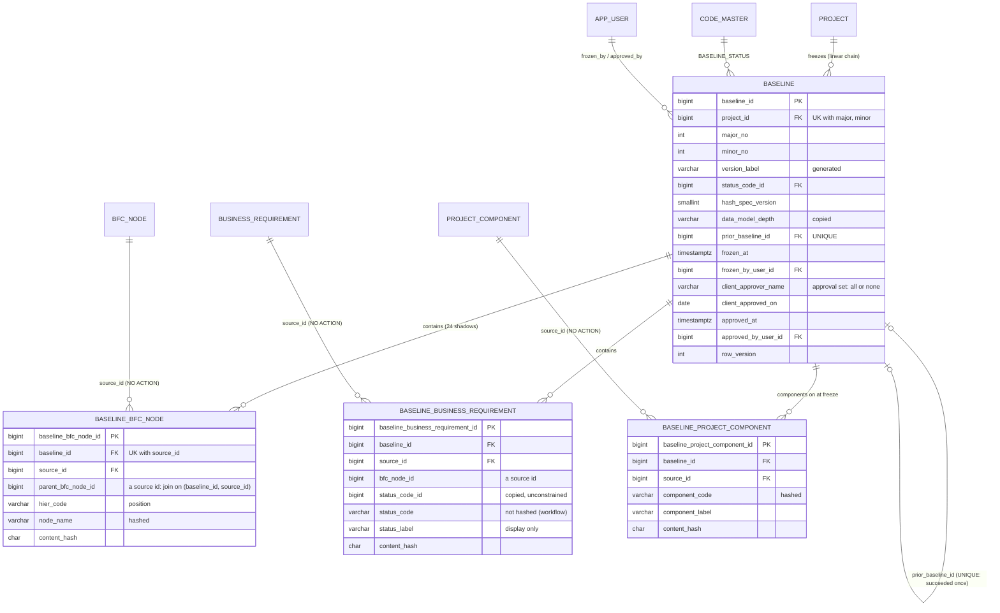

# Slice 8 — The baseline freeze (wave 1d): physical schema spec

Author: `apple` · 2026-10-11 · source of truth: `docs/VB_design.md`. **The §1a blocks "Revision 2026-10-11"
(D-37…D-50) and "Slice 7 schema rulings" (S7-1…S7-7) are authoritative.** They override §4.6, §6.1's
"30 shadow tables", §7.7 and §9's baseline rows where they disagree. **No redesign.** Where the design is
silent once a choice is made physical, the choice here is **proposed** and marked **[Q-n]** (§12). Every
[Q-n] carries a recommendation the build can proceed on.

| Part | Decisions | Tables |
|---|---|---|
| **8a** the header | §4.6, §5.3 Baselines, §6.2, §6.6, A-36, Q8 | `baseline` |
| **8b** the shadows | §5.4.4, §6.1, R2-D3, D-37, slice7 freeze-set notes | 24 generated `baseline_*` tables |
| **8c** freeze, approve, diff | §7.7, §7.13 `priced_diff`, D-50 (engine only), S7-3 | services + routes, no tables |

**In:** the header, 24 shadows, `FREEZE_SET` as data with component gates, `HASH_COLUMNS` v1, freeze, client
approval, supersede, diff (baseline↔baseline and baseline↔live), priced diff, the read-only baseline screens
that need no diagram renderer.
**Out:** the encrypted archive file (criterion 155) and `purge_project` (criterion 154) → **before first
client use** with Azure (D-35) [Q-22]; the version-comparison screen (D-50, wave 4); baseline-mode BFC tree,
DFD and ERD renderers (1f / wave 4) [Q-21]; shadows for unbuilt tables (§6).
Dialect **PostgreSQL 16**. House conventions as `slice7_schema.md`. Head before this slice is **0046**.

---

## 1. What changes in `services/baseline_shadow.py` (the generator)

The generator stays the single definition of a shadow's shape (VB law 2). It gains four rules. Nothing about
a shadow is written by hand.

| Rule | Today | After |
|---|---|---|
| Copied columns | live − §5.1 audit − PK − GENERATED | **unchanged**, minus `SHADOW_EXCLUDED[table]` |
| Code pairs | — | for every `<p>_code_id` whose sibling `<p>_category` is a GENERATED column (the S1-4 pattern, so the column is provably a `code_master` FK): add **`<p>_code varchar(40)`** and **`<p>_label varchar(200)`**. The `<p>_code_id` is still copied (unconstrained, never hashed) [Q-1] |
| Hash | — | **`content_hash char(64) NOT NULL`** (hex sha256, §4) |
| Keys | PK, `baseline_id` FK | + `source_id` FK → the live PK **ON DELETE NO ACTION** [Q-3]; `uq_<shadow>_source (baseline_id, source_id)`; `ix_<shadow>_source (source_id)` |

```python
SHADOW_EXCLUDED = {"function_requirement": ("suggested_br_id",)}    # D-34 / S6a-1 tripwire reads this
def code_pairs(live: Table) -> list[str]                            # ["status", "raci", ...] prefixes
def snapshot_column_names(live) -> list[str]                        # copied columns, in live order
def shadow_table(live, metadata, *, baseline_fk=True, source_fk=True) -> Table
def parity_problems(live, shadow) -> list[str]                      # names AND types (§7 test)
```

- **Name collision guard:** `shadow_table` raises if a generated `<p>_code` / `<p>_label` collides with a
  copied column. None does today (`bfc_set_code` is a CHECK column, not a `_code_id`).
- **No intra-baseline FKs** (`baseline_parent_node_id`, `baseline_br_id` … of §5.3) [Q-2]. Live FK columns
  are copied verbatim, so they already hold the *source* ids of their targets; a join inside one baseline is
  `child.parent_bfc_node_id = parent.source_id AND child.baseline_id = parent.baseline_id`, served by the
  `uq_<shadow>_source` index. Every shadow has the same shape and the generator needs no per-table knowledge.
- **GENERATED columns are dropped, as today.** `br_data_entity.direction` is therefore not in its shadow; it is
  `CASE crud_code WHEN 'R' THEN 'I' ELSE 'O' END`, recomputed by readers. The guard columns
  (`node_is_process`, `io_is_active`, `node_bfc_set`, `*_category` …) mean nothing in a snapshot.
- **Every column nullable** except `baseline_id`, `source_id`, `content_hash` (A-7: a snapshot records what
  was, including values a later constraint would reject).
- **Lifecycle is unaffected:** `lifecycle._links()` skips tables without `is_active`, so neither the header nor
  a shadow ever becomes a liveness link.
- **Where the shadows live at runtime:** `models/baseline.py` holds `SHADOWED` (the 24 live table names, in
  freeze order) and builds `SHADOW_TABLES = {name: shadow_table(Base.metadata.tables[name], Base.metadata)}`
  at import. They are Core `Table`s on `Base.metadata` (autogenerate sees them), not ORM classes: the freeze
  writes them with `insert().from_select()` and readers select from them.

## 2. `baseline` — one frozen version of one project's scope (8a)

| Column | Type | Null | Default | Constraint | Description |
|---|---|---|---|---|---|
| `baseline_id` | bigint identity | NO | identity | PK | |
| `project_id` | bigint | NO | — | → `project` | from the route, never the body |
| `major_no` | integer | NO | — | `ck_baseline_major CHECK (major_no >= 1)` | P9: identity is two integers |
| `minor_no` | integer | NO | — | `ck_baseline_minor CHECK (minor_no >= 0)` | `v1.10` after `v1.9` (criterion 37) |
| `version_label` | varchar(24) | NO\* | GENERATED `'v' \|\| major_no \|\| '.' \|\| minor_no` STORED | UK with project | rendered, never parsed, cannot disagree with the integers [Q-7] |
| `status_code_id` | bigint | NO | — | category FK | `BASELINE_STATUS`: FROZEN → APPROVED → SUPERSEDED, or FROZEN → SUPERSEDED |
| `status_category` | varchar(40) | NO\* | GENERATED `'BASELINE_STATUS'` | category FK | S1-4 |
| `hash_spec_version` | smallint | NO | — | `ck_baseline_hash_spec CHECK (hash_spec_version >= 1)` | finding D5; `CURRENT_HASH_SPEC` at freeze |
| `data_model_depth` | varchar(10) | NO | — | `ck_baseline_depth CHECK (data_model_depth IN ('KEYS_ONLY','FULL'))` | copied from `project` (slice7 §7). The components on are `baseline_project_component` [Q-11] |
| `note` | text | YES | — | `ck_baseline_note_not_blank (note IS NULL OR btrim(note) <> '')` | |
| `prior_baseline_id` | bigint | YES | — | `(…, project_id) → baseline (uq_baseline_project)` | the default diff target; lineage [Q-8] |
| `frozen_at` | timestamptz | NO | `now()` | — | the creation time [Q-6] |
| `frozen_by_user_id` | bigint | NO | — | → `app_user` | from the JWT (§9.2) [Q-6] |
| `client_approver_name` | varchar(200) | YES | — | approval set, below | who signed for the client (§4.6 "manual client sign-off") [Q-9] |
| `client_approved_on` | date | YES | — | approval set | the date on the sign-off |
| `approval_note` | text | YES | — | `ck_baseline_approval_note_not_blank` | |
| `approved_at` | timestamptz | YES | — | approval set | when it was recorded in VB |
| `approved_by_user_id` | bigint | YES | — | → `app_user`; approval set | who recorded it |
| `updated_at` | timestamptz | NO | `now()` | `fn_set_updated_at()` trigger | |
| `updated_by` | bigint | YES | — | → `app_user` | |
| `row_version` | integer | NO | `1` | ORM `version_id_col` | approve and supersede are optimistic writes |

\* stored, never NULL.

- **No `is_active`, `deleted_at`, `deleted_by`** (A-36, §6.2 finding P6). No `created_at` / `created_by`:
  `frozen_at` / `frozen_by_user_id` are that pair under the design's names [Q-6].
- **Keys and constraints:**
  - PK `baseline_id`; `uq_baseline_project (baseline_id, project_id)` (target for `prior_baseline_id` and, in
    wave 2, `change_request.against_baseline_id`).
  - `uq_baseline_version (project_id, major_no, minor_no)` (§6.2 P9); `uq_baseline_label (project_id,
    version_label)` (§6.2).
  - **A straight line, declaratively** [Q-8]: `uq_baseline_prior (prior_baseline_id)` (a baseline is succeeded
    at most once, A-8 "no branching"); partial `uq_baseline_first (project_id) WHERE prior_baseline_id IS NULL`;
    `ck_baseline_prior CHECK ((prior_baseline_id IS NULL) = (major_no = 1 AND minor_no = 0))`. Two
    simultaneous freezes therefore produce one baseline and one 409 from the database (criterion 37).
  - `ck_baseline_approval_set CHECK (num_nonnulls(client_approver_name, client_approved_on, approved_at,
    approved_by_user_id) IN (0, 4))`.
  - `fk_baseline_status (status_code_id, status_category) → code_master (uq_code_category_target)` ON UPDATE
    NO ACTION. `frozen_by_user_id`, `approved_by_user_id`, `updated_by` → `app_user`.
- **Indexes:** `uq_baseline_version` (leading `project_id`) serves the list and "latest"; `ix_baseline_status
  (status_code_id)`; `uq_baseline_prior` serves the lineage walk.
- **Immutability, belt and braces** [Q-10]:
  - **Braces (§6.6):** `REVOKE UPDATE ON baseline FROM vb_app; GRANT UPDATE (status_code_id,
    client_approver_name, client_approved_on, approval_note, approved_at, approved_by_user_id, updated_by,
    row_version) ON baseline TO vb_app`. No DELETE (default privileges never grant it).
  - **Belt:** `fn_baseline_header_guard()` `BEFORE UPDATE OR DELETE`: DELETE raises; UPDATE raises if any of
    `baseline_id, project_id, major_no, minor_no, hash_spec_version, data_model_depth, note,
    prior_baseline_id, frozen_at, frozen_by_user_id` is `IS DISTINCT FROM` its old value, or if any approval
    column was non-null and changes. Same `restrict_violation` errcode as `fn_reject_modification()`.
  - **Status transitions are service-enforced under lock** (R2-D11: a trigger would read `code_master`):
    approve takes the header `FOR UPDATE` and requires FROZEN; freeze takes the prior header `FOR UPDATE` and
    moves it to SUPERSEDED (§6.2 row 8, Q8 — so a wave-2 CR reading it `FOR SHARE` serialises).
- **Model:** `Baseline(Base)` in `models/baseline.py`, not `AuditMixin`; `__mapper_args__ = {"version_id_col":
  row_version}`; `owning_project_id()`. Exported (law 10).
- **Seeds: no change.** `BASELINE_STATUS` (is_system) already holds FROZEN, APPROVED, SUPERSEDED. DRAFT is
  seeded and never written [Q-23].

## 3. The shadow tables (8b)

**Common shape of every `baseline_<t>`** (generated, §1):

| Column | Type | Null | Constraint | Description |
|---|---|---|---|---|
| `baseline_<t>_id` | bigint identity | NO | PK | |
| `baseline_id` | bigint | NO | `fk_baseline_<t>_baseline → baseline` NO ACTION; leads `uq_baseline_<t>_source` | |
| `source_id` | bigint | NO | `fk_baseline_<t>_source → <t>(<pk>)` ON DELETE NO ACTION; `ix_baseline_<t>_source` | the live PK; the diff join and the "history of BR-0042" lookup |
| *copied columns* | as live | YES | none | §1 |
| `<p>_code`, `<p>_label` | varchar(40), varchar(200) | YES | none | code and label of the referenced `code_master` row at freeze. **The code is hashed; the label is display only** (R2-D3, criterion 28) |
| `content_hash` | char(64) | NO | none | §4 |

Plus, on every shadow: `trg_baseline_<t>_immutable BEFORE UPDATE OR DELETE FOR EACH ROW EXECUTE FUNCTION
fn_reject_modification()` (**no TRUNCATE trigger — ruling S8-2**) (A-7, criterion 26); `REVOKE UPDATE ON baseline_<t> FROM vb_app` (default
privileges grant it; §6.6, criterion 55). The app keeps SELECT and INSERT.

### 3.1 Per entity: copied columns, code pairs, hash, position, gate

Order is freeze order (§6.1's, less the unbuilt tables). "Copied" lists the business columns that survive
§1 (every shadow also copies `project_id`, never hashed). **Position** columns are excluded from the hash and
drive MOVED (§5). **Gate** is §3.2.

| # | Entity (shadow `baseline_<t>`) | `source_id` = | Copied (beyond `project_id`) | Code pairs | **HASH_COLUMNS v1** | Position | Gate |
|---|---|---|---|---|---|---|---|
| 1 | `org_unit` | `org_unit_id` | parent_org_unit_id, level_no, level_code_id, org_unit_code, org_unit_name, seq_no, description | level | org_unit_code, org_unit_name, level_code, description | parent_org_unit_id, level_no, seq_no | always |
| 2 | `org_role` | `org_role_id` | org_unit_id, org_role_code, org_role_name, responsibility_desc, headcount | — | org_unit_id, org_role_code, org_role_name, responsibility_desc, headcount | — | always |
| 3 | `bfc_node` | `bfc_node_id` | parent_bfc_node_id, level_no, is_process, seq_no, hier_code, node_name, purpose_desc, data_processing_desc, bfc_set_code, performer_kind, performer_org_unit_id, performer_org_role_id, performer_application_id, performer_label | — | bfc_set_code, is_process, node_name, purpose_desc, data_processing_desc, performer_kind, performer_org_unit_id, performer_org_role_id, performer_application_id, performer_label | parent_bfc_node_id, level_no, seq_no, hier_code | TO_BE rows always; AS_IS rows ⇐ `AS_IS` |
| 4 | `data_entity` | `data_entity_id` | de_number, de_name, description, business_owner_note | — | de_number, de_name, description, business_owner_note | — | always |
| 5 | `data_field` | `data_field_id` | data_entity_id, seq_no, field_name, data_type_code_id, length_val, precision_val, scale_val, is_mandatory, is_primary_key, pk_ordinal, is_foreign_key, ref_data_entity_id, ref_data_field_id, fk_group_no, description | data_type | data_entity_id, field_name, data_type_code, length_val, precision_val, scale_val, is_mandatory, is_primary_key, pk_ordinal, is_foreign_key, ref_data_entity_id, ref_data_field_id, fk_group_no, description | seq_no | always |
| 6 | `external_entity` | `external_entity_id` | ext_number, ext_name, kind_code_id, description | kind | ext_number, ext_name, kind_code, description | — | always |
| 7 | `process_trigger` | `process_trigger_id` | trigger_name, trigger_kind, schedule_note, description | — | trigger_name, trigger_kind, schedule_note, description | — | `TO_BE_DFD` ∨ `AS_IS` |
| 8 | `bfc_node_data_entity` | `bfc_node_data_entity_id` | bfc_node_id, data_entity_id, direction, note | — | bfc_node_id, data_entity_id, direction, note | — | step set |
| 9 | `bfc_node_org_role` | `bfc_node_org_role_id` | bfc_node_id, org_role_id, raci_code_id, raci_behaviour | raci | bfc_node_id, org_role_id, raci_code, raci_behaviour | — | step set |
| 10 | `bfc_node_external_flow` | `bfc_node_external_flow_id` | bfc_node_id, external_entity_id, direction, data_entity_id, flow_label, note | — | bfc_node_id, external_entity_id, direction, data_entity_id, flow_label, note | — | step set, DFD: to-be ⇐ `TO_BE_DFD`, as-is ⇐ `AS_IS` |
| 11 | `bfc_node_trigger` | `bfc_node_trigger_id` | bfc_node_id, process_trigger_id, note | — | bfc_node_id, process_trigger_id, note | — | step set, DFD (as row 10) |
| 12 | `business_requirement` | `br_id` | bfc_node_id, br_number, br_statement, business_logic, output_expectation, status_code_id | status | br_number, bfc_node_id, br_statement, business_logic, output_expectation — **not status** [Q-13] | — | always (to-be by construction, S7-2) |
| 13 | `br_data_entity` | `br_data_entity_id` | br_id, bfc_node_id, data_entity_id, crud_code, usage_note | — | br_id, data_entity_id, crud_code, usage_note | — | always |
| 14 | `br_org_role` | `br_org_role_id` | br_id, org_role_id, raci_code_id, raci_behaviour | raci | br_id, org_role_id, raci_code, raci_behaviour | — | always |
| 15 | `application` | `application_id` | application_code, application_name, vendor, version_label, app_kind_code_id, lifecycle_code_id, description | app_kind, lifecycle | application_code, application_name, vendor, version_label, app_kind_code, lifecycle_code, description | — | `APPLICATION` |
| 16 | `solution` | `solution_id` | solution_number, solution_name, description, category_code_id, status_code_id, benefit_note, effort_note | category, status | solution_number, solution_name, description, category_code, status_code, benefit_note, effort_note | — | `SOLUTION` |
| 17 | `br_solution` | `br_solution_id` | br_id, solution_id, coverage_note | — | br_id, solution_id, coverage_note | — | `SOLUTION` |
| 18 | `function_requirement` | `fr_id` | fr_number, fr_name, description, solution_id, fr_type_code_id, fr_type_behaviour, complexity_code_id, effort_days, fulfilment_status_code_id, acceptance_note (**not** `suggested_br_id`, when it lands) | fr_type, complexity, fulfilment_status | fr_number, fr_name, description, solution_id, fr_type_code, fr_type_behaviour, complexity_code, effort_days, acceptance_note — **not fulfilment status** [Q-13] | — | `FUNCTION_REQUIREMENT` |
| 19 | `fr_interface` | `fr_id` (its PK) | source_application_id, target_application_id, pattern_code_id, method_code_id, frequency_code_id, volume_note | pattern, method, frequency | source_application_id, target_application_id, pattern_code, method_code, frequency_code, volume_note | — | `FUNCTION_REQUIREMENT` ∧ `APPLICATION` |
| 20 | `fr_interface_data_entity` | `fr_interface_data_entity_id` | fr_id, data_entity_id, note | — | fr_id, data_entity_id, note | — | `FUNCTION_REQUIREMENT` ∧ `APPLICATION` |
| 21 | `application_solution` | `application_solution_id` | application_id, solution_id, allocation_note | — | application_id, solution_id, allocation_note | — | `APPLICATION` ∧ `SOLUTION` |
| 22 | `application_bfc_node` | `application_bfc_node_id` | application_id, bfc_node_id, support_note | — | application_id, bfc_node_id, support_note | — | `APPLICATION`, and as-is rows ⇐ `AS_IS` |
| 23 | `effort_rate` | `effort_rate_id` | fr_type_code_id, complexity_code_id, standard_days, change_rationale | fr_type, complexity | fr_type_code, complexity_code, standard_days — **not the rationale** [Q-13] | — | `EFFORT` |
| 24 | `project_component` | `project_component_id` | component_code_id | component | component_code | — | always (the live rows *are* the components on) |

Notes on the table:
- **Confirmed against the models:** there is **no `fr_bfc_node`** (§6.1 row 24 was never built; S7-2 says a
  future one carries the `'TO_BE'` guard). `fr_interface`'s PK is `fr_id`, so its `source_id` is the FR id
  and `fr_interface_data_entity.fr_id` joins to it. `effort_rate` gets no `fr_type_behaviour` column: the
  behaviour of a referenced type is immutable (Q6/R2-D8), and the FR shadow carries its own copy [Q-1].
- **Hashing FK ids is correct:** they are source ids, stable across baselines. Renaming org unit 12 shows as
  org unit 12 CHANGED, not as every process it performs CHANGED.
- `bfc_set_code` is identity and never changes (7c); it is hashed harmlessly. `node_bfc_set` is GENERATED and
  dropped. The performer columns are hashed (slice7 §9.12).

**Excluded from the freeze set** (never shadowed): `bfc_node_flow` (retired, D-38), `diagram_layout` (D-30),
`project_template_component`, `project_member`, `user_access_grant`, `app_user`, `audit_event`,
`import_batch`, `import_row`, `project_sequence`, `code_master` (labels are copied instead), `project`,
`program`, `client`. Stakeholder, WBS: not built, and never baselined (§6.1).

### 3.2 `FREEZE_SET` as data — component gates (D-37)

`services/components.py` gains **`FREEZE_GATES`** beside `COMPONENT_ROWS` (slice7 §7 placed it there), and
`services/freeze_set.py` holds the rest of each entry:

```python
@dataclass(frozen=True)
class Gate:
    all_of: frozenset[str] = frozenset()        # every code on
    any_of: frozenset[str] = frozenset()        # at least one on (process_trigger)
    by_step_set: dict[str, str] | None = None   # row filter through bfc_node: {"AS_IS": "AS_IS", "TO_BE": "TO_BE_DFD"}
                                                # a set missing from the dict is not filtered (always frozen)
FREEZE_GATES = {
  "bfc_node":               Gate(by_step_set={"AS_IS": "AS_IS"}),      # filter on the row's own set
  "bfc_node_data_entity":   Gate(by_step_set={"AS_IS": "AS_IS"}),
  "bfc_node_org_role":      Gate(by_step_set={"AS_IS": "AS_IS"}),
  "bfc_node_external_flow": Gate(by_step_set={"AS_IS": "AS_IS", "TO_BE": "TO_BE_DFD"}),
  "bfc_node_trigger":       Gate(by_step_set={"AS_IS": "AS_IS", "TO_BE": "TO_BE_DFD"}),
  "process_trigger":        Gate(any_of={"TO_BE_DFD", "AS_IS"}),
  "application":            Gate(all_of={"APPLICATION"}),
  "application_bfc_node":   Gate(all_of={"APPLICATION"}, by_step_set={"AS_IS": "AS_IS"}),
  "solution": Gate(all_of={"SOLUTION"}), "br_solution": Gate(all_of={"SOLUTION"}),
  "function_requirement": Gate(all_of={"FUNCTION_REQUIREMENT"}),
  "fr_interface": Gate(all_of={"FUNCTION_REQUIREMENT", "APPLICATION"}),
  "fr_interface_data_entity": Gate(all_of={"FUNCTION_REQUIREMENT", "APPLICATION"}),
  "application_solution": Gate(all_of={"APPLICATION", "SOLUTION"}),
  "effort_rate": Gate(all_of={"EFFORT"}),
}   # any table not listed: always frozen

@dataclass(frozen=True)
class FrozenEntity:
    table: str; area: str                      # D-50 areas: ORG, BFC, DFD, DATA, BR, SOLUTION, FR, APPLICATION, EFFORT, SCOPE
    hash_columns: dict[int, tuple[str, ...]]   # {1: (...)} — §3.1
    position_columns: tuple[str, ...] = ()
    label_columns: tuple[str, ...] = ()        # what a diff row shows: br_number, hier_code + node_name, …
FREEZE_SET: tuple[FrozenEntity, ...]            # §3.1 order; a test asserts its tables == models.baseline.SHADOWED
CURRENT_HASH_SPEC = 1
```

- **Gating is by table plus a step-set row filter, never by column** [Q-12]. The gate is evaluated against
  `components.enabled(db, project_id)` read **inside the freeze transaction**. A closed gate freezes **zero
  rows** of that table; the shadow is still in the set.
- **Why the filter rarely bites, and why it still exists.** OR-1 forbids switching a component off while it
  has live rows, so a closed gate usually filters nothing. The exceptions are rows that exist regardless of
  the switch: the **rate card** (seeded for every project, so `EFFORT` off must drop it) and **legacy to-be
  `application_bfc_node`** rows (7c §9.3(4): frozen while `APPLICATION` is on). FR `complexity_code_id` /
  `effort_days` need no column gate: with `EFFORT` off they are NULL (OR-1 via `COMPONENT_ROWS["EFFORT"]`).
- **A gate must never silently drop a live row a project relies on.** So **`rows_in_off_component` moves from
  `INFORMATIONAL` to `FREEZE_BLOCKING_WARNINGS`** [Q-12]: if a gating gap ever leaves live rows in an off
  component, the freeze refuses and names them instead of omitting them.

## 4. `content_hash`, specified (spec version 1)

```
content_hash = encode(sha256(convert_to(
                 concat_ws(E'\x1f', coalesce(c1::text, E'\x1e'), coalesce(c2::text, E'\x1e'), …),
               'UTF8')), 'hex')                         -- c1… = FREEZE_SET[t].hash_columns[1], in order
```

- **Computed in SQL, in the freeze's `INSERT … SELECT`** [Q-15], from a generated expression
  (`freeze_set.hash_sql(entity, version)`). The live-side diff (§5.3) uses the same expression, so live and
  frozen hashes are comparable by construction.
- **Canonical text = PostgreSQL's `::text` of the stored type**: booleans `true`/`false`, `numeric(7,2)` with
  its stored scale (`5.00`), integers in decimal, `char(1)` without padding, text as stored (no trimming,
  no case folding). This pins what §7.7's `str(v)` left open. The archive verifier (criterion 155, later)
  must reproduce these exact forms; the test suite fixes them with literal-hash cases.
- **Separator `\x1f`, NULL sentinel `\x1e`** (record separator: PostgreSQL text cannot hold `\x00`). NULL,
  `''` and `'\x1e'`-free text therefore hash differently (criterion 41's second half).
- **Codes, never labels** (R2-D3): the hash reads `<p>_code` (joined from `code_master` on `<p>_code_id`).
  A relabel changes `<p>_label` in the next snapshot and nothing else (criterion 28).
- **Excluded** in v1: position columns (D-10, §3.1); `suggested_br_id` (D-34, not even shadowed); every
  `*_code_id` (the id of an override row is not scope); BR `status_code` and FR `fulfilment_status_code`
  (workflow, not scope); `effort_rate.change_rationale` (the why of a term, not the term) [Q-13];
  `project_id`.
- **When the version bumps:** only when an existing entity's `hash_columns` list changes. A new live column
  added **unhashed** goes into the shadow (parity forces it) with no bump. A new **entity** joining the set
  (issue, benefit, phase …) adds `hash_columns[<current>]` for itself and does not bump.

## 5. Freeze, approve and diff (8c)

### 5.1 Freeze — `POST /projects/{project_id}/baselines/freeze`

Body `{note, bump: MINOR|MAJOR, confirm_text}`. Guard `project_ctx("EDIT")`, **no component** (baselines are
always on) [Q-18]. A helper `GET /projects/{project_id}/baselines/next?bump=` (`project_ctx("VIEW")`) returns
`{next_label, confirm_text, errors, freeze_blocking, warnings, counts_by_entity}` for the dialog; it writes
nothing.

```
freeze(project_id, note, bump, confirm_text, user):
    with a NEW session at REPEATABLE READ (§4.6, R2-P6)       # not the request session: the guard already ran
                                                              # queries on it at READ COMMITTED
        eff = access.require_project(user, project_id, "EDIT", db=tx)       # re-checked inside the snapshot
        prior = latest baseline of project FOR UPDATE         # None for the first
        major, minor = (1,0) | (prior.major+1, 0) if MAJOR | (prior.major, prior.minor+1)
        expected = f"{project.project_code} v{major}.{minor}"
        if confirm_text != expected: 422 "Type the project code and version to confirm"    # P6
        report = consistency_check(project_id, db=tx)
        errors   = non-empty lines NOT in INFORMATIONAL ∪ WARNINGS ∪ FREEZE_BLOCKING_WARNINGS
        blocking = non-empty lines in FREEZE_BLOCKING_WARNINGS          # S7-3: missing I/O is already scoped
                                                                        # to charts whose DFD component is on
        if errors or blocking: 409 {errors, blocking}                   # criterion 35, 46
        on = components.enabled(project_id, db=tx)
        b = INSERT baseline(…, status=FROZEN, hash_spec_version=CURRENT_HASH_SPEC,
                            data_model_depth=project.data_model_depth, prior_baseline_id=prior?.id,
                            frozen_by_user_id=user)       # UK / uq_baseline_prior violation → 409 (criterion 37)
        for e in FREEZE_SET:                              # one INSERT … SELECT per entity
            if gate closed for `on`: continue
            INSERT INTO baseline_<t> (baseline_id, source_id, <copied>, <p>_code, <p>_label, content_hash)
            SELECT :b, t.<pk>, t.<copied>, cm_p.code, cm_p.label, <hash_sql>
            FROM <t> t LEFT JOIN code_master cm_p ON cm_p.code_id = t.<p>_code_id …
            [JOIN bfc_node n ON n.bfc_node_id = t.bfc_node_id] WHERE t.project_id = :p AND t.is_active
            [AND step-set filter]
        UPDATE business_requirement SET status = BASELINED, updated_by = user
            WHERE project_id = :p AND is_active AND status <> BASELINED    # AFTER the snapshot [Q-17]
        if prior: prior.status = SUPERSEDED, updated_by = user             # row_version bumps
        AUDIT BASELINE_FROZEN {version_label, hash_spec_version, components: sorted(on),
                               counts: {entity: n}, superseded: prior?.version_label, warnings: [line names]}
        commit
    any SerializationFailure → 409 "Something changed while freezing. Nothing was saved; freeze again."
```

- **One transaction, one snapshot.** A failure anywhere leaves no header and no rows (criterion 15). An edit
  committed during the freeze appears in neither half (criterion 30).
- **WARNINGS** (`entities_without_fields`, `entities_keys_only`) never refuse (Ben, 2026-10-09); they are
  returned in the 201 body and recorded in the audit detail.
- **BR status** [Q-17]: every live BR becomes `BASELINED`, **after** the snapshot, so the frozen row keeps
  the consultant's DRAFT/CONFIRMED (status is not hashed, so this never makes v1.1 read CHANGED).
  `SUPERSEDED` (BR_STATUS) is not written by this slice.

### 5.2 Approve — `POST /baselines/{id}/approve`

Body `{client_approver_name, client_approved_on, approval_note, row_version}`. Guard
`object_guard(Baseline, "EDIT")` [Q-9, Q-18]. Locks the header `FOR UPDATE`; status must be FROZEN (so only
the latest baseline, since a freeze supersedes its prior), else 409 naming the status; stale `row_version`
→ 409. Sets the four approval columns and APPROVED; audit `BASELINE_APPROVED {version_label,
client_approver_name, client_approved_on}`. **No un-approve, no reopen** (§4.6). An APPROVED baseline is
SUPERSEDED by the next freeze and keeps its approval columns, so "v1.2 was signed by K. Tanaka on 3 Nov"
survives.

### 5.3 Diff — `GET /projects/{project_id}/baselines/diff?from={id}&to={id|live}[&priced=true]`

Guard `project_ctx("VIEW")`; the service 404s unless **both** baselines belong to `project_id` (S3, criterion
50). The route moves under `/projects/{project_id}` [Q-19] so the guard can see the project (criterion 49).

```
diff(project_id, a, b):                       # b may be LIVE: the freeze's gated SELECT, hashed with
                                              # CURRENT_HASH_SPEC and the current components [Q-19]
    for e in FREEZE_SET:
        va, vb = spec version of each side
        if e.hash_columns[va] != e.hash_columns[vb]:
            out[e] = {"status": "SCHEMA_VERSION_MISMATCH"}; continue      # per entity [Q-16]
        FULL OUTER JOIN A_rows, B_rows ON source_id:
            only B  → ADDED;  only A → REMOVED
            both, hash differs → CHANGED, fields = hash columns IS DISTINCT FROM, moved = position differs
            both, hash equal, any position column differs → MOVED              # criterion 33
        out[e] = {area, component_on: {a, b}, rows: [{source_id, change, fields, moved, label}]}
    return out
```

- **Precedence:** CHANGED wins over MOVED; a changed row that also moved carries `moved: true` [Q-14].
- `component_on` comes from each side's `baseline_project_component` (live: `enabled()`), so the screen can
  say "Solutions were not used in v1.0" rather than show a wall of ADDED.
- **Labels** for a link row resolve its ends inside the same side (`(baseline_id, source_id)` join), so a
  removed link to a removed BR still reads "BR-0042 ↔ SOL-0003".
- **`priced=true`** runs §7.13 `priced_diff` over `baseline_function_requirement` (`solution_id` plays
  `source_solution_id`). **Only when `EFFORT` is on in both sides** (slice7 §7): otherwise 200 with
  `pricing: {available: false, reason: "EFFORT_OFF", in: ["v1.0"]}` [Q-20]. Effort exposed needs `SOLUTION`
  on in the side it reads; otherwise it is `null`, not 0.

### 5.4 Read routes (§14.4) [Q-21]

| Route | Guard | Returns |
|---|---|---|
| `GET /projects/{project_id}/baselines` | `project_ctx("VIEW")` | headers, newest first |
| `GET /projects/{project_id}/baselines/next?bump=` | `project_ctx("VIEW")` | §5.1 preview |
| `POST /projects/{project_id}/baselines/freeze` | `project_ctx("EDIT")` | 201 header + counts + warnings |
| `GET /baselines/{id}` | `object_guard(Baseline, "VIEW")` | header, components on, counts per entity |
| `GET /baselines/{id}/rows/{entity}?offset=&limit=` | `object_guard(Baseline, "VIEW")` | snapshot rows of one `FREEZE_SET` entity (400 for any other name); labels shown, never code ids |
| `POST /baselines/{id}/approve` | `object_guard(Baseline, "EDIT")` | §5.2 |
| `GET /projects/{project_id}/baselines/diff` | `project_ctx("VIEW")` | §5.3 |

No PATCH, PUT or DELETE route exists on a baseline or a shadow. `ROUTE_COMPONENTS` (criterion 49b) maps no
component to `baselines`. The restricted-project leak test (7b) seeds one marked baseline.

## 6. How the unbuilt tables join later

| Wave | Tables | Gate | Migration | `hash_spec_version` |
|---|---|---|---|---|
| Issues (component `ISSUE`, slice TBD) | `issue`, `issue_br` | `ISSUE` | that slice's migration adds both shadows through the generator, in the same commit as the live tables or the one after | no bump: new entities add `hash_columns[current]` |
| 2 | `benefit`, `benefit_solution` | `BENEFIT` (needs `SOLUTION`) | as above | no bump |
| 3 | `phase`, `solution_phase`, `solution_dependency` | none decided yet (phasing has no component); rec: always on, or a new component if Ben adds one | as above | no bump |
| never | `change_request`, `cr_impact`, `risk`, `decision`, `wbs_item`, `stakeholder` | — | — | — (§6.1 "not baselined") |

A baseline frozen before a table joined simply has no rows in it. A diff across that boundary reports the
new rows as ADDED, which is true. The `component_on` flags make it readable.

## 7. Tests this slice owes (criteria)

- **Parity against the database (criterion 27)** [Q-4]: for each name in `SHADOWED`, read
  `information_schema.columns` of `baseline_<t>` after `upgrade head` and compare names **and** types with
  `shadow_table(live)`. A live column added without its shadow column, in the same migration, fails CI.
- **Grants (criteria 26, 55):** `vb_app` has SELECT, INSERT and no UPDATE/DELETE on every `baseline_*`;
  `baseline` has column-level UPDATE on exactly the §2 list; direct UPDATE/DELETE as `vb_app` and as the
  owner both raise (trigger).
- **Every shadow has both triggers** (catalogue query).
- 13 (reworded: every table whose gate is open, §11), 14, 15, 16, 17, 17a, 28, 30, 33, 35/48 (EDIT freezes;
  a VIEWER is refused), 37, 41 (per entity, §11), 46, 50, 54 (`BASELINE_FROZEN`, `BASELINE_APPROVED`), 57,
  58. Plus: a requirements-only project freezes with no DFD and no rate card rows; `EFFORT` off ⇒ no
  `baseline_effort_rate` rows and `pricing.available = false`; literal-hash cases for each canonical form
  (§4); the S6a-1 tripwire passes against the real `SHADOW_EXCLUDED`.

## 8. ER fragment



## 9. Migrations

| Rev | Creates / changes | Depends on |
|---|---|---|
| **0047** | `baseline`: columns of §2, generated `version_label` and `status_category`, PK, `uq_baseline_project`, `uq_baseline_version`, `uq_baseline_label`, `uq_baseline_prior`, partial `uq_baseline_first`, 5 CHECKs, status FK, 3 user FKs, `ix_baseline_status`; `updated_at_trigger("baseline")`; `CREATE FUNCTION fn_baseline_header_guard()` + `trg_baseline_header_guard`; `REVOKE UPDATE` + column-level `GRANT UPDATE (…)` | `code_master` (`uq_code_category_target`), `project`, `app_user` |
| **0048** | the **24 shadows** of §3.1, each with PK, two FKs, `uq_…_source`, `ix_…_source`, the two reject triggers, `REVOKE UPDATE … FROM vb_app` | 0047; every live table in `SHADOWED` |

- **0048 is literal DDL, generated once, never re-generated on replay** [Q-4, Q-5]. A migration that called
  `shadow_table(Model.__table__)` at upgrade time would build *today's* columns when replayed on a fresh
  database next year, and the later migration that adds a shadow column would then fail with "already exists".
  So `scripts/print_shadow_ddl.py` (or autogenerate against `models.baseline.SHADOW_TABLES`) prints
  `op.create_table(…)` blocks, and the output is committed. It imports nothing from `models`. From then on,
  **any migration that adds a column to a shadowed live table adds the shadow column in the same
  migration**; the parity test (§7) is the check.
- **New `vb_ops` helpers (append-only):** `immutable_guards(table)` (both reject triggers + `REVOKE UPDATE`)
  and `drop_immutable_guards(table)`.
- **One migration for the 24 shadows, not 24** [Q-5]: they are one generated unit with one test; law 10's
  "one per commit" is kept (0047 and 0048 are separate commits).
- **Downgrades:** each first runs `DO $$ BEGIN IF EXISTS (SELECT 1 FROM baseline) THEN RAISE EXCEPTION
  'baselines exist: downgrade refused'; END IF; END $$`, then drops (0048: triggers, then tables; 0047:
  trigger, function, grants, table). Reversible while empty; **refuses rather than pauses** once a baseline
  exists, so it can never shred evidence.
- **Models:** `models/baseline.py` (`Baseline`, `SHADOWED`, `SHADOW_TABLES`), imported last in
  `models/__init__.py` (law 10). **Seeds:** none. **Consistency:** `rows_in_off_component` moves to
  `FREEZE_BLOCKING_WARNINGS` [Q-12]. **Deviations:** add lines to `PLAYBOOK_DEVIATIONS.md` for the header's
  missing soft delete and `created_*` pair (A-36, [Q-6]) and for shadows' missing audit columns (A-7).

## 10. Size and indexes

| Project size | Rows per freeze | Note |
|---|---|---|
| criterion 13 (40 nodes, 25 BRs, 12 solutions, 30 FRs, 15 DEs) | ≈ 600–900 | |
| A-35 bound, to-be only (2,000 processes) | ≈ 35,000 | bfc_node 2.6k, step I/O 6k, RACI 4k, BR 2k, BR CRUD 5k, fields 4k, br_solution 3k, FR 1.5k … |
| A-35 bound, with as-is | ≈ 50,000 | + nodes 2.6k, I/O 6k, RACI 4k, external flows, triggers, support |

At 150–400 bytes a row plus two indexes, a bound-size freeze is ≈ 20–30 MB; twenty freezes ≈ 0.5 GB. 24
`INSERT … SELECT`s with SQL-side sha256 take a few seconds at the bound, so the freeze stays synchronous
(§1a v8 review). **Indexes per shadow:** `uq_…_source (baseline_id, source_id)` serves the diff join, the
per-baseline listing (leading `baseline_id`) and intra-baseline joins; `ix_…_source (source_id)` serves the
`source_id` FK check and "every baseline in which BR-0042 appeared". No others: shadows are never filtered
by business columns except within one baseline, which the UK already narrows.

## 11. Contradictions and rewordings

1. **§5.3 / §5.2 "intra-baseline FKs" (`baseline_parent_node_id` …)** — not built [Q-2]; joins use copied
   source ids.
2. **§5.3 "store resolved labels, not code FKs"** — the shadow stores code **and** label (as §5.4.4 and
   R2-D3 later said) and also keeps the unconstrained `<p>_code_id` [Q-1].
3. **§6.1 "30 shadow tables"** — **24 today**: − `bfc_node_flow`, − `fr_bfc_node` (never built), − 7 unbuilt
   (issue, issue_br, benefit, benefit_solution, phase, solution_phase, solution_dependency); + `process_trigger`,
   `bfc_node_trigger`, `project_component`. Criterion 13 and 30 should read "every table in `FREEZE_SET` whose
   gate is open".
4. **§9 `GET /baselines/diff`** → `GET /projects/{project_id}/baselines/diff` [Q-19]; §9 "OWNER only" → EDIT
   (slice7 §8.6, line 454).
5. **§7.7 `str(v)`** — canonical text is PostgreSQL `::text` [Q-15].
6. **Criterion 41** — `SCHEMA_VERSION_MISMATCH` is reported per entity whose hashed list differs [Q-16].
7. **§5.2 header block `frozen_by` vs law 3's `created_by`** — the design's names win [Q-6].
8. **`purge_project` vs the reject trigger:** the trigger fires for the owner role too. The purge slice must
   `ALTER TABLE … DISABLE TRIGGER` inside its transaction (owner only), delete shadows before live rows
   (`source_id` is NO ACTION), then the header (its guard trigger likewise). Recorded here so that slice
   does not discover it.

---

## 12. Questions for Ben (recommendation first)

1. **Codes in snapshots.** **Rec:** every `<p>_code_id` keeps its id (unconstrained) and gains `<p>_code` +
   `<p>_label`, generated by the rule "a `_code_id` with a GENERATED `_category` sibling". Hash the code, show
   the label. No extra behaviour column on `effort_rate` (behaviour is immutable once used).
2. **Intra-baseline FKs.** **Rec:** none. Copied live FK values are source ids; join on `(baseline_id,
   source_id)`. Keeps every shadow one generated shape.
3. **`source_id` FK.** **Rec:** FK to the live PK, ON DELETE NO ACTION (§6.2), plus an index on `source_id`.
   Only `purge_project` ever deletes, and it deletes shadows first.
4. **Migration form.** **Rec:** 0048 is generated once and committed as literal DDL; it imports no models.
   Afterwards a live column and its shadow column ship in the same migration, and the parity test compares the
   database (names and types) with the generator.
5. **One migration for 24 shadows.** **Rec:** yes (0048), separate commit from the header (0047).
6. **Header audit columns.** **Rec:** `frozen_at` / `frozen_by_user_id` are the creation pair (no
   `created_at` / `created_by`), plus `updated_at`, `updated_by`, `row_version`; no soft delete (A-36). Two
   deviation lines.
7. **`version_label`.** **Rec:** a GENERATED column from the two integers, so it cannot disagree with them.
8. **Linear lineage in the database.** **Rec:** `UNIQUE (prior_baseline_id)`, one first baseline per project
   (partial UK), and a CHECK tying "no prior" to v1.0. Concurrent freezes resolve to one 409 by constraint.
9. **Client approval in this slice.** **Rec:** yes. Four approval columns on the header (all or none),
   `POST /baselines/{id}/approve` at EDIT, only from FROZEN, audited, never undone. The next freeze moves
   FROZEN or APPROVED to SUPERSEDED and the approval facts stay.
10. **Header immutability.** **Rec:** column-level UPDATE grant (status, approval columns, `updated_by`,
    `row_version`) **and** a guard trigger rejecting DELETE and any change to the frozen columns or to an
    approval once set. Transitions stay service-enforced under `FOR UPDATE`.
11. **Components on at freeze.** **Rec:** read them from `baseline_project_component`; no array on the
    header. `data_model_depth` is copied onto the header.
12. **Gating.** **Rec:** whole-table gates plus a step-set row filter (`FREEZE_GATES` in `components.py`), and
    promote `rows_in_off_component` to `FREEZE_BLOCKING_WARNINGS` so a gate never silently drops a live row.
13. **Hash exclusions beyond the design's.** **Rec:** exclude BR `status_code` (set by the freeze itself), FR
    `fulfilment_status_code` (delivery progress, like WBS) and `effort_rate.change_rationale` (the reason, not
    the rate). All three are still snapshotted and shown.
14. **MOVED.** **Rec:** position = `hier_code`, `seq_no`, **and** `parent_*_id`, `level_no` on `bfc_node` and
    `org_unit`; `seq_no` on `data_field`. A re-parented node is MOVED, not CHANGED. CHANGED beats MOVED and
    carries `moved: true`.
15. **Hash computation.** **Rec:** in SQL inside the `INSERT … SELECT`; canonical text = PostgreSQL `::text`;
    separator `\x1f`, NULL sentinel `\x1e`. Pinned by literal-hash tests.
16. **Schema mismatch scope.** **Rec:** per entity: only entities whose hashed list differs between the two
    spec versions report `SCHEMA_VERSION_MISMATCH`; the rest diff normally.
17. **BR status at freeze.** **Rec:** every live BR → BASELINED, after the snapshot (the frozen row keeps
    DRAFT/CONFIRMED). BR_STATUS `SUPERSEDED` is not written by 1d; an edit after a freeze does not change the
    status. The update bumps `row_version`, so an open BR form gets 409, which is correct.
18. **Who.** **Rec:** freeze and approve at EDIT (a User; slice7 §8.6); a VIEWER is refused; no component gate.
    Confirm text = `"<project_code> <next_label>"` (§7.7).
19. **Diff route and live diff.** **Rec:** `GET /projects/{project_id}/baselines/diff?from=&to=` with
    `to=live` supported now (it is the freeze's own SELECT). The D-50 screen stays wave 4.
20. **Priced diff with effort off.** **Rec:** 200 with `pricing.available = false` and which side had it off,
    rather than an error; the screen hides the toggle.
21. **Read-only baseline screens now.** **Rec:** list, freeze dialog, header page (counts, components,
    approval), a generic per-entity snapshot table and the diff with field drill-down. Baseline-mode BFC tree,
    DFD and ERD come with 1f / wave 4.
22. **Criterion 155 and `purge_project`.** **Rec:** defer both to "before first client use" with Azure
    (D-35): they need Key Vault and immutable Blob Storage. The seam is the `BASELINE_FROZEN` audit row
    (archive job keys on it) and §11 item 8 (purge order).
23. **BASELINE_STATUS `DRAFT`.** **Rec:** leave it seeded and never write it: no seed change. The freeze is
    one transaction, so a draft baseline cannot exist.
24. **Serialization failures.** **Rec:** no automatic retry; 409 "Something changed while freezing. Nothing
    was saved; freeze again." A busy project may need a second click, which is visible and safe.

---

## 13. Design review round 1 — dispositions (design-auditor, 2026-10-11)

7 findings (2 HIGH, 2 MEDIUM, 3 LOW), all fixed before the first commit. Ben's standing instruction
(2026-10-11): recommendations are accepted.

| # | Finding | Disposition |
|---|---|---|
| DR8-P1 HIGH | A checkpoint freeze while sign-off is pending leaves the signed version un-approvable (§5.2 accepted FROZEN only), and "agreed" was a status | **Fixed.** Approval may be recorded on a FROZEN **or SUPERSEDED** baseline; FROZEN → APPROVED, SUPERSEDED keeps its status and gains the approval set. `client_approved_on` must fall between the freeze date (ICT) and today. **The agreed baseline is the newest with a recorded approval** (`is_agreed` on the list and header), not a status — wave 2's CR targets it. The freeze preview names the baseline it supersedes and whether it still awaits sign-off; the audit row records it |
| DR8-P2 MEDIUM | The typed confirmation binds the version label, not the content | **Fixed.** `/next` returns `preview_digest` (§DR8-S1's digest over the live set); the freeze body must carry it and the freeze recomputes it inside its snapshot → 409 "The scope changed since you opened this freeze" on mismatch |
| DR8-D1 MEDIUM | A type change on a hashed column rewrites frozen evidence (ALTER … TYPE does not fire row triggers) | **Rule.** A shadow column's type is never ALTERed. A change to a shadowed live column's type **pauses for Ben** (destructive to evidence, law 10) and, if it changes the `::text` form of a hashed column, bumps `CURRENT_HASH_SPEC`. Recorded in `baseline_shadow.py` |
| DR8-L1 LOW | The BR → BASELINED flip must bump `row_version` | **Already so** (`row_version + 1` in the bulk UPDATE); test `test_a_stale_br_form_after_a_freeze_is_409` |
| DR8-L2 LOW | Separator/sentinel characters in text could forge a field boundary | **Fixed before pinning.** Each hashed value is length-prefixed: `char_length(v::text) || ':' || v::text`, NULL → `\x1e`. Literal-hash test pins it |
| DR8-L3 LOW | A `to=live` diff read 24 SELECTs at READ COMMITTED | **Fixed.** Every diff runs in its own read-only REPEATABLE READ session |
| DR8-S1 HIGH | `vb_app` keeps INSERT, so rows could be appended to an existing (even approved) baseline undetected | **Fixed twice.** (1) `trg_baseline_<t>_insert_guard` (AFTER INSERT, statement-level, transition table) refuses any row whose header was not written in the same transaction (`frozen_at = now()`). (2) `baseline.content_digest` = sha256 over every entity's ordered `source_id:content_hash` list, frozen with the header; the header read reports `intact`, and the diff and rows routes refuse (409) a baseline that fails it |

**Questions the auditor raised for Ben, answered as recommended (D-48 pattern):**
1. *Any staff USER may freeze or approve any unrestricted project (D-40).* Keep EDIT (S8-1, slice7 §8.6); the
   freeze is audited with actor and the preview shows what is superseded. A project that needs a tighter
   wall is restricted (OR-6).
2. *Which baseline is contractual?* The newest with a recorded client approval (DR8-P1).
3. *Evidence for an approval?* Optional `approval_reference` (the signed document's id or file hash), part of the
   immutable approval set.
4. *May a BASELINED BR go back to DRAFT/CONFIRMED by hand?* Yes — BR status is workflow, not hashed (Q-13); the
   next freeze sets BASELINED again.
5. *`client_approver_name` is personal data in an immutable column.* Erasure is by `purge_project` only
   (Q15, before first client use); the name is a business signatory, recorded under the engagement contract.

## 14. sara pre-commit audit — dispositions (2026-10-11)

0 HIGH, 4 MEDIUM (all fixed), 7 LOW (5 fixed, 2 to the VB-005 backlog).

| # | Finding | Disposition |
|---|---|---|
| M1 | An approval's empty optional fields could be filled in later | **Fixed** in 0047: once `client_approver_name` is set, no approval column may change. Test `test_a_recorded_approval_is_closed_even_its_empty_fields` |
| M2 | The insert-guard test failed on the unique key before reaching the trigger | **Fixed**: inserts a row the baseline does not hold and matches the trigger's message; the other cases match trigger text (owner) or the grant refusal (app) |
| M3 | The integrity check compared hashes only; the digest had no second record | **Fixed**: `verify` also recomputes every row's hash from its columns (`freeze_set.rehash_mismatches`); `BASELINE_FROZEN` records `content_digest` in the append-only audit |
| M4 | Criteria 15, 30, 37 were argued, not tested | **Fixed**: failure partway (nothing written), an edit committed mid-freeze (in neither half), a concurrent change to the prior header (one 409, no new baseline). The first-freeze race (two v1.0s) rests on `uq_baseline_first` + 23505 → 409 and is not separately tested |
| L1 | Every IntegrityError read "freeze again" | **Fixed**: only 23505 / 40001 / 40P01 → 409 |
| L2 | Approve skipped the integrity check and allowed an older version after a newer approval | **Fixed** both |
| L3 | Approve response always `is_agreed: false` | **Fixed** |
| L4 | A 20-digit id overflowed bigint → 500 | **Fixed**: diff params max 18 digits; `object_guard` treats a longer id as not found (all routes) |
| L5 | Hash-spec lookup was exact-key | **Fixed**: `freeze_set.columns_for` takes the newest list at or below the version; an entity that joined later diffs as ADDED |
| L6 | Leak sweep's positive control missed parameterised baseline routes; doc citations; deviation row 4; link tables not probed by `COMPONENT_ROWS` | **Fixed** except the probe: OR-1 refuses switching a component off while its main rows live, and a live link under a retired parent is already a must-be-empty consistency error, so the gap is theoretical → VB-005 |
| L7 | Rows paged in Python; every read recomputes the digest; the diff is synchronous at A-35 scale | Rows now **paged in SQL**. Digest-per-read and a synchronous large diff stay (a read is seconds at the bound) → VB-005, revisit with D-50's screen |
